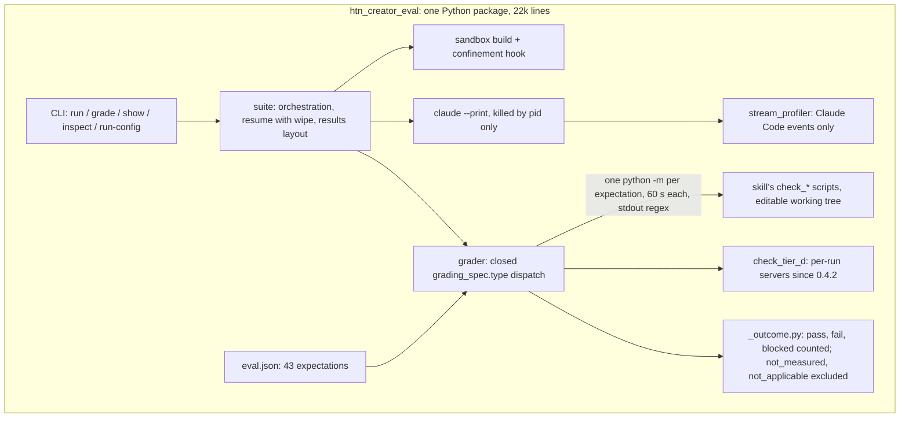
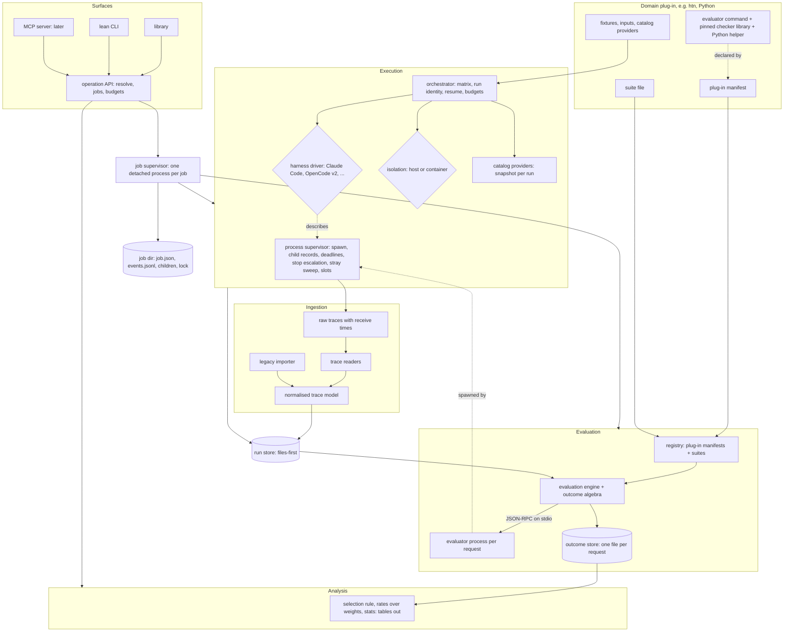
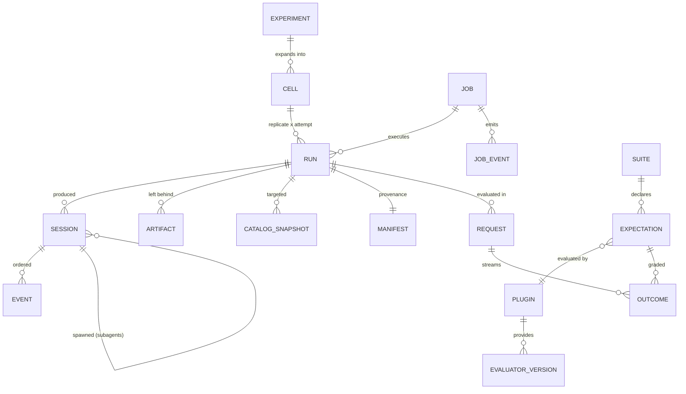
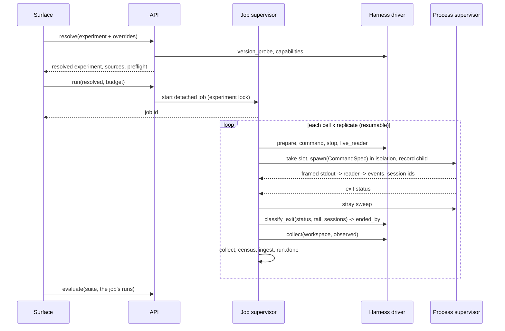

# Candler — Architecture

The intended design of Candler. Nothing is implemented yet. Points marked *provisional* are expected
to move once code meets real harnesses; the rest stand unless implementation proves them wrong, and
then this document changes together with the code. The reasoning behind the design, and its review,
are in the `candler_core` reports of mcp-python-ingestion (`__reports__/candler_core/` on branch
`feat/skill-htn-creator`).

## Executive Summary

- **Problem.** Running and evaluating LLM agents is welded into one domain-specific Python harness
  (`htn_creator_eval`, 22k lines): a closed grader dispatch over 10 `grading_spec.type` values,
  trace parsing for Claude Code only, a CLI whose flags are mostly derivable, and one Python process
  spawned per expectation per run.
- **Proposed change.** A standalone Rust core with two equal halves behind one operation API:
  - **execution:** run agents through shipped harness drivers under controlled conditions;
  - **evaluation:** grade traces and artifacts, fresh or on disk, through out-of-process evaluator
    plug-ins speaking one protocol.

  The library, a lean CLI and (later) an MCP server are thin surfaces over the API. Domain science
  enters only as plug-ins. The core depends on no project.
- **Non-goals.** Domain science (HTN tiers, PlanTrace, the `check_*` scripts stay in their project);
  LLM-as-judge gates; adversarial security isolation; dashboards and figures.
- **Biggest risks.** A trace model that drops signal; a driver trait shaped like Claude Code;
  supervision leaks (orphans, detached descendants); parity failures that are really instrument
  drift; fork safety in the Python helper on macOS; the team's first Rust project.
- **Validation.** Golden-regrade parity on the 240-run corpus (10,320 outcome rows); execution
  parity with today's `run` on a smoke matrix; a second harness (OpenCode v2) and a second plug-in
  (`waiting-on-processes`) before the contract freezes at 1.0.

## Current State



Measured on the eval env (2026-10-28): a bare interpreter starts in 34 ms; a spawn plus checker
import costs 40–285 ms. 18 expectations per run are graded by spawned skill scripts, so a 240-run
regrade spends roughly 5–15 CPU-minutes on startup alone.

## Proposed State



### Layer responsibilities

| Layer | Owns | Never owns |
|---|---|---|
| Operation API | The operation set, argument resolution with the source of every value, jobs, budgets, confirmations | Any domain notion |
| Job supervisor | Job identity, the job directory, the event stream, cancellation | What a run or an outcome means |
| Process supervisor | Every process Candler starts (agents, evaluators): spawn into its own process group, child records, deadlines, stop escalation, stray sweep, machine-wide slots | Harness or evaluator semantics |
| Execution | Experiment matrix, run identity, resume, isolation, catalog snapshots, artifact collection | What the artifacts mean |
| Harness drivers | Harness-specific data: config files, command line, stop action and signal, exit classification, what to collect, version detection | Starting, timing or killing processes |
| Ingestion | Trace readers, the normalised trace model, the legacy importer | Judgement |
| Run store | Run identity, content-addressed artifacts, the workspace view, manifest, integrity, the invalid-run ledger | Grades |
| Evaluation | Plug-in registry, suite resolution, `applies_to` and dependency `blocked`, evaluator requests, the outcome store | Domain logic |
| Evaluators (plug-in) | Domain science over trace + artifacts + snapshots + inputs + metadata | Layout, statistics, which runs an expectation applies to |
| Analysis | The selection rule, rates, tests, intervals, multiplicity; JSON or CSV tables | Re-deciding any outcome; drawing figures |

### Workspace

crates.io has one flat namespace without organisation scopes, so crates carry the project prefix
(`candler-*`, hyphenated; Rust code sees `candler_core`), not the organisation's name. The
organisation owns them through a crates.io team backed by the CrackingShells GitHub organisation.
All names below were free on 2026-10-28.

| Crate | Holds | Release line |
|---|---|---|
| `candler-schemas` | Every wire type as a serde struct; generated JSON Schema files committed beside them | `schemas@x.y.z` |
| `candler-core` | API, resolution, job and process supervisors, orchestrator, store, evaluation engine, outcome algebra, analysis (`statrs`) | core `vx.y.z` |
| `candler-harness` | The public `HarnessDriver` and `TraceReader` traits | core |
| `candler-harness-claude-code`, `candler-harness-opencode` | Shipped drivers and readers | core |
| `candler` | The binary: CLI, and later the MCP server as a subcommand | core |

**Python helper for plug-in authors** (`python/candler-evaluator` in this repo, outside the cargo
workspace, published to PyPI as `candler-evaluator` on its own tag line; the protocol does not
require it, the HTN plug-in uses it): the JSON-RPC loop; the file-descriptor stdout guard; one forked child per
expectation with its deadline; instrument digests and dirty flags; models generated from the JSON
Schema.

Tooling: Rust 2024 edition, Grit `rust-conventions`, `release-plz` (per-crate versions and
changelogs from Conventional Commits; git-only, releasing from `main` on every push with a
tag and a GitHub release per new version, and with publishing to crates.io off until it is
enabled), `cocogitto` (`cog verify` in a
`commit-msg` hook and in CI). `serde_json` with `float_roundtrip`.

## Operation API

| Operation | Input | Output | Long-running? |
|---|---|---|---|
| `resolve` | experiment or suite + overrides | the resolved experiment, every value with its source; preflight results | no |
| `run` | resolved experiment + budget | job id | yes (job) |
| `ingest` | raw trace dirs or a legacy results folder | run keys | yes (job) for big corpora |
| `evaluate` | suite + run selection | job id | yes (job) |
| `analyze` | analysis spec + outcome selection | tables (JSON or CSV), intervals, tests | no |
| `jobs` / `events` / `cancel` | job selection | job records, the event stream, cancellation | no |
| `show` / `inspect` | run, cell or experiment selection | outcomes with evidence, provenance, integrity | no |
| `diff` | two evaluator versions or two outcome sets | per-expectation changes | no |

**Resolution order (all surfaces):** explicit argument > experiment or suite file > project config
> user config > derived value > core default. `resolve` reports each value's source and the
manifest records it. Values that can be known are derived, never asked for. `resolve` is the real
preflight: skill checkout at the pinned tag, isolation build, plug-in environments (built once per
lock digest), evaluator `describe`, harness version and capabilities, secrets present, gateway auth
probe. No tokens are spent.

**Value sources** (`ValueSource`, recorded per value): `explicit_argument`, `experiment_file`,
`project_config`, `user_config`, `derived {step}` (the preflight step that derived it),
`core_default`, `imported {file}` (the legacy importer, naming the run-relative source file), and
`unrecorded`, which carries no value: the source system did not record it, and nothing guesses it.

**Preflight steps** are registered with the resolver, which runs them in registration order. Each
step sees the configuration, the caller's working directory and the values resolved so far
(including what earlier steps derived); a duplicate step name is refused, and so is a path that
two steps both derive. Every failed check is
reported before resolution fails. The milestones that own a check (evaluation, execution) register
its step; `resolve` itself knows none.

### Configuration

| File | Where | Keys |
|---|---|---|
| Project config | `candler.toml` in the project root, the nearest ancestor of the working directory holding one | `store.root` (default `<project root>/.candler/store`; with no project, `$XDG_STATE_HOME/candler/store`, else `~/.local/state/candler/store`), `plugins.dirs[]` |
| User config | `$XDG_CONFIG_HOME/candler/config.toml`, else `~/.config/candler/config.toml` | `slots.count` |

Unknown keys are refused, naming the file and key. A machine-wide setting (`slots.count`) is
refused in a project config. A relative path written in a config file resolves against that file's
directory; a relative path given as an argument resolves against the caller's working directory
(I14).

**Formats.** Documents people write (configs, experiment and suite files, plug-in manifests) are
TOML; records and messages are JSON. Either is validated, after parsing, against its JSON Schema.
Keys with a unit carry it: `deadline_ms`, `grace_ms`, `wall_s`, `max_cost_usd`.

### Budget

| Field | Meaning | On reaching it |
|---|---|---|
| `per_run.wall`, `per_run.turns?`, `per_run.cost?` | Caps on one agent run; a treatment condition, the same for every arm | The run ends, `ended_by = cap`; the run is valid |
| `max_runs?`, `max_tokens?`, `max_cost?`, `wall?` | Caps on the job | Runs in flight end `invalid(budget_stop)`; no new run starts |
| `max_parallel` | Concurrent agent runs or evaluator processes in this job; default 1 | — |

Across jobs, without a daemon: each agent or evaluator process holds one of N machine-wide slot
files (`~/.local/state/candler/slots/<n>.lock`, taken with `flock`, released by the kernel when the
holder dies). N comes from user config (*provisional* default).

### Experiment file (`experiment/1`, on the `schemas@` line)

A TOML document: `schema`; `fixed` (field path → value, the same in every cell); `factors` (field
path → its levels, in order); `replicates`; `budget` (the fields above, with units in the keys:
`per_run.wall_s`, `per_run.turns`, `per_run.max_cost_usd`, `max_runs`, `max_tokens`,
`max_cost_usd`, `wall_s`, `max_parallel`); `harness`; `treatment`; `secrets[]` (variable names
only). A level is a value, or a table that fills the values under its path (a model level sets the
model id and its provider settings together). The cells are the cartesian product of the factor
levels, in the order the factors and levels are written; listing them is a pure function of the
file (`ExperimentFile::cells`), and running them belongs to the orchestrator. A field path is
dotted: `^[a-z][a-z0-9_]*(\.[a-z][a-z0-9_]*)*$`.

### CLI surface over the jobs

| Command | Does |
|---|---|
| `candler run <experiment> [--<field> <value> ...]` | Resolves (file first, CLI fields override), then starts a job; prints the job id |
| `candler ls` | Lists experiment files. *Provisional:* `experiments/` under the project root, plus any path given |
| `candler ps` | Lists jobs with id, experiment, state, progress |
| `candler kill <id> \| --all` | Stops jobs; asks for confirmation unless `--yes` / `-y` |
| `candler watch <id> [--json \| --live]` | Follows a job's events: `--json` (default) prints event records, `--live` draws progress |
| `candler evaluate`, `show`, `inspect`, `diff`, `analyze`, `resolve` | The other operations |

"Experiment" names the file that declares factors, levels, replicates and budget (today's
`run_config` YAML). "Plan" is not used: it collides with HTN planning.

## Jobs, runs and supervision

### Job

- **No daemon.** Each job is one detached supervisor process. When no job runs, nothing of Candler
  runs.
- **Job directory** `<store>/jobs/<job-id>/`: `job.json` (id, supervisor pid and start time, spec
  digest, state), an append-only `events.jsonl`, `children/`, and a `lock` the supervisor holds with
  `flock`. `ps` reports a job `lost` when its lock is free and no `job.ended` event exists.
- **Event envelope** (on the `schemas@` line): `{v, seq, at, job_id, run?, kind, payload}`.
  Consumers skip kinds they do not know.
- **First event set** (*provisional*): `job.started`, `job.ended`; `run.started`, `run.ended` (with
  `ended_by` and exit status), `run.failed` (reason code), `run.stray` (survivors found by the
  sweep); `evaluation.outcome`; `process.spawned`, `process.stop_step`, `process.exited`. The job
  record (`job.json`), the envelope and these payloads are on the `schemas@` line.
- **Order of delivery:** `run` + events + `ps` + `kill` → `watch --json` → `ls` + `watch --live`.

### Run identity and resume

- **Run key** = `(cell digest, replicate, attempt)`. The cell digest hashes the cell's comparability
  fields (see the run manifest). Replicates count valid attempts only.
- **One supervisor per experiment:** `<store>/experiments/<digest>/lock`, held with `flock`.
- **Completion** = `run.done`, written (fsync, then rename) after collect and ingest. It seals the
  run: nothing in its directory changes afterwards, and the manifest's `integrity` says whether the
  run counts. The manifest may be rewritten until then.
- **Resume** replays the stored resolved values, never re-derives them. If a value that is re-checked
  differs (a harness that auto-updated, a missing secret, a moved tag), resume refuses unless forced,
  and a forced deviation is recorded on every run it affects. Before reusing a run, resume reaps the
  recorded children of any lost job.
- An attempt without `run.done` is sealed `invalid(interrupted)` and stays in the ledger; the next
  attempt gets the next number. Nothing is ever deleted. A forced deviation is listed in the
  manifest's `deviations[] {path, stored?, observed?}`, outside the hash.

### Ends

| End | Run status |
|---|---|
| Completed, agent error, or a per-run cap | valid; `ended_by` measured |
| Gateway or provider error (connection refused, 0 tokens, or an error result carrying a provider status) | `invalid(gateway)`; retried once as a new attempt |
| Job budget, `candler kill`, supervisor lost | `invalid(budget_stop \| killed \| interrupted)`; never charged to an arm |
| Input passed off as output | `invalid(input_leak)` |
| Collection failed, or the reader cannot parse the stream or does not know its format version | `invalid(collection_error \| reader_error \| format_unknown)`; raw kept |
| Infrastructure: the daemon failed (`docker run` exit 125, or the container never started), the container was OOM-killed or killed by someone else (137 with no stop of ours), or the trace is silent | `invalid(infrastructure)`; `ended_by` unknown; never retried |

The driver's `classify_exit` sees the parsed sessions, so an exit 0 with an error result, or a run
with zero tokens, is classified from the trace, not from the exit status.
An error result with no provider status, such as a usage-policy refusal after the agent has
worked, is an agent error: the run is valid and graded, never retried as a gateway failure.
In a container the end also reads `docker inspect` (`State.OOMKilled`, `ExitCode`). The entrypoint's
own `timeout` (exit 124) is the wall cap, as is the supervisor's deadline. When several signals
hold, the first match wins: our stop (`budget_stop`, `killed`), daemon facts, OOM, a foreign 137,
the gateway, the reader, the trace's gateway signals, collection, input leak, then the valid ends.

### Process supervision

- Every child is spawned into its own process group with `CANDLER_RUN=<run key>` (or the request id
  for evaluators) in its environment. Its pid, pgid and start time are written to `children/` as soon
  as the spawn returns.
- **Stop escalation:** the driver's pre-stop action, if any (an HTTP call or a command the core
  runs) → the request's stop hook, if any → the driver's stop signal and grace → terminate the
  process group → kill it → **stray sweep** → the stop hook's destroy step. Every step is an event.
- **Containers (Docker, through the `docker` CLI).** The supervised child is the `docker run`
  client; its stdout is the stream. Killing the client does not stop the container, so a run in a
  container carries a **stop hook**, attached per spawn request: at pre-stop it reads the cidfile,
  re-verifies the container and runs `docker stop -t <grace>`; its destroy step runs only when the
  escalation ended the child. A run that exits by itself is inspected, collected, then destroyed.
  Agent and gateway containers never use `--rm`, so the exit facts survive for the inspect.
- **Container records.** Each container gets `children/container-<cid12>.json`
  (`container-record/1`: `{cid, labels {job, run, experiment}, created_at, image_id, role:
  agent|gateway, spawned_at}`) and the labels `candler.job`, `candler.run`, `candler.experiment`.
  The entrypoint runs under `timeout <wall_s + 60 s>`, so an orphaned container expires by itself
  on any engine.
- **Stray sweep.** Harnesses start descendants in new sessions (Claude Code 2.1.304 spawns its Bash
  shell and its hooks detached), so a group kill misses them. Inside a container they die with the
  container. On the host, on Linux, the job supervisor is a child subreaper and scans `/proc` for
  the marker; orphans it adopts are signalled one pid at a time after their parent (itself) and
  start time are re-verified, and reaped with `waitpid(pid)`, never `waitpid(-1)`. macOS has no
  host scan: its only host children are the docker client and first-party commands, and the gap
  is recorded. The container sweep lists the job's labelled containers and destroys the strays
  among them. Survivors are evented as `run.stray`, then killed.
- **Supervisor death.** A job is lost when its lock is free and its events have no `job.ended`.
  `ps`, `kill` and `run` reap a lost job's recorded children, its labelled containers, its network
  and its strays; until one of them runs, an orphaned container runs at most to its own `timeout`.
  There is no parent-death signal: setting one needs a `pre_exec` hook, which
  `forbid(unsafe_code)` excludes, and a container outlives its client anyway. Labels, self-expiry
  and the Linux child subreaper (safe through `rustix`) bound orphans instead.
- **Child record** (`child-record/1`, on the `schemas@` line): `{pid, pgid, start, marker,
  spawned_at}`, written and fsynced in `children/` before `spawn` returns. `start` is `{kind: linux,
  boot_id, ticks}` (field 22 of `/proc/<pid>/stat`), `{kind: darwin, sec, usec}`, or `{kind:
  unavailable}`. A liveness check compares the pid *and* `start`, so a reused pid never looks alive;
  `unavailable` never reads as alive.
- **Exit status** `{kind: code, code}` or `{kind: signal, signal}`, the same type in the driver's
  `ProcessExit` and in the `process.exited` payload.
- **Reaping from a record.** `reap(record, stop)` stops a group from its child record alone, so
  resume and `kill` reap a lost job's children with the same escalation.
- **Signalling (I22).** Every signal goes through one choke point, which denies by default. It
  signals only a pid or group this supervisor spawned and still holds in its live child table,
  re-verified (leader pid and `start` match the child record) right before the signal. It also
  refuses a pid or group of 1 or less, its own pid and its own process group, since `kill(-1)`
  signals every process the user owns. A group read back from disk (`reap`, the stray sweep, a
  container census by marker) passes the same re-verification; a mismatch is refused and
  reported, never signalled. Delivery sits behind a `Signaller` seam: the guard and the
  escalation logic are tested against a recording fake, and real-signal tests only check end to
  end that spawned children die. The guard also signals two kinds of process this supervisor did
  not spawn, the class of call behind the `kill(-1)` incident, so their rules are stricter:
  - a host stray found by the marker scan (`signal_marked`), and an orphan the subreaper adopted
    (`signal_adopted`, its parent is this process);
  - right before the signal, the guard re-verifies the target's pid, its `start` and the run
    marker read again from that process (on Linux, `/proc/<pid>/environ`); a marker match from
    an earlier scan never suffices;
  - it refuses a pid of 1 or less, its own pid, its own process group, a process of another uid,
    and a target that no longer carries the marker. A refusal is a recorded outcome, never a
    fallback to a wider signal;
  - each call names one pid. No path takes a pattern, a name or "all": `kill --all` walks the
    job records one verified target at a time;
  - a group is adopted for stopping only when the job's `children/` records list it and its
    verification passes, never on a marker scan alone.
- **Destroying containers (I22 for containers).** Destroying a container or a network is as
  dangerous as a signal, so one guard holds the only destroy capability. It never destroys by name,
  pattern or "all". A container is destroyable if the job's `children/` records it, or if it is
  labelled for the current job or a lost one (its lock is free) with the matching run, and
  `docker inspect` re-verifies its labels and creation time right before `stop` or `rm`. A
  mismatch is refused and reported. The gateway sidecar and the per-job network follow the same
  rule. The destroy calls sit behind a seam with a recording fake, as `Signaller` does.
- **Pre-stop over HTTP** reaches loopback only: the host is parsed, never matched as text, and must
  be `localhost`, `127.0.0.0/8` or `::1`; redirects are not followed. A failed or timed-out pre-stop
  continues the escalation.
- **Supervision events:** `process.spawned`, `process.stop_step` (which step, and when),
  `process.exited`. The sink that receives them owns the envelope's `seq`, `job_id` and `at`.

### Agent environment and secrets

- The core builds each child's environment from an allowlist (`PATH`, `LANG`, an isolated `HOME`
  and XDG directories, `TMPDIR`) plus the driver's overlay. Nothing else is inherited (today's code
  removes `CLAUDECODE` and the conda and venv variables explicitly; under an allowlist they never
  arrive).
- Secrets are referenced by variable name in the experiment, resolved when the process is spawned,
  checked at `resolve` and again at resume, and recorded as `{name, present}`, never as a value.
- **In a container** the environment is built from nothing and passed with `-e` only; the docker
  client itself gets its own allowlist (`DOCKER_HOST`, `DOCKER_CONTEXT`, its config dir). The
  container runs non-root, with a read-only root, tmpfs `/tmp`, no capabilities,
  `no-new-privileges`, and pids, memory and CPU limits. Only the workspace and a per-run HOME (a
  host directory outside the workspace, so sub-agent transcripts survive) are writable; inputs are
  mounted read-only at their workspace paths.
- **The model token never enters the agent container.** The agent sits alone on a per-job
  internal network with a gateway sidecar, which holds the token (passed through stdin into a
  tmpfs file, never env or argv) and forwards to the provider. The agent gets a base URL and a
  dummy token that mean nothing off that network. A cell may ask for the `bridge` network
  (`isolation.network`) when the agent needs the internet.
- **The configuration surface.** Each path is a cell value (hashed and compared), a setting
  (dropped from `Comparable`) or a typed root (filled by derived steps, never by the file):

  | Path | Class |
  |---|---|
  | `model.id`, `model.endpoint`, `model.effort` | cell value |
  | `tools.allowed`, `tools.disallowed`, `mcp.*`, `permission_mode` | cell value |
  | `prompt.template`, `prompt.values` | cell value |
  | `isolation.image` (the derived local image ID), `isolation.network`, `isolation.env_lock`, `isolation.limits.*` | cell value |
  | `budget.per_run.{wall_s, turns, max_cost_usd}` | cell value |
  | `isolation.build.{dockerfile, context}` (its content enters `inputs[]`) | setting |
  | `request.harness`, `request.treatment`, `request.treatment_source`, `model.token_secret` | setting |
  | `harness`, `treatment`, `inputs[]`, `snapshots`, `environments` (reserved) | typed root |

  A CLI path resolves against the caller's cwd, a path in the experiment file against that
  file's directory (I14).

### Raw traces

The supervisor archives each harness output stream as a framed file. That file is the raw input of
I3, so event times are reproducible even where the harness emits none.

**`raw-frames/1`** (JSONL, on the `schemas@` line):

- **Header**, the first line: `{kind: header, schema, stream, clock, source?}`. `stream` is a stream
  name (`stdout`, `stderr`, or a collected file's name). `clock` is `{kind: monotonic, anchor{wall,
  mono_ns}}`, one wall-clock reading paired with the monotonic clock, or `{kind: unrecorded}`.
  `source` is the digest of the file the frames were cut from, when they were cut after the fact.
- **Frames**, the following lines: `{kind: frame, t_mono_ns?, data}`, with `data` either `{kind: text,
  text}` (valid UTF-8) or `{kind: bytes, base64}`. Frame indices count the lines after the header,
  from 0.
- **Line framing.** One frame per line of the stream, its `\n` kept. A trailing line without `\n` is
  its own frame. Concatenating the frames' data reproduces the stream byte for byte. A stream read
  by a `Document` reader is framed whole instead: one frame holding the stream.
- **Writing.** The file is written plain and flushed after each frame; on close it is gzipped (header
  mtime 0) and renamed into place. A stream framed after the fact (an imported legacy stream) has
  `clock: unrecorded` and no `t_mono_ns`.
- **Times.** `Event.at`, `Session.started_at` and `Session.ended_at` are optional. Each comes from
  the harness's timestamp, else from the frame time; neither is ever interpolated.

## Harness drivers

### What the runner needs from a harness

| Phase | Needed | Varies between harnesses |
|---|---|---|
| Prepare | Model, endpoint, skill or plug-in, MCP servers, permissions and instructions written into the workspace | File names and formats; model ids and provider configuration |
| Confine | An in-harness guard where one exists (Claude Code's PreToolUse hook) | Some have none; the container is then the only boundary |
| Launch | Headless command line, environment overlay, working directory | Flags; budget options |
| Observe | Live events, normalised; the session ids seen | Streamed on stdout, or kept in a local database |
| Stop | An optional pre-stop action, then a signal and grace period | Execution may live in a server outside the child (OpenCode v2) |
| Classify the exit | Exit status, output tail and the parsed sessions → `ended_by` | Codes, messages, error results |
| Collect | Files, or the output of an export command | Home-dir transcripts, stdout, a SQLite store |
| Read offline | Parse a trace on disk, no process | Line streams or whole documents; format versions |
| Census | The tool catalog the agent actually had | How to list built-in and MCP tools |

### Traits (signatures only)

- `HarnessDriver`
  - `id() -> HarnessId`; `supported() -> VersionReq`
  - `version_probe() -> CommandSpec`; `parse_version(output) -> Version`
  - `capabilities() -> Capabilities { graceful_stop, live_events, budgets{turns, cost}, in_harness_guard, census, execution_outside_child }`
  - `prepare(cell, workspace) -> { files[], env_overlay }`
  - `command(cell, workspace) -> CommandSpec { argv, env_overlay, cwd }`
  - `stop() -> StopSpec { pre_stop: Option<Action>, signal, grace }`, with `Action = Command(CommandSpec) | Http { method, url, body }`
  - `live_reader() -> Option<Box<dyn TraceReader>>`; `offline_reader(stream) -> Option<Box<dyn TraceReader>>`
    for a stream the core collected (an export)
  - `classify_exit(exit {status, ended, tail}, sessions) -> EndedBy`, `ended` saying whether the
    process exited, hit its deadline or was stopped
  - `collect(workspace, observed) -> CollectSpec[]`, with `CollectSpec = File(glob) | Command(CommandSpec, name)`
- `TraceReader`
  - `id() -> name@version`, written into the trace header; the version is bumped whenever the
    reader's output changes
  - `framing() -> Lines | Document`
  - `detect(sample) -> Option<(FormatVersion, Confidence)>`
  - `feed(frame {raw_ref, at?, record}) -> Event[]` (one line, or the whole document); the core
    supplies the frame's place and its wall time from the raw header's clock
  - `observed() -> Observed { session_ids[] }`
  - `finish() -> Result<Session[], ReaderError>` (root first; children linked by `parent_session`)

Drivers return data and never act on processes; the core runs every command and HTTP call they
describe. The reader is synchronous, so the core owns all async I/O and drivers stay usable as
`dyn` trait objects. A reader can exist without a driver. Missing capabilities are refused at
`resolve`.

The core feeds the child's stdout to `live_reader()` whenever the driver returns one, and the ids
that `collect` receives are that reader's `observed()`. A driver whose harness writes its events
elsewhere (OpenCode v2) may still return a Lines reader over stdout that emits no events and only
reports the session ids it sees; `live_events` then means only that events arrive before the exit.
The export it collects goes to `offline_reader`. A run the experimenter stopped (job budget,
`candler kill`) is classified by the core, whatever `classify_exit` returns (I20).

Drivers are compiled in, one crate each, selected by the experiment at runtime. A third-party
driver is a crate against `candler-harness`, contributed upstream or built in. The trait is part of
the 1.0 freeze.

**Model levels.** An experiment's model level maps, per harness, to a model id plus the provider and
endpoint configuration the driver writes in `prepare`.

### OpenCode v2 (second driver, M4)

From its documentation (2026-10-28): sessions run in a shared background server unless `run
--standalone`; interruption is an API call; sessions live in SQLite and are exported with
`opencode session export <id>`; MCP "code mode" is on by default and bundles several MCP calls into
one tool call. So the driver forces `--standalone`, declares `execution_outside_child`, stops with
an HTTP pre-stop action, collects through the export command with the observed session id, isolates
`HOME`, XDG and `OPENCODE_DB` through its overlay, and treats code mode as an explicit experiment
factor (changing it changes the treatment, I7). Not yet confirmed: the JSON event schema, exit
codes, signal behaviour, budget options and the binary name; the driver work checks them first.

### Session runner (M4)

Headless runs end at the first final answer, which kills background tasks, so behaviour between
turns (background-task notifications, monitor events, wake-ups) never happens in them. The session
runner keeps a stream-json session's input open so a notification starts a further turn.

- **End rule:** the session ends when it has been idle for at least Q seconds *and* the last Stop
  payload lists no background task and no session cron, or when a per-run cap or the budget is
  reached. A pending wake-up keeps the session open. Ending closes the input, then waits for
  SessionEnd; `ended_by` is recorded.
- **Controls:** positive control C1 (a task that must survive the end rule) and negative control C2
  (a task that must end at idle) run in every session experiment.
- **`init_tools`:** the tool list the harness reports at start is captured per run; when it differs
  between arms of one stratum, that stratum is invalid (I7).
- **Observation hooks** never deny or modify a tool call (I9).
- **Per-model environment profiles** carry model-specific flags (for example a reasoning-effort
  level a gateway model requires).

## Plug-ins

### Plug-in manifest (static; on the `schemas@` line)

| Field | Meaning |
|---|---|
| `name`, `version` | Must equal what `describe` returns |
| `protocol` | Protocol major.minor it speaks |
| `command` | argv, relative to the plug-in directory |
| `environment` | `{kind: uv \| none, project, lock}`; the core builds one environment per lock digest and reuses it |

The core reads manifests without running anything. *Provisional:* the project config lists plug-in
directories; a suite names an evaluator as `name@range`.

### Suite file (on the `schemas@` line)

Each expectation: `id`, `group`, `role` (gate / quality / descriptive), `evaluator` (`name@range`),
`kind`, `params`, `depends_on[]`, `applies_to` (arms or conditions), `deadline_ms?`.

- The core decides `applies_to`: an expectation that does not apply to a run is recorded
  `not_applicable` with cause `{reason: not_applicable_to_arm}` and is not sent.
- The core decides dependency `blocked`: when a dependency is `fail` or `blocked`, the dependant is
  recorded `blocked` with cause `{expectation: id}` and is not sent.
- Dependencies graded by the same evaluator go in the same request (C6 uses C1 and C5); outcomes of
  dependencies graded elsewhere are passed in `prior[]`.
- Parameters are not templates. Evaluators read run facts from `metadata` and `inputs` (today's
  `{domain_name}` and `{servers_dir}` substitutions become declared needs).

## Evaluator protocol

JSON-RPC 2.0, one message per line on the evaluator's stdin and stdout. stderr is free text, stored
as the evaluator's log.

| Message | Direction | Kind | Content |
|---|---|---|---|
| `describe` | core → evaluator | request | none |
| ↳ result | | response | `protocol`, `name`, `version`, `instruments[] {name, version, digest, dirty}`, `environment {lock_digest, packages{}}`, `kind` (deterministic / probabilistic), `kinds[] {kind, params_schema, needs, default_deadline_ms}`, `reuse` (reserved) |
| `evaluate` | core → evaluator | request | `context` (below), `items[] {expectation_id, kind, params, deadline_ms}`, `prior[]`, `scratch` |
| `outcome` | evaluator → core | notification | one outcome record, as soon as known |
| `progress`, `log` | evaluator → core | notification | free payload, forwarded into job events |
| ↳ result | | response | `{reported: n}` |
| `cancel` | core → evaluator | notification | request id; the evaluator answers `evaluate` with error `-32800` (request cancelled) |

**`needs`** = `{trace: bool, artifacts[] (run-relative globs), snapshots[] (kinds), inputs[]
(kinds), metadata[] (run-manifest field paths)}`. `resolve` checks every need can be met.

**Run context:** `run` (key); `root` (a read-only, workspace-shaped view of the run: content-
addressed blobs materialised under their workspace paths by hard links or clones, so `domain.py`
sits beside `problems.py`); `trace` (normalised trace file); `raw[]`; `artifacts[] {path
(run-relative), abs, sha256}`; `snapshots[] {kind, path, digest}`; `inputs[] {kind, path, digest}`
(from the cell or suite: server source trees, fixtures; ground-truth inputs never enter the
isolation, I8); `metadata` (the declared manifest fields). Absolute paths are valid where the
evaluator runs (host or container) and exist only in requests. `scratch` is the evaluator's; the run
store is read-only to it.

**Digests of a request.** Both are `sha256` over RFC 8785 JSON, so any language recomputes them.

- `context_digest` covers the projection `{artifacts: [{path, sha256}], snapshots: [{kind,
  digest}], inputs: [{kind, digest}], metadata: {<field path>: value}}`: lists sorted by `path` or
  by `(kind, digest)`, every key present (lists possibly empty). Absolute paths, `root`, `trace`,
  `raw[]` and `scratch` are outside it: they say where the run is, not what was graded.
- `suite_entry_digest` covers `{kind, params, role, depends_on, applies_to?}` of one suite entry:
  `depends_on` sorted, `applies_to` omitted when absent. `id`, `group`, `evaluator` and
  `deadline_ms` are outside it, so renaming an expectation or moving its deadline keeps its digest.

**Lifetime.** The core starts one evaluator process per request, in its own process group, sends
`describe` then `evaluate`, and keeps stdin open until the `evaluate` result arrives; it then closes
stdin. End of input means "finish in-flight work, then exit". On cancel: send `cancel`, close stdin,
then escalate as for any child. Reusing a worker across runs later is a core setting plus `reuse`;
the protocol does not change.

**Deadlines and isolation per expectation.** Each item carries `deadline_ms` (suite value, else the
kind's default; 60 s for the HTN checkers, as today). An evaluator may run children inside its own
request: the Python helper imports the checker libraries once, then forks one child per item and
enforces that item's deadline, so a hanging or exiting agent `domain.py` costs one expectation, not
the run, and planner state never leaks between expectations. The core enforces the request deadline
(the sum of item deadlines plus a margin) by killing the evaluator's process group.

**Stdout guard.** The helper duplicates file descriptor 1 to a private protocol descriptor and
points descriptor 1 at stderr before any import, so C extensions, `os.write(1, …)` and subprocesses
cannot reach the protocol pipe. On the core side, a line that is not JSON is logged and counted and
never aborts a request; a JSON line that is not a valid protocol message is a malformed message.

**Version.** The core accepts a plug-in whose `protocol` has its own major and a minor no newer than
its own; a mismatch fails `resolve` and names the side to upgrade. `describe` must match the
manifest's name and version.

**Failures.** Every item the evaluator did not report becomes `not_measured` with cause
`{reason: instrument_error}` (or `{reason: deadline}`), never `fail`. Outcomes already received are
kept.

## Data Model



### Run store (files-first)

| Path | Holds |
|---|---|
| `runs/<run key>/` | `manifest.json`, `run.done`, `raw/` (`raw-frames/1`), `trace.jsonl` (`normalised-trace/1`), `tree.json` (`run-tree/1`: workspace paths → sha256) |
| `blobs/<sha256>` | Artifact contents, once |
| `outcomes/<run key>/<evaluator@version>/<request id>.jsonl` | One request's outcomes; written as `.partial`, renamed when the result arrives; one writer, no locks |
| `jobs/<job id>/` | `job.json`, `events.jsonl`, `children/`, `lock` |
| `experiments/<digest>/lock` | One supervisor per experiment |

An index can always be rebuilt from these files. Stored paths are relative to the run root (I17).

- **Marker.** `store.json` `{schema: candler-store/1}` at the root; a directory without it is not
  opened as a store. The default root is `<project root>/.candler/store`; outside any project it is
  `$XDG_STATE_HOME/candler/store`, else `~/.local/state/candler/store`, beside the slot files, so a
  command finds the same store from any working directory.
- **Index.** `index/runs.jsonl` and `index/outcomes.jsonl` are a cache, internal to the core:
  appended under `index/lock`, rewritten atomically by `rebuild_index`, and read tolerating a torn
  last line.
- **Blobs** are written to a temporary file, verified against their digest, renamed, and made
  read-only (0444). A blob that exists is never rewritten.
- **Outcome files** are written as `.partial`, fsynced, and renamed when the request ends. Readers
  never see a `.partial`; a final file is never replaced.
- **Runs.** `raw/` holds finished `raw-frames/1` files (`<stream>.jsonl.gz`); the store does no
  framing itself. `run.done` is written last.

### Run manifest (`run-manifest/1`, on the `schemas@` line)

`{run, experiment, factors[], comparable, sources[], secrets[], measured[], started_at?, ended_at?,
host?, job?, integrity, import?}`.

- **`comparable`** `{values[] {path, value?}, harness {name, version, driver?}, treatment,
  snapshots[], inputs[], environments[]}`: every resolved value by field path (isolation under
  `isolation.*`), the harness, the treatment reference (skill tag and commit), the catalog snapshot
  and input digests, and the plug-in environment lock digests. A value without `value` was
  `unrecorded`. Every list is sorted and holds no duplicate; a reader refuses one that is not.
  `Comparable::from_resolved` builds it from the resolved values: the roots `harness`, `treatment`,
  `snapshots`, `inputs` and `environments` fill the typed fields, every other path goes to
  `values`. Operational settings (config keys, explicit paths) are resolved apart and never enter
  it, and a string value that is an absolute path is refused: a file enters a cell as an `inputs[]`
  digest. The per-run caps are cell values under `budget.per_run.*`; the job caps (every other
  `budget.*` path) and `replicates` are operational settings, which `resolve` classifies by path. A
  snapshot's digest is that of its RFC 8785 form without `captured_at`.
- **Cell digest** = `sha256` of the RFC 8785 form of `comparable`, computed by one function
  (`RunManifest::cell_digest`). Changing the digest an existing manifest yields requires a new
  schema tag.
- **Outside the hash:** `sources[] {path, source}` (where each value came from, I12: one entry for
  every path in `values` and for every typed root present, or a path under it such as
  `harness.version`; settings have no entry, since they never enter the manifest; moving a value
  from the command line to the experiment file keeps its cell), `secrets[] {name, present}` (I19),
  `measured[] {path, value, source}` (values observed during the run, the run's end under
  `run.ended_by` and `run.exit`), `deviations[]`, timestamps, host, job id and the attempt. This nuisance set is part of the schema, not an implementer's choice. Stored paths are
  run-relative (I17).
- **`factors[]`** names the field paths that vary across the experiment's cells; **`experiment`** is
  the digest of the sorted cell digests. One function computes each.
- **`integrity`** `{kind: valid}` or `{kind: invalid, reason}`. **`import`** records how an imported
  run was read: format label, base commit, the legacy integrity block, `sources[] {path,
  sha256}`, each stored as a blob, and `requests[] {evaluator, request}`, the outcome files it
  wrote, by which a diff finds the imported reference.

### Normalised trace model (`normalised-trace/1`, on the `schemas@` line)

`Session {id, source{harness, harness_version, reader, reader_version}, model, started_at?,
ended_at?, ended_by, parent_session?, raw_ref}`; `Event {seq, at?, kind, span?, raw_ref, ext}` with
kinds `user_message`, `assistant_message`, `tool_call` (`origin`, `argv?`, `wrapped_calls[]?` for a
call that bundles several MCP calls), `tool_result` (`is_error`, `denied?`), `notification`, `usage`
(`scope: message | session_total`). `at` comes from the harness when it emits one, else from the
frame time in the raw file, else it is absent.

- **File.** JSONL: a header `{schema, reader: name@version, raw[]}`; then the sessions, root first and
  each parent before its children; then the events `{session, event}` in feed order.
- `seq` counts from 0 in each session, without gaps. `span` is the harness's id pairing a call with
  its result (Claude Code's `tool_use` id). `raw_ref` is `{stream, frame}`.
- **Session ids.** A child session's id is `<parent id>/<tool_use id>`; ids hold no `#` or white
  space, so they read as the session part of an `event:` evidence ref.
- **Usage.** A message split over several lines reports its usage once, on the first line carrying
  its message id. A `session_total` is the session's running total, so a later one supersedes an
  earlier one. For Claude Code it sums the usage of the session's result lines; it does not
  reconcile with the result's `modelUsage`, which accumulates across the whole process, and only
  the cost agrees between the two. An unknown line becomes a `notification` with the line in
  `ext`, and readers skip kinds they do not know (I18).
- **Reproducibility.** The trace is a function of the raw files and the reader at its version (I3):
  feeding the same frames, however they are chunked, gives the same file byte for byte.

### Wire schema: outcome record

| Field | Type | Notes |
|---|---|---|
| `run` | run key | |
| `expectation_id` | string | must exist in the suite |
| `role` | gate / quality / descriptive | copied from the suite entry when graded |
| `evaluator` | `name@version` | |
| `instruments[]` | `{name, version, digest, dirty}` | I6: a `gate` or `quality` record has no dirty instrument |
| `suite_entry_digest` | hash | of the expectation's `kind`, `params`, `role`, `applies_to`, `depends_on` |
| `context_digest` | hash | of the artifacts, snapshots, inputs and metadata sent |
| `request_id` | id | |
| `status` | `pass` / `fail` / `blocked` / `not_measured` / `not_applicable` | five-state algebra |
| `value?` | number / fraction `{num, den}` / count / text / named counts | a fraction carries its counts |
| `weight?` | `{num, den}`, `1 ≤ den`, `num ≤ den`; `0/0` only on a `pass` with a legacy cause | contribution to a rate; defaults: pass 1/1, fail 0/1, blocked 0/1; a `pass` has `num = den`, a `fail` `num < den`, a `blocked` `num = 0`; absent on `not_measured` and `not_applicable`, which have no effective weight |
| `probability?` | `{p, calibration_ref}`, `p` in [0, 1] | reserved; never set by deterministic evaluators, so never on a `gate` or `quality` record (I5) |
| `evidence[]` | `{ref?, note?}`, at least one | ref = `event:<session>#<seq>` or `path:<run-relative path>` |
| `cause?` | `{expectation: id}` / `{artifact: path}` / `{reason: code}` / `{legacy: code}` (deprecated) | required for `blocked`, `not_measured`, `not_applicable`; absent on `pass` and `fail` except `legacy` |

**Identity key:** `(run, expectation_id, evaluator@version, instruments digest, suite_entry_digest,
context_digest)`.

**Rates.** Per role, a rate is Σ `weight.num` / Σ `weight.den` over the `pass`, `fail` and `blocked`
outcomes, summed per expectation, never per eval. `blocked` is a failure, attributed to its cause:
the agent under-produced, and that must not vanish. `not_measured` and `not_applicable` are excluded
and always reported as counts with their causes.

**Selection rule (analysis, `show`, `diff`).** An analysis selects one evaluator version per
expectation; mixing versions is refused unless asked for. Among outcomes with the same identity key,
the latest complete request wins. Differing outcomes under one key, other than an
`instrument_error` or `deadline` replaced by a measured one, are reported as I4 violations. Roles
and weights are read from the outcomes, never from today's suite.

### Wire schema: tool-catalog snapshot

What the MCP servers a run targets actually offered, captured per run by a catalog provider. HTN's
Tier D grades a mapping against it, the run manifest records its digest as a comparability field
(I7), and evaluators receive it through `needs.snapshots[]`.

`schema: "tool-catalog-snapshot/1"`, `captured_at`, `provider@version`, `environment?` (string →
string: versions the capture depended on), `ext?` (opaque, provider-specific), `servers[] {name,
source_path, source_digest, transport (stdio / http / sse), tools[]}`. Tools are in MCP
`tools/list` shape, camelCase kept: `name`, `inputSchema`, `title?`, `description?`,
`outputSchema?`, `annotations?`, and every other key preserved as given. HTN's
`tool-catalog-snapshot/0` is this shape with `servers_dir` and `stubbed_modules` at the top level;
its capture script and loader move them under `ext`.

Server names are unique within a snapshot and tool names within a server, compared byte for
byte; both are non-empty. A reader keeps every key of a tool, `ext` and `environment`, and every
value, except: keys not defined for a snapshot or a server are dropped; of repeated keys the last
is kept; object keys are sorted; numbers are held as `i64`, `u64` or `f64`, so an integer beyond
the 64-bit range becomes a float, a decimal beyond `f64` precision is rounded and a magnitude
beyond `f64` is refused; and text nested deeper than about 120 levels is refused.

### Wire encodings

The rules every wire type of the `schemas@` line follows.

| Topic | Rule |
|---|---|
| Unions | Internally tagged on `kind`, with the payload named after the variant: `{"kind": "number", "number": 1.46}`, `{"kind": "count", "count": 14}`, `{"kind": "fraction", "num": 0, "den": 14}`, `{"kind": "text", "text": "…"}`, `{"kind": "counts", "counts": {"measured": 3}}`. A value fraction has `den ≥ 1`; a number is finite (no NaN or infinity); counts are 64-bit unsigned. |
| Causes | One-key objects, as in the outcome record table. Reason codes match `^[a-z][a-z0-9_]*$`; the core reserves `not_applicable_to_arm`, `instrument_error` and `deadline`. |
| Legacy marker | `{legacy: code}` marks a record whose status, weight or cause the other causes cannot state exactly, such as the zero weight `0/0` of a gate pass in the golden corpus; the code says which case (`zero_weight`, `no_replay_target`, `zero_mappings`, `unrecorded`). It is deprecated (`deprecated: true` in the schema, `#[deprecated]` in Rust), written only by the legacy importer and refused from evaluators. It is the only cause a `pass` or `fail` may carry, and a `0/0` weight, allowed only on a `pass`, requires it. It is removed at the first schema major after M2a's parity is signed off. |
| Absent vs null | An optional field is omitted when absent. `null` is never written, and both the schema and the Rust reader reject it: the generator strips the `null` type schemars gives `Option`, and record deserialisation refuses an explicit `null`. Collections are always present, possibly empty. |
| Unknown fields | Schemas are strict (`additionalProperties: false`): they define what a writer at that version emits. Rust readers ignore unknown fields (I18) but read objects only, never a struct written as an array. MCP tool objects, `inputSchema`, `outputSchema` and `ext` are open. |
| Run key | `{"cell": "sha256:<hex>", "replicate": n, "attempt": m}` in records, both counters from 1. Paths and `CANDLER_RUN` use `<cell hex>-r<n>-a<m>`. |
| Digests | `sha256:` + 64 lowercase hex; blob paths use the bare hex. An instrument digest may also be `git:<40 or 64 hex>`, a commit of a clean tree, valid only with `dirty: false`. Digests of JSON values (`suite_entry_digest`, `context_digest`, the cell digest) are taken over RFC 8785 canonical JSON. |
| `name@version` | Split at the last `@`; the name has no `@` or whitespace. Evaluator and instrument versions are SemVer 2.0; a catalog provider's version is a free token `[0-9A-Za-z.+-]+`. |
| Ids, paths, times | `request_id`: UUIDv7, lowercase hyphenated. `expectation_id`: `^[A-Za-z0-9][A-Za-z0-9._-]*$`. Run-relative paths: POSIX, non-empty, no leading `/`, no empty, `.` or `..` segment, no `\`. Timestamps: RFC 3339 with an uppercase `T`, and `Z` or a `±HH:MM` offset, naming a real instant, kept as written. |
| Evidence refs | `event:<session-id>#<seq>`: the session id is non-empty, without `#` or white space; `seq` is a decimal without leading zeros (`0` allowed). `path:<relpath>` optionally followed by `#L<n>` or `#L<n>-<m>`: lines count from 1, `n ≤ m`, and the path holds no `#`. |
| Version marker | A standalone document (the catalog snapshot) carries its `schema` tag. Records that travel inside versioned messages or files (the outcome record) carry none. |
| Schema files | JSON Schema 2020-12, generated by `schemars` from the structs, one self-contained file per root in `crates/candler-schemas/schema/<name>.schema.json`, `$id` `urn:candler:schemas:<name>`, no crate version inside. Cross-field rules are `if`/`then` clauses; rules JSON Schema cannot state (`num ≤ den`, the pass and fail weight rules, unique names, 64- and 32-bit integer limits) are enforced in Rust and stated in a `$comment`. Patterns end with `(?![\s\S])` and spell white space as Unicode's `White_Space` set plus the byte-order mark, never `$` or `\s`: Python's `re`, which Python `jsonschema` uses, lets `$` match before a final newline and gives `\s` a different set, so only this form reads alike under ECMA 262, Rust and Python. A test refuses any published pattern that uses a bare `$`, `.` or an engine-dependent class. `///` docs become `description`s, so a doc edit on a wire type is a schema patch. |
| Drift check | `tests/schema_drift.rs` compares every root in `generated_schemas()` byte for byte with its committed file; `CANDLER_BLESS_SCHEMAS=1` rewrites them. |
| Rust shape | Wire structs are `#[non_exhaustive]`, built through validating builders and deserialised through `try_from` from a JSON object only (never an array), so a record is valid however it was made and a new optional field is a minor in Rust as in the schema. Evolving enums are `#[non_exhaustive]`; `Status` and `Role` are closed. `serde_json` has `float_roundtrip`. JSON text holding an unpaired surrogate escape is refused by the Rust reader. |
| Source files | Source says what is: comments, docs, `#[deprecated]` notes and `$comment`s carry no history, origin or meta-discourse. Reasons live in `__design__/` and `__reports__/`. |

### The `schemas@` line holds

Outcome record · catalog snapshot · raw frames · normalised trace (header, session, event records)
· workspace tree (`run-tree/1`) · child record · evaluator messages (`describe` result, `evaluate`
params, notifications, and the request side: method names, `{reported}` and `-32800`) · plug-in manifest · suite file · run manifest · job record, event envelope
and event payloads · experiment file. All are generated from `candler-schemas`.

## Key Flows

### Live: run, then evaluate



### Evaluation of one run by one evaluator

```mermaid
sequenceDiagram
  participant E as Evaluation engine
  participant P as Process supervisor
  participant V as Evaluator (helper)
  participant C as Forked child per item
  E->>E: applies_to, dependency blocked, build context
  E->>P: take slot, spawn(manifest command), request deadline
  E->>V: describe
  V-->>E: protocol, versions, instruments
  E->>V: evaluate(context, items, prior, scratch)
  loop each item
    V->>C: fork after imports, item deadline
    C-->>V: result or timeout
    V-->>E: outcome
  end
  V-->>E: result {reported: n}
  E->>V: close stdin
  V-->>P: exit
  E->>E: unreported -> not_measured(instrument_error); rename .partial
```

Post-hoc, legacy and regrade flows: `ingest → evaluate → analyze` on disk. A regrade writes new
request files under the new evaluator version; `diff` compares versions.

## Contracts & Invariants

### Other interfaces (signatures only)

- `CatalogProvider.snapshot(cell) -> catalog_snapshot`
- `Isolation.create(cell) -> handle`; `handle.exec`, `handle.inject`, `handle.census`,
  `handle.collect`, `handle.destroy`
- `LegacyImporter.import(results_folder) -> runs[]`

### Invariants

| # | Invariant |
|---|---|
| I1 | The core never names a domain. |
| I2 | A status is never projected onto a number. Rates always carry their counts. |
| I3 | The normalised trace is a pure function of `(framed raw, reader@version)`; the raw is kept. |
| I4 | A deterministic evaluator is a pure function of `(context, params, evaluator@version, instruments)`. A regrade of unchanged inputs reproduces `(status, value, weight, cause)` exactly; evidence text is not compared. |
| I5 | Only deterministic evaluators may hold the `gate` or `quality` role. |
| I6 | **Instrument pinning.** A checker shared by the treatment and the evaluator is a library with its own version. The evaluator depends on a pinned version and reports it in `describe` with a content digest and a dirty flag; every outcome records them. Dirty instruments cannot grade `gate` or `quality` expectations. One experiment grades all its arms with one instrument version unless it says otherwise. |
| I7 | Arms differ only in declared treatment factors. The diff of comparability fields proves it. |
| I8 | Ground truth never exists inside the isolation boundary, and no surface exposes it while its run is live. |
| I9 | Observation never alters behaviour. |
| I10 | An invalid run is never a failure. Invalid runs are reported per arm, with a reason. |
| I11 | Outcomes, events and run attempts are append-only. A sealed record (a run with `run.done`, a committed outcome file, a written event) is never replaced or deleted; what never sealed, such as a `.partial` or an unfinished import, is not a record. |
| I12 | Every resolved argument records its source. Nothing is defaulted silently. |
| I13 | A `run` without a budget is refused on the MCP surface. |
| I14 | One front door, one environment. Plug-in environments are provisioned by the core from their manifests. Relative paths given as arguments resolve against the caller's working directory; relative paths written in a config file resolve against that file's directory. |
| I15 | The core supervises every process it starts, and reaps it and its descendants. Drivers never act on processes. An evaluator may run children only inside its own request; they die with it. |
| I16 | Nothing of Candler runs when no job runs. |
| I17 | Every path-typed field of a stored record is relative: to the run root, or, for what an import read, to the imported cell or folder. Content a harness wrote is kept as written (I3), so a raw stream or a trace event's `ext` may hold absolute paths. |
| I18 | Event and message consumers skip kinds they do not know. |
| I19 | Secret values are never written to the store, a job directory, an event or a log. |
| I20 | An end caused by the experimenter (job budget, kill, lost supervisor) is never charged to an arm. |
| I21 | Analysis reads roles and weights from outcomes, never from the current suite. |
| I22 | The core never signals a process group or pid it did not spawn and re-verify. |

### Error model

| Failure | Surfaces as |
|---|---|
| Reader cannot parse, or the format version is unknown | Run `invalid` (`reader_error` / `format_unknown`); raw kept |
| Harness version outside the supported range, a missing capability, an unmet `need`, a missing secret | `resolve` fails; no run starts |
| Plug-in protocol major differs, or `describe` disagrees with the manifest | `resolve` fails, naming the side to fix |
| Artifact the agent never produced | The evaluator emits `blocked` with cause `{artifact}`, or `fail` when the expectation is about that artifact's existence |
| Artifact missing because collection failed | Run `invalid` (`collection_error`) |
| Evaluator crash, item or request deadline, malformed message, outcome for an item it was not sent | Unreported items `not_measured` (`instrument_error` / `deadline`); stderr kept |
| Gateway or provider error (a transport failure, or an error result carrying a provider status) | Run `invalid(gateway)`; retried once as a new attempt |
| Per-run cap reached | Valid run; `ended_by = cap` |
| Job budget, kill, supervisor lost | Run `invalid` (`budget_stop` / `killed` / `interrupted`) |
| Resume finds a re-checked value changed | Refused unless forced; a forced deviation is recorded per run |
| Arms differ outside declared factors | The stratum is invalid; comparisons are refused |
| Dirty instrument asked to grade a gate or quality expectation | `resolve` fails |

## Golden corpus (M2a exit gate)

**Reference, done 2026-10-28.** The 240 runs of 2026-08-06 (12 cells: Haiku 4.5, Sonnet 4.6, Sonnet
5 × skill v0.2.3–0.2.6, 20 runs each, rikyu domain), regraded by `htn-creator-eval@0.4.2`
(mcp-python-ingestion `28be2c15`, clean tree) against rikyu's own catalog snapshot. Frozen in
`agenticai4hpc26-artifact` on branch `regrade/htn-creator-eval-0.4.2`, commit `7efa1b7`, tag
`candler-m2a-golden`; the published `main` is untouched. `expectations.jsonl` holds one row per
`(run, expectation)`: 10,320 rows.

**Legacy import mapping.** `score` / `max_score` → `weight` (omitted when it equals the default,
dropped on `not_measured`); `blocked_by` → `cause {artifact}`; an integer value → `count`, a float
→ `number`, text → `text`; per-row `role` kept; evaluator `htn-creator-eval@0.4.2`, instrument
`htn_creator_scripts` `0.4.2` with digest `git:28be2c15…` and `dirty: false`. What the clean model
cannot state takes the legacy marker: a `not_measured` row has no cause column, so its cause is
`{legacy: <code>}` with the `reason=` of its `TIER_D_REPLAY` marker (`no_replay_target`, 181 runs ×
4), `zero_mappings` (the mapping declares no entries, 3 runs), or `unrecorded`; a `pass` weighing
`0/0` (209 gate rows) carries `{legacy: zero_weight}`. `expectations.jsonl` carries `status`,
`value`, `score`, `max_score` and `role` only: `blocked_by` and the evidence are in each run's
`eval-N-grading.json`, so the importer reads those (half of those blobs are AppleDouble `._*`
files, which it skips). In this corpus no row has a text value (every
D-E1 and D-E2 row is `blocked` or `not_measured`) and no row is `not_applicable`; fixtures for those
cases are synthetic. Integrity `incomplete`
(`missing_genuine_output`, the agent never produced the file; 56 runs) is a **valid** run;
`contaminated` is `invalid(input_leak)`. Invalid runs are never sent to `evaluate`.

**Parity test.** Candler plus the HTN plug-in, with its checker pinned at `28be2c15` and run one
forked child per expectation with a 60 s deadline, reproduces `(status, value, weight, cause)` for
all 10,320 rows: exactly on clean rows, and through an explicit legacy ↔ clean equivalence table,
written by the M2a plan, on legacy-marked rows. The plug-in emits clean records only. That includes the reference's known defects: C-M2's bijection check false-fires on
88 of 89 failing runs, and D-E1–D-E4 are `not_measured` on 184 runs (no plan replay for a live
cluster) and `blocked` on the 56 runs without a mapping. Statuses over all rows: pass 8,291, blocked
802, not_measured 742, fail 485. Fixes
come after parity, as evaluator version bumps, visible through `diff`.

**Mismatch triage, in order:** the instrument digest differs from the pin (re-pin, rerun) → an
input the legacy importer reconstructed (importer defect) → anything left is a core defect.

**Importing the corpus (M1).**

- **Extraction.** The corpus is read from a `git archive` of the tag, with the empty directories the
  archive drops recreated; nothing is written in the artifact repository.
- **Manifest fields.**

| Field | From | Rule |
|---|---|---|
| `comparable.values` | `experiment.json` `plan.*`, `provenance.*`, `resolved_skill_version` | Each JSON leaf becomes a dotted field path with source `imported{experiment.json}`; a `null` leaf has no value and is `unrecorded`. `plan.out_dir` goes to `import`. |
| `comparable.harness` | the stream's init line, `claude_code_version` | Must agree across a cell, else the import is refused |
| `measured` | each run's `eval_metadata.json` `provenance.*`, where the cell-level value is `null` | Source `imported{<run-relative path>}`; the copies within one run must agree, else the import is refused |
| `factors` | — | The field paths whose values differ across the imported cells |
| `experiment` | — | The digest of the sorted cell digests |
| `run` | — | `(cell digest, N, 1)`, N from the run folder |
| `started_at`, `ended_at` | `progress.jsonl` `run_start` + `elapsed_seconds`, `run_complete.completed_at` | |
| `integrity` | `PROVENANCE.json` `runs[].original_integrity.verdict` | `clean` and `incomplete` → `valid`; `contaminated` → `invalid{input_leak}`; any other value is refused; cross-checked with the cell's `contamination_catalog.jsonl` |
| `import` | — | The format label, base commit, legacy integrity block, and every source file read with its sha256, each kept as a blob |

- **Evaluator identity** comes from `PROVENANCE.json` `pinned` (`describe`, `commit`, `dirty`). The
  instrument name, the marker patterns and the format label come from import rules the caller
  supplies, so the core names no domain (I1).
- **Outcome identity.** One request per run per evaluator. `request_id` is a UUIDv7 whose 48-bit
  time is the regrade's finish time in milliseconds (`PROVENANCE.json` `regraded_at.finished`) and
  whose 74 random bits are the first 74 bits of `sha256(<run key path form> 0x00 <evaluator
  name@version>)` (12 bits of `rand_a`, then 62 of `rand_b`), so a re-import yields the same id. `suite_entry_digest` is computed over a synthesised suite entry and
  `context_digest` over the context projection, with the functions live runs use. Imported digests
  never equal live ones, so M2a joins imported and live outcomes on `(run, expectation_id,
  evaluator@version)`.
- **Edges.** An invalid run gets no outcomes; its grading files stay as blobs. A reader failure lands
  the run without a trace and is listed in the import report. A run without `outputs/` is refused.
- **Re-import (I11).** A byte-identical re-import is a no-op. Every finished run is compared with the
  folder, manifest and workspace tree, before the first write, and one that differs is refused, so a
  refused import writes nothing. A run that began importing but has no `run.done` is moved aside,
  its moved-aside copy is deleted, and it is imported again: it never sealed, so I11 does not hold it.

**Known gaps:** the corpus is `with_skill` only, so parity does not exercise `not_applicable` or a
contaminated run. The sandbox planner version is `null` in `experiment.json`, which is written when
the experiment is planned; the value each run actually used is in its `eval_metadata.json`, written
by the original artifact commit `36290ab`, and is imported under `measured`. At cell level it stays
`unrecorded`.

## Alternatives Considered

| Decision | Options | Chosen | Tradeoff accepted |
|---|---|---|---|
| Language | Python + uv / **Rust** | Rust | First Rust project; the first plug-in stays Python, so the protocol is the main path |
| Wire schema source | Hand-written JSON Schema / **serde structs, schema generated** | structs | Schema shape follows Rust types; CI checks the generated files match |
| Protocol framing | MessagePack / gRPC / **JSON-RPC 2.0 lines on stdio** | JSON-RPC | Text parsing, negligible against small messages; every language speaks it |
| Evaluator isolation | Process per expectation / **process per request, forked child per expectation** / long-lived worker | fork | One interpreter start per run per evaluator; fork safety must hold on macOS; long-lived workers stay a future feature |
| Paths | Inline payloads / **file paths into a workspace-shaped view** | paths | Evaluators need filesystem access; links cost nothing |
| Outcome storage | One shared JSONL / **one file per request** | per request | More files; no locks, no races, partial requests visible |
| I6 | Independent re-implementation / **one pinned checker library** | pinning | The agent may hold the same checker as its grader; whether it used it is measured separately (instructed coverage) |
| `blocked` in rates | Excluded / **counted as a failure** | counted | An arm that produces less cannot look better |
| Harness support | External protocol / **compiled-in drivers behind public traits** | compiled in | A new driver needs a rebuild or an upstream PR |
| Jobs | Daemon / blocking CLI / **detached supervisor per job, kernel-released locks** | per job | `ps` reconstructs state from job directories; orphan reaping on macOS waits for the next command |
| Figures | In core / **tables out** | tables | Users bring their own plotting |

## Risks & Mitigations

| Risk | Mitigation |
|---|---|
| The trace model drops signal (side-chains, denials, hook payloads, bundled MCP calls) | `ext`, `raw_ref`, `wrapped_calls`; a fixture corpus per harness format version |
| The driver trait ends up shaped like Claude Code | OpenCode v2 before the freeze; its known differences are already in the trait |
| Detached descendants or orphans survive (Claude Code starts its shells in new sessions) | Marker sweep after every group kill; child records; Linux child subreaper; reaping from records by `ps`, `kill` and `run`; a test kills a supervisor mid-run and checks no marked process survives. A Linux parent-death signal is not in place: the execution milestone decides between an isolated `unsafe` module and the subreaper plus marker sweep alone |
| `fork` after imports is unsafe on macOS when threads or system frameworks are loaded | The helper refuses to fork when more than one thread exists and falls back to one process per item; tested on macOS in M2a |
| Parity mismatches are instrument drift | Instrument digests and dirty flags; the pinned reference; the triage order |
| The legacy importer reconstructs inputs wrongly | Importer fixtures; triage step 2 |
| Harness churn (formats, flags, auto-updates) | Supported ranges; unknown formats `invalid`; resume refuses a changed harness version |
| Unconfirmed OpenCode v2 facts | Checked first in M4; the driver declares what it cannot do |
| First Rust project | Grit conventions and their reviewer; small crates; schemas and protocol first |
| The lean CLI regrows flags | Every new option must say why it cannot be derived or live in the experiment file |
| An agent driving the MCP surface spends without bound or reads ground truth | Mandatory budgets (I13); read/mutate split; I8 at the surface |

## Deliberately open

Decided during development: pairing keys, execution order and a declared blocking factor (M6; start
times are recorded from M2b); a `without_skill` fixture for the parity suite; reporting
`instrument_error` and `deadline` counts per arm; event kinds beyond the first set; where `ls` looks;
how plug-ins are registered; the slot count default; a macOS orphan watchdog; long-lived workers; the
MCP tool shapes; the store root default. The container backend is decided (M2b): Docker through
its CLI, one `docker run` per run; `Isolation` turns a plan into a spawn request, then collects
and destroys. The long-lived handle's `exec`, `inject` and whole-container `census` are M5's, as
are a host backend and an egress allowlist.

## Implementation

The milestones, their order, exit gates and scope are in the meta-roadmap
[`__roadmap__/candler-v1/`](../__roadmap__/candler-v1/README.md). Each milestone is planned in
detail by its own session, as its own campaign under `__roadmap__/`.

HTN lane: HTN Phase 4.5 reads the catalog snapshot; Phase 7 writes its Tier C logic as library
functions; after M2a the checker library becomes the plug-in and `eval.json` becomes a suite file
(no templates); Phase 8 waits for M5. The reasoning is in
`/Users/hacker/Documents/src/External/PCfVW/mcp-python-ingestion/__reports__/candler_core/02-findings_lane_overlap_v0.md`.
