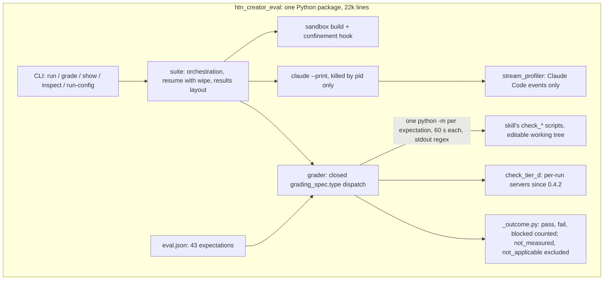
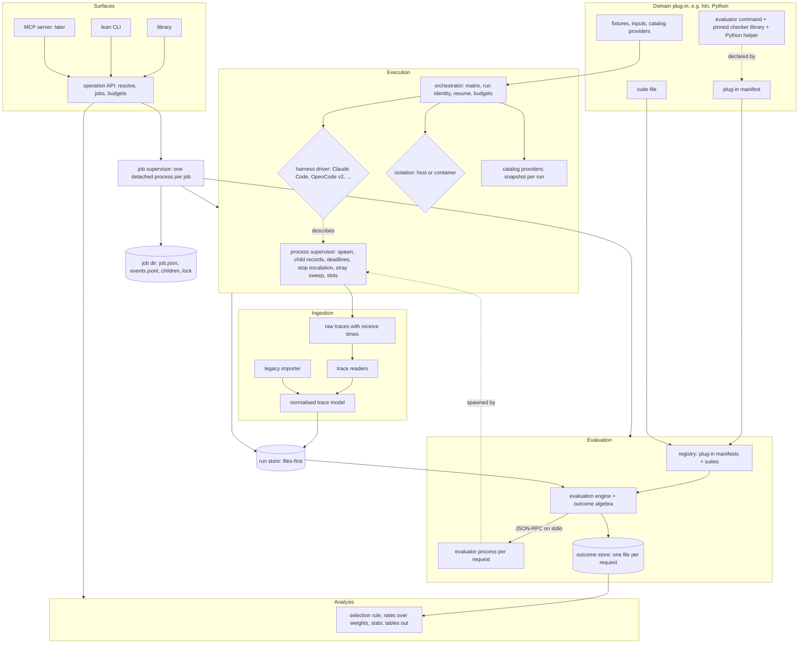
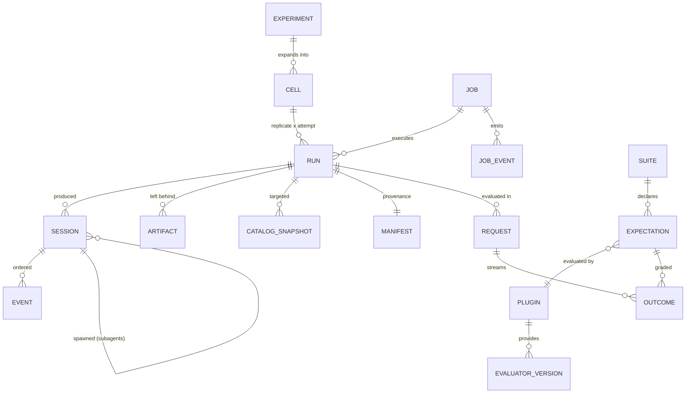
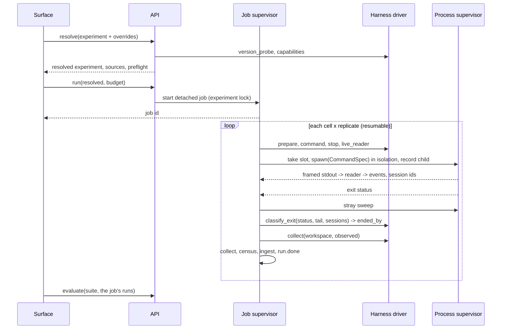

# Candler — Architecture

The intended design of Candler. Nothing is implemented yet. Points marked *provisional* are expected
to move once code meets real harnesses; the rest stand unless implementation proves them wrong, and
then this document changes together with the code. The reasoning behind the design, and its review,
are in the `candler_core` reports of mcp-python-ingestion (`__reports__/candler_core/` on branch
`feat/skill-htn-creator`).

## Executive Summary

- **Problem.** Running and evaluating LLM agents is welded into one domain-specific Python harness
  (`htn_creator_eval`, 22k lines): a closed grader dispatch over 10 `grading_spec.type` values,
  trace parsing for Claude Code only, a CLI whose flags are mostly derivable, and one Python process
  spawned per expectation per run.
- **Proposed change.** A standalone Rust core with two equal halves behind one operation API:
  - **execution:** run agents through shipped harness drivers under controlled conditions;
  - **evaluation:** grade traces and artifacts, fresh or on disk, through out-of-process evaluator
    plug-ins speaking one protocol.

  The library, a lean CLI and (later) an MCP server are thin surfaces over the API. Domain science
  enters only as plug-ins. The core depends on no project.
- **Non-goals.** Domain science (HTN tiers, PlanTrace, the `check_*` scripts stay in their project);
  LLM-as-judge gates; adversarial security isolation; dashboards and figures.
- **Biggest risks.** A trace model that drops signal; a driver trait shaped like Claude Code;
  supervision leaks (orphans, detached descendants); parity failures that are really instrument
  drift; fork safety in the Python helper on macOS; the team's first Rust project.
- **Validation.** Golden-regrade parity on the 240-run corpus (10,320 outcome rows); execution
  parity with today's `run` on a smoke matrix; a second harness (OpenCode v2) and a second plug-in
  (`waiting-on-processes`) before the contract freezes at 1.0.

## Current State



Measured on the eval env (2026-10-28): a bare interpreter starts in 34 ms; a spawn plus checker
import costs 40–285 ms. 18 expectations per run are graded by spawned skill scripts, so a 240-run
regrade spends roughly 5–15 CPU-minutes on startup alone.

## Proposed State



### Layer responsibilities

| Layer | Owns | Never owns |
|---|---|---|
| Operation API | The operation set, argument resolution with the source of every value, jobs, budgets, confirmations | Any domain notion |
| Job supervisor | Job identity, the job directory, the event stream, cancellation | What a run or an outcome means |
| Process supervisor | Every process Candler starts (agents, evaluators): spawn into its own process group, child records, deadlines, stop escalation, stray sweep, machine-wide slots | Harness or evaluator semantics |
| Execution | Experiment matrix, run identity, resume, isolation, catalog snapshots, artifact collection | What the artifacts mean |
| Harness drivers | Harness-specific data: config files, command line, stop action and signal, exit classification, what to collect, version detection | Starting, timing or killing processes |
| Ingestion | Trace readers, the normalised trace model, the legacy importer | Judgement |
| Run store | Run identity, content-addressed artifacts, the workspace view, manifest, integrity, the invalid-run ledger | Grades |
| Evaluation | Plug-in registry, suite resolution, `applies_to` and dependency `blocked`, evaluator requests, the outcome store | Domain logic |
| Evaluators (plug-in) | Domain science over trace + artifacts + snapshots + inputs + metadata | Layout, statistics, which runs an expectation applies to |
| Analysis | The selection rule, rates, tests, intervals, multiplicity; JSON or CSV tables | Re-deciding any outcome; drawing figures |

### Workspace

crates.io has one flat namespace without organisation scopes, so crates carry the project prefix
(`candler-*`, hyphenated; Rust code sees `candler_core`), not the organisation's name. The
organisation owns them through a crates.io team backed by the CrackingShells GitHub organisation.
All names below were free on 2026-10-28.

| Crate | Holds | Release line |
|---|---|---|
| `candler-schemas` | Every wire type as a serde struct; generated JSON Schema files committed beside them | `schemas@x.y.z` |
| `candler-core` | API, resolution, job and process supervisors, orchestrator, store, evaluation engine, outcome algebra, analysis (`statrs`) | core `vx.y.z` |
| `candler-harness` | The public `HarnessDriver` and `TraceReader` traits | core |
| `candler-harness-claude-code`, `candler-harness-opencode` | Shipped drivers and readers | core |
| `candler` | The binary: CLI, and later the MCP server as a subcommand | core |

**Python helper for plug-in authors** (`python/candler-evaluator` in this repo, outside the cargo
workspace, published to PyPI as `candler-evaluator` on its own tag line; the protocol does not
require it, the HTN plug-in uses it): the JSON-RPC loop; the file-descriptor stdout guard; one forked child per
expectation with its deadline; instrument digests and dirty flags; models generated from the JSON
Schema.

Tooling: Rust 2024 edition, Grit `rust-conventions`, `release-plz` (per-crate versions and
changelogs from Conventional Commits, publishing to crates.io), `cocogitto` (`cog verify` in a
`commit-msg` hook and in CI). `serde_json` with `float_roundtrip`.

## Operation API

| Operation | Input | Output | Long-running? |
|---|---|---|---|
| `resolve` | experiment or suite + overrides | the resolved experiment, every value with its source; preflight results | no |
| `run` | resolved experiment + budget | job id | yes (job) |
| `ingest` | raw trace dirs or a legacy results folder | run keys | yes (job) for big corpora |
| `evaluate` | suite + run selection | job id | yes (job) |
| `analyze` | analysis spec + outcome selection | tables (JSON or CSV), intervals, tests | no |
| `jobs` / `events` / `cancel` | job selection | job records, the event stream, cancellation | no |
| `show` / `inspect` | run, cell or experiment selection | outcomes with evidence, provenance, integrity | no |
| `diff` | two evaluator versions or two outcome sets | per-expectation changes | no |

**Resolution order (all surfaces):** explicit argument > experiment or suite file > project config
> derived value > core default. `resolve` reports each value's source and the manifest records it.
Values that can be known are derived, never asked for. `resolve` is the real preflight: skill
checkout at the pinned tag, isolation build, plug-in environments (built once per lock digest),
evaluator `describe`, harness version and capabilities, secrets present, gateway auth probe. No
tokens are spent.

### Budget

| Field | Meaning | On reaching it |
|---|---|---|
| `per_run.wall`, `per_run.turns?`, `per_run.cost?` | Caps on one agent run; a treatment condition, the same for every arm | The run ends, `ended_by = cap`; the run is valid |
| `max_runs?`, `max_tokens?`, `max_cost?`, `wall?` | Caps on the job | Runs in flight end `invalid(budget_stop)`; no new run starts |
| `max_parallel` | Concurrent agent runs or evaluator processes in this job; default 1 | — |

Across jobs, without a daemon: each agent or evaluator process holds one of N machine-wide slot
files (`~/.local/state/candler/slots/<n>.lock`, taken with `flock`, released by the kernel when the
holder dies). N comes from user config (*provisional* default).

### CLI surface over the jobs

| Command | Does |
|---|---|
| `candler run <experiment> [--<field> <value> ...]` | Resolves (file first, CLI fields override), then starts a job; prints the job id |
| `candler ls` | Lists experiment files. *Provisional:* `experiments/` under the project root, plus any path given |
| `candler ps` | Lists jobs with id, experiment, state, progress |
| `candler kill <id> \| --all` | Stops jobs; asks for confirmation unless `--yes` / `-y` |
| `candler watch <id> [--json \| --live]` | Follows a job's events: `--json` (default) prints event records, `--live` draws progress |
| `candler evaluate`, `show`, `inspect`, `diff`, `analyze`, `resolve` | The other operations |

"Experiment" names the file that declares factors, levels, replicates and budget (today's
`run_config` YAML). "Plan" is not used: it collides with HTN planning.

## Jobs, runs and supervision

### Job

- **No daemon.** Each job is one detached supervisor process. When no job runs, nothing of Candler
  runs.
- **Job directory** `<store>/jobs/<job-id>/`: `job.json` (id, supervisor pid and start time, spec
  digest, state), an append-only `events.jsonl`, `children/`, and a `lock` the supervisor holds with
  `flock`. `ps` reports a job `lost` when its lock is free and no `job.ended` event exists.
- **Event envelope** (on the `schemas@` line): `{v, seq, at, job_id, run?, kind, payload}`.
  Consumers skip kinds they do not know.
- **First event set** (*provisional*): `job.started`, `job.ended`; `run.started`, `run.ended` (with
  `ended_by` and exit status), `run.failed` (reason code), `run.stray` (survivors found by the
  sweep); `evaluation.outcome`.
- **Order of delivery:** `run` + events + `ps` + `kill` → `watch --json` → `ls` + `watch --live`.

### Run identity and resume

- **Run key** = `(cell digest, replicate, attempt)`. The cell digest hashes the cell's comparability
  fields (see the run manifest). Replicates count valid attempts only.
- **One supervisor per experiment:** `<store>/experiments/<digest>/lock`, held with `flock`.
- **Completion** = `run.done`, written (fsync, then rename) after collect and ingest.
- **Resume** replays the stored resolved values, never re-derives them. If a value that is re-checked
  differs (a harness that auto-updated, a missing secret, a moved tag), resume refuses unless forced,
  and a forced deviation is recorded on every run it affects. Before reusing a run, resume reaps the
  recorded children of any lost job.
- An attempt without `run.done` becomes `invalid(interrupted)` and stays in the ledger; the next
  attempt gets the next number. Nothing is ever deleted.

### Ends

| End | Run status |
|---|---|
| Completed, agent error, or a per-run cap | valid; `ended_by` measured |
| Gateway or provider error (connection refused, 0 tokens) | `invalid(gateway)`; retried once as a new attempt |
| Job budget, `candler kill`, supervisor lost | `invalid(budget_stop \| killed \| interrupted)`; never charged to an arm |
| Input passed off as output | `invalid(input_leak)` |

The driver's `classify_exit` sees the parsed sessions, so an exit 0 with an error result, or a run
with zero tokens, is classified from the trace, not from the exit status.

### Process supervision

- Every child is spawned into its own process group with `CANDLER_RUN=<run key>` (or the request id
  for evaluators) in its environment. Its pid, pgid and start time are written to `children/` as soon
  as the spawn returns.
- **Stop escalation:** the driver's pre-stop action, if any (an HTTP call or a command the core
  runs) → the driver's stop signal and grace → terminate the process group → kill it → **stray
  sweep** → destroy the container when isolation is a container. Every step is an event.
- **Stray sweep.** Harnesses start descendants in new sessions (Claude Code 2.1.304 spawns its Bash
  shell and its hooks detached), so a group kill misses them. On Linux the supervisor is a child
  subreaper and scans `/proc` for the marker; on macOS it scans same-user processes for the marker.
  Survivors are evented as `run.stray`, then killed. The same scan serves the process census.
- **Supervisor death.** On Linux children get a parent-death signal (set from one long-lived spawner
  thread). On macOS, `ps`, `kill` and `run` reap a lost job's recorded children and strays; until one
  of them runs, an orphaned agent may keep going (*provisional*: a watchdog may follow).
- Liveness checks compare pid *and* start time, so a reused pid never looks alive.

### Agent environment and secrets

- The core builds each child's environment from an allowlist (`PATH`, `LANG`, an isolated `HOME`
  and XDG directories, `TMPDIR`) plus the driver's overlay. Nothing else is inherited (today's code
  removes `CLAUDECODE` and the conda and venv variables explicitly; under an allowlist they never
  arrive).
- Secrets are referenced by variable name in the experiment, resolved when the process is spawned,
  checked at `resolve` and again at resume, and recorded as `{name, present}`, never as a value.

### Raw traces

The supervisor archives each harness output stream as framed records `{t_mono_ns, data}` with one
wall-clock anchor in the header, compressed when the run closes. That framed file is the raw input
of I3, so event times are reproducible even where the harness emits none.

## Harness drivers

### What the runner needs from a harness

| Phase | Needed | Varies between harnesses |
|---|---|---|
| Prepare | Model, endpoint, skill or plug-in, MCP servers, permissions and instructions written into the workspace | File names and formats; model ids and provider configuration |
| Confine | An in-harness guard where one exists (Claude Code's PreToolUse hook) | Some have none; the container is then the only boundary |
| Launch | Headless command line, environment overlay, working directory | Flags; budget options |
| Observe | Live events, normalised; the session ids seen | Streamed on stdout, or kept in a local database |
| Stop | An optional pre-stop action, then a signal and grace period | Execution may live in a server outside the child (OpenCode v2) |
| Classify the exit | Exit status, output tail and the parsed sessions → `ended_by` | Codes, messages, error results |
| Collect | Files, or the output of an export command | Home-dir transcripts, stdout, a SQLite store |
| Read offline | Parse a trace on disk, no process | Line streams or whole documents; format versions |
| Census | The tool catalog the agent actually had | How to list built-in and MCP tools |

### Traits (signatures only)

- `HarnessDriver`
  - `id() -> HarnessId`; `supported() -> VersionReq`
  - `version_probe() -> CommandSpec`; `parse_version(output) -> Version`
  - `capabilities() -> Capabilities { graceful_stop, live_events, budgets{turns, cost}, in_harness_guard, census, execution_outside_child }`
  - `prepare(cell, workspace) -> { files[], env_overlay }`
  - `command(cell, workspace) -> CommandSpec { argv, env_overlay, cwd }`
  - `stop() -> StopSpec { pre_stop: Option<Action>, signal, grace }`, with `Action = Command(CommandSpec) | Http { method, url, body }`
  - `live_reader() -> Option<Box<dyn TraceReader>>`
  - `classify_exit(status, tail, sessions) -> EndedBy`
  - `collect(workspace, observed) -> CollectSpec[]`, with `CollectSpec = File(glob) | Command(CommandSpec, name)`
- `TraceReader`
  - `framing() -> Lines | Document`
  - `detect(sample) -> Option<(FormatVersion, Confidence)>`
  - `feed(record) -> Event[]` (one line, or the whole document)
  - `observed() -> Observed { session_ids[] }`
  - `finish() -> Result<Session[], ReaderError>` (root first; children linked by `parent_session`)

Drivers return data and never act on processes; the core runs every command and HTTP call they
describe. The reader is synchronous, so the core owns all async I/O and drivers stay usable as
`dyn` trait objects. A reader can exist without a driver. Missing capabilities are refused at
`resolve`.

Drivers are compiled in, one crate each, selected by the experiment at runtime. A third-party
driver is a crate against `candler-harness`, contributed upstream or built in. The trait is part of
the 1.0 freeze.

**Model levels.** An experiment's model level maps, per harness, to a model id plus the provider and
endpoint configuration the driver writes in `prepare`.

### OpenCode v2 (second driver, M4)

From its documentation (2026-10-28): sessions run in a shared background server unless `run
--standalone`; interruption is an API call; sessions live in SQLite and are exported with
`opencode session export <id>`; MCP "code mode" is on by default and bundles several MCP calls into
one tool call. So the driver forces `--standalone`, declares `execution_outside_child`, stops with
an HTTP pre-stop action, collects through the export command with the observed session id, isolates
`HOME`, XDG and `OPENCODE_DB` through its overlay, and treats code mode as an explicit experiment
factor (changing it changes the treatment, I7). Not yet confirmed: the JSON event schema, exit
codes, signal behaviour, budget options and the binary name; the driver work checks them first.

## Plug-ins

### Plug-in manifest (static; on the `schemas@` line)

| Field | Meaning |
|---|---|
| `name`, `version` | Must equal what `describe` returns |
| `protocol` | Protocol major.minor it speaks |
| `command` | argv, relative to the plug-in directory |
| `environment` | `{kind: uv \| none, project, lock}`; the core builds one environment per lock digest and reuses it |

The core reads manifests without running anything. *Provisional:* the project config lists plug-in
directories; a suite names an evaluator as `name@range`.

### Suite file (on the `schemas@` line)

Each expectation: `id`, `group`, `role` (gate / quality / descriptive), `evaluator` (`name@range`),
`kind`, `params`, `depends_on[]`, `applies_to` (arms or conditions), `deadline_ms?`.

- The core decides `applies_to`: an expectation that does not apply to a run is recorded
  `not_applicable` with cause `{reason: not_applicable_to_arm}` and is not sent.
- The core decides dependency `blocked`: when a dependency is `fail` or `blocked`, the dependant is
  recorded `blocked` with cause `{expectation: id}` and is not sent.
- Dependencies graded by the same evaluator go in the same request (C6 uses C1 and C5); outcomes of
  dependencies graded elsewhere are passed in `prior[]`.
- Parameters are not templates. Evaluators read run facts from `metadata` and `inputs` (today's
  `{domain_name}` and `{servers_dir}` substitutions become declared needs).

## Evaluator protocol

JSON-RPC 2.0, one message per line on the evaluator's stdin and stdout. stderr is free text, stored
as the evaluator's log.

| Message | Direction | Kind | Content |
|---|---|---|---|
| `describe` | core → evaluator | request | none |
| ↳ result | | response | `protocol`, `name`, `version`, `instruments[] {name, version, digest, dirty}`, `environment {lock_digest, packages{}}`, `kind` (deterministic / probabilistic), `kinds[] {kind, params_schema, needs, default_deadline_ms}`, `reuse` (reserved) |
| `evaluate` | core → evaluator | request | `context` (below), `items[] {expectation_id, kind, params, deadline_ms}`, `prior[]`, `scratch` |
| `outcome` | evaluator → core | notification | one outcome record, as soon as known |
| `progress`, `log` | evaluator → core | notification | free payload, forwarded into job events |
| ↳ result | | response | `{reported: n}` |
| `cancel` | core → evaluator | notification | request id; the evaluator answers `evaluate` with error `-32800` (request cancelled) |

**`needs`** = `{trace: bool, artifacts[] (run-relative globs), snapshots[] (kinds), inputs[]
(kinds), metadata[] (run-manifest field paths)}`. `resolve` checks every need can be met.

**Run context:** `run` (key); `root` (a read-only, workspace-shaped view of the run: content-
addressed blobs materialised under their workspace paths by hard links or clones, so `domain.py`
sits beside `problems.py`); `trace` (normalised trace file); `raw[]`; `artifacts[] {path
(run-relative), abs, sha256}`; `snapshots[] {kind, path, digest}`; `inputs[] {kind, path, digest}`
(from the cell or suite: server source trees, fixtures; ground-truth inputs never enter the
isolation, I8); `metadata` (the declared manifest fields). Absolute paths are valid where the
evaluator runs (host or container) and exist only in requests. `scratch` is the evaluator's; the run
store is read-only to it.

**Lifetime.** The core starts one evaluator process per request, in its own process group, sends
`describe` then `evaluate`, and keeps stdin open until the `evaluate` result arrives; it then closes
stdin. End of input means "finish in-flight work, then exit". On cancel: send `cancel`, close stdin,
then escalate as for any child. Reusing a worker across runs later is a core setting plus `reuse`;
the protocol does not change.

**Deadlines and isolation per expectation.** Each item carries `deadline_ms` (suite value, else the
kind's default; 60 s for the HTN checkers, as today). An evaluator may run children inside its own
request: the Python helper imports the checker libraries once, then forks one child per item and
enforces that item's deadline, so a hanging or exiting agent `domain.py` costs one expectation, not
the run, and planner state never leaks between expectations. The core enforces the request deadline
(the sum of item deadlines plus a margin) by killing the evaluator's process group.

**Stdout guard.** The helper duplicates file descriptor 1 to a private protocol descriptor and
points descriptor 1 at stderr before any import, so C extensions, `os.write(1, …)` and subprocesses
cannot reach the protocol pipe. On the core side, a line that is not JSON is logged and counted and
never aborts a request; a JSON line that is not a valid protocol message is a malformed message.

**Version.** The core accepts a plug-in whose `protocol` has its own major and a minor no newer than
its own; a mismatch fails `resolve` and names the side to upgrade. `describe` must match the
manifest's name and version.

**Failures.** Every item the evaluator did not report becomes `not_measured` with cause
`{reason: instrument_error}` (or `{reason: deadline}`), never `fail`. Outcomes already received are
kept.

## Data Model



### Run store (files-first)

| Path | Holds |
|---|---|
| `runs/<run key>/` | `manifest.json`, `run.done`, `raw/` (framed), `trace.jsonl`, `tree.json` (workspace paths → sha256) |
| `blobs/<sha256>` | Artifact contents, once |
| `outcomes/<run key>/<evaluator@version>/<request id>.jsonl` | One request's outcomes; written as `.partial`, renamed when the result arrives; one writer, no locks |
| `jobs/<job id>/` | `job.json`, `events.jsonl`, `children/`, `lock` |
| `experiments/<digest>/lock` | One supervisor per experiment |

An index can always be rebuilt from these files. Stored paths are relative to the run root (I17).

### Run manifest (on the `schemas@` line)

Run key; experiment digest; cell factor values; every resolved value with its source (secrets as
`{name, present}`); harness `{name, version, driver@version}`; isolation; treatment reference (skill
tag and commit); catalog snapshot and input digests; plug-in environment lock digests; start and end
times; host; job id; integrity verdict.

**Comparability fields** (used by I7 and by the cell digest): the cell factor values and every
resolved value, except a fixed nuisance set: timestamps, absolute paths, pids, host, job id, attempt.
The nuisance set is part of the schema, not an implementer's choice.

### Normalised trace model

`Session {id, source{harness, harness_version, reader, reader_version}, model, started_at, ended_at,
ended_by, parent_session?, raw_ref}`; `Event {seq, at, kind, span?, raw_ref, ext}` with kinds
`user_message`, `assistant_message`, `tool_call` (`origin`, `argv?`, `wrapped_calls[]?` for a call
that bundles several MCP calls), `tool_result` (`is_error`, `denied?`), `notification`, `usage`.
`at` comes from the harness when it emits one, else from the receive time in the raw frame.

### Wire schema: outcome record

| Field | Type | Notes |
|---|---|---|
| `run` | run key | |
| `expectation_id` | string | must exist in the suite |
| `role` | gate / quality / descriptive | copied from the suite entry when graded |
| `evaluator` | `name@version` | |
| `instruments[]` | `{name, version, digest, dirty}` | I6 |
| `suite_entry_digest` | hash | of the expectation's `kind`, `params`, `role`, `applies_to`, `depends_on` |
| `context_digest` | hash | of the artifacts, snapshots, inputs and metadata sent |
| `request_id` | id | |
| `status` | `pass` / `fail` / `blocked` / `not_measured` / `not_applicable` | five-state algebra |
| `value?` | number / fraction `{num, den}` / count / text / named counts | a fraction carries its counts |
| `weight?` | `{num, den}` | contribution to a rate; defaults: pass 1/1, fail 0/1, blocked 0/1 |
| `probability?` | number in [0, 1] + `calibration_ref` | reserved; never set by deterministic evaluators |
| `evidence[]` | `{ref, note}` | ref = session/seq or run-relative path |
| `cause?` | `{expectation: id}` / `{artifact: path}` / `{reason: code}` | required for `blocked`, `not_measured`, `not_applicable` |

**Identity key:** `(run, expectation_id, evaluator@version, instruments digest, suite_entry_digest,
context_digest)`.

**Rates.** Per role, a rate is Σ `weight.num` / Σ `weight.den` over the `pass`, `fail` and `blocked`
outcomes, summed per expectation, never per eval. `blocked` is a failure, attributed to its cause:
the agent under-produced, and that must not vanish. `not_measured` and `not_applicable` are excluded
and always reported as counts with their causes.

**Selection rule (analysis, `show`, `diff`).** An analysis selects one evaluator version per
expectation; mixing versions is refused unless asked for. Among outcomes with the same identity key,
the latest complete request wins. Differing outcomes under one key, other than an
`instrument_error` or `deadline` replaced by a measured one, are reported as I4 violations. Roles
and weights are read from the outcomes, never from today's suite.

### Wire schema: tool-catalog snapshot

`captured_at`, `provider@version`, `servers[] {name, source_path, source_digest, transport,
tools[]}` with tools in MCP `tools/list` shape.

### The `schemas@` line holds

Outcome record · catalog snapshot · normalised trace · evaluator messages (`describe` result,
`evaluate` params, notifications) · plug-in manifest · suite file · run manifest · job record and
event envelope · experiment file. All are generated from `candler-schemas`.

## Key Flows

### Live: run, then evaluate



### Evaluation of one run by one evaluator

```mermaid
sequenceDiagram
  participant E as Evaluation engine
  participant P as Process supervisor
  participant V as Evaluator (helper)
  participant C as Forked child per item
  E->>E: applies_to, dependency blocked, build context
  E->>P: take slot, spawn(manifest command), request deadline
  E->>V: describe
  V-->>E: protocol, versions, instruments
  E->>V: evaluate(context, items, prior, scratch)
  loop each item
    V->>C: fork after imports, item deadline
    C-->>V: result or timeout
    V-->>E: outcome
  end
  V-->>E: result {reported: n}
  E->>V: close stdin
  V-->>P: exit
  E->>E: unreported -> not_measured(instrument_error); rename .partial
```

Post-hoc, legacy and regrade flows: `ingest → evaluate → analyze` on disk. A regrade writes new
request files under the new evaluator version; `diff` compares versions.

## Contracts & Invariants

### Other interfaces (signatures only)

- `CatalogProvider.snapshot(cell) -> catalog_snapshot`
- `Isolation.create(cell) -> handle`; `handle.exec`, `handle.inject`, `handle.census`,
  `handle.collect`, `handle.destroy`
- `LegacyImporter.import(results_folder) -> runs[]`

### Invariants

| # | Invariant |
|---|---|
| I1 | The core never names a domain. |
| I2 | A status is never projected onto a number. Rates always carry their counts. |
| I3 | The normalised trace is a pure function of `(framed raw, reader@version)`; the raw is kept. |
| I4 | A deterministic evaluator is a pure function of `(context, params, evaluator@version, instruments)`. A regrade of unchanged inputs reproduces `(status, value, weight, cause)` exactly; evidence text is not compared. |
| I5 | Only deterministic evaluators may hold the `gate` or `quality` role. |
| I6 | **Instrument pinning.** A checker shared by the treatment and the evaluator is a library with its own version. The evaluator depends on a pinned version and reports it in `describe` with a content digest and a dirty flag; every outcome records them. Dirty instruments cannot grade `gate` or `quality` expectations. One experiment grades all its arms with one instrument version unless it says otherwise. |
| I7 | Arms differ only in declared treatment factors. The diff of comparability fields proves it. |
| I8 | Ground truth never exists inside the isolation boundary, and no surface exposes it while its run is live. |
| I9 | Observation never alters behaviour. |
| I10 | An invalid run is never a failure. Invalid runs are reported per arm, with a reason. |
| I11 | Outcomes, events and run attempts are append-only. Nothing is deleted. |
| I12 | Every resolved argument records its source. Nothing is defaulted silently. |
| I13 | A `run` without a budget is refused on the MCP surface. |
| I14 | One front door, one environment. Plug-in environments are provisioned by the core from their manifests. Relative paths resolve against the caller's working directory. |
| I15 | The core supervises every process it starts, and reaps it and its descendants. Drivers never act on processes. An evaluator may run children only inside its own request; they die with it. |
| I16 | Nothing of Candler runs when no job runs. |
| I17 | Stored records hold only run-relative paths. |
| I18 | Event and message consumers skip kinds they do not know. |
| I19 | Secret values are never written to the store, a job directory, an event or a log. |
| I20 | An end caused by the experimenter (job budget, kill, lost supervisor) is never charged to an arm. |
| I21 | Analysis reads roles and weights from outcomes, never from the current suite. |

### Error model

| Failure | Surfaces as |
|---|---|
| Reader cannot parse, or the format version is unknown | Run `invalid` (`reader_error` / `format_unknown`); raw kept |
| Harness version outside the supported range, a missing capability, an unmet `need`, a missing secret | `resolve` fails; no run starts |
| Plug-in protocol major differs, or `describe` disagrees with the manifest | `resolve` fails, naming the side to fix |
| Artifact the agent never produced | The evaluator emits `blocked` with cause `{artifact}`, or `fail` when the expectation is about that artifact's existence |
| Artifact missing because collection failed | Run `invalid` (`collection_error`) |
| Evaluator crash, item or request deadline, malformed message, outcome for an item it was not sent | Unreported items `not_measured` (`instrument_error` / `deadline`); stderr kept |
| Gateway or provider error | Run `invalid(gateway)`; retried once as a new attempt |
| Per-run cap reached | Valid run; `ended_by = cap` |
| Job budget, kill, supervisor lost | Run `invalid` (`budget_stop` / `killed` / `interrupted`) |
| Resume finds a re-checked value changed | Refused unless forced; a forced deviation is recorded per run |
| Arms differ outside declared factors | The stratum is invalid; comparisons are refused |
| Dirty instrument asked to grade a gate or quality expectation | `resolve` fails |

## Golden corpus (M2a exit gate)

**Reference, done 2026-10-28.** The 240 runs of 2026-08-06 (12 cells: Haiku 4.5, Sonnet 4.6, Sonnet
5 × skill v0.2.3–0.2.6, 20 runs each, rikyu domain), regraded by `htn-creator-eval@0.4.2`
(mcp-python-ingestion `28be2c15`, clean tree) against rikyu's own catalog snapshot. Frozen in
`agenticai4hpc26-artifact` on branch `regrade/htn-creator-eval-0.4.2`, commit `7efa1b7`, tag
`candler-m2a-golden`; the published `main` is untouched. `expectations.jsonl` holds one row per
`(run, expectation)`: 10,320 rows.

**Legacy import mapping.** `score` / `max_score` → `weight`; `blocked_by` → `cause {artifact}`;
text values (D-E1, D-E2) → text `value`; per-row `role` kept. Integrity `incomplete`
(`missing_genuine_output`, the agent never produced the file; 56 runs) is a **valid** run;
`contaminated` is `invalid(input_leak)`. Invalid runs are never sent to `evaluate`.

**Parity test.** Candler plus the HTN plug-in, with its checker pinned at `28be2c15` and run one
forked child per expectation with a 60 s deadline, reproduces `(status, value, weight, cause)` for
all 10,320 rows. That includes the reference's known defects: C-M2's bijection check false-fires on
88 of 89 failing runs, and D-E1–D-E4 are `not_measured` (no plan replay for a live cluster). Fixes
come after parity, as evaluator version bumps, visible through `diff`.

**Mismatch triage, in order:** the instrument digest differs from the pin (re-pin, rerun) → an
input the legacy importer reconstructed (importer defect) → anything left is a core defect.

**Known gaps:** the corpus is `with_skill` only, so parity does not exercise `not_applicable` or a
contaminated run; the agent-side planner version of those runs is unrecorded (`null`) and must be
labelled so in any analysis.

## Alternatives Considered

| Decision | Options | Chosen | Tradeoff accepted |
|---|---|---|---|
| Language | Python + uv / **Rust** | Rust | First Rust project; the first plug-in stays Python, so the protocol is the main path |
| Wire schema source | Hand-written JSON Schema / **serde structs, schema generated** | structs | Schema shape follows Rust types; CI checks the generated files match |
| Protocol framing | MessagePack / gRPC / **JSON-RPC 2.0 lines on stdio** | JSON-RPC | Text parsing, negligible against small messages; every language speaks it |
| Evaluator isolation | Process per expectation / **process per request, forked child per expectation** / long-lived worker | fork | One interpreter start per run per evaluator; fork safety must hold on macOS; long-lived workers stay a future feature |
| Paths | Inline payloads / **file paths into a workspace-shaped view** | paths | Evaluators need filesystem access; links cost nothing |
| Outcome storage | One shared JSONL / **one file per request** | per request | More files; no locks, no races, partial requests visible |
| I6 | Independent re-implementation / **one pinned checker library** | pinning | The agent may hold the same checker as its grader; whether it used it is measured separately (instructed coverage) |
| `blocked` in rates | Excluded / **counted as a failure** | counted | An arm that produces less cannot look better |
| Harness support | External protocol / **compiled-in drivers behind public traits** | compiled in | A new driver needs a rebuild or an upstream PR |
| Jobs | Daemon / blocking CLI / **detached supervisor per job, kernel-released locks** | per job | `ps` reconstructs state from job directories; orphan reaping on macOS waits for the next command |
| Figures | In core / **tables out** | tables | Users bring their own plotting |

## Risks & Mitigations

| Risk | Mitigation |
|---|---|
| The trace model drops signal (side-chains, denials, hook payloads, bundled MCP calls) | `ext`, `raw_ref`, `wrapped_calls`; a fixture corpus per harness format version |
| The driver trait ends up shaped like Claude Code | OpenCode v2 before the freeze; its known differences are already in the trait |
| Detached descendants or orphans survive (Claude Code starts its shells in new sessions) | Marker sweep after every group kill; child records; Linux subreaper and parent-death signal; a test kills a supervisor mid-run and checks no marked process survives |
| `fork` after imports is unsafe on macOS when threads or system frameworks are loaded | The helper refuses to fork when more than one thread exists and falls back to one process per item; tested on macOS in M2a |
| Parity mismatches are instrument drift | Instrument digests and dirty flags; the pinned reference; the triage order |
| The legacy importer reconstructs inputs wrongly | Importer fixtures; triage step 2 |
| Harness churn (formats, flags, auto-updates) | Supported ranges; unknown formats `invalid`; resume refuses a changed harness version |
| Unconfirmed OpenCode v2 facts | Checked first in M4; the driver declares what it cannot do |
| First Rust project | Grit conventions and their reviewer; small crates; schemas and protocol first |
| The lean CLI regrows flags | Every new option must say why it cannot be derived or live in the experiment file |
| An agent driving the MCP surface spends without bound or reads ground truth | Mandatory budgets (I13); read/mutate split; I8 at the surface |

## Deliberately open

Decided during development: pairing keys, execution order and a declared blocking factor (M6; start
times are recorded from M2b); a `without_skill` fixture for the parity suite; reporting
`instrument_error` and `deadline` counts per arm; event kinds beyond the first set; where `ls` looks;
how plug-ins are registered; the slot count default; a macOS orphan watchdog; long-lived workers; the
container backend; the MCP tool shapes; the store root default.

## Implementation

The milestones, their order, exit gates and scope are in the meta-roadmap
[`__roadmap__/candler-v1/`](../__roadmap__/candler-v1/README.md). Each milestone is planned in
detail by its own session, as its own campaign under `__roadmap__/`.

HTN lane: HTN Phase 4.5 reads the catalog snapshot; Phase 7 writes its Tier C logic as library
functions; after M2a the checker library becomes the plug-in and `eval.json` becomes a suite file
(no templates); Phase 8 waits for M5. The reasoning is in
`/Users/hacker/Documents/src/External/PCfVW/mcp-python-ingestion/__reports__/candler_core/02-findings_lane_overlap_v0.md`.
