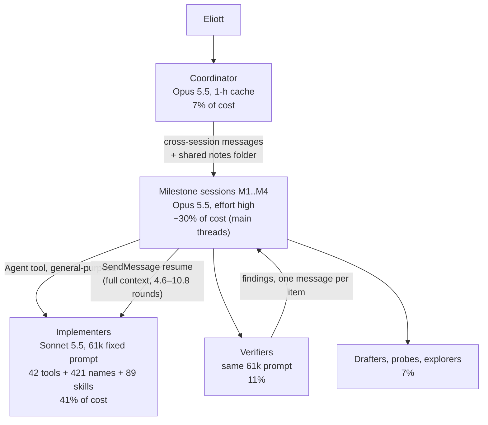
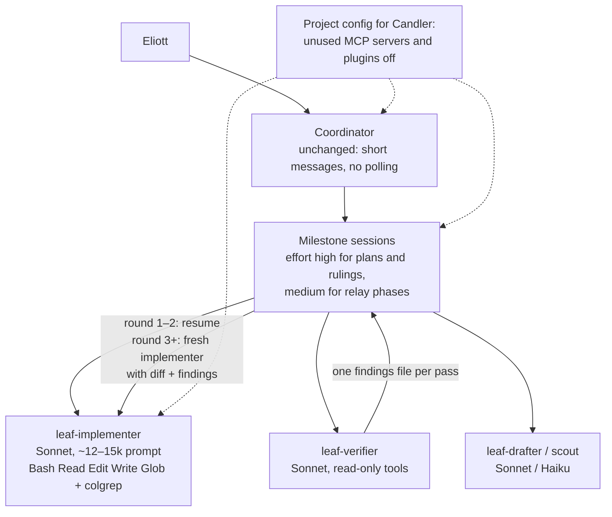
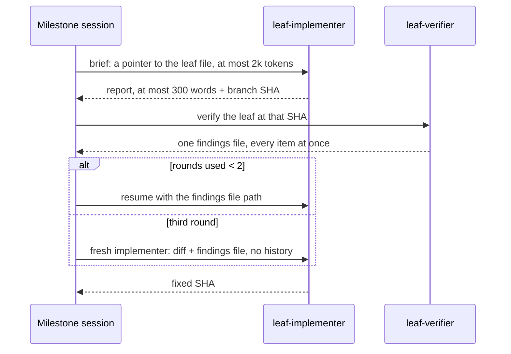

# Configuring the agent system for cost — Architecture Analysis (v0)

Date: 2026-11-12

## Executive Summary

- **Problem.** The Candler campaign cost about 1,346 USD at API list prices. The two companion findings reports trace it to three drivers:
  - a 61k-token fixed prompt that every subagent re-reads on every call, about 70% of it unused;
  - long resumed contexts in implementers, the cost of their fix rounds;
  - main-session work: 41% of the total, mostly re-reading 170–300k contexts.

  Coordination itself is 7%.
- **Proposed change.** Keep the topology: Eliott, then the coordinator, then the milestone sessions, then the leaf subagents. Change what each node carries:
  1. trim the MCP servers and plugins Candler doesn't use;
  2. give each leaf role an agent definition with a tool allowlist;
  3. bound fix rounds;
  4. size leaves at drafting time;
  5. keep reports into orchestrators short, with file pointers.
- **Non-goals.** Fewer verifiers: they found the `imported_strata` hole and six false claims in the refusal pages. Also not proposed: merging the coordinator into Eliott, or changing models for design rulings.
- **Biggest risks.** An allowlist that misses a tool an implementer needs. The desktop app injecting its tools whatever the allowlist says. Skills becoming unreachable once `Skill` is dropped.
- **Validation.** A pilot on M4's next leaves, measuring first-call size, USD per leaf, rounds and defects found, against the M2c and M3 baselines.

## Current State

## Proposed State

## Key Flows

The fix-round protocol that bounds resumed context:

## Contracts & Invariants

**Agent definitions** (Markdown with frontmatter; user level `~/.claude/agents/`, or project level `.claude/agents/`):

| Field | leaf-implementer | leaf-verifier | leaf-drafter | scout |
|---|---|---|---|---|
| `model` | sonnet | sonnet | sonnet | haiku |
| `tools` | Bash, Read, Edit, Write, Glob, colgrep `search` / `expand` / `find_files`, Monitor, TaskStop | Bash, Read, Glob, colgrep | Bash, Read, Write, Glob, colgrep | Read, Glob, colgrep |
| `autoCompactWindow` | 200000 (optional, pilot both ways) | — | — | — |
| Excluded | Agent, Artifact, browser, iOS, visualize, session tools, ToolSearch, SearchPlugins | the same, plus Edit and Write | the same, plus Edit | everything else |

**Project configuration for Candler** (Eliott's settings): turn off, for this project only, the MCP servers and plugins its sessions never use:
- the HPC servers (octopus-dev, banyan, dgx1, rikyu);
- ArangoDB, Wolfram, Svelte, macOS Calendar and Notes, Drive and arXiv;
- the GitHub connector (the sessions use `gh`).

**Invariants:**
- An implementer never delegates: it has no `Agent` tool. A verifier never edits.
- A brief is at most 2k tokens and points at files. A report back is at most 300 words plus SHAs and file paths. Long content travels as files in the shared notes folder, never inline.
- Every verifier pass yields one findings file with every item. No item is sent alone.
- An implementer is resumed for at most two fix rounds. A third round starts a fresh implementer with the diff and the findings file.
- A drafted leaf is sized to fit within about 100 implementer calls and a 200k context. A leaf expected to exceed that is split at drafting time.
- Cross-session messages carry decisions, SHAs and paths, and say "no reply needed" when none is.

**Error model:**
- A missing tool surfaces as an agent reporting `blocked: needs <tool>`, never as a workaround. The orchestrator then adds the tool to the definition, or runs that step itself.
- A skill an agent needs but can't load surfaces the same way. Until preloading is verified, the brief names the skill's file to read.

## Alternatives Considered

| Option | Expected effect (campaign counterfactual) | Decision |
|---|---|---|
| A. Eliott supervises directly; no coordinator | Saves at most 7% (94 USD), and costs Eliott's attention at every relay | Rejected for now |
| B. Sonnet for the milestone orchestrators | Saves ~140 USD on output and 1-h writes; reads cost the same (0.20 USD/MTok). Risk to the quality of rulings | Partial: Sonnet for side sessions only |
| C. 1-h cache TTL for subagents | Avoids 48 USD of expiry rewrites, but doubles every subagent write (+~110 USD) | Rejected |
| D. A global 200k context cap | At most ~83 USD (6%), and compaction may drop detail mid-leaf | Optional, implementers only, in the pilot |
| E. Restricted agent definitions + project-level plugin trim | ~140 USD from the subagent prompt alone (10%), and more from the main sessions' lists | **Chosen** |
| F. Fewer or cheaper verifiers | Verifiers are 11%; they caught defects no gate caught | Rejected |

Together with the round cap and leaf sizing, a total of 20–25% looks reachable. The pilot measures the part from the round cap, which this data can't separate.

## Risks & Mitigations

| Risk | Mitigation |
|---|---|
| The allowlist misses a tool (Monitor, TaskStop, colgrep), and the agent stalls or improvises | The `blocked: needs <tool>` contract. The pilot starts generous and trims from observed tool use (`calls.csv` lists every tool called) |
| The desktop app injects its browser, iOS and visualize tools regardless of the allowlist | Measure the pilot agent's first call. If it stays above 40k, report it upstream and fall back to trimming plugins |
| Skills (`rust-conventions`, `waiting-on-processes`) become unreachable without `Skill` | Keep `Skill` in the pilot and measure the listing's cost. Test whether agent definitions can preload skills |
| Compaction loses leaf detail | Pilot `autoCompactWindow` on half the leaves only, and compare fix rounds |
| Definitions drift as plugins change | Keep them in one user-level folder, and re-measure after plugin updates |
| Lower orchestrator effort weakens a ruling | Lower it only for relay phases, and raise it again for plan reviews and rulings |

## Roadmap Recommendation

No roadmap is needed. The milestone sketch:
- **Pilot (M4's next two or three leaves).** Eliott enables the project-level plugin trim and adds `leaf-implementer` and `leaf-verifier`. M4 uses them. Measure first-call size, USD per leaf, rounds and defects, against M2c (3.3 USD per leaf) and M3 (9.5 USD).
- **Adopt.** If the pilot holds quality, make the definitions the default in every milestone's implementer brief, and write the round cap and the report size into the briefs. They are agent-process rules, so they go in the briefs and the shared notes, never in `AGENTS.md`.
- **Re-measure.** Run `aggregate.py` and `analyse.py` again at M4's close, as findings v1.
