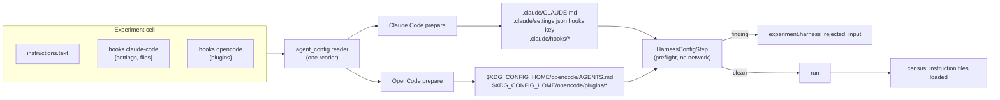

# Agent configuration as data — Architecture Analysis (v0)

M6.5 makes instruction files (`CLAUDE.md`, `AGENTS.md`) and hooks per-arm values of an experiment cell. Each driver installs them where its harness looks. Before the agents run, the harness's own check reports on what Candler installed, and any finding refuses the cell. The plan was approved on 2026-11-25. The roadmap is [`__roadmap__/m6_5-agent-config/`](../../__roadmap__/m6_5-agent-config/README.md).

## Executive Summary

| Question | Answer |
|---|---|
| Cause removed | Instruction files and hooks are not `AgentSetting`s. So no driver answers for them, no page says where they go, no digest covers them, and nothing refuses a cell whose harness drops them. |
| Shape | New cell values: `instructions.text`, `hooks.claude-code` and `hooks.opencode`. They are inline, exactly like `mcp.servers`. |
| Translation | None. The instruction text is the same for both harnesses and goes to each harness's own file. Each harness gets its own hooks payload, installed verbatim. |
| Boundary | Candler guarantees the installation. The harness judges the content. |
| Harness check finds an error or a warning | Refused: `experiment.harness_rejected_input`. |
| Proof | A real-harness end-to-end run against the scripted fake model. No RiVault run is needed. |
| Cost | About $55. Cap $75. |

**Rulings taken while planning**

| Choice | Ruling |
|---|---|
| A harness finding | Refuse errors and warnings alike. |
| Where file contents come from | Inline text in the cell. There is no file-reference mechanism. |
| Placement | A new roadmap root, M6.5. Its high-level status is kept in macOS Reminders. |

## Current State

Today, an `inputs` entry is the only way to put a file in front of the agent. It fails here in four ways:

1. It applies to the whole experiment, so every arm's agent sees every arm's files.
2. The file needs a different name for each harness.
3. It lands at the workspace root, where outputs are collected, and risks `input_leak`.
4. It cannot reach `.claude/settings.json`, which the Claude Code driver renders.

**Where each harness looks**

| Harness (pinned) | Instruction file it reads | Hooks it runs | Evidence |
|---|---|---|---|
| Claude Code 2.1.311 | Project: `<cwd>/CLAUDE.md` or `<cwd>/.claude/CLAUDE.md`. User: `~/.claude/CLAUDE.md`, which does not load under the driver's `--setting-sources project,local`. | The `hooks` key of any settings file in scope. All matching hooks run, and their results merge. | Context7 `/websites/code_claude` |
| OpenCode V2 2.2.7 | `AGENTS.md` only, never `CLAUDE.md`: walking up from the cwd to `$HOME`, plus `<config>/AGENTS.md`. | JS/TS plugins (`Plugin.define`). Local ones in `<config>/plugins/` skip npm. | Context7 `/websites/opencode_ai/v2`; `config/plugin/instruction.ts:84-94` and `plugin/module.ts:109-110` at v2.2.7 |

**How each harness fails on bad input**

| Harness | A whole file is rejected | One entry is rejected | Its own check |
|---|---|---|---|
| Claude Code | A *Settings Error* (bad JSON, or a value the schema rejects): the file is not applied. | A *Settings Warning* (for example an unknown hook event): that entry is skipped and the rest applies. | `claude doctor`. Its exit code and whether it runs without a TTY are not documented, so the probe settles them. |
| OpenCode | A config document is dropped with a warning. A plugin is logged as failed and disabled. Startup continues. | Unknown config keys are ignored. | `opencode debug config` and `opencode plugin list`. `plugin check` covers package plugins only. |

## Proposed State

**Where each value lands**

| Value | Claude Code | OpenCode | Collected as output? |
|---|---|---|---|
| `instructions.text` | `<workspace>/.claude/CLAUDE.md` (project scope) | `$XDG_CONFIG_HOME/opencode/AGENTS.md` (global scope, in the home) | No. `.claude/**` is excluded, and the home is not collected. |
| Hooks configuration | `hooks.settings` goes verbatim under the `hooks` key of `.claude/settings.json`. | none (OpenCode hooks are code) | No |
| Hook files | `.claude/hooks/<rel>`, mode 0755 | `$XDG_CONFIG_HOME/opencode/plugins/<name>` | No |

Candler's own observation hooks stay in the home `--settings` file. `InstructionsLoaded` is added to them, and that file is passed in headless mode too. Since only the `hooks` key is taken from the consumer, the consumer cannot switch the observers off.

## Key Flows

```mermaid
sequenceDiagram
  participant C as candler resolve
  participant D as driver
  participant K as check container (cell image, no network)
  participant H as harness check
  C->>D: plan(cell)
  D-->>C: prepared files + config_check()
  C->>K: place prepared files
  K->>H: claude doctor / opencode debug config + plugin list
  H-->>C: output, exit
  C->>D: read_config_check(output)
  alt any error or warning
    C-->>C: refuse cell, harness_rejected_input, exit 2
  else clean
    C-->>C: record verdict beside harness identity
  end
```

The check runs once for each distinct combination of harness, image, instructions and hooks, not once per run.

## Contracts & Invariants

**Surface**

| Path | Type | Refusal on misuse |
|---|---|---|
| `instructions.text` | string | `experiment.document_invalid` (wrong type) |
| `hooks.<harness>` | an envelope with `deny_unknown_fields`; contents free | `experiment.cell_value_invalid` (unknown harness key) |
| `hooks.claude-code.settings` | object, verbatim | judged by the harness only |
| `hooks.claude-code.files` | map from a relative path to text | `format.rel_path_invalid` |
| `hooks.opencode.plugins` | map from a file name to text | `format.rel_path_invalid` |

**Declaration**

- Two new settings, `AgentSetting::Instructions` and `AgentSetting::Hooks`, which both drivers answer.
- A new `DriverFact::ConfigCheck`.
- Two new trait methods:
  - `config_check(&Plan) -> Option<CommandSpec>`
  - `read_config_check(output) -> CheckVerdict`

**Error model**

| When | Code | Side to fix |
|---|---|---|
| The cell has a `hooks` table but no entry for its own harness | `experiment.cell_value_missing` | experiment |
| The harness's own check reports an error or a warning | `experiment.harness_rejected_input` (new). Message: "Candler installed X at Y; H rejects it: «output»" | experiment |

**Invariants**

1. Every value is in the cell, so the cell digest, factor levels and `inspect` cover it.
2. One reader, `candler_harness::agent_config`, serves every consumer of these values.
3. No installed file appears among a run's collected outputs.
4. A cell is never run with part of its declared configuration dropped. Candler refuses the cell instead.
5. Candler's observation hooks cannot be disabled by the consumer's payload.
6. Every run's census names the instruction files the harness loaded. That includes a stray file from a fixture.

## Alternatives Considered

| Decision | Options | Chosen | Tradeoff accepted |
|---|---|---|---|
| Hooks payload | Shared and translated, or verbatim per harness | Verbatim per harness | An arm on two harnesses needs two payloads. Translation is impossible in general anyway: JSON plus shell on one side, JS modules on the other. |
| Where file contents come from | Inline text, file references, or `inputs` | Inline text | Long files are pasted or generated into the TOML. The alternative was a new "file value" mechanism, about $6 and one more leaf. `inputs` reach every arm. |
| A harness finding | Refuse both, refuse errors and warn on warnings, or warn only | Refuse both | A harmless deprecation notice also refuses. In exchange, an arm never runs silently without part of its hooks. |
| OpenCode scope | Workspace `AGENTS.md`, or global `<config>/AGENTS.md` | Global | The two harnesses use different scopes (project and global). The text reaches the model the same way, and the scope is stated on the capability page. |
| Proof | A live RiVault run, or the fake model | The fake model | None. The fake model records each request, so the proof is deterministic and costs no tokens. |

## Risks & Mitigations

| Risk | Mitigation |
|---|---|
| `claude doctor` needs a TTY or network, or says nothing about hooks. | The level-1 probe settles it. If no check is reliable, `ConfigCheck` is `no (…)`, the page says so, and the census is the proof. |
| OpenCode's `<config>` does not follow `XDG_CONFIG_HOME`. | The probe checks it. If it fails, install at the path OpenCode does read and state it. |
| `InstructionsLoaded` does not fire under `--print`. | The probe checks it. The fallback is the fake model's records: the text reached the model. |
| Passing `--settings` in headless mode changes behaviour. | The file holds only observe-only hooks. The guards compare headless runs before and after. |
| A consumer hook approves permission prompts and changes what `permission_mode` means. | This is the consumer's choice, stated on the experiment-file page. |
| A fixture's own `CLAUDE.md` or `AGENTS.md` also loads. | The census reports it. Nothing removes it. |

## Roadmap Recommendation

A new root, [`__roadmap__/m6_5-agent-config/`](../../__roadmap__/m6_5-agent-config/README.md). The tool refuses a `.` in a node name, so the directory is `m6_5`. Depth sets the order, and siblings run in parallel.

| Level | Leaves | Owns |
|---|---|---|
| L1 | `probe_harness_checks`, `declaration` | Which harness checks are reliable. The P8 entries, schema, one reader, refusals, inspect and pages, with the answers still Refused. |
| L2 | `install_claude_code`, `install_opencode`, `preflight_check` | Installation and census in each driver, with answers flipped to Mapped. `HarnessConfigStep` and the new refusal. |
| L3 | `e2e_guard` | Both end-to-end guards on the real harnesses and the fake model. |
| L4 | `adversarial_review` | A read-only review of the merged milestone and the closing report. |

- **Gates.** G1 to G9 of the plan. Each is an observation shown failing on the base (`8d82f63b`). They are copied into the leaves that own them.
- **Out of scope:**
  - file references;
  - project or user memory as a factor;
  - npm plugins;
  - other settings keys and other `.claude/` content;
  - trace events for each hook run;
  - removing a fixture's own instruction files;
  - M7 and M8. M8's plugin may later use hooks.

## Execution model

The roadmap's leaves refer to this section. A copy of it goes into every brief.

**Roles**

- A coordinator dispatches the work and merges it.
- It writes no product code and never verifies its own dispatches.
- Every implementer, verifier and reviewer is a Sonnet subagent.

**Verification, scaled to risk**

- Every leaf gets a `spec-verifier` pass.
- `preflight_check` and `install_claude_code` also get an adversarial review before they merge.
- A seam review of the whole diff so far follows the close of L1 and of L2 ([leaf template](../../__roadmap__/leaf_template.md), convention 4).
- L4 is the final review.

**Shared codebase, owned debt**

Every brief opens with the same statement:

- The codebase is shared with every agent and person who builds on it after this leaf.
- The implementer owns what the leaf leaves behind.
- A miss, a misuse, an accretion, a helper left behind, or tooling refactored without the old one cleaned up is debt that someone downstream has to handle. It breaks sustainability and scalability directly.

So each leaf:

- reuses the existing reader, renderer or step;
- removes, in the same leaf, whatever it made obsolete;
- leaves no scaffolding, debug helper or one-off script.

The verifier checks these three points as gates.

**Reviews stay in scope**

- A finding is fixed in the leaf only if it concerns the leaf's own pieces, its gates or the code it touched.
- A finding that is unrelated, or too expensive to fix here, is filed under `__reports__/agent_config/` as an observation or a notice. The coordinator escalates it to the top coordination session, so the milestones can be re-planned around it.
- A leaf gets at most two rounds of implementing and verifying. If it would need a third, it stops and is escalated.

**Git**

- The integration branch is `feat/m6.5-agent-config`, cut from `origin/main` at `8d82f63b`.
- Each leaf branch is rebased on the integration branch, then merged with `--no-ff`.
- Commit messages go through `git commit -F`.
- No history is rewritten.
- Nothing is pushed and no PR is opened without Eliott. The PR to `main` waits for a green `container-e2e` (leaf template, convention 5).

**Machine**

- Builds use the slots `/Users/hacker/Documents/tmp/m6_5-target/slot-1..3`.
- At most 3 builds run at once, and a slot is never used by two worktrees at the same time.
- A leaf removes its slot when it merges.
- A leaf deletes the containers and images it starts.
- Nobody stops or prunes Docker.

**Spend**

- Spend is measured from host transcripts with `__reports__/agent-token-costs/scripts/spend.py`, per leaf and for the coordinator.
- The milestone cap is $75. At the cap, work stops and a report is written.

**Status**

- The high-level status lives in macOS Reminders, managed with the `scheduling-work` skill.
- There is one reminder for M6.5 and one for each level.
- Each reminder is updated when its level closes.
