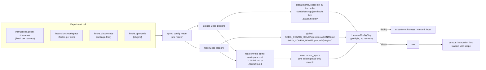
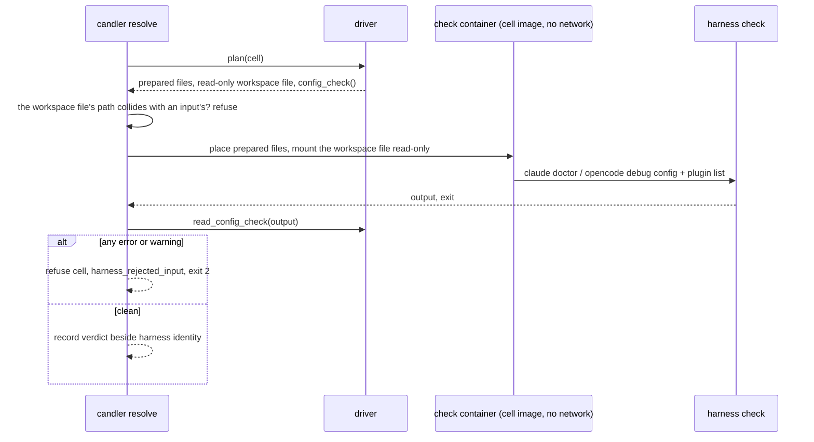
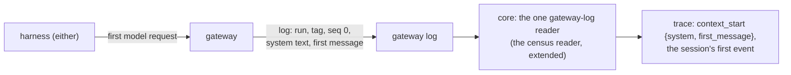

# Agent configuration as data — Architecture Analysis (v2)

M6.5 makes instruction files (`CLAUDE.md`, `AGENTS.md`) and hooks values of an experiment cell. Each driver installs them where its harness looks. Before the agents run, the harness's own check reports on what Candler installed, and any finding refuses the cell. The plan was approved on 2026-11-25. The roadmap is [`__roadmap__/m6_5-agent-config/`](../../__roadmap__/m6_5-agent-config/README.md).

**What changed since v1.** Eliott ruled on how the feature is proved:

- **Instructions.** A live run's trace must show the exact global and workspace texts in the agent's starting system prompt.
- **Hooks.** A hook sure to fire, at session start, must show in the same live trace.

Today's trace cannot show either, so v2 adds a harness-neutral trace event, `context_start`, recorded by the gateway from each run's first model request, a new L1 leaf that builds it, gates G11–G13, and a live RiVault confirmation run in L3. See §Live trace proof.

**What changed from v0 to v1.** Eliott ruled on two points the [consumer notice](00-notice_consumer_requirements_v0.md) raised:

- Instructions come in **two scopes**. A *global* file per harness is set for the whole experiment. A *workspace* file is set per arm and is installed at the workspace root on both harnesses, where it overrides or complements the global one. v0 had one value, installed at `.claude/CLAUDE.md` on Claude Code and at the global `AGENTS.md` on OpenCode.
- **Evaluator access is deferred.** The consumer writes the evaluator and already knows which instructions the box holds, so no evaluator needs to read them back. No gate is added; the item sits under Out of scope until a consumer brings a reason.

The sections below are v0 with all these rulings applied. §Execution model is unchanged except for the cap and the leaves that get an adversarial review.

## Executive Summary

| Question | Answer |
|---|---|
| Cause removed | Instruction files and hooks are not `AgentSetting`s. So no driver answers for them, no page says where they go, no digest covers them, and nothing refuses a cell whose harness drops them. |
| Shape | New cell values: `instructions.global.<harness>`, `instructions.workspace`, `hooks.claude-code` and `hooks.opencode`. All are inline, exactly like `mcp.servers`. |
| Two scopes | `instructions.global` is meant for `[fixed]`: one text per harness, shared by every arm. `instructions.workspace` is meant to be a factor: one text per arm, the same on both harnesses, installed as the workspace's root `CLAUDE.md` or `AGENTS.md`. |
| Translation | None. The workspace text goes verbatim to each harness's own file name. Each harness gets its own global text and its own hooks payload, installed verbatim. |
| Boundary | Candler guarantees the installation. The harness judges the content. |
| Harness check finds an error or a warning | Refused: `experiment.harness_rejected_input`. |
| Proof | From the trace, as a consumer reads it: a guard on the real harnesses against the scripted fake model, then a live confirmation run on RiVault. Both find the exact instruction texts and a session-start hook's marker in the trace's `context_start` event. |
| Cost | About $72. Cap $85. |

**Rulings**

| Choice | Ruling |
|---|---|
| A harness finding | Refuse errors and warnings alike. |
| Where file contents come from | Inline text in the cell. There is no file-reference mechanism. |
| Placement of the work | A new roadmap root, M6.5. Its high-level status is kept in macOS Reminders. |
| Instruction scopes (2026-11-25, after the notice) | A global file per harness for the experiment, and a workspace-root file per arm that overrides or complements it, on both harnesses. |
| Evaluator access (2026-11-25, after the notice) | Deferred. No evaluator has a reason to read the instructions back from the box. |
| Proof (2026-11-25, on the v1 plan) | Live, from the trace: both exact instruction texts in the starting system prompt, and a session-start hook's marker. |

**Reading of "inputs".** Eliott wrote that the global files belong in Candler's *inputs*. This plan reads that as "set once for the whole experiment", and makes `instructions.global` a cell value written in `[fixed]`, not an `inputs` entry. Three reasons: an `inputs` entry lands in the workspace and is collected, which is where the global file must not be; it is not part of `comparable.values`, so the digest and `inspect` would not cover it; and the inline ruling already covers file contents. Nothing refuses varying `instructions.global` as a factor, since a consumer may want that.

## Current State

Today, an `inputs` entry is the only way to put a file in front of the agent. It fails here in four ways:

1. It applies to the whole experiment, so every arm's agent sees every arm's files.
2. The file needs a different name for each harness.
3. A file at the workspace root is collected as an output, so it is graded as the agent's work, and the agent can edit it.
4. It cannot reach `.claude/settings.json`, which the Claude Code driver renders.

**Where each harness looks**

| Harness (pinned) | Instruction files it reads | Hooks it runs | Evidence |
|---|---|---|---|
| Claude Code 2.1.311 | Project: `<cwd>/CLAUDE.md` or `<cwd>/.claude/CLAUDE.md`, and `CLAUDE.md` in each parent directory. User: `~/.claude/CLAUDE.md`, which loads only with `user` among the setting sources; the driver passes `--setting-sources project,local`. | The `hooks` key of any settings file in scope. All matching hooks run, and their results merge. | Context7 `/websites/code_claude` |
| OpenCode V2 2.2.7 | `AGENTS.md` only, never `CLAUDE.md`: walking up from the cwd to `$HOME`, plus the global `<config>/AGENTS.md`. | JS/TS plugins (`Plugin.define`). Local ones in `<config>/plugins/` skip npm. | Context7 `/websites/opencode_ai/v2`; `config/plugin/instruction.ts:84-94` and `plugin/module.ts:109-110` at v2.2.7 |

**How each harness fails on bad input**

| Harness | A whole file is rejected | One entry is rejected | Its own check |
|---|---|---|---|
| Claude Code | A *Settings Error* (bad JSON, or a value the schema rejects): the file is not applied. | A *Settings Warning* (for example an unknown hook event): that entry is skipped and the rest applies. | `claude doctor`. Its exit code and whether it runs without a TTY are not documented, so the probe settles them. |
| OpenCode | A config document is dropped with a warning. A plugin is logged as failed and disabled. Startup continues. | Unknown config keys are ignored. | `opencode debug config` and `opencode plugin list`. `plugin check` covers package plugins only. |

**What the core already does for a workspace-root file.** `mount_inputs` (`crates/candler-core/src/runner/exec/mod.rs:146`) bind-mounts each input file read-only into the workspace and re-checks the whole mount list. The output tree builder lists no path under a read-only mount point, so such a file is never collected. `input_leak` (`crates/candler-core/src/runner/evidence/leak.rs:10`) seals a run only when an output's digest equals an input's. The workspace instruction file reuses this path, so it is neither collected nor editable.

## Proposed State

**Where each value lands**

| Value | Claude Code | OpenCode | Collected as output? |
|---|---|---|---|
| `instructions.global.<harness>` | `~/.claude/CLAUDE.md` in the run's home, with `user` added to the setting sources, if the probe shows that loads nothing else from that home; else the parent directory of the workspace, which Claude Code walks. | `$XDG_CONFIG_HOME/opencode/AGENTS.md` (global scope, in the home) | No. The home and the workspace's parent are not collected. |
| `instructions.workspace` | `<workspace>/CLAUDE.md` | `<workspace>/AGENTS.md` | No. It is a read-only mount, which the tree builder skips. |
| Hooks configuration | `hooks.settings` goes verbatim under the `hooks` key of `.claude/settings.json`. | none (OpenCode hooks are code) | No |
| Hook files | `.claude/hooks/<rel>`, mode 0755 | `$XDG_CONFIG_HOME/opencode/plugins/<name>` | No |

**How the workspace file reaches the root.** The driver does not write it into the workspace. Its plan lists it as a read-only workspace file: a name (`CLAUDE.md` or `AGENTS.md`) and its text. The core stores the text and mounts it through `mount_inputs`, beside the declared inputs, so one mount path and one re-check cover both. The plan field and the trait method that names the file are declared in L1; the drivers fill them in L2; the core mounts them in L2.

**Override or complement.** Both harnesses load the global file and the workspace file together. Which one the model reads as overriding is each harness's own rule: Claude Code ranks project memory over user memory, and OpenCode concatenates the files it finds. The probe records the order in which each harness puts the two texts in front of the model, and the capability page states it.

Candler's own observation hooks stay in the home `--settings` file. `InstructionsLoaded` is added to them, and that file is passed in headless mode too. Since only the `hooks` key is taken from the consumer, the consumer cannot switch the observers off.

## Key Flows

The check runs once for each distinct combination of harness, image and prepared files, not once per run.

## Live trace proof

**The gap.** The normalised trace has no place for the agent's starting context. Its event kinds (`crates/candler-schemas/src/trace.rs:901`, `KnownKind`) are `user_message`, `assistant_message`, `tool_call`, `tool_result`, `notification` and `usage`. Claude Code's stream-json does not carry the system prompt, and the gateway logs only the sequence number and the tool names of each request (`crates/candler-core/tests/it/guard_census_gateway.rs`). No trace today can show that an instruction reached the model.

**The event.** The gateway sees every request of every harness, so it is the neutral source, as it already is for OpenCode's census.

| Member | Holds |
|---|---|
| `system` | The system text of the run's first model request, verbatim. |
| `first_message` | The first message of that request, verbatim. Claude Code places some hook output there. |

- One event per session, from the first request only.
- The change is additive to the trace schema, so it is a minor wire bump, and a trace written before it still reads.
- One reader of the gateway log serves both the census and this event. A second reader is debt.

**What the proof reads.**

| Proof | Read from the trace | Arms |
|---|---|---|
| Instructions | `context_start.system` contains the global text and the arm's workspace text verbatim, and never the other arm's workspace text. | two arms, workspace text A or B |
| Hooks | A session-start hook prints a fixed marker. The marker is in `context_start`, in the system text or the first message, as the harness places it. | every arm |

On Claude Code the hook is `SessionStart`. On OpenCode it is a plugin hook that adds to the system text, or the nearest session-start hook. The probe's question (g) settles which hook fires in a headless run and where its output lands. If a harness has none whose output reaches the first request, the plan returns to Eliott before L2.

**Twice.** The guard `guard_agent_config_e2e` reads the stored trace against the fake model, so the proof is deterministic. Then one live `candler run` on RiVault, on both harnesses with two arms and one replicate each, reads the same members from its stored traces. Reasoning-Small is enough because the run tests reachability, not scores. A findings report quotes the excerpts.

## Contracts & Invariants

**Surface**

| Path | Type | Refusal on misuse |
|---|---|---|
| `instructions.global` | a table keyed by harness id; each value a string | `experiment.cell_value_invalid` (unknown harness key); `experiment.cell_value_missing` (no key for the cell's harness) |
| `instructions.workspace` | string | `experiment.document_invalid` (wrong type) |
| `hooks.<harness>` | an envelope with `deny_unknown_fields`; contents free | `experiment.cell_value_invalid` (unknown harness key); `experiment.cell_value_missing` (no key for the cell's harness) |
| `hooks.claude-code.settings` | object, verbatim | judged by the harness only |
| `hooks.claude-code.files` | map from a relative path to text | `format.rel_path_invalid` |
| `hooks.opencode.plugins` | map from a file name to text | `format.rel_path_invalid` |

**Declaration**

- Two new settings, `AgentSetting::Instructions(scope)` with the scopes global and workspace, and `AgentSetting::Hooks`. Both drivers answer each.
- A new `DriverFact::ConfigCheck`.
- New trait methods:
  - `config_check(&Plan) -> Option<CommandSpec>`
  - `read_config_check(output) -> CheckVerdict`
  - the name of the workspace instruction file (`CLAUDE.md` or `AGENTS.md`)
- A `Plan` field for read-only workspace files, which the core mounts.

**Error model**

| When | Code | Side to fix |
|---|---|---|
| The cell has a `hooks` or `instructions.global` table but no entry for its own harness | `experiment.cell_value_missing` | experiment |
| `instructions.workspace` is set and a declared input also mounts a file at the workspace instruction file's path | `experiment.instructions_collide` (new), at `/fixed/instructions.workspace` or the factor's path, naming the input. The file is refused, never shadowed. | experiment |
| The harness's own check reports an error or a warning | `experiment.harness_rejected_input` (new). Message: "Candler installed X at Y; H rejects it: «output»" | experiment |

**Invariants**

1. Every value is in the cell, so the cell digest, factor levels and `inspect` cover it.
2. One reader, `candler_harness::agent_config`, serves every consumer of these values.
3. No installed file appears among a run's collected outputs. The workspace file is a read-only mount, and every other file lives under `.claude/` or the home.
4. The agent cannot change either instruction file.
5. A cell is never run with part of its declared configuration dropped or shadowed. Candler refuses the cell instead.
6. Candler's observation hooks cannot be disabled by the consumer's payload.
7. Every run's census names the instruction files the harness loaded, with their scope. That includes a fixture's own file when no workspace text is set.
8. Every session's trace begins with `context_start`, holding the first request's system text and first message as the gateway saw them.

## Alternatives Considered

| Decision | Options | Chosen | Tradeoff accepted |
|---|---|---|---|
| Hooks payload | Shared and translated, or verbatim per harness | Verbatim per harness | An arm on two harnesses needs two payloads. Translation is impossible in general anyway: JSON plus shell on one side, JS modules on the other. |
| Where file contents come from | Inline text, file references, or `inputs` | Inline text | Long files are pasted or generated into the TOML. The alternative was a new "file value" mechanism, about $6 and one more leaf. `inputs` reach every arm. |
| A harness finding | Refuse both, refuse errors and warn on warnings, or warn only | Refuse both | A harmless deprecation notice also refuses. In exchange, an arm never runs silently without part of its hooks. |
| Instruction scopes | One value (v0), or a global value per harness plus a workspace value per arm | Two scopes (Eliott) | Two values to learn. In exchange, the shared part is written once, and each arm's part sits where both harnesses read a project file. |
| Global file as an `inputs` entry or a cell value | `inputs`, or `instructions.global` in `[fixed]` | Cell value | It is not written in the `inputs` array. In exchange, the digest covers it and it never lands in the workspace. |
| Workspace file written or mounted | Written by the driver into the workspace, or mounted read-only by the core | Mounted | The core gains a source of mounts besides inputs. In exchange, the file is not collected, not graded, not editable, and a collision is found by the existing re-check. |
| Where the proof reads | The fake model's records, the census, or the trace | The trace (Eliott) | A new trace event and a gateway change. In exchange, the proof reads what a consumer reads. |
| Source of the starting context | Each harness's own stream, or the gateway | The gateway | The gateway log grows by one request's text per run. In exchange, both harnesses give the same event, and Claude Code's stream does not carry the system prompt anyway. |
| Proof run | The fake model, a live RiVault run, or both | Both | One live run of about $3. In exchange, the guard stays deterministic and the live run confirms it on a real model. |

## Risks & Mitigations

| Risk | Mitigation |
|---|---|
| `claude doctor` needs a TTY or network, or says nothing about hooks. | The level-1 probe settles it. If no check is reliable, `ConfigCheck` is `no (…)`, the page says so, and the census is the proof. |
| Adding `user` to Claude Code's setting sources also loads user settings from the run's home. | The probe checks what `user` loads. If anything beyond `~/.claude/CLAUDE.md` loads, the global file goes to the workspace's parent directory instead, and the page states that scope. |
| A single-file read-only bind mount at the workspace root is not read by a harness. | The probe mounts one on each harness. If one does not read it, the plan returns for a ruling before L2. |
| OpenCode's `<config>` does not follow `XDG_CONFIG_HOME`. | The probe checks it. If it fails, install at the path OpenCode does read and state it. |
| `InstructionsLoaded` does not fire under `--print`. | The probe checks it. The fallback for the census is `context_start.system`: the text reached the model. |
| Passing `--settings` in headless mode changes behaviour. | The file holds only observe-only hooks. The guards compare headless runs before and after. |
| A consumer hook approves permission prompts and changes what `permission_mode` means. | This is the consumer's choice, stated on the experiment-file page. |
| An agent copies the workspace file into its outputs, and the run is sealed `input_leak`. | The same holds for any input today. The guard's agent does not copy it, and G9 checks no run is sealed. |
| The system text is tens of kilobytes, and the gateway's log line becomes large. | Only the first request of a run is recorded. `trace_context` measures the line on both harnesses and states the size on the trace page. |
| No session-start hook on a harness reaches the first request. | The probe's question (g) settles it before L2, and the plan returns to Eliott if so. |
| A fixture's own root `CLAUDE.md` or `AGENTS.md`. | With `instructions.workspace` set, a declared input at that path is refused (`experiment.instructions_collide`). Without it, the fixture's file stays and the census reports it. |

## Roadmap Recommendation

A new root, [`__roadmap__/m6_5-agent-config/`](../../__roadmap__/m6_5-agent-config/README.md). The tool refuses a `.` in a node name, so the directory is `m6_5`. Depth sets the order, and siblings run in parallel.

| Level | Leaves | Owns |
|---|---|---|
| L1 | `probe_harness_checks`, `declaration`, `trace_context` | `trace_context`: the gateway records the first request, and the trace gains `context_start`. The others: which harness checks are reliable, which session-start hook reaches the first request, where Claude Code's global file loads, and whether a read-only root mount is read. The P8 entries, schema, one reader, refusals, inspect, pages and the read-only workspace file in `Plan`, with the answers still Refused. |
| L2 | `install_claude_code`, `install_opencode`, `preflight_check` | Installation and census in each driver, with answers flipped to Mapped. In core: `HarnessConfigStep`, the new refusals, and the workspace file's mount through `mount_inputs`. |
| L3 | `e2e_guard` | Both end-to-end guards on the real harnesses and the fake model, reading the trace; then the live RiVault run. |
| L4 | `adversarial_review` | A read-only review of the merged milestone and the closing report. |

**Gates.** Each is an observation shown failing on the base (`8d82f63b`), copied into the leaf that owns it.

| # | Observation after | On the base | Leaf |
|---|---|---|---|
| G1 | `candler resolve` of `[fixed] instructions.workspace = "…"` succeeds, and `inspect` shows an `instructions` member. | exit 2 `experiment.unknown_path` at `/fixed/instructions.workspace` | declaration |
| G2 | Two levels of `instructions.workspace` give two cells with different digests; so do two levels of `hooks.claude-code.settings`. | `unknown_path` | declaration |
| G3 | `harness-capabilities.md` has the rows *instructions: global*, *instructions: workspace*, *hooks* and *config check*, mapped on both harnesses. | no such rows | declaration, then both install leaves |
| G4 | From the trace: on each harness, the run's `context_start.system` holds the global text and the arm's workspace text verbatim, and never the other arm's workspace text. | `unknown_path` | e2e_guard (fake model, then live) |
| G5 | e2e: the scripted tool call is answered with an error carrying the hook's marker. On Claude Code a PreToolUse script exits 2; on OpenCode a plugin throws in `execute.before`. | the call succeeds; no hook | e2e_guard |
| G6 | An invalid payload (a Claude Code hooks entry with an unknown event; an OpenCode plugin with no default export) is refused at `resolve` with `experiment.harness_rejected_input`, quoting the harness's output. The valid payload passes. | `unknown_path` | preflight_check (fake driver), e2e_guard (real images) |
| G7 | Each run's census lists both installed instruction files with their scope, on each harness. | no field | both install leaves, e2e_guard |
| G8 | `hooks.claude-code` on an OpenCode cell with no `hooks.opencode` is `experiment.cell_value_missing` at `/fixed/hooks`; likewise `instructions.global` with no key for the cell's harness, at `/fixed/instructions.global`. | `unknown_path` | declaration |
| G9 | The workspace instruction file is not among a run's collected outputs, an agent's write to it fails, and no run is sealed `input_leak`. | not reachable | preflight_check, e2e_guard |
| G10 | With `instructions.workspace` set, an input declared at the workspace instruction file's path is refused at `resolve` with `experiment.instructions_collide`, naming the input. | `unknown_path` | preflight_check |
| G11 | From the trace: on each harness, the session-start hook's marker is in `context_start`. | `unknown_path` | e2e_guard (fake model, then live) |
| G12 | Every session of a run on either harness begins with a `context_start` event whose `system` equals the system text the gateway saw. A trace written before the change still reads. | no such event | trace_context |
| G13 | Live on RiVault: one experiment on both harnesses, two arms, one replicate each, shows G4 and G11 in its stored traces, and `04-findings_live_confirmation_v0.md` quotes the excerpts. | no such event | e2e_guard |

**Out of scope:**

- file references;
- instruction scopes beyond global and workspace, such as files in subdirectories;
- npm plugins;
- other settings keys and other `.claude/` content;
- a trace event for every hook run (the session-start marker in `context_start` is the hook proof);
- the context of later requests (only the first request is recorded);
- removing a fixture's own instruction file when no workspace text is set (the census reports it);
- evaluator access to the instruction and hook values. Deferred until a consumer brings a reason: the consumer who writes the evaluator already knows the values. Today an evaluator that names one of these paths among its metadata needs receives it, like any cell value;
- M7 and M8. M8's plugin may later use hooks.

## Execution model

The roadmap's leaves refer to this section. A copy of it goes into every brief.

**Roles**

- A coordinator dispatches the work and merges it.
- It writes no product code and never verifies its own dispatches.
- Every implementer, verifier and reviewer is a Sonnet subagent.

**Verification, scaled to risk**

- Every leaf gets a `spec-verifier` pass.
- `preflight_check`, `install_claude_code` and `trace_context` also get an adversarial review before they merge.
- A seam review of the whole diff so far follows the close of L1 and of L2 ([leaf template](../../__roadmap__/leaf_template.md), convention 4).
- L4 is the final review.

**Shared codebase, owned debt**

Every brief opens with the same statement:

- The codebase is shared with every agent and person who builds on it after this leaf.
- The implementer owns what the leaf leaves behind.
- A miss, a misuse, an accretion, a helper left behind, or tooling refactored without the old one cleaned up is debt that someone downstream has to handle. It breaks sustainability and scalability directly.

So each leaf:

- reuses the existing reader, renderer or step;
- removes, in the same leaf, whatever it made obsolete;
- leaves no scaffolding, debug helper or one-off script.

The verifier checks these three points as gates.

**Reviews stay in scope**

- A finding is fixed in the leaf only if it concerns the leaf's own pieces, its gates or the code it touched.
- A finding that is unrelated, or too expensive to fix here, is filed under `__reports__/agent_config/` as an observation or a notice. The coordinator escalates it to the top coordination session, so the milestones can be re-planned around it.
- A leaf gets at most two rounds of implementing and verifying. If it would need a third, it stops and is escalated.

**Git**

- The integration branch is `feat/m6.5-agent-config`, cut from `origin/main` at `8d82f63b`.
- Each leaf branch is rebased on the integration branch, then merged with `--no-ff`.
- Commit messages go through `git commit -F`.
- No history is rewritten.
- Nothing is pushed and no PR is opened without Eliott. The PR to `main` waits for a green `container-e2e` (leaf template, convention 5).

**Machine**

- Builds use the slots `/Users/hacker/Documents/tmp/m6_5-target/slot-1..3`.
- At most 3 builds run at once, and a slot is never used by two worktrees at the same time.
- A leaf removes its slot when it merges.
- A leaf deletes the containers and images it starts.
- Nobody stops or prunes Docker.

**Spend**

- Spend is measured from host transcripts with `__reports__/agent-token-costs/scripts/spend.py`, per leaf and for the coordinator.
- The milestone cap is $85 (raised from $75 in v2 for the trace leaf and the live run). At the cap, work stops and a report is written.

**Status**

- The high-level status lives in macOS Reminders, managed with the `scheduling-work` skill.
- There is one reminder for M6.5 and one for each level.
- Each reminder is updated when its level closes.
