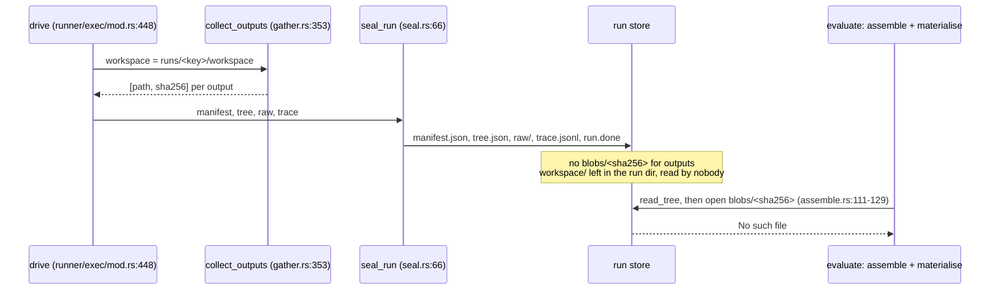
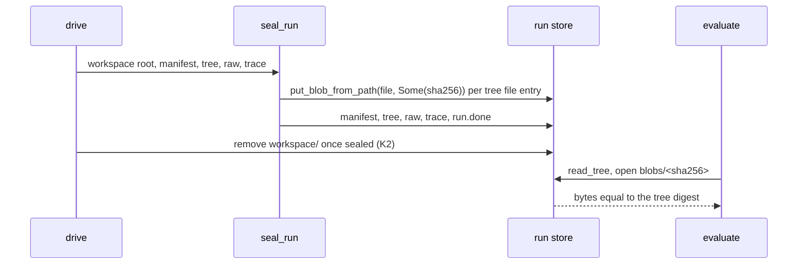
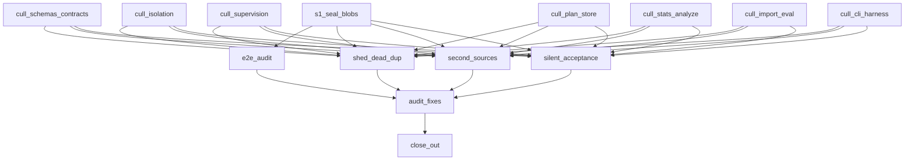

# Diet: architecture plan (v0)

Date: 2026-11-24. Tip: `1002cb82` (M6b, PR #56). Branch: `feat/diet`.

## Executive Summary
- **Problem.** Nobody can say which parts of Candler work from end to end and which only pass their own tests. The suite has grown from 269 to 836 tests, and test code is now as large as product code (about 80k lines against 81k). One defect shows how leaf-scoped tests miss things. S1: a native run seals the digests of its output files but not their bytes, so `evaluate` cannot grade any run that writes a file. Every test that evaluates a native run uses a fake Docker in which no agent ever writes a file.
- **Proposed change.** Five moves in four levels:
  1. Fix S1 at the seal, and add the one guard that would have caught it.
  2. Cut the suite down to guards written at the consumer's interfaces: about 753 test functions under `tests/` become about 440.
  3. Remove the dead paths and duplicated machinery for which we have evidence, plus the M6b follow-ups that remove a second source of a fact or a silent acceptance.
  4. Audit every README claim with real RiVault runs, and have an agent read the stored bytes.
  5. Close with the README yardstick restored.
- **Non-goals.**
  - New features.
  - The MCP server (M7). The audit records it as not built.
  - S2, which is on hold.
  - Judging the refusal codes again: M6b's codes review stands.
  - Statistics method changes.
- **Biggest risks.**
  - A cull deletes the only test of a behaviour.
  - Parallel culls collide on `tests/it/main.rs`.
  - Removing `workspace/` hides a reader nobody found.
  - Implementer call caps overrun 1.5 to 3 times, as they did in M6b.
- **Validation.** Every level runs fmt, clippy, nextest and doc. DIGEST and GOLDEN stay unchanged. Every merged or rewritten guard is seen red once. The RiVault audit gives a verdict on each README claim from bytes an agent has read.
- **Expected net change.**

  | Measure | Change |
  |:--|:--|
  | nextest | 836 → about 525 (±40) |
  | Test lines | −25k to −33k |
  | Product lines | −250 to −450 net |

  Product code barely shrinks. The weight is in the tests, and the integrity gain is S1 plus the refusals that replace silent acceptance.

## The yardstick
The README's purpose paragraph is the yardstick, quoted as written (founding commit `254ff4a0`, unchanged until 2026-11-24):

> A domain-agnostic core for evaluating LLM-based agents. Candler has two equal halves behind one operation API:
> - **Execution:** run agents under controlled conditions (experiment matrix, runners, isolation, per-run tool-catalog snapshots, provenance).
> - **Evaluation:** grade traces and artifacts, fresh or already on disk, through pluggable evaluators that emit one outcome record format.
>
> A library, a lean CLI and an MCP server are thin surfaces over that API. Domain science (for example the HTN-creator evaluation) plugs in as evaluators, suite specs, fixtures and catalog providers. The core names no domain.

**Finding.** `db5a0fae` ("rewrite the readme as the project's store window", 2026-11-24, part of the M6b docs work) removed this paragraph from `README.md`. The new opening keeps the matrix, isolation, provenance, plug-in grading and statistics. It drops "one operation API", "thin surfaces", "fresh or already on disk" and "per-run tool-catalog snapshots". Decision **K3** below proposes restoring the paragraph as written.

## Current state: where S1 lives

Evidence:
- `put_blob` and `put_blob_from_path` have exactly two non-test callers: `import/assets.rs:56 put_sources` and `experiment/inputs.rs:321 store_input`.
- `seal_run_observed` (`seal.rs:83-113`) writes the manifest, tree, raw streams, trace and `run.done`, and nothing else.
- `evaluate` reads output bytes only through `evaluation/context/assemble.rs:92-171` and `materialise.rs:161-216`, both from `blobs/`.
- Nothing reads `runs/<key>/workspace/` after the seal. `StoreLayout` has no accessor for it.
- The session runner goes through the same `drive`, so it has the same gap.

**Why every test passed.** Three test setups each miss the defect:
- The CLI tests' fake Docker (`crates/candler/tests/it/support/cli_run.rs:11-160`) sleeps on `start -a` and writes nothing. So the sealed tree in `guard_input_seam.rs` and in `guard_cli_evaluate.rs sealed_world` has no output entry, and `assemble` never opens a blob.
- The evaluation guards evaluate imported runs, whose blobs `put_sources` stored.
- `guard_run_context.rs seal_synthetic` stores the blobs by hand.

The real-Docker tests (`container_run_e2e`, `guard_cli_e2e`, `i8_e2e`) never evaluate.

## Proposed state

## Contracts & Invariants
| Contract | After the diet |
|:--|:--|
| Seal | A sealed native or session run holds `blobs/<sha256>` for every file entry of its `tree.json`. Blobs are written before the manifest, so a run with `run.done` never refers to a missing blob. A halt leaves only content-addressed blobs, which are not records (I11 holds). |
| Blob verification | Each blob is stored with its expected digest: the `put_blob_from_path(path, Some(&sha256))` form that exists today. A file that changed after collection fails the seal. No second verification layer. |
| Store layout (R01 store-layout row, `architecture.md:1107`) | Under container isolation, `workspace/` is not kept after the seal (K2). `home/` stays until a reader check in `s1_seal_blobs` says otherwise. |
| Digests | No cell, context, run or golden digest moves. `tree.json` already carries each sha256, and the manifest is unchanged. |
| Suite | A test under `tests/` is a guard at one of six consumer interfaces (next section). Structure tests and covered confirms are deleted. Every deletion names the guard that covers it, or says "structure". |
| Refusals | Silent acceptance becomes a refusal at the one owner of the check. `codes.toml` only grows (rows appended; a retired row keeps its line). |
| Error model | S1 failures surface as the seal's existing `StoreError` (the run stays unsealed and resumable). A new refusal is a `refusal/1` with its code and pointer. |

## How we establish what really works: the RiVault audit
A green suite proves that the tests agree with the code. The audit asks the README instead. One agent drives `candler` from the merged L0 tip against cheap RiVault models (`using-rivault` skill; Reasoning-Small is fine for reachability), reads the stored bytes, and writes a verdict per claim. Every run is one that a claim needs: 8 cells and 2 resume runs, at near-zero token cost.

| README claim | What the audit runs | What the agent reads and checks | Works means |
|:--|:--|:--|:--|
| Experiment matrix | One file, models × treatment (2 × 2), 2 replicates, OpenCode harness through the gateway (shape of `__reports__/m4-session-runner/live/opencode.toml`) | `resolve` record vs the file; one manifest per cell; cell digests distinct per level, equal per replicate | 8 sealed runs whose values match the file and their sources |
| Runners | The same job, plus one `kill` mid-job then `run` again | `ps` and `watch` records; the resumed job runs only the missing cells; attempt numbers | Resume loses nothing and repeats nothing |
| Isolation | The 13 container e2e guards once on the real daemon; the i8 canary in the audit's own suite | e2e result; the canary absent from the agent's trace and workspace bytes | All pass; canary in no agent-visible byte |
| Per-run tool-catalog snapshots | One stdio MCP server declared in the experiment | The run's catalog snapshot vs the server's real tool list; `census.*` in the manifest | Snapshot equals what the agent was offered |
| Provenance | `analyze` over the store; one pair made non-comparable on purpose (a second experiment digest) | `comparability_class`, the refused pair and its cause | Only one-factor pairs compared; the refusal names the cause |
| Evaluation, fresh | The task makes the agent write a file; `evaluate` with a plug-in whose suite needs `artifacts` | The blob bytes vs what the model wrote (trace); the outcome records | Each outcome is computed from the stored bytes (S1 closed) |
| Evaluation, on disk | `ingest` of the mini legacy corpus, then `evaluate` | The outcome rows vs the corpus oracle | Rows equal the oracle |
| Pluggable evaluators, one record format | Two evaluators (the Python helper example and a second fixture) on the same runs | Both record sets validate against `outcome-record` and are read by `show --rates` | One format, two producers |
| One operation API; library and lean CLI as thin surfaces | Read, not run: each `commands/*.rs` calls one `candler-core` operation and renders its record | Any command that builds its own shape (known: `resolve.rs:200 print_failures`) | Every verb is a renderer of a core record |
| MCP server | Not built (M7) | n/a | Recorded as not built |
| Domain plugs in; core names no domain | Rewritten `guard_layering_i1` rows (a renamed domain imports and grades); a colgrep scan for `htn`/`hddl` in `crates/*/src` (today: only camel-case false hits in `outcome.rs`) | Both | No domain name in core; a renamed domain works |

The audit writes `__reports__/diet/01-findings_e2e_audit_v0.md`: one row per claim with works, broken or not built, and the evidence paths. A broken claim goes to `audit_fixes` (L2) if one capped piece can fix it, and to Next otherwise.

## How the suite becomes the critical set
A guard observes one of six consumer interfaces:
1. The `candler` CLI: records, exit codes and `refusal/1`.
2. The `candler-core` operation API.
3. The wire formats and stored artifacts.
4. Digests and golden vectors.
5. The harness and evaluator plug-in contract.
6. The isolation promise as seen from outside, through Docker e2e.

A Sonnet sweep classified every test file under `tests/` from its header and test docs, with targeted reads. The verdicts below are its output, checked against the rule by the coordinator. Each piece re-checks before it deletes.

| Family | Files | Tests now | Kept | Why the rest go |
|:--|--:|--:|--:|:--|
| Schemas, contracts, codes | 23 | 139 | 77 | Schema-vs-reader pins, name grammars and "two shapes" are confirms of a refactor |
| Container isolation | 30 | 100 | 61 | The e2e rows hold the promise; the argv and config renderers are structure |
| Supervision, session, jobs | 14 | 82 | 37 | The observable promise is "no process left, no secret on disk"; handle and event rows are internal |
| Plan, resolve, run store | 12 | 83 | 59 | Mostly guards; the treatment-level (t3) rows are repeated three or four times |
| Stats, analyze | 13 | 106 | 67 | The scipy and statsmodels vectors are independent; the op-API and CLI repeat the same hand counts |
| Import, evaluation | 17 | 100 | 60 | `legacy_mapping` repeats `import_mini`; four oracle self-tests test the test helper |
| CLI surface, harness drivers | 20 | 140 | 81 | Help stamps, embedded-asset pins, argv baseline pins and fixture hashes are structure |
| **Total under `tests/`** | 129 | **753** | **≈ 442** | |

**Files that go whole (22).** These are structure tests, helper self-tests, or rows another guard already holds:
- `guard_assert_clean`, `guard_platform_seam`;
- `guard_layering_i22`, which scans the source for destroy verbs. `guard_container_guard` b10 and `container_stop_e2e` hold the promise;
- `guard_wiring` with `support/wiring.rs`, `guard_job_spec_file`, `guard_spec_file`;
- `guard_oracle_mini`, `guard_oracle_aggregates`, `guard_oracle_ac`;
- `guard_egress_proxy`, except two render rows that move into `guard_egress_setting`;
- `control_e2e`, `egress_proxy_e2e`;
- `guard_two_shapes`, `guard_mcp_names`, `guard_cell_reading`, `guard_unsupported_setting`, `guard_fixture_provenance`;
- `guard_name_grammars`, `guard_field_path_walk`, `guard_event_kinds`, `guard_import_origin`;
- `guard_ground_truth_cli`.

**Files merged into their family's guard (10), with the tests that survive:**

| From | Into | Tests kept |
|:--|:--|--:|
| `create_e2e` | `container_run_e2e` | 1 |
| `guard_legacy_mapping` | `guard_import_mini` | 4 |
| `guard_package_names` | `guard_import_mini` | 1 |
| `guard_proc_stat` | `guard_signal` | 2 |
| `guard_refusal_codes` | schemas `guard_refusal` | 2 |
| `guard_selection` | `guard_analysis_report` | 1 |
| `guard_tree_walk` | `guard_build_context` | 2 |
| `guard_unstarted_destroy` | `guard_container_record` | 1 |
| `guard_wire_shapes` | `guard_execution_wire` | 3 |
| `guard_cli_diff_refusal` | `guard_cli_refusal` | 1 |

**Rewritten at the consumer's interface (1).** `guard_layering_i1` scans the source to show that the core names no domain. That is the README's fourth claim, tested as structure. It becomes two rows in `guard_import_mini`: a corpus whose domain is renamed imports and grades to the same rows.

**Rows culled inside kept files.** These are the duplicate clusters the sweep found:
- the treatment-level rows across `guard_run_plan`, `guard_job_orchestrate`, `guard_cli_run` and `guard_settings_out_of_cell`;
- the analyze counts in `guard_analyze`, against `guard_analysis_report` and `guard_stats`;
- secrets-never-on-disk, held in five places;
- I8, held in five places;
- refusal codes, held in five places;
- destroy discipline (I22), held in seven places.

Each cluster keeps one guard per interface it crosses: typically one at the op API and one at the CLI.

The 121 `#[test]` functions inside `src/` are not swept. A piece judges them only in the modules it already touches.

**Why about 525 and not another number.** It is what remains when each behaviour keeps one guard per interface it crosses. The per-family kept counts come from that rule, not from a target. A piece that finds a cull has no covering guard keeps the test and says so.

**Critical behaviour set.** These 15 are the guards to run first when someone asks whether Candler works. R01 §Testing records them by name; no new nextest profile.
1. `i8_canary_never_reaches_the_agent`.
2. `gateway_e2e` b17 and b37.
3. `egress_allowlist_holds_on_a_real_daemon`.
4. `evaluator_only_input_never_reaches_the_agent`.
5. The new S1 guard.
6. `guard_cli_evaluate` e4.
7. `guard_golden_parity`.
8. `guard_cell_digest digests_equal_the_oracle` with `guard_context_digest`.
9. `guard_cli_refusal` r2.
10. `guard_cli_surface` u1 with `every_data_verb_prints_its_record`.
11. `guard_known_truth` H0 and power.
12. `guard_stats` t1 (Wilson, Fisher).
13. `guard_run_plan` b26 (resume).
14. `guard_job_runtime` b32 and b33.
15. `guard_ingest` i1 and i4.

## What the codebase sheds
| Item | Evidence | Lines | Piece |
|:--|:--|--:|:--|
| `PlanOutcome::summary` and `PlanSummary` | `runner/plan.rs:1071-1133`; only caller is `guard_run_plan.rs:1206-1277` (M6b: no CLI caller after C1 was withdrawn) | ≈ −62 src, −72 test | `shed_dead_dup` |
| Tree walkers beside `tree.rs Walk` | `experiment/inputs.rs:229-286`, `import/raw.rs:314-360`, `import/read.rs:400-433` and `469-483`, `resolve/steps/ground_truth.rs:199-217` each walk again with `read_dir`; `ground_truth` builds the same path→digest map as `tree`. `commands/ls.rs:95` stays (it walks only `*.toml`) | −120 to −200 | `shed_dead_dup` |
| A second sha256→`Digest` | `jobs/runtime/session.rs:93 digest_of` repeats `Digest::of_bytes`; `import/read.rs:220` is a pass-through wrapper | −20 to −30 | `shed_dead_dup` |
| Twin `docker_failed` mappers | `isolation/image.rs:778`, `isolation/container/guard.rs:667` | ≈ −10 | `shed_dead_dup` |
| Codes no variant constructs | M6b codes review V4: eight rows with zero construction sites, unproven. A one-off `catalog()` probe, run once, then deleted; a proven row gets `retired`/`lifted`, never deletion | 0 (rows stay) | `shed_dead_dup` |
| Hand-built failure shape of `resolve` | `commands/resolve.rs:200-219 print_failures` builds `json!` with no record (M6b follow-up) | ≈ 0 net | `second_sources` |
| `watch --live` duplicates `--format text` | `commands/watch.rs:24-35, 81-87` | ≈ −20 | `second_sources` |
| Key names spelled again as literals | value readers, the `slots` check, `layers.rs:371 is_location`, five private path texts in `resolve/paths.rs`; `status`/`usage_failure` typed 0/1/2 (`main.rs:122`) | ≈ −30 | `second_sources` |
| `HOME` literal in `probe_env` | `isolation/image.rs:936-943` | ≈ 0 | `second_sources` |
| "stratum" in the comparability sense | `crates/candler/build.rs:66`, R01 outside §Analysis statistics | 0 | `second_sources` |
| Degraded transcript line | `trace/transcript.rs:20-52` folds a serialisation failure into an empty `kind`: a defensive check against our own types | ≈ −5 | `second_sources` |
| Silent acceptance | `ResolveInput::secret_names` defaults to empty (`layers.rs:116-166`); an `env` name equal to `model.token_secret` is not refused; `[fixed] replicates` silently wins and `replicates.x` is a no-op (`runner/plan.rs:354-369`); a non-string server `command`/`args` is skipped (`jobs/orchestrate/servers.rs:36-69`) | +40 to +70 | `silent_acceptance` |
| S1 | above | +30 to +50 | `s1_seal_blobs` |

**What M6b added, judged.** Most of its +3,300 lines are records and generated pages. Those consolidate: one record per verb, rendered as text. The two additions that only add are the server start check, which starts one container per declared stdio server before every job, and the knowledge pages. The audit measures the server check's wall time on a small job. Anything that serves no README claim goes to Next with its numbers, not to a cut tonight.

## M6b's open question, answered
Its knowledge transfer asked whether the diet takes every "diet" row. **No.** The diet takes the rows that remove a second source of a fact (`second_sources`) and the rows where input is silently accepted (`silent_acceptance`). It rejects rows that only ask for one more test, because the suite is shrinking. It moves type refinements and performance to Next.

| M6b follow-up | Disposition |
|:--|:--|
| hand-built shapes of `evaluate`/`resolve`; `watch --live`; literal keys, paths, 0/1/2; `HOME` literal; "stratum"; `text_line` | `second_sources` |
| `secret_names` default; `env` = `token_secret`; `[fixed] replicates`, `replicates.x`, `NotPositive` for a non-integer; non-string server `command`/`args` | `silent_acceptance` |
| the `late.sh` timing flake | `cull_import_eval` (widen the window or use a clock the test controls) |
| guard that the gateway gets no `env`; CLI test of `inspect --transcript`; text-content test; a test row per variant | nobody: each adds a test the diet does not need |
| record fields as primitive types; `Summary` omits refused comparisons; serial server probes; `sh` assumed in the image | Next |

## Alternatives Considered
| Decision | Options | Chosen, and why | Tradeoff accepted |
|:--|:--|:--|:--|
| Where S1 is fixed | (a) the seal stores blobs; (b) `evaluate` reads `workspace/`; (c) a post-seal "publish" step | (a): one owner, the seal. Blobs are the store's single source (copy-equal per I17, append-only per I11). (b) makes `workspace/` a second source that a `cp -R` of the store must carry with it. (c) adds a step that can be skipped | `SealStep` gains a step, so the B30 layout guard changes, with the reason stated |
| `workspace/` after the seal | keep / remove | Remove (K2): no reader exists, and once the bytes are blobs it holds them twice and keeps venvs | Debugging a run reads `blobs/` through `tree.json`, not a directory |
| The guard for S1 | real Docker e2e / CLI with the fake Docker made to write | The fake Docker writes a file into the bind-mounted workspace on `start -a`; then `candler run`, delete `workspace/`, `candler evaluate`. It runs in the default suite with no daemon | Real-container coverage comes from the audit, once |
| Suite reduction | per-file judgement / a target count / coverage tooling | Per-file judgement against the six interfaces, with a named covering guard for each deletion | Slower than a target; avoids deleting the only test of a behaviour |
| Codes | merge families / keep M6b's verdict | Keep M6b's verdict (no merge), and only retire rows that the probe proves unemitted | 263 caller codes stay |
| Audit timing | before the diet / after S1 | After L0 (S1 merged), beside L1: it then tests the fix and still leaves L2 to repair what it finds | No pre-diet baseline beyond what S1 already shows |

## Risks & Mitigations
| Risk | Mitigation |
|:--|:--|
| A cull removes the only test of a behaviour | Each deletion names its covering guard in the commit body. Each merged or rewritten guard is seen red once by a mutation, which is then reverted. The verifier attacks "a promise now held by no test" |
| Parallel culls collide on `tests/it/main.rs` and shared `support/` | Each piece owns a set of files (in its leaf). `main.rs` mod lines: the second to merge rebases. `support/cli_run.rs` belongs to `s1_seal_blobs` only |
| A hidden reader of `workspace/` | `s1_seal_blobs` step 1 checks with colgrep (`run_dir(`, `"workspace"`) and stops if a reader exists. K2 can fall back to "keep" |
| Caps overrun (M6b: 1.5 to 3 times) | Every file a leaf names comes from a colgrep hit taken tonight. Caps are written as stop actions. Each piece has a fresh verifier and a fresh agent per fix round |
| Disk: `scripts/worktree.py` refuses a shared target dir, so each worktree builds the workspace on its own | At most 3 pieces build at once. `df -h /System/Volumes/Data` before each wave. Remove the worktree and its `target/` at each merge |
| The audit cannot reach RiVault (VPN down) | The audit stops after its first probe and reports. L1's code pieces do not depend on it |

## The build

The roadmap is `__roadmap__/diet/`. Each leaf holds its owned files, steps and gates.

| Level | Piece | Touches | Done means |
|:--|:--|:--|:--|
| L0 | `s1_seal_blobs` (Opus) | `runner/exec/{seal,mod}.rs`, `store/`; `candler/tests/it/{support/cli_run.rs,guard_input_seam.rs}`; `core/tests/it/{guard_run_exec,guard_run_context}.rs`; R01 store-layout row | The S1 guard is red on the tip and green after the fix. B30 is updated with its reason. `workspace/` is removed (K2). No digest moves |
| L0 | `cull_schemas_contracts` | `candler-schemas/tests/*`, `core/tests/it/guard_refusal_codes.rs`, `candler/tests/it/contract_pages.rs` | The family's verdicts are applied. Each deletion cites its guard. Merged guards are seen red |
| L0 | `cull_isolation` | `core/tests/it/{guard_container_*,guard_egress_*,guard_image,guard_declared_inputs,guard_layering_i22,guard_unstarted_destroy,guard_census_gateway,guard_server_check,guard_ground_truth_refusal}.rs`, `guard_container_e2e/` | As above, plus the e2e subset green once on the real daemon |
| L0 | `cull_supervision` | `core/tests/it/{guard_supervise,guard_signal,guard_proc_stat,guard_job_*,guard_spec_file,guard_session,guard_controls,guard_wiring,guard_platform_seam,guard_detach}.rs`, `support/wiring.rs` | As above |
| L0 | `cull_plan_store` | `core/tests/it/{guard_resolve*,guard_run_plan,guard_run_evidence,guard_store,guard_settings_out_of_cell,guard_plugin_environment,guard_tree_walk,guard_build_context,guard_frames,guard_treatment_*,guard_secrets_step,guard_upstream_ca,guard_seams,guard_transcript,guard_assert_clean}.rs` | As above |
| L0 | `cull_stats_analyze` | `core/tests/it/{guard_stats*,guard_known_truth,guard_selection,guard_analysis_*,guard_comparability,guard_diff}.rs`; `candler/tests/it/{guard_analyze*,guard_golden_design}.rs` | As above |
| L0 | `cull_import_eval` | `core/tests/it/{guard_import_mini,guard_legacy_mapping,guard_package_names,guard_layering_i1,guard_oracle_*,guard_golden,guard_engine,guard_evaluate_job,guard_protocol_client,guard_registry}.rs`; `candler/tests/it/{guard_ingest,guard_oracle_ac,guard_golden_parity,guard_eval_infra}.rs` | As above, plus `guard_layering_i1` rewritten and the `late.sh` flake fixed |
| L0 | `cull_cli_harness` | `candler/tests/it/{guard_cli*,guard_inspect,guard_registry,guard_ground_truth_cli}.rs` (not `support/cli_run.rs`, not `guard_input_seam.rs`); the three harness crates' `tests/` | As above |
| L1 | `shed_dead_dup` | `runner/plan.rs`, `tree.rs` and the five walkers, `jobs/runtime/session.rs`, `isolation/{image.rs,container/guard.rs}`, `codes.toml` | Items removed. DIGEST and `guard_build_context` unchanged. The probe is deleted after one run |
| L1 | `second_sources` | `candler/src/commands/{resolve,watch,evaluate}.rs`, `candler/src/main.rs`, `resolve/{layers,paths}.rs`, `isolation/image.rs`, `trace/transcript.rs`, `candler/build.rs`, R01 wording | Each fact has one source; `watch --live` is retired; the `resolve` failure is a versioned record |
| L1 | `silent_acceptance` | `resolve/layers.rs`, `runner/plan.rs` or `resolve/` (wherever `replicates` is owned), `jobs/orchestrate/servers.rs`, `codes.toml` | Each silent case is refused with a code and a pointer; one table-driven guard |
| L1 | `e2e_audit` | no product code; `__reports__/diet/01-findings_e2e_audit_v0.md`, its experiment files under `__reports__/diet/audit/` | A verdict and evidence per README claim; the agent has read the stored bytes |
| L2 | `audit_fixes` | what the audit names, capped at one piece | Each broken claim fixed, or moved to Next with its evidence |
| L3 | `close_out` | `README.md` (K3), `__design__/architecture.md` (§Testing: the six interfaces and the critical set; store layout), knowledge transfer, spend | Gates green on the diet tip; spend measured with `spend.py` |

**Gates for every piece:**
- `cargo fmt --check`;
- `cargo clippy --workspace --all-targets -- -D warnings`;
- `cargo nextest run` on the touched crates (the workspace at each level close);
- `RUSTDOCFLAGS="-D warnings" cargo doc --workspace --no-deps`;
- DIGEST (the cell and context digest guards, `guard_build_context`) and GOLDEN (`guard_golden_parity`, `guard_analyze_golden`, `guard_golden_design`) unchanged, unless the leaf says why;
- a cull piece reports its count before and after, and every deleted test with its covering guard or "structure";
- a guard that changes or is new is seen red once.

## Cost
How each piece is priced: calls × average context × cache-read rate, then ×1.6 for the rest of the bill (cache reads were 62 % of the bill in M5b L0), plus a fresh Sonnet verifier (20 calls at 120k, $0.38).

| Rate | Cache read | Use |
|:--|--:|:--|
| Sonnet 5.5 | $0.10 / MTok | most pieces |
| Opus 5.5 | $0.20 / MTok | `s1_seal_blobs` and the coordinators |

M6b ran 1.5 to 3 times over its estimates, so each piece's cap is 2 times its estimate, written as a stop action.

| Piece | Model | Calls × avg ctx | Estimate $ | Cap $ |
|:--|:--|:--|--:|--:|
| `s1_seal_blobs` | Opus | 40 × 150k | 2.3 | 4.6 |
| 7 × `cull_*` | Sonnet | 35–40 × 140k each | 7 × 1.25 = 8.8 | 17.5 |
| `shed_dead_dup` | Sonnet | 40 × 150k | 1.35 | 2.7 |
| `second_sources` | Sonnet | 40 × 150k | 1.35 | 2.7 |
| `silent_acceptance` | Sonnet | 35 × 150k | 1.2 | 2.4 |
| `e2e_audit` | Sonnet | 45 × 150k (RiVault tokens near-free) | 1.1 | 2.2 |
| `audit_fixes` | Sonnet | 35 × 150k | 1.2 | 2.4 |
| `close_out` | Sonnet | 30 × 150k | 0.7 | 1.5 |
| Level coordinators (3; L2 and L3 share one) | Opus | 60 × 180k each | 3 × 3.5 = 10.4 | 21 |
| **Build** | | | **≈ 28** | **≈ 57** |

**Plan $58 for the build**, which is the sum of the caps. With this planning session (about $10) and the milestone coordinator over three levels (about $15–20), the whole diet stays under $100.

## Next (not tonight)
| Item | Why not tonight |
|:--|:--|
| The hand-rolled refusal impls beside the macro (`jobs/refusal.rs:57-363`, `evaluation/refusal.rs:92-390`, ≈ −100 lines) | Medium risk to catalog order and the page guards; no defect |
| Two cell runners: `exec/mod.rs drive` (510 lines) and `jobs/orchestrate/controls.rs:626 DockerControlRunner::drive` | Not diffed; high risk on the S1 path; needs its own study |
| Serial server probes; `sh` assumed; the server check's cost per job | Waits for the audit's measurement |
| Record fields as primitive types; `Summary` omits refused comparisons | Type refinement, not integrity |
| The `suite.`/`evaluation.dependency_*` code pair | M6b deferred it, with an evidence trigger |
| The Claude Code harness against RiVault | Not exercised by the audit (OpenCode is); needs a gateway route check |
| S2 (analyze table) | On hold |

## Decisions to approve
| Id | Decision | Recommendation |
|:--|:--|:--|
| K1 | Test policy: a test under `tests/` is a guard at one of the six interfaces; each deletion names its covering guard; about 836 → 525 | Approve |
| K2 | S1 at the seal, blobs before the manifest; `runs/<key>/workspace/` removed after the seal | Approve. Fallback: keep `workspace/` if step 1 finds a reader |
| K3 | Restore the README purpose paragraph as written, above the store-window text | Approve, unless M6b's PR carries Eliott's explicit approval of its removal |
| K4 | Codes: no new judgement; retire only rows the probe proves unemitted; append rows for the new refusals | Approve |
| K5 | Silent acceptance becomes refusals (files accepted today are refused) | Approve |
| K6 | Audit findings: fix only what breaks a README claim, in one capped piece; the rest go to Next | Approve |

## Compat and breaking changes (no external users; named here)
- **Store.** Native and session runs now hold their output blobs. With K2, `workspace/` disappears from new runs. Stores sealed before the diet stay unevaluable for output-reading suites (no backfill; rerun).
- **CLI.** `watch --live` is retired, with no alias. `resolve`'s failure output becomes a versioned record (new `schema` key and shape).
- **Experiment and resolve.** New refusals:
  - an `env` name equal to `model.token_secret`;
  - a `[fixed] replicates` that conflicts with a level;
  - a `replicates.<x>` path;
  - a non-integer replicate count, which now gets its own code;
  - a non-string MCP server `command` or `args`.
- **Library.** `ResolveInput::secret_names` becomes required. `PlanOutcome::summary` and `PlanSummary` are removed.
- **Codes.** Rows are appended. A row may gain `retired` if the probe proves it unemitted. No row is deleted.
- **Unchanged.** No digest or golden vector moves. No `schemas@` major bump: the new refusals are codes, not schema changes. The `resolve` failure record is a new versioned record, a minor bump.
