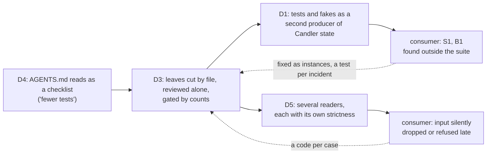
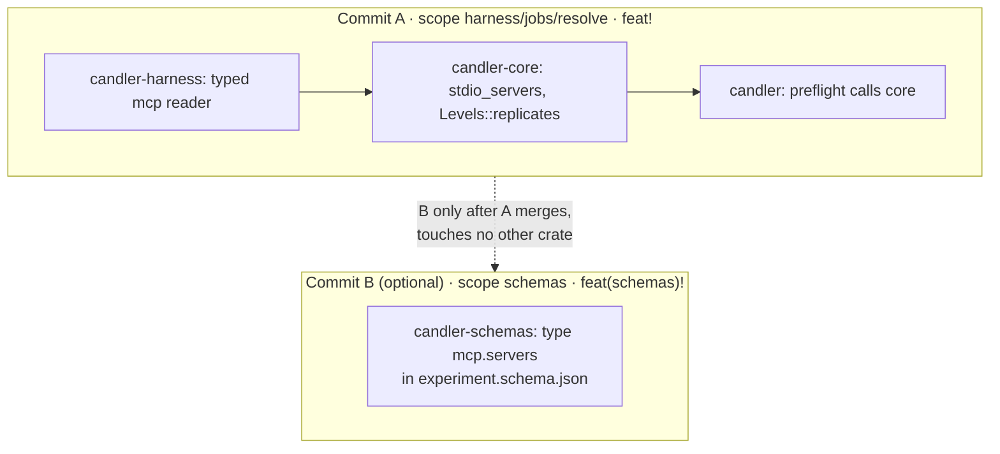
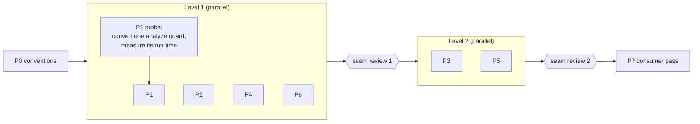

# M6c: the rest of the cycle, planned around its causes

**Type**: architecture · **Round**: v0 · **Base**: `feat/diet` at `9d029080` · **Branch**: `claude/m6c-cycle-plan-62d49d`
**Status**: proposal for the coordinator, then Eliott. No roadmap change until he approves.

## Verdict

PR #57 is worth merging under an honest description. It fixed real defects (S1, B1, three silent
acceptances) and removed tests that guarded nothing. But it fixed instances, and it was steered by counts.
The causes that produced S1 and B1 are still in the tree, and so is the process that let them through.
This plan removes four causes. **D1** and **D3** carry most of the weight. D4 and D5 follow from them.

| | Cause | Level where it starts | Where a consumer pays |
|---|---|---|---|
| **D1** | Tests and fakes produce Candler's own state a second time, by hand | what the code leaves | S1 found by the HTN consumer, B1 by the audit |
| **D3** | Milestones are cut by file ownership, reviewed one leaf at a time, and gated by counts | how it is developed | second_sources never ran; the golden covers never ran; folds blocked |
| **D4** | `AGENTS.md` states the principle as a checklist, and the checklist was read as "fewer tests" | how it is developed | count gates (D3) |
| **D5** | One consumer input has several readers, and each reader picks its own strictness | what the code leaves | G18; the 3 per-case refusals; audit-2 |

Draft 0's D2 ("tests enter below the consumer interface") is merged into D1. It has the same cause, and
§D1 says which tests enter through meaning and which still build their own inputs. Draft numbering is kept
so that the coordinator's challenges map one to one. The audit's five defects are written **audit-1…audit-5**
in this report, to keep them apart from the cycle defects.

## The yardstick

The README purpose paragraph, verbatim as written at `254ff4a0`. M6b's `db5a0fae` removed it from
`README.md`; whether it comes back is K3, Eliott's decision (§Open items).

> A domain-agnostic core for evaluating LLM-based agents. Candler has two equal halves behind one
> operation API: - **Execution:** run agents under controlled conditions (experiment matrix, runners,
> isolation, per-run tool-catalog snapshots, provenance). - **Evaluation:** grade traces and artifacts,
> fresh or already on disk, through pluggable evaluators that emit one outcome record format. A library,
> a lean CLI and an MCP server are thin surfaces over that API. Domain science (for example the
> HTN-creator evaluation) plugs in as evaluators, suite specs, fixtures and catalog providers. The core
> names no domain.

Every claim below is judged against this paragraph. The phrases that matter most here are "provenance",
"per-run tool-catalog snapshots", "already on disk" and "thin surfaces over that API".

## How the defects feed each other

The loop closes at the consumer. A defect found there comes back as a leaf scoped to the files it touched.
That leaf adds a guard for the instance, and the cause stays where it was.

## D1: Candler state with a second producer

### Evidence (mechanism)

- **S1.** A native run sealed its digests but not the output blobs. The suite passed because the tests
  that read outputs got their sealed runs from `seal_synthetic` (`guard_run_context.rs:80`), which calls
  `put_blob` itself. The test produced the state the runner was supposed to produce, so the runner's gap
  could not show. The HTN consumer found it: evaluation passed 74/74 only after the blobs were copied by
  hand.
- **B1.** OpenCode's `collect` returned no file spec. The conformance suite takes "what the driver must
  collect" from each driver's own fixture (`Case::with_collect`, `conformance.rs:213`). `check_collect`
  (`:967`) checks only that the command is sound. The oracle came from the code under check, which breaks
  the rule `candler-testkit` was created to keep. The audit found it, not the suite.
- **The seeders.** `guard_cli.rs:87` and `guard_cli_surface.rs:400` are near copies. So are
  `guard_analyze.rs:266` and `guard_golden_design.rs:339`. Each seals a run with no tree, no trace and no
  raw record, then writes outcomes. The real runner never produces that state. `analyze`, `inspect` and
  `evaluate` are therefore guarded against store shapes that do not occur. At least five more seeders
  exist (`seed_run`, `seed_run_of_a`, `write_run`, `sealed_with`, `plant_*`). Each is free to drift from
  the runner in its own way.
- **The Docker fakes.** About ten independent stand-ins exist, among them `fake_docker`, `Fakery`,
  `FakeDaemon`, the `FakeHost`/`FakeAgent` set, `VersionRig`, `Rig` and `BUILDS`. No test holds any of
  them to the real daemon. The container-e2e group runs the real daemon, but it does not compare its
  behaviour with a fake.

### Cause

Each leaf needed a sealed run, a collected file set or a daemon. It built one in its own files, because
those were the files it owned (D3). Nothing in the repository says where test state should come from
(D4).

### Which tests enter through meaning, and which build inputs

A blanket rule ("every test goes through the CLI") would be another checklist, and it would be wrong:
a unit test of the store's own writer has to build the writer's inputs. The plan rests on one question,
asked of each piece of state a test needs: **who produces this state in real use?**

| Who produces it in real use | Where the test gets it | Example |
|---|---|---|
| Candler (sealed run, outcome, collected tree, snapshot) | from Candler's own producer, under a scripted agent and a scripted evaluator | `analyze` needs a store with two arms. It runs a native scripted experiment, not `seed()` |
| The consumer (experiment file, evaluator plug-in, suite spec, corpus) | the test writes it, because writing it is the consumer's own act | a resolve refusal test writes a malformed experiment file |
| A system Candler does not own (Docker daemon, harness binary, model) | a stand-in, held to the real system by a contract test that runs in CI | `FakeDaemon` |
| The unit under test itself | built directly, in that unit's own tests | the store's writer tests build trees |

The guards at the consumer interface (CLI, MCP, op API) stay, and they keep entering through meaning:
each states what a consumer sees. What changes is where their *preconditions* come from. When the
precondition is Candler state, the guard asks Candler for it.

The forced edits in `b5309c91` (`ResolveInput::default()` became `ResolveInput::new(Vec::new())` across
the op-API callers) are **not** D1 evidence. Those tests call the op API, which is a consumer interface,
and the break was the API's own. Draft 0 counted them as evidence; that was wrong, and they are dropped.

### Changes that remove the cause

1. **One test producer of sealed runs.** This is a support module in `candler-testkit` or the `it`
   support, as the probe decides. It runs the real native runner with a scripted agent and an optional
   scripted evaluator. `seal_synthetic` and the duplicated seeders are retired into it. If the probe
   shows the real runner is too slow for the analyze-heavy guards, the fallback is a single seeder that
   seals through the runner's own sealing step, with tree and blobs. Even then there is one producer,
   not ten.
2. **A collect invariant in conformance whose oracle is outside the driver.** A shared conformance case
   has the scripted agent write files, and checks that every driver's `collect` stores exactly those
   files. The oracle is what the agent wrote, not what the driver's fixture expects.
3. **One Docker stand-in, held to the daemon.** The fakes fold into one stand-in, wherever the tests
   need a different daemon behaviour that the scripted agent cannot give. A contract guard runs one
   scripted scenario against both the stand-in and the real daemon, and compares what each one observes
   (§Proof).

### Where the fake-vs-real gate runs (challenge 6)

It runs in CI, on every pull request. `.github/workflows/container-e2e.yml` runs on `ubuntu-latest`
with a real daemon, on any PR that touches `crates/**`, `Cargo.*`, `assets/docker/**`,
`.config/nextest.toml` or the workflow. It runs the ignored `guard_container_e2e::` and `guard_cli_e2e::`
groups with `--run-ignored only --no-tests=fail`, then checks every expected guard **by name**. On PR #57
it passed in 7m11s. The contract guard joins that group, and its name joins the by-name list, so a
deleted or renamed guard fails the job rather than vanishing.

**Gap:** `main` has no branch protection (the GitHub API returns 404), so a red check does not block a
merge. Making `Gates` and `container-e2e` required checks is a repository setting. It is Eliott's call,
and it is the one change that turns "the gate runs" into "the gate binds".

## D3: how milestones are cut, reviewed and gated

### Evidence (mechanism)

- **File ownership blocked the right change.** `shed_dead_dup` could not fold duplicates whose second
  copy sat outside its OWNED regex. `silent_acceptance` stopped at 3 of 6 cases because the other three
  need `runner/refusal.rs` and `jobs/refusal.rs`, and it left an `#[ignore]` whose reason names the
  OWNED set, not a behaviour.
- **A concept leaf was dropped by a gate, not a decision.** `second_sources` ("each fact the CLI prints
  or checks has one source") was cut when the CI gate came up, and it was never re-cut. Its concept is
  D5's.
- **Gates that a vacuous suite passes.** The GOLDEN gate (`-E 'test(/golden/)'` passes) passed while
  the 8 corpus-gated golden tests were ignored: they need `CANDLER_GOLDEN_CORPUS`, which no leaf and no
  CI job sets. The leaf passed its gate without the tests that give the gate its meaning ever running.
- **Counts as goals.** The M6c leaf gates on "about 525 nextest tests". M6b added 27 tests and removed
  none, and the diet then removed 96. Both moves passed their gates. Neither gate asked what a consumer
  can now rely on.
- **Review cannot see seams.** The verifier is "given only this leaf and the diff". S1 and B1 lived at
  seams (runner↔store, driver↔conformance). The M6b knowledge transfer records the same pattern: briefs
  stated false facts, commits were not green on their own, and guards were written with or after the
  code.

### Cause

The unit of work is a set of files, because that makes parallel agents safe to merge. The unit of
review is the same set. A cause that spans two owners therefore has no owner, and a gate that checks the
leaf's own files cannot see the seam.

### Changes that remove the cause (roadmap conventions)

- **Cut leaves by concept.** A leaf owns a concept, such as "sealed runs have one producer". It touches
  whatever files that concept needs. Two leaves run in parallel only when their concepts are
  independent. Where they share a file, merge order settles it, not a regex.
- **Gates are observations.** Each gate names a behaviour a consumer can see, and the gate is shown
  failing on the base before it passes on the tip. Counts can appear in the evidence. They are never the
  gate.
- **A gate that skips is a gate that fails.** Any gate whose meaning depends on ignored tests runs them
  (`--run-ignored`), or states where they ran. The golden covers run at the milestone consumer pass,
  with the corpus set, and the nextest output must list them as passed, not skipped.
- **Reviews span seams.** A seam review falls after each merge level (§How this work is developed). The
  reviewer gets the milestone's whole diff so far and the consumer interface, not one leaf.

These conventions live in `__roadmap__` (the leaf template and its README), not in `AGENTS.md`.

## D4: what `AGENTS.md` says

### Evidence

The section "Sustainable, scalable, efficient" restates the three-part principle, asks three questions,
and ends with a list of failures. The diet plan (`00-…`) turned that list into "836 → 525 tests". The
words gave no reason to read them otherwise: they say what to avoid, but not what sanity means for a
tool that records what agents did.

### Proposal (quoted in full, Eliott's to approve)

It replaces the section "Sustainable, scalable, efficient". The machine-wide principle stays in the
global file, which this text neither restates nor paraphrases.

> **What sane work means in Candler**
>
> Candler exists so that someone else can trust a record of what an agent did. That trust holds only
> if each kind of state Candler stores (a sealed run, its outputs, an outcome, a catalog snapshot) has
> one producer, and that producer is Candler's own code. A test that needs such a state asks Candler to
> make it, under a scripted agent if it must; it does not assemble the state by hand, because a second
> producer can only agree with the first by luck. Where Candler leans on something it does not own (a
> container daemon, a harness binary, a model), a stand-in is fine for as long as a test that runs in
> CI holds it to the real thing. Each input a consumer writes has one reader, and that reader refuses
> what it does not understand: a second, more lenient reading of the same declaration is a defect even
> when nothing reaches it yet. A change is done when a consumer's path through it has been seen
> working, and seen failing without it; how many tests or lines it moved says nothing either way.

## D5: one input, several readers

### Evidence (mechanism)

- **MCP servers.** The experiment schema does not type `mcp.servers`. The drivers read it through
  `candler_harness::mcp::servers` (`mcp.rs:77`), and OpenCode's `render_config` refuses a malformed
  entry. Core reads the same declaration a second time in `stdio_servers`
  (`jobs/orchestrate/servers.rs:36`). That reader skips an entry with no string `command`, and drops
  non-string `args` and `env` values. One declaration therefore has two strictness regimes. G18 (`mcp.*`
  silently gave no servers before `1e6dc91a`) was this cause, fixed as an instance.
- **Replicates.** The CLI checks the count in `check_replicate_count` (`preflight.rs:269`). Core's
  `Levels::replicates` (`runner/plan.rs:354`) silently falls back to `file.replicates()`. The library
  and MCP surfaces get the lenient reader; only the CLI gets the strict one. That breaks "thin surfaces
  over that API".
- **audit-2.** `resolve` accepts an absolute path in mcp args, which `run` refuses. It is the same
  cause: two readers.
- **The three per-case codes PR #57 adds** (`experiment.env_token_secret`,
  `experiment.replicates_path`, `experiment.replicates_not_count`) are honest refusals. But each
  exists because a reader had to be patched case by case.

### Change that removes the cause

Each consumer input gets one typed reader, owned by the crate that owns the input's meaning. Every
surface and every later stage takes the typed value from it, and nothing reads the raw table again:

- **MCP servers:** `candler_harness::mcp` returns typed server values and refuses at resolve. Core's
  `stdio_servers` takes the typed values instead of re-reading JSON.
- **Replicates:** core owns the one reader, and the CLI preflight calls it.
- **The rest of silent_acceptance** (the three deferred cases, plus the siblings `token_secret` from
  defaults or config and non-string server env) lands here. It is the same concept, so it is no longer
  blocked by OWNED. The `#[ignore]`d row is un-ignored.
- **From second_sources:** the `resolve` failure record from core, replacing `print_failures`'
  hand-built JSON (ruling K5), and `transcript.rs` no longer folding a serialisation failure into an
  empty line.

### Blast radius and the cut (challenge 5)

- **Commit A touches no file in `crates/candler-schemas/`**, because `mcp.servers` is not in the
  schema today. The schemas-release gate (CONTRIBUTING.md:69 and :139: a release-triggering commit
  touching `crates/candler-schemas/` uses scope `schemas` and touches no other crate) therefore does not
  apply. It is still a `!` change: experiment files that ran before (with a server silently dropped)
  are now refused. That is the K5 ruling, applied at the root, and it is the same kind of break that
  `b5309c91` made.
- **Commit B is optional.** It types `mcp.servers` in the published schema, so that tools outside
  Candler see the type. The experiment schema sets `additionalProperties: false` at the top level, so
  B makes some documents that validated before invalid. It is therefore `feat(schemas)!`, never a plain
  `fix(schemas)`. It is a schemas-only commit after A merges. Whether to do B is Eliott's call;
  A alone removes the cause.
- **The three codes stay in PR #57 as they are.** Once there is one reader, a malformed field may be
  refused by that reader's own code, with the field path in the record. If so, the three per-case codes
  fold into it. That fold is a consequence, and it is judged by one test: a consumer who reads the
  refusal still knows what to fix. If they would not, the codes stay. Fewer codes is not the goal.

## B2: the catalog snapshot is only a digest

The README promises "per-run tool-catalog snapshots". `CatalogStep::run` (`resolve/steps/catalog.rs`)
records a `DigestRef` and nothing else. The digest is `Catalog::content_digest`, while `Store::put_blob`
digests raw bytes, so the canonical bytes have to be stored for the digest to resolve.

**The one decision for Eliott: may `resolve` write to the store?**

| Option | What it means | Cost |
|---|---|---|
| **(a) `resolve` writes the bytes** | `resolve` puts the canonical catalog bytes into the store when it computes the digest | `resolve` stops being a pure read. A dry `resolve` leaves blobs behind that no run references |
| **(b) the run writes the bytes** *(recommended)* | `resolve` keeps the canonical bytes in the plan it hands on, and the runner stores them when it seals, beside the outputs | the plan carries bytes, not only a digest. `resolve` stays pure, and the snapshot shares the S1 sealing path |
| (c) keep the digest only | document it | leaves a README claim unmet. Listed only so the choice is explicit |

The guard: a consumer opens a sealed run and reads the catalog it ran with, through `inspect` or the
op API. It fails on the base, because the digest resolves to nothing.

## Proof, as observations of the mechanism (challenge 2)

No result below is a count. Where a number appears, it is evidence, never the claim.

| Change | Observation that proves it | Seen failing how |
|---|---|---|
| D1 · one producer of sealed runs | Reapply the pre-S1 sealing (digests without blobs) on a scratch branch: the guards that read outputs now fail, because their runs come from the runner | before the change, the same revert leaves those guards green; that is S1's mechanism |
| D1 · collect invariant | Revert B1's fix on a scratch branch: the shared conformance case fails for OpenCode only, naming the files the agent wrote | on the base, the same revert passes conformance |
| D1 · stand-in held to the daemon | Change one behaviour of the stand-in (e.g. the exit status of a stopped container): the contract guard fails in container-e2e, in CI, on the PR | on the base, no test notices the change |
| D5 · one reader | An experiment with a malformed MCP server: on the base, `run` proceeds and the server is silently absent; on the tip, `resolve` refuses it with the field path, with the same record from the CLI, the MCP server and the op API | the base behaviour *is* the failure, shown by the same input |
| D3 · gates that cannot skip | The milestone's golden gate runs with the corpus set: the golden tests are listed as passed, not skipped | the same command without the corpus fails the gate instead of passing it vacuously |
| B2 · snapshot | `inspect` of a sealed run shows the catalog it ran with | on the base, the digest resolves to no blob |
| D4 · `AGENTS.md` | Indirect, and honest about it: the seam reviews record where a leaf's choice followed or broke the paragraph. The real test is whether the next milestone writes count gates or hand-made state again | — |

## The consumer pass on the after tip (challenge 3)

This is the milestone's last gate, and it replaces the old `close_out`. It is not a baseline. It is
one pass by our own team of agents, on the after tip, doing what the README says Candler is for:

1. Write a small experiment matrix (two arms, a few replicates) for both harnesses, Claude Code and
   OpenCode, under container isolation, with RiVault models and one MCP server.
2. Run it, then grade its artifacts with an evaluator plug-in, fresh and again from disk.
3. Do the same through the CLI and through the MCP server.
4. Record every friction the agent hits. For each one, trace it to a cause and judge it against a phrase
   of the purpose paragraph. A friction whose cause is one of D1–D5 reopens that piece. Any other
   friction becomes a finding for Eliott, not a fix inside this milestone.

The before tip is used only where it shows that a specific cause is gone, with the inputs from §Proof
(the malformed MCP server; the S1 and B1 reverts). Two open questions are settled here rather than
guessed at: whether a plug-in reading `context.root/path` meets `outputs/outputs/…` (the audit
plug-in's layout surprise), and audit-1 (does `resolve` need to print the cell count).

## Open items, each placed

| Item | Where it lands | Note |
|---|---|---|
| **PR #57** | merge with the description below | Eliott's decision |
| **K3** (restore the purpose paragraph) | Eliott's decision | Options: (i) restore it verbatim at the top of `README.md`, above the store-window text; (ii) keep it in `__design__/` only, as the yardstick for agents. The plan judges against the paragraph either way |
| **second_sources** | its concept goes to D5. The resolve record and the transcript fold land there | `watch --live`, the named constants and "stratum" are kept only where the consumer pass meets the second source; otherwise they are recorded and not done |
| **silent_acceptance rest** | D5 | the `#[ignore]` with the OWNED reason goes |
| **B2** | its own small piece, after Eliott's (a)/(b) | |
| **close_out** | becomes the consumer pass, then the knowledge transfer | |
| **audit-1** (cell count) | judged at the consumer pass | it was built then withdrawn in M6b as C1; it should not return without a consumer reason |
| **audit-2** (abs path) | D5 | same cause |
| **audit-3** (`treatment` cannot be a factor) | not in M6c | a missing capability, not a cycle defect. Recorded for Eliott |
| **audit-4** (nested `prompt.values.hint` not paired) | D5, if the pass shows it is accepted and ignored; otherwise recorded like audit-3 | |
| **audit-5** (`kill` prompts on stdout off a TTY, exits 2) | a small CLI fix, with its guard at the CLI | |
| **ignored golden covers** | D3: run at the consumer pass with the corpus | they cannot run in CI while the corpus is not there |
| **seal_synthetic** | retired by D1 | |

### PR #57: draft description

> **merge(api): land the architecture diet**
>
> This branch removes tests that guarded nothing and fixes defects that real consumers found. It
> does not, on its own, make the codebase saner: its gates were counts, and its leaves were cut by
> file ownership. The follow-up plan (`__reports__/diet/02-architecture_cycle_plan_v0.md`) works on
> those causes.
>
> **Fixed, each with a guard at the interface where a consumer saw it**
> - A native run now stores each output's bytes when it seals, not only their digests (S1, found by
>   the HTN consumer's smoke run).
> - An OpenCode run now stores the files the agent wrote (B1, found by the end-to-end audit).
> - `resolve` refuses three inputs it used to accept silently: a token secret in `env`, a path as
>   `replicates`, and a non-integer `replicates`. This is a breaking change for experiment files that
>   relied on them. It adds three refusal codes.
> - One unused plan summary is removed, and the digest path is folded into one.
>
> **Removed**
> - Tests in seven areas (CLI and harness, isolation, supervision, plan and store, stats and analyze,
>   import and evaluation, schemas and contracts) that restated the code or duplicated another guard.
>   Each removal had to meet the deletion bar in `__reports__/diet/00-architecture_diet_plan_v0.md`.
>
> **Known limits, carried into the follow-up plan**
> - Many tests still build sealed runs by hand, and the Docker stand-ins are not held to the real
>   daemon. This is how S1 and B1 got through.
> - Three of the six silent-acceptance cases remain. MCP server declarations still have two readers
>   with different strictness.
> - The tool-catalog snapshot is still stored only as a digest (B2).
> - The corpus-gated golden tests did not run for this branch.
>
> 🤖 Generated with [Claude Code](https://claude.com/claude-code)

## How this work is developed (challenge 7)

### Pieces, by concept

| Piece | Concept | Depends on | Touches (indicative, not an OWNED set) |
|---|---|---|---|
| **P0** | Conventions: the `AGENTS.md` paragraph and the leaf template | Eliott's approval | `AGENTS.md`, `__roadmap__/` |
| **P1** | Sealed runs have one test producer | the P1 probe | test support in `candler-core` and `candler`, the guards that seed |
| **P2** | Collect has an oracle outside the driver | — | `candler-harness/src/conformance.rs`, driver fixtures |
| **P3** | One Docker stand-in, held to the daemon | — | core test support, the container-e2e workflow |
| **P4** | One reader per input (D5, silent_acceptance rest, second_sources' record, audit-2, audit-4) | — | `candler-harness/src/mcp.rs`, core `resolve`, `runner/plan.rs`, `jobs/orchestrate/servers.rs`, refusal files, CLI preflight |
| **P5** | The catalog snapshot is stored | Eliott's (a)/(b), and P1's sealing path | `resolve/steps/catalog.rs`, the runner's sealing |
| **P6** | audit-5 | — | CLI `kill` |
| **P7** | Consumer pass and knowledge transfer | all the above | reports only |

### Order and parallelism

- **P1 goes first among the code pieces**, starting with a probe. Its producer is what P3's contract
  guard and P5's guard build on. The probe settles whether the real runner is fast enough, or whether
  the one-seeder fallback is needed, before the rest of P1 is written.
- **P2, P4 and P6 are independent concepts** and run beside P1. P4 shares no file with P1.
- **P3 waits for level 1** because it shares core test support with P1. Its concept is independent,
  but merging after P1 avoids rewriting the same support twice.
- **Seam review 1** gets the merged diff of level 1 and the consumer interface. It asks whether any
  test still produces Candler state by hand, and whether any input still has a second reader.
  **Seam review 2** asks the same of level 2, plus whether the stand-in and the snapshot hold at their
  seams. Each review is a fresh agent, given the plan, the whole diff since `feat/diet`, and the
  README paragraph.

### Cost and wall clock, with basis

| Basis | Figure |
|---|---|
| M5 | about 4.5× over its estimate |
| M6b | caps overrun 1.5–3×; build cost $66.4 |
| Overnight diet | about $68, for less than this plan |

| Piece | Estimate |
|---|---|
| P0 | $3 |
| P1, with its probe | $25 |
| P2 | $8 |
| P3 | $12 |
| P4 | $18 |
| P5 | $6 |
| P6 | $3 |
| Two seam reviews | $10 |
| P7 consumer pass and knowledge transfer | $12, RiVault tokens near free |
| **Estimate** | **about $97** |
| **Expected, at M6b's overrun** | **$145–290** |

The M6c leaf caps the whole diet at $100, and about $68 of that is spent. **This plan does not fit that
cap.** Either Eliott raises it, or the plan is cut in this order:

1. P6 and audit-4's investigation move to a later milestone.
2. P5 (B2) waits, with its decision taken and recorded.
3. P3 shrinks to the contract guard for the one stand-in the container-e2e group already uses; the
   other fakes fold later.
4. Last resort: P1 builds the producer and moves the seeders that S1's path reads. The rest migrate
   when they are next touched, and the seam review checks that no new one appears.

P0, P2, P4 and P7 are never cut. They are the cheapest pieces that remove a cause, and P7 is how the
milestone knows it worked.

**Wall clock:** about two working days. The bound is the waits for Eliott's three decisions (P0
wording, B2, the cap) and the two seam reviews, not agent time.

### Machine footprint

- **Builds.** Every piece shares
  `CARGO_TARGET_DIR=/Users/hacker/Documents/tmp/claude-worktrees/Candler/candler-diet/target`. At most
  three pieces build at once, because cargo's lock serialises them anyway. Each leaf brief states this,
  together with cleanup on finish.
- **Docker.** container-e2e runs in CI. Locally, Docker is used only by P3 and by the consumer pass.
  Each removes the images, containers and networks it created, by name. Nothing is pruned, and Docker
  is never stopped.
- **RiVault.** Only the consumer pass makes model calls: one small matrix per harness, not repeated
  unless a fix reopens a piece.
- **Worktrees.** Each piece's worktree and branch are removed after it merges.

## Names (challenge to "diet")

| Name | What it says about the work |
|---|---|
| **Seams** *(recommended)* | The defects live where two things meet: runner and store, driver and conformance, stand-in and daemon, two readers of one input, two leaves under one cause. Review now falls on those places too |
| One source | each state one producer, each input one reader. Fits D1 and D5, says nothing about D3 |
| Ground truth | tests take their truth from the real producer. Fits D1, misses D3 and D5 |
| Cycle | names the scope (develop, leave, consume) but not what was wrong in it |

"Seams" still fits D5: the two MCP readers are a seam between core and the drivers, and the replicate
check is a seam between the CLI and core. Existing paths (`__reports__/diet/`, `__roadmap__/diet/`,
`feat/diet`) keep their names until Eliott rules.

## Decisions for Eliott

1. **The `AGENTS.md` paragraph** (§D4), as quoted, or amended.
2. **B2:** may `resolve` write to the store? Options (a), (b) or (c) in §B2; (b) is recommended.
3. **Budget:** raise the $100 whole-diet cap to fit about $150–290, or apply the cut order.
4. **K3:** restore the purpose paragraph in `README.md`, or keep it as an agents-only yardstick.
5. **PR #57:** merge, with the description above.
6. **Required checks on `main`** (`Gates`, `container-e2e`), so that a red gate blocks a merge.
7. **Commit B in D5** (type `mcp.servers` in the published schema, `feat(schemas)!`), or A alone.
8. **The name:** "Seams", or another.
