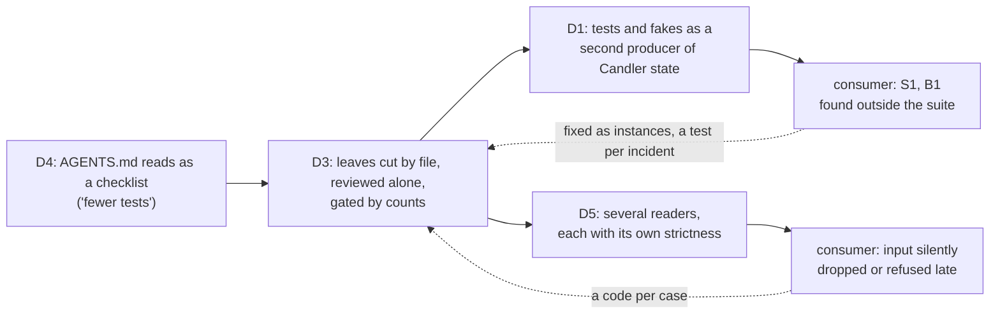
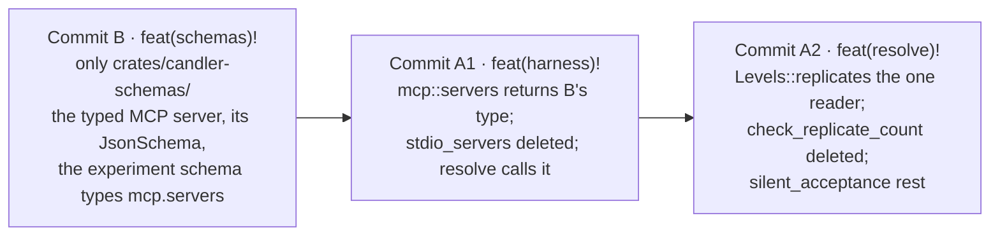
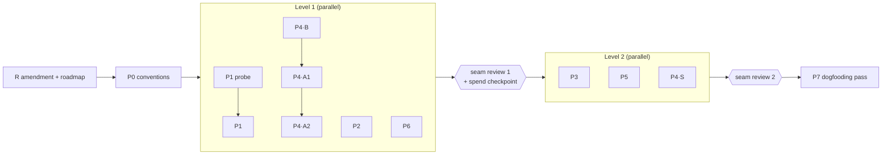

# M6c: the rest of the cycle, planned around its causes

**Type**: architecture · **Round**: v2 · **Base**: `feat/diet` at `9d029080` · **Branch**: `claude/m6c-cycle-plan-62d49d`
**Status**: Eliott has ruled on v1. This round applies his rulings. The amendment and the roadmap follow
once the coordinator has checked it.

**Milestone name: M6c — Integrity.** The roadmap directory becomes `integrity/`, and the amendment
renames `…/surface/diet/` and `m6c_diet.md`. Reports stay under `__reports__/diet/`.

**Changes from v1** (Eliott's rulings):
- D5 is a pattern: the existing reader closest to the use becomes the only reader, with no new layer.
  The proof shows that no indirection was added (§D5).
- Commit B (typing `mcp.servers`) is in. It comes before Commit A, so that A uses B's type and every
  commit builds (§D5).
- P7 is designed to attribute each failure and to report its cost (§The dogfooding pass).
- The `AGENTS.md` paragraph is approved as written. B2 is option (b).
- The plan is fitted to a fresh $100 at the expected spend, coordinator included (§Cost).
- The section on P3 states what it is worth if `main` keeps no required checks.
- K3 and PR #57 are done by the coordinator, so the PR #57 draft is removed.

## Verdict

PR #57 (merged by the coordinator) fixed real defects (S1, B1, three silent acceptances) and removed
tests that guarded nothing. But it fixed instances, and it was steered by counts.
The causes that produced S1 and B1 are still in the tree, and so is the process that let them through.
This plan removes four causes. **D1** and **D3** carry most of the weight. D4 and D5 follow from them.
D1 and D3 are also failures of two shared skills, designing-tests and managing-roadmaps. Eliott is
filing those upstream; this plan does not change because of it.

| | Cause | Level where it starts | Where a consumer pays |
|---|---|---|---|
| **D1** | Tests and fakes produce Candler's own state a second time, by hand | what the code leaves | S1 found by the HTN consumer, B1 by the audit |
| **D3** | Milestones are cut by file ownership, reviewed one leaf at a time, and gated by counts | how it is developed | second_sources never ran; the golden covers never ran; folds blocked |
| **D4** | `AGENTS.md` states the principle as a checklist, and the checklist was read as "fewer tests" | how it is developed | count gates (D3) |
| **D5** | One consumer input has several readers, and each reader picks its own strictness | what the code leaves | G18; the 3 per-case refusals; audit-2 |

Draft 0's D2 ("tests enter below the consumer interface") is merged into D1. It has the same cause, and
§D1 says which tests enter through meaning and which still build their own inputs. Draft numbering is kept
so that the coordinator's challenges map one to one. The audit's five defects are written **audit-1…audit-5**
in this report, to keep them apart from the cycle defects.

## The yardstick

The README purpose paragraph, verbatim as written at `254ff4a0`. M6b's `db5a0fae` removed it; under
K3 the coordinator is putting it back at the top of `README.md`.

> A domain-agnostic core for evaluating LLM-based agents. Candler has two equal halves behind one
> operation API: - **Execution:** run agents under controlled conditions (experiment matrix, runners,
> isolation, per-run tool-catalog snapshots, provenance). - **Evaluation:** grade traces and artifacts,
> fresh or already on disk, through pluggable evaluators that emit one outcome record format. A library,
> a lean CLI and an MCP server are thin surfaces over that API. Domain science (for example the
> HTN-creator evaluation) plugs in as evaluators, suite specs, fixtures and catalog providers. The core
> names no domain.

Every claim below is judged against this paragraph. The phrases that matter most here are "provenance",
"per-run tool-catalog snapshots", "already on disk" and "thin surfaces over that API".

## How the defects feed each other

The loop closes at the consumer. A defect found there comes back as a leaf scoped to the files it touched.
That leaf adds a guard for the instance, and the cause stays where it was.

## D1: Candler state with a second producer

### Evidence (mechanism)

- **S1.** A native run sealed its digests but not the output blobs. The suite passed because the tests
  that read outputs got their sealed runs from `seal_synthetic` (`guard_run_context.rs:80`), which calls
  `put_blob` itself. The test produced the state the runner was supposed to produce, so the runner's gap
  could not show. The HTN consumer found it: evaluation passed 74/74 only after the blobs were copied by
  hand.
- **B1.** OpenCode's `collect` returned no file spec. The conformance suite takes "what the driver must
  collect" from each driver's own fixture (`Case::with_collect`, `conformance.rs:213`). `check_collect`
  (`:967`) checks only that the command is sound. The oracle came from the code under check, which breaks
  the rule `candler-testkit` was created to keep. The audit found it, not the suite.
- **The seeders.** `guard_cli.rs:87` and `guard_cli_surface.rs:400` are near copies. So are
  `guard_analyze.rs:266` and `guard_golden_design.rs:339`. Each seals a run with no tree, no trace and no
  raw record, then writes outcomes. The real runner never produces that state. `analyze`, `inspect` and
  `evaluate` are therefore guarded against store shapes that do not occur. At least five more seeders
  exist (`seed_run`, `seed_run_of_a`, `write_run`, `sealed_with`, `plant_*`). Each is free to drift from
  the runner in its own way.
- **The Docker fakes.** About ten independent stand-ins exist, among them `fake_docker`, `Fakery`,
  `FakeDaemon`, the `FakeHost`/`FakeAgent` set, `VersionRig`, `Rig` and `BUILDS`. No test holds any of
  them to the real daemon. The container-e2e group runs the real daemon, but it does not compare its
  behaviour with a fake.

### Cause

Each leaf needed a sealed run, a collected file set or a daemon. It built one in its own files, because
those were the files it owned (D3). Nothing in the repository says where test state should come from
(D4).

### Which tests enter through meaning, and which build inputs

A blanket rule ("every test goes through the CLI") would be another checklist, and it would be wrong:
a unit test of the store's own writer has to build the writer's inputs. The plan rests on one question,
asked of each piece of state a test needs: **who produces this state in real use?**

| Who produces it in real use | Where the test gets it | Example |
|---|---|---|
| Candler (sealed run, outcome, collected tree, snapshot) | from Candler's own producer, under a scripted agent and a scripted evaluator | `analyze` needs a store with two arms. It runs a native scripted experiment, not `seed()` |
| The consumer (experiment file, evaluator plug-in, suite spec, corpus) | the test writes it, because writing it is the consumer's own act | a resolve refusal test writes a malformed experiment file |
| A system Candler does not own (Docker daemon, harness binary, model) | a stand-in, held to the real system by a contract test that runs in CI | `FakeDaemon` |
| The unit under test itself | built directly, in that unit's own tests | the store's writer tests build trees |

The guards at the consumer interface (CLI and op API today; MCP once M7 builds it) stay, and they keep entering through meaning:
each states what a consumer sees. What changes is where their *preconditions* come from. When the
precondition is Candler state, the guard asks Candler for it.

The forced edits in `b5309c91` (`ResolveInput::default()` became `ResolveInput::new(Vec::new())` across
the op-API callers) are **not** D1 evidence. Those tests call the op API, which is a consumer interface,
and the break was the API's own. Draft 0 counted them as evidence; that was wrong, and they are dropped.

### Changes that remove the cause

1. **One test producer of sealed runs.** This is a support module in `candler-testkit` or the `it`
   support, as the probe decides. It runs the real native runner with a scripted agent and an optional
   scripted evaluator. If the probe shows the real runner is too slow for the analyze-heavy guards, the
   fallback is a single seeder that seals through the runner's own sealing step, with tree and blobs.
   The guards on S1's path (the ones that read outputs, through `seal_synthetic` today) move to it.
2. **A collect invariant in conformance whose oracle is outside the driver.** A shared conformance case
   has the scripted agent write files, and checks that every driver's `collect` stores exactly those
   files. The oracle is what the agent wrote, not what the driver's fixture expects.
3. **A stand-in held to the daemon.** A contract guard runs one scripted scenario against the stand-in
   that the container-e2e group's code paths already use and against the real daemon, and compares what
   each one observes (§Proof).

The cause is gone once three things hold: the producer exists; the guards on S1's and B1's paths use it;
and the conventions (§D3, §D4), checked by the seam review, refuse any new hand-made seeder or any new
stand-in with no contract guard. The other seeders and fakes migrate when someone next touches them,
for their own reasons.

**Why not migrate them all now.** A mass migration would be excess at the development level, the very
thing this plan is about. It would make a large churn diff over a test tree that no consumer uses, and
cost most of this plan's budget. It would also load the seam reviews with mechanical edits, which hide
the few changes that matter. Each seeder left in place is a known instance of a cause that can no longer
spread, not the cause itself.

### Where the fake-vs-real gate runs

It runs in CI, on every pull request. `.github/workflows/container-e2e.yml` runs on `ubuntu-latest`
with a real daemon, on any PR that touches `crates/**`, `Cargo.*`, `assets/docker/**`,
`.config/nextest.toml` or the workflow. It runs the ignored `guard_container_e2e::` and `guard_cli_e2e::`
groups with `--run-ignored only --no-tests=fail`, then checks every expected guard **by name**. On PR #57
it passed in 7m11s. The contract guard joins that group, and its name joins the by-name list, so a
deleted or renamed guard fails the job rather than vanishing.

**Gap:** `main` has no branch protection (the GitHub API returns 404), so a red check does not block a
merge. Making `Gates` and `container-e2e` required checks is a repository setting, and it is not ruled
yet.

**What P3 is worth if the checks stay optional.** The contract guard still runs on every PR that
touches the crates, and it still goes red when the stand-in and the daemon part ways. What it loses is
the power to stop a merge. Its worth then rests on whoever merges reading the check. The leaf template
(P0) says that a roadmap merge waits for a green `container-e2e`, and agents follow the template, so
for merges made by agents the check still binds. For a merge made by hand, it is only a signal. That is
why P3 is the first piece cut while the checks stay optional (§Cost).

## D3: how milestones are cut, reviewed and gated

### Evidence (mechanism)

- **File ownership blocked the right change.** `shed_dead_dup` could not fold duplicates whose second
  copy sat outside its OWNED regex. `silent_acceptance` stopped at 3 of 6 cases because the other three
  need `runner/refusal.rs` and `jobs/refusal.rs`, and it left an `#[ignore]` whose reason names the
  OWNED set, not a behaviour.
- **A concept leaf was dropped by a gate, not a decision.** `second_sources` ("each fact the CLI prints
  or checks has one source") was cut when the CI gate came up, and it was never re-cut. Its concept is
  D5's.
- **Gates that a vacuous suite passes.** The GOLDEN gate (`-E 'test(/golden/)'` passes) passed while
  the 8 corpus-gated golden tests were ignored: they need `CANDLER_GOLDEN_CORPUS`, which no leaf and no
  CI job sets. The leaf passed its gate without the tests that give the gate its meaning ever running.
- **Counts as goals.** The M6c leaf gates on "about 525 nextest tests". M6b added 27 tests and removed
  none, and the diet then removed 96. Both moves passed their gates. Neither gate asked what a consumer
  can now rely on.
- **Review cannot see seams.** The verifier is "given only this leaf and the diff". S1 and B1 lived at
  seams (runner↔store, driver↔conformance). The M6b knowledge transfer records the same pattern: briefs
  stated false facts, commits were not green on their own, and guards were written with or after the
  code.

### Cause

The unit of work is a set of files, because that makes parallel agents safe to merge. The unit of
review is the same set. A cause that spans two owners therefore has no owner, and a gate that checks the
leaf's own files cannot see the seam.

### Changes that remove the cause (roadmap conventions)

- **Cut leaves by concept.** A leaf owns a concept, such as "sealed runs have one producer". It touches
  whatever files that concept needs. Two leaves run in parallel only when their concepts are
  independent. Where they share a file, merge order settles it, not a regex.
- **Gates are observations.** Each gate names a behaviour a consumer can see, and the gate is shown
  failing on the base before it passes on the tip. Counts can appear in the evidence. They are never the
  gate.
- **A gate that skips is a gate that fails.** Any gate whose meaning depends on ignored tests runs them
  (`--run-ignored`), or states where they ran. The golden covers run at the dogfooding pass (P7),
  with the corpus set, and the nextest output must list them as passed, not skipped.
- **Reviews span seams.** A seam review falls after each merge level (§How this work is developed). The
  reviewer gets the milestone's whole diff so far and the consumer interface, not one leaf.

These conventions live in `__roadmap__` (the leaf template and its README), not in `AGENTS.md`.

## D4: what `AGENTS.md` says

### Evidence

The section "Sustainable, scalable, efficient" restates the three-part principle, asks three questions,
and ends with a list of failures. The diet plan (`00-…`) turned that list into "836 → 525 tests". The
words gave no reason to read them otherwise: they say what to avoid, but not what sanity means for a
tool that records what agents did.

### The paragraph (approved by Eliott as written in v1)

It replaces the section "Sustainable, scalable, efficient". The machine-wide principle stays in the
global file, which this text neither restates nor paraphrases.

> **What sane work means in Candler**
>
> The README promises provenance, per-run tool-catalog snapshots, and grading of artifacts "already on
> disk". Those promises hold only if each kind of state Candler stores (a sealed run, its outputs, an
> outcome, a catalog snapshot) has one producer, and that producer is Candler's own code. A test that needs such a state asks Candler to
> make it, under a scripted agent if it must; it does not assemble the state by hand, because a second
> producer can only agree with the first by luck. Where Candler leans on something it does not own (a
> container daemon, a harness binary, a model), a stand-in is fine for as long as a test that runs in
> CI holds it to the real thing. The README also promises "thin surfaces over that API", so each input
> a consumer writes has one reader, below every surface, and that reader refuses what it does not
> understand: a second, more lenient reading of the same declaration is a defect even when nothing
> reaches it yet. A change is done when a consumer's path through it has been seen
> working, and seen failing without it; how many tests or lines it moved says nothing either way.

## D5: one input, several readers

### Evidence (mechanism)

- **MCP servers.** The experiment schema does not type `mcp.servers`. The drivers read it through
  `candler_harness::mcp::servers` (`mcp.rs:77`), and OpenCode's `render_config` refuses a malformed
  entry. Core reads the same declaration a second time in `stdio_servers`
  (`jobs/orchestrate/servers.rs:36`). That reader skips an entry with no string `command`, and drops
  non-string `args` and `env` values. One declaration therefore has two strictness regimes. G18 (`mcp.*`
  silently gave no servers before `1e6dc91a`) was this cause, fixed as an instance.
- **Replicates.** The CLI checks the count in `check_replicate_count` (`preflight.rs:269`). Core's
  `Levels::replicates` (`runner/plan.rs:354`) silently falls back to `file.replicates()`. The library
  gets the lenient reader; only the CLI gets the strict one. That breaks "thin surfaces over that API",
  and the MCP server (M7) would inherit the lenient one.
- **audit-2.** `resolve` accepts an absolute path in mcp args, which `run` refuses. It is the same
  cause: two readers.
- **The three per-case codes PR #57 adds** (`experiment.env_token_secret`,
  `experiment.replicates_path`, `experiment.replicates_not_count`) are honest refusals. But each
  exists because a reader had to be patched case by case.

### Change that removes the cause: a pattern, not two fixes

The pattern is **one reader per input**, and the code gets it without new layers. For each input, the
existing reader closest to its use becomes the only reader. Every other place that needs the value calls
that reader directly. No trait, wrapper type or "input service" is added to stand between the readers;
that kind of layer would trade the efficiency of the code (one more hop for every reader, one more
thing to learn) for a sanity that one direct call already gives.

- **MCP servers.** The reader that stays is `candler_harness::mcp::servers`. The drivers already use
  it, and `candler-core` already depends on `candler-harness`. It returns Commit B's typed servers
  instead of a raw map, so a malformed entry is refused when it is parsed. OpenCode's `server()` keeps
  only its job, translating a typed server into OpenCode's config shape. Core's `stdio_servers` is
  deleted, and its caller calls `candler_harness::mcp::servers` itself, picking the stdio servers with
  a `match`. `resolve` calls the same function on each cell, so the refusal comes before any run.
- **Replicates.** The reader that stays is core's `Levels::replicates`, which loses its silent fallback.
  The CLI's `check_replicate_count` is deleted, and the preflight calls core's reader.
- **The rest of silent_acceptance** (the three deferred cases, plus the siblings `token_secret` from
  defaults or config and non-string server env) follows the same pattern. It is the same concept, so it
  is no longer blocked by OWNED. The `#[ignore]`d row is un-ignored.
- **From second_sources:** the `resolve` failure record from core, replacing `print_failures`'
  hand-built JSON (ruling K5), and `transcript.rs` no longer folding a serialisation failure into an
  empty line.
- **A migration note for the HTN lane.** P4 is a `!` change, and the HTN lane is Candler's only
  consumer. When P4 lands, the HTN coordinator gets a note saying which experiment files are now refused
  (a malformed MCP server entry, a replicate count the CLI used to catch alone, and the remaining
  silent-acceptance cases) and why, with the refusal each one now gets. It also names the library
  break: `stdio_servers` and `Stdio`, made public by PR #57, are gone. This repository has no external
  users, so it is a note, not a compatibility shim.

### Commit order: B, then A

- **B comes first, and builds alone.** It adds a public type to `candler-schemas` (the crate's schemas
  are generated from Rust types through `schemars`, and a drift check keeps the committed files in
  step). Nothing uses the type yet, so the workspace builds. It touches only `crates/candler-schemas/`
  and is scoped `schemas`, so the schemas-release gate (CONTRIBUTING.md:69 and :139) passes. Experiment
  files with a malformed `mcp.servers` that validated before now fail, so it is `feat(schemas)!`.
- **A uses B's type instead of duplicating it.** `candler-harness` and `candler-core` both already
  depend on `candler-schemas`, so A1 imports the type. A1 and A2 touch no file in
  `crates/candler-schemas/`, and each builds and passes on its own.
- **To check at the leaf:** `fixed` keys its values by dotted field path, through `patternProperties`.
  The leaf confirms that the experiment schema can type the one path `mcp.servers` there, and in factor
  levels. If it cannot, B publishes the type as its own generated schema, and A1's reader enforces it
  for both `fixed` and factors. The commit order is the same either way.
- **The three codes PR #57 added stay as they are.** Once there is one reader, a malformed field may be
  refused by that reader's own code, with the field path in the record. If so, the three per-case codes
  fold into it. That fold is a consequence, and it is judged by one test: a consumer who reads the
  refusal still knows what to fix. If they would not, the codes stay. Fewer codes is not the goal.

## B2: the catalog snapshot is only a digest

The README promises "per-run tool-catalog snapshots". `CatalogStep::run` (`resolve/steps/catalog.rs`)
records a `DigestRef` and nothing else. The digest is `Catalog::content_digest`, while `Store::put_blob`
digests raw bytes, so the canonical bytes have to be stored for the digest to resolve.

**Ruled: option (b), the run writes the bytes.** `resolve` keeps the canonical bytes in the plan it
hands on, and the runner stores them when it seals, beside the outputs. `resolve` stays a pure read, and
the snapshot shares S1's sealing path, so P5 follows P1.

The guard: a consumer opens a sealed run and reads the catalog it ran with, through `inspect` or the
op API. It fails on the base, because the digest resolves to nothing.

## Proof, as observations of the mechanism

No result below is a count. Where a number appears, it is evidence, never the claim.

| Change | Observation that proves it | Seen failing how |
|---|---|---|
| D1 · one producer of sealed runs | Reapply the pre-S1 sealing (digests without blobs) on a scratch branch: the guards that read outputs now fail, because their runs come from the runner | before the change, the same revert leaves those guards green; that is S1's mechanism |
| D1 · collect invariant | Revert B1's fix on a scratch branch: the shared conformance case fails for OpenCode only, naming the files the agent wrote | on the base, the same revert passes conformance |
| D1 · stand-in held to the daemon | Change one behaviour of the stand-in (e.g. the exit status of a stopped container): the contract guard fails in container-e2e, in CI, on the PR | on the base, no test notices the change |
| D5 · one reader | An experiment with a malformed MCP server: on the base, `run` proceeds and the server is silently absent; on the tip, `resolve` refuses it with the field path, with the same record from the CLI and the library (op API) | the base behaviour *is* the failure, shown by the same input |
| D5 · no indirection added | The diff of A1 and A2 adds no trait and no wrapper type, and no new module between an input and its use; B's type is the only new type. From each use (OpenCode's config, core's stdio launch, the CLI preflight) to the parse there is one direct call, no more hops than before. The deleted readers (`stdio_servers`, `check_replicate_count`) are gone, and a colgrep search for readers of `mcp.servers` finds one function | a seam reviewer reading the diff for new types and call hops is the check; it fails if a wrapper appears |
| D3 · gates that cannot skip | The milestone's golden gate runs with the corpus set: the golden tests are listed as passed, not skipped | the same command without the corpus fails the gate instead of passing it vacuously |
| B2 · snapshot | `inspect` of a sealed run shows the catalog it ran with | on the base, the digest resolves to no blob |
| D4 · `AGENTS.md` | Indirect, and honest about it: the seam reviews record where a leaf's choice followed or broke the paragraph. The real test is whether the next milestone writes count gates or hand-made state again | — |

## The dogfooding pass on the after tip (P7)

This is the milestone's last gate, and it replaces the old `close_out`. It is not a baseline. Its value
depends on one thing: when the agent fails, the pass must say whose failure it is. Was it the agent
misusing the CLI or the library, or does Candler really lack something? Everything below serves that,
and the cost.

**The agent has only what an outside consumer has.** It works in a scratch directory outside the repo,
with the installed `candler` binary and its `--help`, the README, `docs/`, and the library's rendered
rustdoc. It gets no repo source. A Rust program that uses the library has to compile against the crate,
so the source sits in cargo's dependency directory. The agent is told to use the docs, and its
transcript shows whether it opened that source anyway. If it did, that is itself a friction: the docs
did not suffice. Candler ships no skills yet (they are M7's), so none are given.

**Its task comes from the README's claims, not from Candler's internals and not from HTN.** In a toy
domain that names nothing of HTN, it:

1. writes a two-arm experiment matrix with a few replicates, under container isolation, with one MCP
   tool server declared for the agent being run;
2. runs it, with OpenCode on a RiVault model as the agent under test;
3. checks that each run kept its tool-catalog snapshot and its provenance;
4. grades the artifacts with an evaluator plug-in, once fresh and once "already on disk";
5. does steps 1, 2 and 4 again through the library (op API). Candler's own MCP server is M7 and is not
   built yet, so it is not part of this pass.

**Two models, one harness.** The pass runs twice, with two RiVault models from different families as
the consumer agent, both under OpenCode (chosen from RiVault's live list when the pass runs). One
harness keeps harness differences out of the comparison. Two models give the signal that matters: a
friction both of them hit points to Candler, and one that only one hits points first to that model.
Claude Code is not one of the two, because it would add USD spend for a signal the second RiVault model
already gives.

**Every friction is classified from the kept transcripts** by one question: was what the agent needed
documented, and reachable from what it had?

| What the transcript shows | Whose failure | What follows |
|---|---|---|
| Documented and reachable, and the agent missed it or misused it | the agent's, if only one model hit it | noted; no change |
| Documented and reachable, but **both** models missed it | Candler's documentation or surface: it is there but cannot be found | a finding, judged against the README phrase it serves |
| It exists, but is not documented or not reachable from the installed surface | Candler's | a finding; if its cause is D1–D5, that piece reopens |
| It does not exist | Candler's, a missing capability | a finding for Eliott, not a fix inside M6c |

A RiVault model does the first pass of the classification over the transcripts. One Claude agent checks
every friction that model rated as Candler's, and rereads a sample of the others.

**Cost, bounded.** Each model gets one attempt, with a turn cap and a wall-clock cap set from the P1
probe's run times. There is no rerun unless a fix reopens a piece. The report gives the latency of each
step and of Candler's own runs, as well as the USD, measured from transcripts. RiVault tokens are
reported as tokens, since their USD cost is near zero.

The before tip is used only where it shows that a specific cause is gone, with the inputs from §Proof
(the malformed MCP server; the S1 and B1 reverts). Two open questions are settled here rather than
guessed at: whether a plug-in reading `context.root/path` meets `outputs/outputs/…` (the audit
plug-in's layout surprise), and audit-1 (does `resolve` need to print the cell count).

## Open items, each placed

| Item | Where it lands | Note |
|---|---|---|
| **PR #57** | merged by the coordinator | this branch is rebased onto `origin/main` once it lands |
| **K3** (restore the purpose paragraph) | done by the coordinator | the paragraph goes back at the top of `README.md` |
| **second_sources** | its concept goes to D5. The resolve record and the transcript fold land there | `watch --live`, the named constants and "stratum" are kept only where the dogfooding pass meets the second source; otherwise they are recorded and not done |
| **silent_acceptance rest** | D5 | the `#[ignore]` with the OWNED reason goes |
| **B2** | P5, option (b) as ruled | |
| **close_out** | becomes the dogfooding pass (P7), then the knowledge transfer | |
| **audit-1** (cell count) | judged at the dogfooding pass | it was built then withdrawn in M6b as C1; it should not return without a consumer reason |
| **audit-2** (abs path) | D5 | same cause |
| **audit-3** (`treatment` cannot be a factor) | not in M6c | a missing capability, not a cycle defect. Recorded for Eliott |
| **audit-4** (nested `prompt.values.hint` not paired) | D5, if the pass shows it is accepted and ignored; otherwise recorded like audit-3 | |
| **audit-5** (`kill` prompts on stdout off a TTY, exits 2) | a small CLI fix, with its guard at the CLI | |
| **ignored golden covers** | D3: run at the dogfooding pass with the corpus | they cannot run in CI while the corpus is not there |
| **seal_synthetic** | its S1-path guards move to D1's producer; it goes when its last caller does | |

## How this work is developed

### Pieces, by concept

| Piece | Concept | Who does it | Touches (indicative, not an OWNED set) |
|---|---|---|---|
| **R** | The amendment and the M6c roadmap (`integrity/`) | this session | `__roadmap__/` |
| **P0** | The approved `AGENTS.md` paragraph and the leaf template | Sonnet | `AGENTS.md`, `__roadmap__/` |
| **P1** | Sealed runs have one test producer | Sonnet | test support, and the guards on S1's and B1's paths |
| **P2** | Collect has an oracle outside the driver | RiVault first, Sonnet if its gates fail | `candler-harness/src/conformance.rs`, driver fixtures |
| **P3** | The stand-in container-e2e uses is held to the daemon | Sonnet | one contract guard, the container-e2e guard list |
| **P4·B** | `mcp.servers` is typed | RiVault first, Sonnet if its gates fail | `crates/candler-schemas/` only |
| **P4·A1** | MCP servers have one reader | Sonnet | `candler-harness/src/mcp.rs`, OpenCode's `prepare.rs`, core `jobs/orchestrate/servers.rs`, `resolve` |
| **P4·A2** | Replicates have one reader, and the silent_acceptance rest, with the HTN note | Sonnet | `runner/plan.rs`, CLI preflight, refusal files |
| **P4·S** | second_sources' resolve record and the transcript fold | Sonnet | `resolve` record, `trace/transcript.rs` |
| **P5** | The catalog snapshot is stored, option (b) | Sonnet | `resolve/steps/catalog.rs`, the runner's sealing |
| **P6** | audit-5 (`kill` off a TTY) | RiVault first, Sonnet if its gates fail | CLI `kill` |
| **P7** | The dogfooding pass and the knowledge transfer | RiVault agents; one Claude agent to read | reports only |

RiVault stands in where a piece is small and has a gate that a test can judge without taste: B, P2's
first attempt, P6, the P7 agents, and the first pass of the P7 classification. Seam reviews and the
pieces that need design judgement stay on Claude.

### Order and parallelism

- **P1 goes first among the code pieces**, starting with a probe. P5's guard builds on its producer,
  and P7's caps come from the probe's run times.
- **P4 runs as one chain in one worktree**: B, then A1, then A2. That order is what keeps every commit
  building (§D5).
- **P2, P4 and P6 are independent concepts** and run beside P1.
- **Level 2** holds what waits on level 1: P5 on P1's sealing path, P3 on P1's test support, and P4·S on
  A2's refusal files.
- **Seam review 1** gets the merged diff of level 1 and the consumer interface. It asks whether any test
  still produces Candler state by hand, whether any input still has a second reader, and whether a layer
  crept in between an input and its use. **Seam review 2** asks the same of level 2, plus whether the
  stand-in and the snapshot hold at their seams. Each review is a fresh Claude agent, given this plan,
  the whole diff since the base, and the README paragraph.

### Cost: fitted to $100 at the expected spend

**Basis.** M5 ran about 4.5× over its estimate, before caps existed. M6b, with caps, ran 1.5–3× over
(build cost $66.4). The overnight run cost about $68, for less than this plan. The plan therefore caps
every row at **2× its estimate**, the middle of M6b's capped range, and fits the sum of caps to $100.
The coordinator's row is inside the $100. All spend is measured from transcripts.

| Row | Estimate | Cap (2×) |
|---|---|---|
| Coordinator, for the whole milestone | $8 | $16 |
| R amendment and roadmap | $3 | $6 |
| P0 | $1 | $2 |
| P1, with its probe | $10 | $20 |
| P2 (RiVault first) | $4 | $8 |
| P3 | $6 | $12 |
| P4·B (RiVault first) | $1 | $2 |
| P4·A1 | $6 | $12 |
| P4·A2 with the HTN note | $5 | $10 |
| P4·S | $3 | $6 |
| P5 | $6 | $12 |
| P6 (RiVault first) | $1 | $2 |
| Seam reviews 1 and 2 | $8 | $16 |
| P7 (RiVault agents; one Claude reader) | $7 | $14 |
| **Total** | **$69** | **$138** |

The full plan does not fit $100 at the expected spend. Two rows wait:

| Cut | What is lost | Caps after |
|---|---|---|
| 1. P3 waits, while `main` keeps no required checks | the stand-in stays unchecked against the daemon, recorded as an open cause. If Eliott makes the checks required, P3 comes back under the same checkpoint | $126 |
| 2. P4·S waits | two instances of "one source" stay. The pattern is already shown by A1 and A2 | $120 |

**Never cut:** both seam reviews, which are the D3 remedy and the cheapest place to catch the next S1,
and every row that carries a ruling or removes a cause: the coordinator's row, R, P0, P1, P2, P4·B,
A1 and A2, P6 and P7.

**P5 is decided at the checkpoint.** It carries Eliott's B2 ruling, so it is not cut in advance. At
seam review 1, the spend of level 1, measured from transcripts, is set against its caps. If level 1 is
over its caps, P5 waits, with option (b) recorded. Otherwise it runs in level 2.

**How the $100 holds.** The remaining rows estimate at about $60, which is $90–180 at M6b's measured
1.5–3×, and their caps total $120. The sum of caps is a set of ceilings, not the budget. **The $100 is
enforced by the checkpoint plus the per-row caps, not by the sum of caps.** A row that reaches its cap
stops, commits what is green, and reports what is left. The checkpoint after seam review 1 decides P5
against the measured spend before level 2 starts.

**Wall clock:** about two working days, bound by the two seam reviews and the P7 runs rather than by
the leaves.

### Machine footprint

- **Builds.** Every piece shares
  `CARGO_TARGET_DIR=/Users/hacker/Documents/tmp/claude-worktrees/Candler/candler-diet/target`. At most
  three pieces build at once, because cargo's lock serialises them anyway. Each leaf brief states this,
  together with cleanup on finish.
- **Docker.** container-e2e runs in CI. Locally, Docker is used only by P3 and by the dogfooding pass.
  Each removes the images, containers and networks it created, by name. Nothing is pruned, and Docker
  is never stopped.
- **RiVault.** P7 makes two consumer-agent runs, each running a small matrix with OpenCode on RiVault.
  B, P2 and P6 make one attempt each on RiVault. Nothing is repeated unless a fix reopens a piece.
- **Worktrees.** Each piece's worktree and branch are removed after it merges.

## Name

Ruled: **M6c — Integrity**. The roadmap directory is `integrity/`. The amendment renames
`…/surface/diet/` to `…/surface/integrity/` and `m6c_diet.md` to `m6c_integrity.md`. Reports stay under
`__reports__/diet/`. The branch name `feat/diet` belongs to the merged PR #57 and is not reused; M6c's
integration branch is `feat/integrity`.

## Rulings, and what is still open

| v1 decision | Ruling |
|---|---|
| `AGENTS.md` paragraph | approved as written in v1 |
| B2 | option (b): the run writes the bytes |
| Budget | a fresh $100 for M6c, coordinator included, fitted at the expected spend (§Cost) |
| K3 | done by the coordinator |
| PR #57 | merged by the coordinator |
| Commit B | in, ordered before A (§D5) |
| Name | M6c — Integrity |
| **Required checks on `main`** | **not ruled.** While it stays open, P3 is the first cut (§D1, §Cost) |

