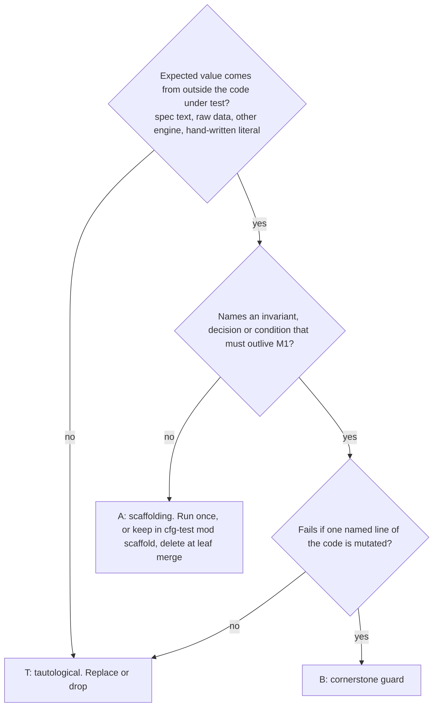

# M1 contracts: Test Definition (v0)

Date: 2026-11-05. Target path: `__reports__/m1-contracts/00-test_definition_v0.md`.

## Executive Summary

**What must be proven.** The ranked critical conditions hold:
- the cell digest content;
- persisted frame and trace shapes;
- no process survives and no secret leaks;
- the store never exposes a partial file and its layout is frozen;
- the golden corpus imports losslessly, with no domain word in the core;
- the traits fit a second harness;
- every resolved value records its source.

**What the plan gets wrong.** Its gates are mostly sound. Four patterns would give a false sense of safety:
- Two "enumeration" gates take their expectations from the schema they test (cell digest, `context_digest`).
- The precedence proptest checks against the order constant that the code itself uses.
- Several gates cost more than they protect: 10^5 doubles, re-exec crash tests, a multi-thread proptest, a 2^6 subset sweep.
- The golden gate cannot run in CI, because the corpus is absent there. The mini-corpus twin is therefore the only mapping guard CI has.

**Volume.** About 60 committed B tests across the milestone, against about 110 already in `candler-schemas`. No A test survives a leaf's merge. Workspace `nextest` runs in under 60 s. The ignored golden test runs in under 5 minutes.

## Model: how every test is judged

## Scope

- **In scope:** the M1 gates, critical conditions 1–8, and the invariants I1, I3, I10–I12, I15, I17–I19, I21.
- **Out of scope:**
  - serde, schemars, `ryu-js`, `std::File::lock` and `rename` atomicity;
  - M2a and M2b behaviour;
  - live Claude Code capture.
- **Assumptions:** the golden corpus is extracted locally by the prepare script. CI has no corpus, so the mini-corpus is the CI oracle.
- **Trust boundaries:**
  - Real: filesystem, processes, procfs and libproc parsers (as pure functions), the Node/Python probes run once.
  - Mocked: harnesses (fakes), the network (a loopback listener only).

## Classification of the plan's gates

Dispositions are B (cornerstone guard), A (scaffolding) and T (tautological). "Fold" means merged into another test. G means a static gate that is not a test.

| Leaf | Gate | Class | Protects / flaw | Oracle, or disposition |
|---|---|---|---|---|
| foundations | JCS vectors, RFC App. B | B | Cond 1 | The RFC text itself |
| foundations | 10^5 random doubles | A | Cost: ~MBs of fixture | Run once, record in leaf report. Commit about 2k stratified doubles (powers of 2, subnormals, 1e21 edge, max, -0), with the Node generator script |
| foundations | UTF-16 key order | B, fold | Cond 1 | RFC §3.2.3 sample goes into the vectors file |
| foundations | >2^53 and lone surrogates refused | B | Cond 1 | Spec rule. One table test |
| foundations | cross-engine pattern probe | A plus B | Pattern contract | Run `uv run` once per pattern change and record it. Commit about 40 hand-picked vectors per pattern (trailing `\n`, Unicode digits) that Rust asserts and the script can replay |
| foundations | `check::<T>()` per type | T | Re-checks the derives | Registration only. Drop as a test. The drift test covers it |
| trace | frame proptest over arbitrary bytes | B | D1, I3 | The input bytes. One property, owned once by `frames` (dedupe with the supervisor's "Nth line") |
| trace | ordering mutation test | B, trimmed | Cond 2 | D2 rule list. One single-fault mutation per rule from a valid base. Assert refusal and the offending seq or session in the message. Drop "distinct error", which only re-checks the enum |
| trace | write→read→write identical | T unless fixture is hand-written | I3, I18 | A hand-authored byte-literal trace file with `ext` and an unknown kind |
| trace | no `null` | A, fold | | One helper that validates every committed fixture |
| trace | `SessionId` against `EvidenceRef` | B | D2 agreement | The existing `EvidenceRef` parser, written earlier and independent |
| oracle | extraction script checks | A | Prep tool | Script only, not a test |
| oracle | independent row table | B | G1 | Raw `Value`, no `_ =>` arm, pinned by Python `_outcome.py` sums |
| oracle | aggregates on the full corpus | B (local) | G1 | Third-party sums. Assert 240 and 10,320 first |
| execution | digest sensitivity by enumeration | T | Cond 1. The rule "under `comparable`" comes from the type under test | Replace: see Missing guards 1 |
| execution | key order | B, fold | | A key-shuffled twin in the vectors with the same digest |
| execution | unsorted or duplicate lists refused | B | Cond 1 | One table: 4 lists × 2 faults |
| execution | `run_config` becomes TOML, 12 cells | B | Real-data acceptance | 12 counted by hand from the YAML |
| execution | unknown envelope kind round-trips | B | I18 | Hand-written bytes |
| evaluation | 43 expectations validate | B | Real-data acceptance | `eval.json`. Pin 43 and the id set |
| evaluation | suite graph | B | Suite validity | One table of 4 graphs (dup id, dangling dep, cycle, ok) |
| evaluation | `context_digest` enumeration | T | Same flaw as above | Hand projection table plus independent vectors |
| evaluation | `suite_entry_digest` ignores fields | B, fold | | Twins in the vectors differing in `id`, `evaluator`, `deadline_ms` |
| evaluation | `{legacy}` refused in notifications | B | Cond 7 | Include a positive control: the same cause is accepted in an outcome record |
| evaluation | method names and `-32800` | T | A constant equals a literal | Make them schema `const`s. The drift test and the freeze diff cover them |
| harness | two fakes through both traits | B | Cond 4 | OpenCode facts from the architecture |
| harness | `dyn` and `Send` asserts | B | Cond 4 | Compile-time, inside `public_surface.rs` |
| harness | `cargo tree`, no tokio | B | Layering | Move into the layering guard |
| resolve | precedence proptest, 2^6 | T | Oracle is the code's order constant | Replace: six-row table from D5 prose |
| resolve | unknown keys at every table | B, trimmed | D8 | Hand-list the 4 tables. Do not enumerate from a schema |
| resolve | `slots.count`, path bases | B | D8, I14 | Hand-written files |
| resolve | step visibility, duplicate step, all failures reported | B | Cond 5 | Two tests |
| supervisor | tree ignores TERM, no survivor | B | I15, G4 | The OS: `kill(pid, 0)` plus start time |
| supervisor | record on disk at spawn return | B | G4 | Read the file immediately after `spawn` returns |
| supervisor | forged record not alive | B | I15, PID reuse | A hand-forged record |
| supervisor | event order and payloads | B, trimmed | Cond 3 | Literal ordered kinds. This is also the only schema validation of `process.*` payloads (remove it from seams) |
| supervisor | secret canary | B | I19 | A planted canary string. Needs a scanner self-test |
| supervisor | grandchild holds pipe | B | I15 | Generous slack on the bound |
| supervisor | failed pre-stop still escalates | B | D11 | 2-row table |
| supervisor | loopback parsing | B | D11 | A hand list of about 10 URLs |
| supervisor | Linux clippy, CI note | G | | Keep as gates |
| store | crash re-exec with `abort()` | cost over value | Cond 6 | Replace: in-process stop-after-step-k, then check with an independent `serde_json` reader |
| store | index proptest with N threads | T and flaky | | Test-side directory scan as oracle. One plain 4-thread × 25 test. One hand-torn-line fixture |
| store | blobs 0444, wrong sha, replace refused | B, fold | I11 | One append-only test |
| store | copied store reads identically | B | I17 | Byte-equal reads |
| store | relative paths | B | I17 | The shared scan helper (see Missing guards 4) |
| reader | provenance shas recompute | B | Fixture honesty | Shared helper for every fixture dir. It also enforces the `synthetic` label |
| reader | every frame cited | B | I3, no silent loss | The stream's own frame count |
| reader | usage equals jq sum | B | Cond 2 | Committed totals plus the generator script. No `jq` at test time |
| reader | version table | B | Cond 4 | 6 rows |
| reader | one frame versus chunks | B | I3 | A differential. Name it "output independent of delivery chunking" |
| reader | `digests.toml` ratchet | B (ratchet) | I3 version discipline | A snapshot, not correctness evidence. Needs the diff gate |
| reader | FP and FN denials and subagents | B | Reader correctness | Hand-written `expected.toml` per stream |
| mapping | mini-corpus equals oracle | B | G1 in CI | The oracle |
| mapping | contaminated gives `invalid{input_leak}` | B | G3, I10 | Hand-built fixture. Add an `incomplete`-is-valid case |
| mapping | disagreeing metadata refused | B, fold | D6 | One refusals table (see the import row) |
| mapping | no absolute path in `values` | B, fold | I17 | Shared scan helper |
| import | all 10,320 equal oracle | B (local) | G1 | The oracle |
| import | two dirs, `diff -r` empty | B | I3 determinism | Run on the mini-corpus in CI. Full corpus only inside the golden test |
| import | one byte changed refused | B, fold | I11 | One refusals table: metadata disagree, harness disagree, unknown verdict, missing `outputs/`, one byte |
| import | kill mid-import then re-run | B, rewritten | I11 | Injected `Err` at 3 steps, then `diff -r` against a clean import. No re-exec |
| import | `no_domain_words` | B, ratchet | I1 | A literal deny-list. Widen to `candler-schemas/src` and `candler-harness` |
| import | acme-eval swap | B | I1 | Behavioural. Rewrite the mini-corpus domain strings, then scan the output store for the old strings |
| import | `cargo tree`, no claude-code | B | Layering | Layering guard |
| import | I17 scan | B | I17 | Shared helper |
| seams | cross-leaf assertions | B | Cond 2, 6 | Literals in the test: the layout string, frame lines counted by `lines()`. Drop the duplicated payload-schema check |
| gate_sweep | sweep commit | A | | Run once, record in the leaf report. Not a test file |
| gate_sweep | G5 `expected_roots.txt` | B only if hand-curated | Condition: a root dropped and its file deleted passes drift | List roots from architecture §"The `schemas@` line holds". Never generate it with `ls` |

## Missing cornerstone guards

| # | Condition | Single most valuable test |
|---|---|---|
| 1 | Cond 1, cell digest | `tests/guard_cell_digest.rs` reads a human-authored `hashed_paths.toml` that lists every manifest path as `hashed` or `nuisance`. It carries about 6 independent digest vectors (Python `hashlib` over RFC 8785 via a committed script) and a key-shuffled twin. Completeness: a schema path absent from the table fails. Changing the table or a vector requires a `comparable/N` bump. |
| 2 | I3, replayability | In seams, after `RunWriter::trace`, re-read the stored `raw.gz` with `FrameReader`, feed a fresh reader at the recorded version, and compare bytes to the stored trace. |
| 3 | I19 across the pipeline | In seams, run the fake harness with a canary secret in its environment. At the end, scan `store/`, the job directory, the event log and `record_dir` for the canary. |
| 4 | I17 and every scan guard | One shared `tests/support::assert_clean(dir, needle)` with a self-test that plants a violation and expects failure. Use it for the canary, I17 and the domain scan. It also asserts the scanned set is non-empty, which kills a vacuous pass over an empty directory. |
| 5 | Cond 6, store layout | One test writes a fake run and asserts the exact relative path set equals a literal list taken from architecture §Run store. |
| 6 | Cond 8, importer identity | Pinned `request_id` vectors for 3 runs (UUIDv7 from `regraded_at.finished` and `sha256(run key ‖ evaluator)`), computed by a Python script. |
| 7 | I12 | In the precedence table test, assert `values.keys() == sources.keys()` for every row. |

## Per-crate budget and layout

**Marking convention:**
- Every file in `tests/` is `guard_<topic>.rs`, and every test in it is B.
- Each test function carries a doc line `/// Guards: <I#|D#|Cond#> — <property in domain terms>. Oracle: <source>.`
- Pure-function B tests (loopback parser, procfs parser) may sit in `mod guards` inside the unit's file.
- A tests live only in `#[cfg(test)] mod scaffold` in the unit's file. The leaf's last commit deletes the module unless a test is promoted to B with the header.
- Existing `outcome_*` and `catalog_*` files stay untouched in M1.

| Crate | Files at end of M1 | New B tests | A in committed suite |
|---|---|---|---|
| `candler-schemas` | `guard_jcs` (3), `guard_cell_digest` (5), `guard_context_digest` (2), `guard_trace_wire` (4), `guard_evaluator_protocol` (3), `guard_experiment_file` (1), `guard_pattern_vectors` (1), drift (+1: roots list) | ~20 | 0 |
| `candler-harness` | `public_surface` (1, compile-only), `guard_two_shapes` (2) | 3 | 0 |
| `candler-harness-claude-code` | `guard_reader` (6), `guard_fixture_provenance` (1) | 7 | 0 |
| `candler-core` | `guard_supervise` (8, about half Linux-only), `guard_frames` (2), `guard_store` (5), `guard_resolve` (4), `guard_import_mini` (4), `guard_golden` (2, ignored), `guard_seams` (3), `guard_layering_i1` (3), `public_surface` (1) | ~32 | 0 |

`public_surface.rs` holds usage only, with no behaviour asserts. Any change to it needs a deliberate commit. Existing-suite cleanup is a separate `chore(test)` pass after M1, not part of it.

## Oracle-independence rules

1. An expected value comes from one of these: spec text, raw source data, another engine (Node, Python, `jq`, the OS), or a hand-written literal. It never comes from the code under test, the generated schema, or a constant that the code also uses.
2. An implementer never writes the oracle for their own leaf. The oracle leaf is the model.
3. A blessed snapshot is a ratchet, not correctness evidence. Blessing needs a version bump and a human-read diff, and the commit message says what changed. Applies to `schema/*.json` and `digests.toml`. Add `git diff origin/main` gates that fail on edits to existing lines.
4. A property test names its property in domain terms. It never says "round trip" without naming what is preserved.
5. A refusal test mutates one fault from a valid base and asserts the refusal. It also states a positive control (the unmutated base passes).
6. Every scan guard has a self-test with a planted violation and a non-empty-scan assertion.
7. Bite record: for each B test, the leaf report names the one-line mutation of the implementation that makes it fail. The verifier re-runs 3 of them.
8. Timing assertions use generous slack. A test with a documented flake history is a defect, not a retry.

## Fixture strategy

| Kind | Rule | Budget |
|---|---|---|
| Real streams (reader) | Six streams chosen by shape class (subagent, denial, `api_error`, multi-init, usage repeat), smallest in each class. One copy only. Core's mini-corpus reads the adapter's copies via a relative path, the single allowed cross-crate read. | ≤ 150 KB gz each, ≤ 1 MB total |
| Mini-corpus (importer) | 3 real runs, including one `incomplete` and one with `blocked_by`. Only the files the importer reads, plus one `._*` and one `shared_with_skill/` stub to test skipping. | ≤ 1.5 MB |
| Synthetic | Authored from spec text or by a committed generator, never captured from our own writer. Filename prefix `synthetic_`, `PROVENANCE.toml` entry `synthetic = true`, and a first-line `SYNTHETIC` note where the format allows. | Hooks, MCP, contaminated, text-valued, `not_applicable` |
| Vectors | Digests, doubles, patterns, usage totals, `request_id`. Each ships with its generator script and the engine used. | ≤ 150 KB for JCS |
| Golden corpus | Never copied into the repo beyond the mini-corpus. Local `CANDLER_GOLDEN_CORPUS` only. Say plainly that CI skips it, and run it before each push as a release gate. | 0 |

Total new committed fixtures: ≤ 3 MB.

## Test matrix (committed set after consolidation)

| Group | Scenario | Risk it covers | Tier | Setup / Data | Assertion (observable) |
|---|---|---|---|---|---|
| Digest | Hashed-path table and vectors | Cond 1 | regression | `hashed_paths.toml`, Python-computed vectors, shuffled twin | Digest equals the vector. A path missing from the table fails. The nuisance twin gives the same digest. |
| Digest | Lists refused | Cond 1 | regression | 4 lists × (unsorted, dup) | Reader refuses and names the list |
| Wire | Hand-authored trace bytes | I3, I18 | regression | Byte-literal fixture with `ext` and an unknown kind | Bytes out equal bytes in |
| Wire | Ordering faults | Cond 2 | regression | 7 single-fault mutations | Refused, naming seq or session |
| Frames | Reassembly and index | D1 | regression | Arbitrary bytes, plus a table of 8 literal cases | Concatenation equals input. Line N is frame N. |
| Supervisor | No survivor | I15 | integration (component) | TERM-ignoring tree | Pids dead or start time differs; group empty |
| Supervisor | Canary | I19 | regression | Canary string | Absent from record, events and `Debug` |
| Store | Stop at step k | Cond 6 | regression | In-process stop at each step | An independent reader sees only complete files; retry succeeds |
| Store | Layout | Cond 6 | regression | A fake run | Path set equals the literal list |
| Reader | Citation, usage, chunking, facts | I3, Cond 2 | regression | 6 real and 2 synthetic streams | Every frame cited. Usage equals the committed totals. Chunking leaves output unchanged. Facts match `expected.toml`. |
| Import | Mini equals oracle | G1 | regression | Mini-corpus | Every row equals the oracle |
| Import | Idempotent and deterministic | I11 | regression | Two dirs, injected failure | `diff -r` empty |
| Import | Acme swap | I1 | regression | Rewritten corpus | No old domain string in the store |
| Golden | 10,320 rows | G1 | regression (ignored) | Full corpus | 240 runs, then equal to the oracle |
| Seams | Cross-leaf | I3, I19, I17 | integration (component) | Fake harness | Replay equals stored trace. Canary and I17 scans are clean. |

## Observability and must-run set

Every ignored or Linux-only run is logged to a file and attached to the leaf report. Must run before each push: `guard_cell_digest`, `guard_import_mini`, `guard_store`, `guard_seams`, `guard_layering_i1`, the drift test, and the golden test.

## Concrete edits to the plan

1. **Conventions, new "Test classes" paragraph.** "A leaf commits only B tests. A B test names its invariant, decision or condition, and its oracle, in a doc line. An A test lives only in `#[cfg(test)] mod scaffold` and is deleted in the leaf's last commit. `tests/*.rs` files are named `guard_*`. A leaf report lists each B test with its bite mutation."
2. **Conventions, oracle rules.** Paste the eight oracle-independence rules above.
3. **wire_foundations Gates, replace the first and fourth lines.**
   - "JCS: RFC 8785 App. B plus about 2,000 committed stratified doubles generated once by Node. The 10^5 run is done once and recorded in the leaf report."
   - "Patterns: about 40 committed vectors per pattern, asserted in Rust. Run the `uv run` probe once per change and record it."
   - Delete the `check::<T>()` requirement.
4. **wire_trace Gates.**
   - Replace the first line with "reassembly property owned by `frames`; here only hand-written vectors".
   - Replace the mutation line with "single-fault refusals; name the offending seq or session; no distinct-error requirement".
   - Replace the byte-identical line with "a hand-authored byte-literal trace round-trips".
5. **wire_execution Gates, replace the first two lines.** "A hand-authored `hashed_paths.toml` plus about 6 independent digest vectors (script and engine named) and a shuffled twin. A schema path absent from the table fails. A digest change for an existing vector needs a `comparable` version bump."
6. **wire_evaluation Gates.**
   - Replace the `context_digest` line with "hand projection table plus independent vectors; the `suite_entry_digest` twins differ only in `id`, `evaluator`, `deadline_ms`".
   - Delete "Method names and -32800 are pinned". Make them schema `const`s.
7. **resolve_config Gates, replace line 1.** "Six-row precedence table from D5 prose. Each row asserts value and source. Every row asserts that `values` and `sources` have the same keys. No proptest."
8. **services/run_store Gates, replace lines 1 and 2.** "In-process stop-after-step-k, with an independent `serde_json` reader on the result. Index equals a test-side directory scan. One 4-thread × 25 append test. One hand-torn-line fixture. No re-exec, no proptest."
9. **supervisor Gates.** Remove "validate against the published schema" from seams. Keep it once, in the event-order gate, which also asserts the literal ordered kinds.
10. **claude_code_reader Gates.**
    - Add: "Each vendored stream has a hand-written `expected.toml` (sessions, subagent ids, denial count, `ended_by`) that is asserted."
    - Reword the `digests.toml` gate: "this is a ratchet that does not prove correctness; a CI step fails on an edit to an existing line".
11. **legacy_import Gates.**
    - Replace the kill-mid-import gate with "injected error at 3 steps, then `diff -r` against a clean import".
    - Merge all refusals (one byte, metadata disagree, unknown verdict, missing `outputs/`) into one table gate.
    - Extend `no_domain_words` to `candler-schemas/src` and `candler-harness`.
    - Add "pinned `request_id` vectors for 3 runs".
12. **seams Gates.** Add the three new assertions (replay equals stored trace, canary scan, exact store layout). Remove the duplicate payload-schema line.
13. **gate_sweep.** Change to "no test commit; run the commands and record them. `expected_roots.txt` is hand-curated from architecture §schemas@".
14. **Verification policy, verifier briefs.**
    - Add to every verifier brief: "Find the tautological tests. For each committed test, state its oracle. Mutate one line of the code under test and show the test fails. List the tests that survive."
    - Add to the Grit reviewer checklist: "every `tests/*.rs` file starts with `guard_`; no `mod scaffold` survives; every B test has a `Guards:` line".
15. **Verification policy, new row.** "api_review reads `public_surface.rs` for behaviour asserts. There should be none."
16. **Risks, new row.** "The golden test is not run by CI. Mitigation: the mini-corpus oracle test runs in CI, and the golden test runs before each push and is recorded in the KT report."

## Coordinator rulings

- **`check::<T>()` is kept, as a cornerstone guard (B).** It does not re-check the derives. For every pattern in a type's generated schema, it asserts that `pattern_problem` finds no construct that reads differently under ECMA 262, Rust and Python `re`, and that the pattern ends with the cross-engine end anchor. The drift test only compares the schema with itself, so it does not cover this. The weak point is the hand-kept list of types, which a new type can miss. `wire_foundations` replaces that list with a walk over every root of `generated_schemas()`, which makes it part of the pattern guard together with `guard_pattern_vectors`.
- Every other classification and plan edit above is accepted and folded into the campaign `__roadmap__/m1-contracts/`.
