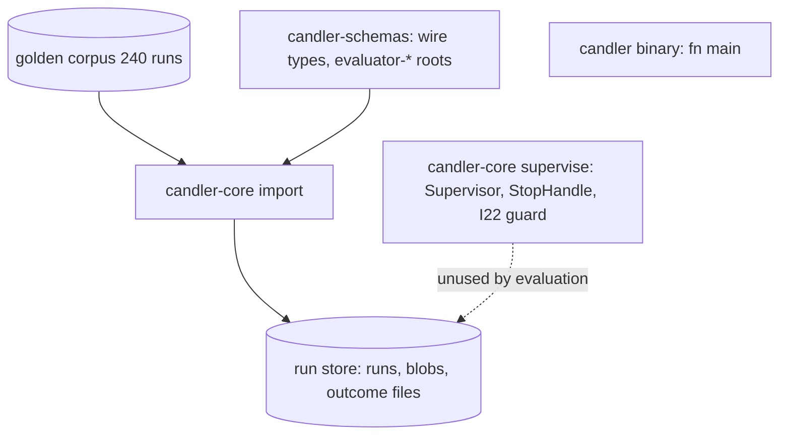

# M2a evaluation parity — Architecture Analysis (v0)

Date: 2026-11-06

The roadmap [`__roadmap__/m2a-evaluation-parity/`](../../__roadmap__/m2a-evaluation-parity/README.md) cites this report as R03. Its section names are the anchors the leaves cite. It pins decisions 1–13 of the approved plan.

## Executive Summary
- **Problem.** M1 can import the golden corpus as `htn-creator-eval@0.4.2`, but Candler cannot yet run an evaluator. Nothing yet shows that a live grade reproduces the recorded one.
- **Proposed change.** M2a adds:
  - a plug-in registry;
  - an evaluation engine over JSON-RPC 2.0 on stdio;
  - the Python helper `candler-evaluator`;
  - the HTN plug-in `htn-creator-eval@0.5.0`, which adapts the pinned grader;
  - `candler import | evaluate | show | diff`.

  The proof is a live regrade of the 240 runs, which must equal the imported rows on Tiers A–C and then reproduce itself.
- **Non-goals.**
  - Tier D (D-E1…6, 1,440 rows), snapshot attach, suite `inputs[]`, the `rikyu_mcp` rule and the mcp-python-ingestion install. See §Scope move.
  - The M2b execution path.
  - Publishing to crates.io or PyPI.
- **Biggest risks.**
  - A diff that cannot see a field.
  - An oracle that shares a source with the code.
  - Kind fidelity on branches the corpus never reaches.
  - An instrument digest that is not the pinned commit.
- **Validation.** 31 cornerstone guards ([R04](01-test_definition_v0.md)). Their apex is `guard_golden_parity` (GP1–GP3), whose expected numbers come from a Python oracle that imports nothing from Candler.

## Scope move
Eliott ruled on 2026-11-06 that the plug-in grades Tiers A–C only, which is 37 of the 43 expectations of `eval.json` at `28be2c15`. The corpus has 240 runs × 43 = 10,320 imported rows, of which 8,880 are A–C.

| A–C rows | pass | not_applicable | fail | blocked | not_measured |
|---|---|---|---|---|---|
| imported `0.4.2` | 7,999 (209 of them `0/0 {legacy: zero_weight}`) | 0 | 415 | 466 | 0 |
| live `0.5.0`, expected | 7,790 | 209 `{reason: empty_population}` | 415 | 466 | 0 |

- **Uncompared.** The uncompared set is exactly {D-E1…D-E6} × 240 = 1,440, so compared + uncompared = 10,320.
- **Gate rates.** D-E3…D-E6 are gates. The live gate rate per cell is therefore `_outcome.py`'s formula over the A–C gates only. The KT tabulates it against the published rates.
- **Registry refusals.** A `snapshots` or `inputs` need is refused with exactly `unsupported in this version: snapshots` or `unsupported in this version: inputs`.
- **Unchanged.** The I4, deadline and instrument gates of the milestone leaf are unchanged. The coordinator OKs the amended wording, recorded in the roadmap's Amendment Log A1.

## Current State


## Proposed State

```mermaid
graph TD
    subgraph Candler
      cli[candler import/evaluate/show/diff] --> engine
      cli --> selection
      engine[evaluation::engine] --> registry[evaluation::registry]
      engine --> context[evaluation::context]
      engine --> client[evaluation::client]
      engine --> writer[store OutcomeWriter]
      registry --> envstep[EnvironmentStep preflight]
      client --> supervise[supervise::Supervisor]
      client --> rpc[schemas evaluation::rpc]
      selection[evaluation::selection: select, rates, diff] --> store[(run store)]
      writer --> store
      context --> store
    end
    subgraph Python
      helper[candler-evaluator: loop, fd guard, fork, identity]
      plugin[htn-creator-candler: kinds, manifest, suite] --> helper
      plugin --> grader[htn_creator_eval and htn-creator-scripts at 28be2c15, installed git+file]
    end
    supervise -- spawn, stdio JSON-RPC --> helper
    oracle[tests/oracle/gen_oracle.py: raw corpus + _outcome.py] -. expected numbers .-> guard[guard_golden_parity]
```


The core names no domain: `guard_layering_i1`, extended to the binary and the helper (NEUT), keeps it that way. HTN vocabulary lives only in `$RW`.

## Key Flows
```mermaid
sequenceDiagram
    participant C as candler evaluate
    participant E as engine
    participant R as registry
    participant X as context
    participant K as client
    participant S as Supervisor
    participant H as helper (one process per request)
    participant F as forked child (one per item)
    C->>E: evaluate(EvaluateRequest)
    E->>R: load manifests, check_suite
    R-->>E: CheckedSuite (no process spawned)
    E->>R: EnvironmentStep: uv sync --frozen once per lock digest
    E->>K: describe (own process)
    K->>S: spawn helper
    H-->>K: DescribeResult (name@version, instrument git:28be2c15…)
    loop each run, up to `concurrency` requests at once
      E->>E: plan: applies_to miss -> not_applicable; dependent of fail -> blocked
      E->>X: assemble(needs) then materialise(workspace)
      X-->>E: RunContext with context_digest
      E->>K: evaluate(params, request deadline)
      K->>S: spawn helper, stdin: one RpcRequest then EOF
      loop each item, dependencies first
        H->>F: fork; child arms SIGALRM item deadline
        F-->>H: outcome on a pipe, or exit/alarm -> not_measured {instrument_error}
        H-->>K: outcome notification
      end
      H-->>K: evaluate result
      alt request deadline fires first
        K->>H: cancel, grace period, then Child::stop (I22)
        K-->>E: unreported items -> not_measured {deadline}
      end
      E->>E: OutcomeWriter create, append, commit (one file per request)
    end
    E-->>C: EvaluateReport
```

## Decisions

### Identity
- The live evaluator is `htn-creator-eval@0.5.0`. The parity check is `candler diff --from htn-creator-eval@0.4.2 --to htn-creator-eval@0.5.0`.
- The `htn-creator-eval@0.5.0` tag in `$R` is cut only on Eliott's go.
- `0.4.2` is what the importer wrote, so the import keeps its M1 spelling. Aligning that spelling is a KT follow-up.

### Truthful instrument
- The instrument is `htn-creator-scripts` 0.1.0, with digest `git:28be2c15…`.
- The helper's `identity(dist)` reads it from that distribution's PEP 610 `direct_url.json`. Its rules:

  | Install | Digest |
  |---|---|
  | `git+file`, `vcs_info.vcs == "git"`, no `dir_info.editable` | `git:<commit_id>` |
  | Editable | `dirty = true` |
  | No `direct_url.json` (an index install) | `IdentityError` |

- The helper never runs `git` on disk.
- The plug-in's lock installs both `htn-creator-scripts` and `htn-creator-eval` from `git+file://$R@28be2c15#subdirectory=…`, never editable and never from `$RW`.

### Adapt don't wrap
- **Rejected options.** Wrapping `grader.py` would make Candler inherit its CLI and its record shape. Porting it would fork the logic.
- **Adopted.** The plug-in writes one pure kind per `grading_spec.type` the 37 A–C entries use, and imports the grader's pure helpers unmodified: `find_output`, `classify_outcome`, `extract_with_regexes`, `parse_ratio_markers`, `_finalize_metric` and `_cast`.
- `grader.py` and the checkers stay byte-identical at `28be2c15`; that is a one-shot gate.
- The grader runs each checker as `sys.executable -m <module>`, with cwd at a private staging root and a 60 s timeout. A kind runs the same module with `runpy.run_module` inside the helper's forked child. It:
  - copies the staged files exactly as the grader does;
  - captures stdout and stderr at fd level;
  - reads `SystemExit` as the exit code.

  The helper's fork, not a subprocess, gives the isolation.

### Kind signature
```python
Kind = Callable[[Params, Context, Sequence[Prior]], Outcome | Mapping[str, Any]]
Params  = Mapping[str, Any]           # the suite entry's params, validated by the registry
class Context(Protocol):              # duck-typed; kinds never import candler_evaluator
    root: Path                        # the materialised workspace; artifacts under root/"outputs"
    artifacts: Sequence[str]          # paths relative to outputs/, "/" separators, sorted
    metadata: Mapping[str, Any]       # one key per metadata need, e.g. "plan.prompt_domain_name"
    scratch: Path                     # a private writable dir; a kind never writes under root
class Prior(Protocol):                # one per depends_on entry, in declared order
    expectation: str
    outcome: Mapping[str, Any]
# returned keys: status, value?, weight? {num, den}, cause? (one key), evidence?
```
- A kind reads only `context`, its params and `prior`. Its result depends on nothing else.
- The helper accepts an `Outcome` dataclass or a mapping with the same keys.

### Quirk table
Kept quirks change A–C rows, so they are explicit params with the grader's default. Redesigned behaviours are rows of `deltas.toml`. Candler-owned behaviours are never done by a kind.

| Behaviour | Class | Where |
|---|---|---|
| B8 `on_missing: fail` (missing target is `fail`, not `blocked`) | kept | param |
| Missing optional `stage_files` source gives `blocked {artifact: <path>}` | kept | param `required` |
| Broken or absent metric gives value 0 and `pass` | kept | metric kinds |
| C6 divide-by-zero gives `0.0` and `pass` | kept | `ratio` param |
| Regexes, `round`, `cast` (int vs float) as in `eval.json` | kept | params |
| `source: grader_run` met by running the fallback script or module in the kind | kept (value-equal; KP1 decides) | metric kinds |
| 0/0 `pass` gives `not_applicable {reason: empty_population}` | ruled by Eliott | kinds; equivalence row |
| Checker timeout or spawn failure (grader: sentinel `-2`/`-3`) gives `not_measured {reason: instrument_error}` | redesigned | `deltas.toml` |
| Ratio `ValueError` gives `not_measured` | redesigned | `deltas.toml` |
| C6 `metric_compute` formula becomes the closed `ratio` kind with numerator and denominator ids in params | redesigned | `deltas.toml` |
| Identity, request and item deadlines, `applies_to`, dependency `blocked` | Candler-owned | core, helper |

### Needs
- Needs replace templates, and no `{…}` survives into the suite.
- `{domain_name}` appears in 11 A–C specs. It becomes the metadata need `plan.prompt_domain_name`, read from the run manifest.
- `{alias}` appears in 15 A–C specs. It is a staging alias that the grader mints as `eval-staging-<8 hex>`, so the plug-in mints it the same way per item. It is never a need.
- The artifact need for every entry is `outputs/**`.

### File rule
- **Artifacts.** The artifacts of a context are the run's stored `outputs/` files matched by an artifact glob, minus any path with a component starting with `.` unless the glob names that component literally.
- **What it drops.** The rule drops `.claude/` (the grader's own `find_output` exclusion), AppleDouble `._*` and `.DS_Store`. The corpus also carries `__MACOSX/` beside the cells, which is outside every run.
- **Paths.** Paths are relative to `outputs/` with `/`.
- **Empty `outputs/`.** It gives no artifacts and no error.
- **Inside a kind.** The kind still applies `find_output`, so a kind sees what the grader saw.
- **Live projection.** `gen_live_context.py` writes the rule in this prose and its vectors are RC1's oracle.

### Environments
- `EnvironmentStep` is a `PreflightStep`. Per plug-in it runs `uv sync --frozen` through `Supervisor::run_captured`, into `<env root>/<sha256(uv.lock ‖ pyproject.toml)>/.venv`.
- The env root is `<state home>/candler/environments` (`registry::default_env_root(&Config)`, from `Config::state_home`), whatever the project: one environment per lock digest serves every store. `EvaluateRequest.env_root` carries it to the engine, which refuses a plug-in whose environment has no `ready` marker.
- `registry` keeps each manifest with its directory, because `command`, `uv.lock` and `pyproject.toml` are relative to it.
- It writes the `ready` marker only after success, and a second run under the same digest spawns nothing (REG2).
- The registry validates params and needs without spawning anything (I14).
- The workspace is a private copy, read-only after writing, outside the store root. A plug-in can never write through to a blob (I11, RC3).

### C6 dependencies
- C6 declares `depends_on [C1, C5]`, and the engine sends all three in one request, with C1 and C5 first. C6 receives their outcomes as `prior[]`.
- If a dependency ends `fail`, `blocked` or `not_measured`, the dependent is `blocked` with cause `{expectation: <id>}`. The core writes that row and never sends the item.
- Every other entry is independent.

### I4
- Request ids are UUID v7 (`RequestId::new_v7`), so they are time-ordered.
- The selection key is `(evaluator name@version, run, expectation, context_digest, suite_entry_digest)`. Two records under one key that differ in `status`, `value`, `weight` or `cause` are an `I4Violation`.
- There is one exception: an error outcome (`not_measured` with cause `instrument_error` or `deadline`) followed by a measured one is a recovery. In that case the later record is current.

### Generic diff
- **Join.** Rows are joined on `(run, expectation)`. The four fields are compared exactly, and evidence is never compared.
- **Normalisation.** A weight equal to its status default (`pass` 1/1, `fail` and `blocked` 0/1) is normalised to absent on both sides.
- **Numbers.** JSON numbers keep their kind: `3` ≠ `3.0`.
- **Change classes.** Missing and extra rows are changes; the classes are `status`, `value`, `weight`, `cause`, `missing` and `extra`.
- **Uncompared.** A row whose expectation is absent from the `to` suite is uncompared, and is listed with its count. A version's suite is read from its records (I21): an expectation is in it when the version has at least one record for it.
- **Nothing compared.** `compared == 0` is an error (exit 2), never "no change": a regrade whose requests all failed leaves no `to` records, and must not pass.

**Equivalence file** (`--equivalence <file>`; the coordinator's conditions of 2026-11-06 apply). It names exact rows, never a pattern over all rows:
```json
{ "generator": "crates/candler/tests/oracle/gen_oracle.py",
  "rules": [ {
    "name": "legacy-zero-weight-pass",
    "from": { "status": "pass", "weight": { "num": 0, "den": 0 }, "cause": { "legacy": "zero_weight" } },
    "to":   { "status": "not_applicable", "cause": { "reason": "empty_population" } },
    "rows": [ { "run": "<cell hex>-r<replicate>-a1", "expectation": "<id>" } ] } ] }
```
- **One allowed change per rule.** `from` and `to` are whole records on the four fields after weight normalisation: an absent key means the field is absent, so the match is exact. The rule applies `from` → `to` only.
- **Exact rows.** A listed row is excused only when its `from` side and its `to` side both exist and equal the rule's `from` and `to` exactly. An unlisted row showing the same change is an ordinary change.
- **Failures.** A listed row missing on either side is a change of class `equivalence_missing`. A listed row showing any other pair, unchanged included, is a change of class `equivalence_mismatch`. A row listed twice, or an unknown key anywhere in the file, makes `diff` refuse the file with exit 2.
- **Generated, not hand-written.** The rule's `from` and `to` are literals in `gen_oracle.py`, transcribed from Eliott's ruling. Its 209 rows come from the raw corpus (`max_score == 0` on an A–C `pass`, the same rows as `na_pairs.txt`). Each run key's cell hex is the digest of the cell's `comparable` object, which the script builds from R01's text with `rfc8785`, as M1's `gen_vectors.py` does. Nothing is read from the importer or the store.
- **Recorded.** `diff` records the file's sha256 and reports the excused rows as their own count, never as unchanged.

**`diff --format json`** has exactly these keys:
```json
{ "compared": 8880, "unchanged": 8671, "excused": 209, "changed": 0,
  "changes": [ { "class": "value", "run": "…", "expectation": "…", "from": {…}, "to": {…} } ],
  "uncompared": [ { "expectation": "D-E1", "count": 240 } ],
  "equivalence": { "sha256": "…", "rows": 209 } }
```
- `compared` counts the `(run, expectation)` rows present on either side for an expectation in both suites, and `unchanged + excused + changed == compared`. Missing, extra and equivalence failures are counted in `changed`. `equivalence` is `null` without `--equivalence`.
- Exit 1 when `changed > 0`, 0 otherwise, 2 on an error or when `compared == 0`.
- In the core, `diff(from, to, equivalence: Option<&Equivalence>)`; `None` gives `equivalence: null`.

**Rates** (`show --rates --evaluator <name@version> --format toml`, and `$ORACLE/rates_by_cell.toml` byte for byte):
```toml
[cell."20260806-035940_v0.2.3_claude-haiku-4-5_model-claude-haiku-4-5_skill_version-htn-creator-v0.2.3"]
gate = [<num>, <den>]
quality = [<num>, <den>]
```
- There is one table per cell directory (12 cells, one arm `with_skill`, 20 runs each), with keys sorted and one trailing newline.
- The formula follows `_outcome.py` at `28be2c15`: `_rate_for_role` and `counts_toward_denominator`.
  - Per run and per role (`gate`, `quality`; the role is read from `eval.json`), sum the numerators and the denominators over expectations whose status is `pass`, `fail` or `blocked`.
  - `blocked` counts with numerator 0. `not_measured` and `not_applicable` are excluded.
  - A cell's pair is the sum of its runs' pairs.
- A 0/0 `pass` adds nothing, which is why the excused rows leave the rates unchanged.
- For live records the pair is the weight's `num`/`den` and the role is the record's own `role` (I21), so `rates` takes no suite; for raw rows the pair is `score`/`max_score`.
- `--rates` requires `--evaluator`: the store holds `0.4.2` and `0.5.0` records, and rates belong to one version.

### Protocol
- `evaluation::rpc` adds one schema root, `evaluator-message`. It wraps the existing `evaluator-request-side` and `evaluator-notification` roots by reference, and no existing schema changes (DRIFT, WIRE2).
- There is one process per request. Stdin carries one `RpcRequest`, then EOF. Stdout carries frames only: notifications as outcomes arrive, then one response.
- **Deadlines.**
  - The item deadline lives in the helper's fork.
  - The request deadline lives in the client: at the deadline it sends `cancel`, waits a grace period, then calls `Child::stop`.
  - Cancel is answered with error `-32800`.
  - A caller cancel (Ctrl-C on `candler evaluate`, through the `cancel` receiver of `evaluate`) takes the same path as the request deadline: `cancel`, grace, `Child::stop`. A cancelled request commits no outcome file. The binary only receives SIGINT; it never sends a signal.
- **Missing items.**
  - An item never reported before an early exit is `not_measured {reason: instrument_error}`.
  - An item never reported by the request deadline is `not_measured {reason: deadline}`; this is the only writer of `deadline`.
  - A late result is discarded.
- **I22.** No evaluation code signals; the only stops go through `Supervisor`/`StopHandle` (PC2).

### Python helper
- **Runtime** (`helper_runtime`).
  - The loop with an fd guard: fd 1 is duplicated to a private frame fd and then pointed at fd 2.
  - Fork per item: the child self-arms `ITIMER_REAL`, and the parent never signals.
  - A no-fork fallback, set with `CANDLER_EVALUATOR_NO_FORK=1`.
  - Pre-fork imports, PEP 610 identity, the plug-in API, and the synthetic and echo plug-ins.
- **Release** (`helper_release`).
  - Models generated from the published schemas, a single-source version and the tag line `candler-evaluator@X.Y.Z`.
  - Commit scope `evaluator-helper`, and a CI job. No PyPI.

### Cross-repo pin
- The plug-in's lock takes `candler-evaluator` from `git+file:///Users/hacker/Documents/src/CrackingShells/Candler@<sha>#subdirectory=python/candler-evaluator`, with `<sha>` a commit of `feat/m2a-evaluation-parity`. A worktree's objects are shared with the main checkout, so that URL resolves.
- After `git rebase --rebase-merges origin/main`, the coordinator re-pins with `uv lock --upgrade-package candler-evaluator`. The coordinator then checks `git merge-base --is-ancestor <pinned> feat/m2a-evaluation-parity`.
- Moving the pin to GitHub is a KT follow-up.

### Skeleton seams
These seams are frozen by `skeleton` before L1, and change only through the coordinator.

```rust
// candler_core::evaluation::engine
pub struct EvaluateRequest {
    pub store: PathBuf, pub plugins: Vec<PathBuf>, pub suite: PathBuf,   // the suite file
    pub runs: Option<String>,          // a glob over run keys; None = every run
    pub concurrency: NonZeroUsize, pub env_root: PathBuf,
    pub request_deadline: Option<Duration>, // None = sum of item deadlines + margin (R01)
}
pub struct EvaluateReport {
    pub request_ids: Vec<RequestId>, pub counts: BTreeMap<String, u64>,
    pub outcome_files: Vec<PathBuf>, pub failed_requests: Vec<(RequestId, String)>,
}
#[non_exhaustive] pub enum EvaluateError { NotBuilt /* , … filled by engine; Debug + Error only */ }
pub async fn evaluate(request: EvaluateRequest, supervisor: Arc<Supervisor>,
    cancel: watch::Receiver<bool>) -> Result<EvaluateReport, EvaluateError>;
```
- **Modules.** `evaluation::{registry, context, client, selection::{select, rates, diff}, engine}`; `registry`, `client` and `engine` are `#[cfg(unix)]`, as `supervise` is.
- **Shared CLI helpers.** `crates/candler/src/commands/common.rs` holds the store root (`--store`, else the configuration), the `Resolver` composition (each milestone's `register_*_steps` call one per line) and the binary's `EventSink`. M2b's commands call it too. `main` runs a multi-thread runtime, and the engine moves blocking store writes to `spawn_blocking`.
- **CLI.** `Cli { --store (env CANDLER_STORE, global), Command }` with these subcommands:

  | Command | Flags |
  |---|---|
  | `import` | `<corpus> --instrument <id@version>` |
  | `evaluate` | `--plugin <manifest> --suite <file> [--runs <glob>] [--concurrency N]` |
  | `show` | `[--rates] [--evaluator <name@version>] --format json\|toml` (`--rates` requires `--evaluator`) |
  | `diff` | `--from <id@version> --to <id@version> [--equivalence <file>] --format json\|text` |

  - Exit codes: 0 for success or no change, 1 for a change found by `diff`, 2 for an error (including `diff` with `compared == 0`).
  - M2b appends variants, one per line.

## Environment
Recorded in Phase 0. The `HTNSTD` gate compares against this.

| Item | Value |
|---|---|
| Candler | worktree on `feat/m2a-evaluation-parity` off `origin/main` `025fc55`; cargo with nextest, uv, jq |
| `$RW` | `feat/candler-htn-plugin` off `feat/skill-htn-creator`, unpushed |
| `mamba run -n forMpyIn` from `$RW` | imports `mcp_python_ingestion` from `$RW/mcp_python_ingestion/__init__.py`, so `$RW` is resolved, not the main checkout |
| HTNSTD baseline (`mamba run -n forMpyIn pytest -q -p no:cacheprovider` in `$RW`) | 470 tests at `28be2c15`: 386 passed, 10 failed, 73 errors (62 `ValueError` and 8 `RuntimeError` at setup: no database), 1 skipped, 1,241 s. The 83 failing ids are in [htnstd_baseline.txt](htnstd_baseline.txt); HTNSTD means no id outside that list fails |
| mcp-python-ingestion MCP server | down; git and the CLI are used instead |

## Contracts & Invariants
- **I1.** The core, the harness, the schemas, the binary and the helper name no domain (NEUT).
- **I4.** No silent change under one key (SEL1, ENG3, GP3).
- **I11.** A plug-in never writes into the store (RC3).
- **I14.** Validation spawns nothing, and environments are built once per lock digest (REG1, REG2).
- **I22.** Only `Supervisor` stops a process, and tests use the recording fake `Signaller` (PC2).
- **Error model.**
  - `RegistryError` names the entry, kind and JSON pointer.
  - `ContextError` covers a missing metadata path or a corrupt blob.
  - `ClientError` covers spawn and protocol faults.
  - An item-level fault is an outcome, never an `Err`: `not_measured {instrument_error | deadline}`.
  - A failed request leaves no committed outcome file and appears in `EvaluateReport.failed_requests`.

## Alternatives Considered

| Topic | Options | Chosen | Tradeoff accepted |
|---|---|---|---|
| Grader reuse | Wrap `grader.py`; port it; adapt it | Adapt: pure kinds that import its helpers | Divergences must be listed and guarded (KP2) |
| Live identity | Reuse `0.4.2`; mint `0.5.0` | `0.5.0` | The parity check is a cross-version diff, which needs the equivalence file |
| 0/0 pass | Keep `pass 0/0`; `not_applicable` | `not_applicable {empty_population}` | One equivalence rule over 209 exact rows |
| Isolation | Subprocess per item; fork per item | Fork, with a no-fork fallback | macOS fork safety, covered by a repeated probe |
| Item deadline | Parent signals child; child self-arms | Child self-arms `SIGALRM` | A wedged child is ended by the core's request deadline |
| Diff | HTN-specific; generic plus data; a pattern rule over all rows | Generic, plus an equivalence file of exact rows | A pattern could hide a real mismatch; exact rows, a recorded digest and a separate `excused` count cannot |
| Helper pin | PyPI; GitHub; `git+file` | `git+file` to the Candler main checkout | Re-pin after the final rebase |

## Risks & Mitigations

| Risk | Mitigation |
|---|---|
| R1 parity drifts | GP1 and GP2 read every number from the oracle files; KP1 runs at kind level first |
| R2 diff blindness | DF1 is planted per class; DF2 decides the exact-row equivalence and its failures; CLI1 pins the key set; the golden-parity verifier tries to hide a mismatch behind the file |
| R3 oracle shares a source | Python reads the raw corpus and `_outcome.py` at `28be2c15`; OR1 is a second engine |
| R4 kind divergence | KP1 to KP3, `deltas.toml`, the mutation sweep into HP1, an adversarial verifier |
| R5 vacuous I4 | ENG3 counter kind; GP3 needs disjoint request ids and 8,880 rows |
| R6 one fault costs more than one item | HR1, PC1, and GP3's zero `deadline` rows |
| R7 instrument not pinned | HR2, the lock gates, GP3's digest prefix |
| R8 domain leak or schema churn | NEUT, REG1, DRIFT, WIRE1, WIRE2 |
| R9 digest not of what was sent | ENG2 echo, RC1 Python vectors, RC3 |
| R10 Python and Rust disagree on the wire | PYM1 and WIRE1 read the same hand-written vectors |
| The pin breaks on rebase | Coordinator re-pin and an ancestor check |

## Roadmap Recommendation
The campaign is [`__roadmap__/m2a-evaluation-parity/`](../../__roadmap__/m2a-evaluation-parity/README.md). Depth is ordering:

| Level | Leaves |
|---|---|
| L0 | `skeleton`, `protocol_wire` |
| L1 `components/` | seven leaves |
| L2 `assembly/` | `engine`, `surfaces`, `helper_release`, `htn_plugin` |
| L3 `parity/` | `golden_parity` |

[R04](01-test_definition_v0.md) assigns each guard to its leaf.
