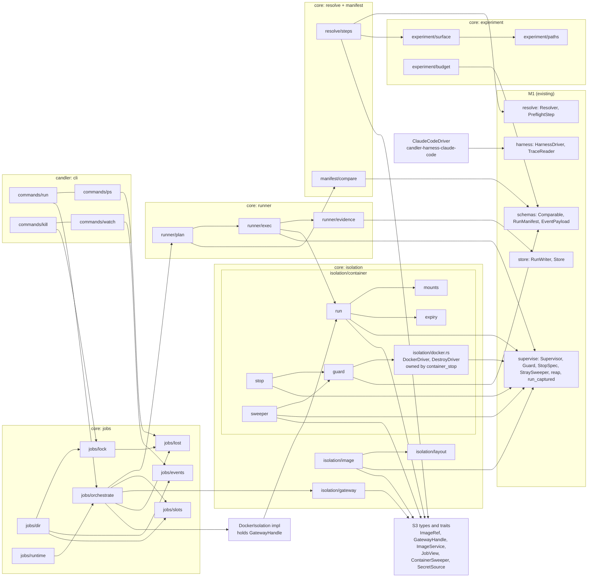
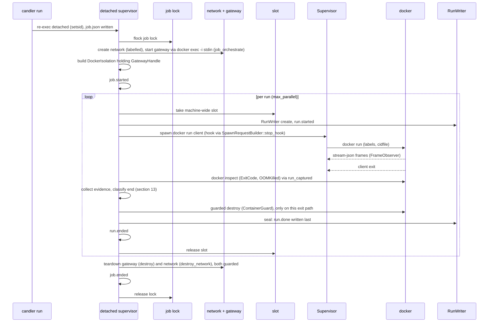
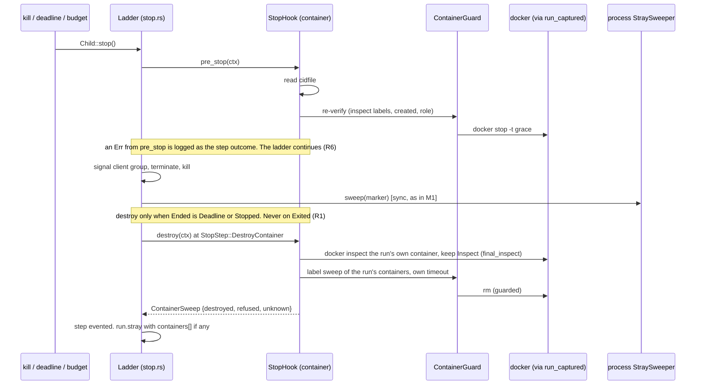
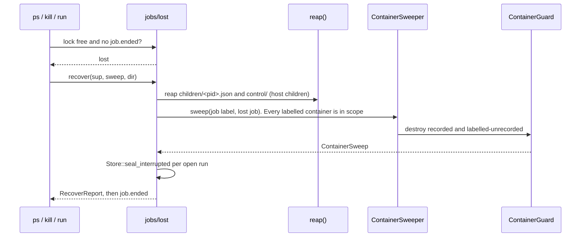

# M2b execution parity: architecture (v0, revised after review round 2)

Status: draft for the lead. Type: architecture. Branch: `feat/m2b-execution-parity`.
Normative for every M2b implementer. Signatures are grounded in M1 code at the worktree HEAD (`025fc55`) and in the approved plan (cited as "plan"). The plan is the decision record. Defects and ungrounded claims are in section 16.

## 1. Context

Eliott ruled on 2026-11-06 that the host sandbox design is not the target.

| Ruling | Consequence |
|---|---|
| Docker only. The host backend is deferred. The `Isolation` trait stays open for it. | One runner, the `docker` CLI. No Docker API crate. |
| The configuration surface is the essence. | Model and endpoint, tools, prompt, skills, MCP server sources and config, permission mode, budget are cell values or typed inputs. |
| Every v5 feature is kept. The mechanism is not. | Section 2 maps each feature to a container carrier. |

The scope moved from M5 into M2b. **M5 keeps:** outcome injection from outside, the whole-container census, the egress allowlist, and plug-in-declared agent environments. Everything else in the M2b leaf stays: job supervisor, `ps`, `kill`, `watch --json`, resume, ends table, comparability diff with the stratum verdict (I7), catalog capture and census, `candler run`.

M1 facts that shape the design (all read in code).

- `Supervisor`, `Guard`, `StopSpec`, `StraySweeper` and `reap` know only processes (I15, I22).
- `HarnessDriver` and `TraceReader` return data and never act on processes.
- `Comparable::from_resolution` drops values at or below a setting path (segment-aware). `from_resolved` refuses a value below a reserved root (`harness`, `treatment`, `snapshots`, `inputs`, `environments`).
- `run.done` is a seal file. It is not an event.
- `crates/candler/src/main.rs` is `fn main() {}`. All CLI is new.

## 2. Feature coverage (replaces the parity gate)

The plan's table, with the owner added. The `feature_map` oracle (L0, independent agent) checks every row in the equivalence smoke.

| v5 feature | Today's mechanism | Container carrier | Owner |
|---|---|---|---|
| Agent confined to its work dir | PreToolUse confine hook. The deny rules were inert | Only the workspace is mounted. Root fs `--read-only`, `--tmpfs /tmp`. No hook | `container_run` |
| No user `~/.claude` | `--setting-sources project,local` | Own HOME in the container, and the flag kept | `container_run`, `claude_code_driver` |
| No `CLAUDECODE`, conda or harness-venv leak | Env scrubbing | Env built from nothing, `-e` only | `container_run` |
| Agent's own venv, pip seeded, `htn_creator_scripts` absent, planner derived from the skill | Per-run venv build | One uv environment baked into an env image layer. Lock derived from the skill's `scripts/pyproject.toml` plus the stable deps | `image` |
| No bundled `domain.py` / `problems.py` in the venv | `prune_bundled_examples` | Pruned in the image build | `image` |
| Input manifest outside the sandbox. Contaminated outputs flagged | Manifest kept out of the sandbox | Inputs bind-mounted read-only under their workspace paths. Digests in `comparable.inputs`. An output whose digest matches an input gives `invalid(input_leak)` | `container_run` (mounts), `run_evidence` (check) |
| Output discovery excludes `.claude/` and venv dirs | Collection scope | `collect` globs in the driver | `claude_code_driver` |
| Same command line | `claude --print` | `claude --print ... --output-format stream-json --verbose --setting-sources project,local --permission-mode <cell value>` | `claude_code_driver` |
| Token never stored | Env var name only in the manifest | The token never enters the container (gateway). Canary gate | `gateway` |
| 3600 s timeout | Subprocess timeout | `budget.per_run.wall_s` cap, plus container self-expiry | `experiment_resolution`, `container_run` |
| `--keep-sandbox` | Sandbox kept on disk | The workspace is kept in the store (I11). "Kept" means the sealed run dir | `run_exec` |
| Provenance (`skill_version`, `eval_infra`, `sandbox_contract`, `planner.*`) | `_provenance.build_block` | The same fields, plus a superset: image digest, Claude Code version read from the image, `isolation.*` values. Section 14 | `run_exec`, `image` |
| Resume skips completed runs and deletes partial ones | `completed_runs` scan | Replays stored values. Partial runs are sealed `invalid(interrupted)`, never deleted | `run_plan` |

Permission mode is a cell value. The HTN experiment keeps `bypassPermissions`, safe because the container is the boundary.

## 3. Key decisions

Numbering is the plan's. The ruling column records what the lead decided on review.

| # | Decision | Rationale | Rejected alternative | Ruling or refinement |
|---|---|---|---|---|
| 1 | `docker` CLI. The supervised child is the `docker run` client, its stdout is the stream-json | `Supervisor`, `OutputSpec::framed`, `FrameObserver` work unchanged. youzuoqi ran 252/252 runs | `bollard` (a second supervision model) | |
| 2 | Spartan base: pinned Claude Code binary, non-root user, python3.12, uv. Env layer `candler-env:<lock digest>` built once under a per-tag `flock`. Runs pin the local image ID as `isolation.image`. Builds run in preflight, supervised, in a temp record dir | A local tag is not a pin. The image ID is | Per-run build | **R3:** debian-slim, chosen by the image probe. Coreutils `timeout` exits 124. Busybox exits 143, so Alpine would break the inside wall-cap signal |
| 3 | Hardening: `--init`, `--user <uid>:<gid>` on a Linux engine, `--read-only` plus tmpfs, `--cap-drop ALL`, `no-new-privileges`, `--pids-limit`, `--memory`, `--cpus`, labels, `--cidfile` | Absent in youzuoqi | | Mount points inside the rw workspace are pre-created |
| 4 | Stop ladder with a `StopHook` seam. No `--rm` on agent and gateway containers (control containers use it, R11). Sweep. Lost job. Docker client env allowlist. `EnvValue::Secret` refused by the wrapper. Entrypoint wrapped in `timeout` | Killing the client does not stop the container. The static `StopSpec.pre_stop` cannot carry a cid that exists only after the cidfile | A raw `docker kill` child (bypasses I22) | F5/F6: `StopHook` has `pre_stop` and `destroy`. No `sweep_report`. All docker calls via `run_captured`. R1: `destroy` runs only when the ladder ended the child. R7: the hook attaches per request only. R4: the inner `timeout` is `wall_s + 60 s` |
| 5 | I22 extends to containers. `ContainerGuard` in `isolation/` | Destroying is as dangerous as a signal | Destroy by label alone | `DestroyDriver` held only by the guard. R10: one destroy rule, in section 10.1. R9: networks go through `destroy_network` |
| 6 | No parent-death signal. `forbid(unsafe_code)` stays. Linux child subreaper via `rustix`, `waitpid(pid)` only | A container outlives its client anyway. Labels and self-expiry bound orphans | `pre_exec` PDEATHSIG | |
| 7 | Gateway: token never enters the agent container. A host proxy (A) or an internal network plus sidecar (B). A spike decides. Plan lean: B | Canary absent from env, files and `docker inspect` | Env token | Section 9 |
| 8 | `lost` is derived: lock free and no `job.ended` | A crash cannot write a flag | Heartbeat | No schema change |
| 9 | Catalog capture once per cell, in preflight, through a command `CatalogProvider`. The digest goes into `comparable.snapshots`. Each run re-derives it and records a mismatch as a deviation. Init-frame `tools` and `mcp_servers` go to `measured[] census.*` | The cell digest hashes `snapshots`, and the lock path and `next_attempt` need it before any run | Per-run capture (splits a cell) | |
| 10 | Resume replays the stored `Comparable`, pinned. Re-checks image ID, CC version, secrets present, tag-to-commit, gateway probe. Refuses unless `--force`, which records `deviations[]` on every new attempt | A changed image must not be silently a new cell | Silent re-resolve | |
| 11 | Paths (I14): a CLI path resolves against the caller's cwd, a path in the experiment file against that file's directory | | | |
| 12 | `Isolation` differs from R01: one `docker run` per run. `ContainerPlan` to `SpawnRequest`, then collect and destroy. `exec`, `inject`, whole-container `census` are M5 | | R01's long-lived handle | R01 amended so nobody builds it |
| 13 | HOME is a per-run **host** directory, bind-mounted rw, outside the workspace. Collect takes sub-agent transcripts from it. `tree.json` excludes the ro input mount points | Transcripts under `~/.claude/projects` would vanish with the container | HOME on a container tmpfs | |
| 14 | Ends additions: `InvalidReason::Infrastructure` (exit 125, container fails to start, and the rulings in section 13). `invalid(gateway)` retried once | | | `run_exec` lists the exact signals |
| 15 | Shared with M2a: `StopHook`, `register_*_steps` composition in `candler`, `isolation.env_lock` is a cell value, not `comparable.environments[]`. It is M2b's to define. `environments` is reserved for M5, and M2a never writes an environment to the run manifest (M2a, 2026-11-06) | | | F3: `register_m2b_steps(r: Resolver) -> Result<Resolver, ResolveError>` (but see F2) |

## 4. Component diagram



Dependency rule. `candler` depends on core. Core `isolation/` depends on `supervise/`. `container_run` consumes only S3 types (`ImageRef`, `GatewayHandle`). The image ID comes from the cell value `isolation.image`. `steps` depends on the `ImageService` trait, not on the `image` module. `job_orchestrate` builds `DockerIsolation` once per job, after the gateway starts (R14). Every docker CLI call goes through `Supervisor::run_captured` (via `DockerDriver`), so I15 has no exception. `candler-harness-claude-code` gains no core dependency. The container wrapper wraps the driver's `CommandSpec`.

## 5. Sequence: one job



Two paths end a run (R1).

- **Normal exit** (`Ended::Exited`): run_exec does inspect, then collect, then a guarded destroy, as in the diagram.
- **The ladder ended the child** (`Ended::Deadline` or `Ended::Stopped`): the hook's `destroy` inspects the run's own container before the rm and keeps the `Inspect` in its state. run_exec holds an `Arc` to the same hook and reads `final_inspect() -> Option<Inspect>` after `wait`. So `classify_end` always has the inspect facts, or knows they are missing.

Control containers (`claude --version`, catalog capture) run with `--rm`, an inner `timeout` and `candler.role=control` (R11). They remove themselves. The guard never destroys them.

## 6. Sequence: stop, kill, lost



`unknown: true` (timeout or daemon error) is evented as `container.sweep_incomplete` (R25), and the step outcome text says so too. It is never read as "none".

Lost-job path. No ladder runs. `ps`, `kill` and `run` call one function, `jobs::lost::recover` (R17). `cli_ps_kill_watch`, `job_runtime` and `run_plan` only call it. `job_store` fills it.



## 7. Scaffold stubs (S3), shared by several leaves

These land first, in the lead's S3 commit. Sketches only. Every async method returns `BoxFuture<'a, Result<..>>`, where `'a` binds `&'a self` and every borrowed argument (written explicitly as `fn m<'a>(&'a self, x: &'a T) -> BoxFuture<'a, ..>` below). M1's `PreflightStep::run` uses `'static` only because it takes `Arc<ResolveContext>` (`resolve/preflight.rs:140-144`). S3's gate, before the api_review starts (N1): the stubs compile (`cargo check --workspace --all-targets`), and a throwaway `#[cfg(test)]` impl of `DockerDriver::inspect` that awaits while holding `cid` compiles too (it proves the impls can hold their borrows), then is deleted with the rest of S3's scaffolding. `futures` is already a dependency. No `async-trait` is added (R5).

```text
// supervise (additive)
trait StopHook: Send + Sync {                    // both methods default to Ok no-op
  fn pre_stop<'a>(&'a self, ctx: &'a StopHookCtx) -> BoxFuture<'a, Result<(), HookError>>;
  fn destroy<'a>(&'a self, ctx: &'a StopHookCtx) -> BoxFuture<'a, Result<ContainerSweep, HookError>>;
}
// final_inspect() is an inherent method of the concrete ContainerStopHook, not of the trait:
//   run_exec keeps an Arc<ContainerStopHook> and passes a clone as Arc<dyn StopHook> to the builder.
struct ContainerSweep { destroyed: Vec<ContainerRef>, refused: Vec<Refusal>, unknown: bool }
SpawnRequestBuilder::stop_hook(self, Arc<dyn StopHook>) -> Self     // per request only (R7)
// No Supervisor::with_stop_hook. Control calls through run_captured never carry a hook, so nothing recurses.
// stop.rs: the ladder calls destroy after the process sweep (StopStep::DestroyContainer),
//   only when Ended is Deadline or Stopped, never on Exited (R1).
//   An Err from pre_stop or destroy is logged as the step's outcome and the ladder continues (R6).
// StraySweeper stays as in M1: fn sweep(&self, &Marker) -> Vec<StrayProcess>. No sweep_report.

// isolation (async docker traits; the real impl lives in isolation/docker.rs, owned by container_stop,
//   and runs every call through Supervisor::run_captured(SpawnRequest, limit) -> Result<Captured, SuperviseError>
//   with a short deadline on the request and a dedicated record dir)
trait DockerDriver: Send + Sync {
  fn inspect<'a>(&'a self, cid: &'a str) -> BoxFuture<'a, Result<Inspect, DockerError>>;
  fn ps_by_label<'a>(&'a self, sel: &'a LabelSel) -> BoxFuture<'a, Result<Vec<ContainerRef>, DockerError>>;
  fn network_create<'a>(&'a self, name: &'a NetworkName, internal: bool, labels: &'a Labels)
      -> BoxFuture<'a, Result<(), DockerError>>;
  fn network_inspect<'a>(&'a self, name: &'a NetworkName)
      -> BoxFuture<'a, Result<Option<NetworkInfo>, DockerError>>;               // R9
  fn image_inspect<'a>(&'a self, tag: &'a str) -> BoxFuture<'a, Result<Option<ImageRef>, DockerError>>;
  fn build<'a>(&'a self, req: &'a BuildRequest) -> BoxFuture<'a, Result<ImageRef, DockerError>>;  // R22
}
trait DestroyDriver: Send + Sync {                // held only by ContainerGuard. No image rm, no prune in M2b
  fn stop<'a>(&'a self, cid: &'a str, grace: Duration) -> BoxFuture<'a, Result<(), DockerError>>;
  fn rm<'a>(&'a self, cid: &'a str) -> BoxFuture<'a, Result<(), DockerError>>;
  fn network_rm<'a>(&'a self, name: &'a NetworkName) -> BoxFuture<'a, Result<(), DockerError>>;
}
// run_argv is a free function owned by container_run (R12):
//   isolation::container::run::run_argv(&ContainerPlan, &CommandSpec) -> Vec<String>     // pure

trait JobView: Send + Sync {                      // R8. job_store implements it
  fn job(&self) -> &JobId;
  fn children(&self) -> Result<Vec<ChildEntry>, JobViewError>;
  fn is_lost(&self, job: &JobId) -> Result<bool, JobViewError>;
}
enum ChildEntry { Process(ChildRecord), Container(ContainerRecord), Unreadable { path: PathBuf, error: String } }
trait ContainerSweeper: Send + Sync {             // container_stop's LabelSweeper implements it (R17)
  fn sweep<'a>(&'a self, scope: &'a SweepScope) -> BoxFuture<'a, Result<ContainerSweep, SweepError>>;
}
struct ContainerGuard { /* Arc<dyn DestroyDriver>, Arc<dyn DockerDriver>, Arc<dyn JobView> */ }
impl ContainerGuard {
  fn destroy<'a>(&'a self, c: &'a ContainerRef, scope: &'a SweepScope) -> BoxFuture<'a, Result<(), GuardRefusal>>;   // N3: R10 needs the scope
  fn destroy_network<'a>(&'a self, n: &'a NetworkName) -> BoxFuture<'a, Result<(), GuardRefusal>>;   // R9
}
// destroy_network accepts only candler-<job12>-net whose candler.job label names the current or a lost job,
// re-verified by network_inspect.

mod jobs::lost {                                  // R17. One recovery function. job_store fills it
  fn recover<'a>(sup: &'a Supervisor, sweep: &'a dyn ContainerSweeper, dir: &'a JobDir)
      -> BoxFuture<'a, Result<RecoverReport, RecoverError>>;
  // reaps host children and control/, runs the container sweep, calls Store::seal_interrupted per open run
}

trait Isolation: Send + Sync {
  fn plan(&self, cell: &Cell, ws: &Workspace) -> Result<ContainerPlan, IsolationError>;
  fn run_request(&self, plan: &ContainerPlan, cmd: CommandSpec) -> Result<SpawnRequest, IsolationError>;
  fn collect_and_destroy<'a>(&'a self, plan: &'a ContainerPlan, ws: &'a Workspace, exit: &'a Exit)
      -> BoxFuture<'a, Result<ContainerOutcome, IsolationError>>;
}
// The impl is DockerIsolation. It holds the GatewayHandle. job_orchestrate builds it once per job, after the gateway starts (R14).
trait Gateway: Send + Sync {                      // content only. Lifecycle is job_orchestrate's
  fn start<'a>(&'a self, sup: &'a Supervisor, docker: &'a dyn DockerDriver, job: &'a JobId, net: &'a NetworkName,
           token: &'a dyn SecretSource) -> BoxFuture<'a, Result<GatewayHandle, GatewayError>>;   // R16
  fn probe<'a>(&'a self, h: &'a GatewayHandle) -> BoxFuture<'a, GatewayStatus>;
  fn status_for<'a>(&'a self, run: &'a RunKey) -> BoxFuture<'a, GatewayStatus>;
}
// GatewayStatus has an Unavailable { reason } variant, so probe and status_for return it bare.
// start sends the token through `docker exec -i` stdin: run_captured with a StdinSpec. job_orchestrate calls start and owns the teardown through the guard.
trait SecretSource: Send + Sync { fn resolve(&self, name: &str) -> Result<SecretValue, SecretError>; }  // by name, at call time, never stored
trait ImageService: Send + Sync {                 // steps depend on this trait, not on the image module (R14)
  fn ensure<'a>(&'a self, lock: &'a LockDigest, build: &'a BuildSetting) -> BoxFuture<'a, Result<ImageRef, ImageError>>;
  fn cc_version<'a>(&'a self, image: &'a ImageRef) -> BoxFuture<'a, Result<Version, ImageError>>;
}
trait CatalogProvider: Send + Sync {
  fn capture<'a>(&'a self, image: &'a ImageRef, cell: &'a Cell) -> BoxFuture<'a, Result<Catalog, CatalogError>>;
}

// types. Fields fixed in S3. Leaves fill behaviour (R13)
struct Runtime { supervisor: Arc<Supervisor>,   // N2: not Clone; one supervisor serves runs and control calls (its process sweeper is harmless on control children)
                  store: Store, sink: Arc<dyn EventSink>, slots: Slots,
                 docker: Arc<dyn DockerDriver>, isolation: Arc<dyn Isolation> }
struct JobSpec { experiment: ExperimentFile, resolution: Resolution, plans: Vec<RunPlan>, budget: Budget }
struct JobEnd { ended_by: JobEndedBy, runs: Vec<RunOutcome> }
struct RunOutcome { key: RunKey, status: RunStatus, ended_by: EndedBy, invalid: Option<InvalidReason>, inspect: Option<Inspect> }
struct Evidence { sessions: Vec<Session>, outputs: Vec<OutputDigest>, tree: TreeJson }
struct Inputs { digests: Vec<InputDigest> }
struct ContainerPlan { image: ImageRef, labels: Labels, mounts: Vec<Mount>, env: Vec<EnvEntry>,
                       network: NetworkName, limits: Limits, cidfile: PathBuf, user: UserSpec,
                       workdir: PathBuf, home: PathBuf, expiry: Duration }
struct ContainerRef { cid: String, labels: Labels, created_at: Timestamp }
struct ImageRef { id: ImageId, cc_version: Version }
struct GatewayHandle { base_url: Url, network: NetworkName, dummy_token: String }
struct RunPlan { cell: CellId, stored: Option<Comparable> }
```

Also in S3: `experiment/paths.rs` (field-path constants, with the extended `is_setting`), `isolation/layout.rs` (workdir, HOME, user, label keys, `EXPIRY_MARGIN`), the four verbs `Run`, `Ps`, `Kill` and `Watch` with one stub file per verb in `crates/candler/src/commands/`, and `jobs::supervise_entry` (a stub that returns an error).

CLI (R24). If M2a's clap skeleton has not merged by S3, S1 adds `clap` and S3 adds a minimal `Command` enum with the four M2b verbs. Whichever lands second rebases, as the coordinator ruled. If M2a has merged, S3 appends one `Command` variant and one dispatch arm per verb.

Notes.
- `StopHook` returns a future because the ladder is async. The sweeper stays sync (M1), runs under `spawn_blocking` bounded by `stop.grace`, and handles processes only.
- `run_captured` spawns through `Supervisor::spawn`, which registers with the `Guard` and writes a `children/<pid>.json` record. Control calls therefore need a record dir and a marker (finding 16 in section 16).
- `Store::seal_interrupted(&RunKey) -> Result<RunManifest, StoreError>` already exists in M1 (`store/run.rs:289`). `run_plan` and `recover` call it. Nobody defines it (R18).
- M1 contradictions to fix in S3 (reported to the lead). (a) The ladder runs the sweep on `Ended::Exited` too (mode `GroupOnly`), so the new `destroy` call needs an explicit `ended != Exited` gate in `stop.rs`. (b) `StepRecord.outcome` is a plain `String`, so an `Err` from a hook, and `unknown: true`, ride in that string and nowhere else. (c) `run_stray(processes)` is a `const fn` with one field, so containers need the additive `run_stray_with_containers` (section 12).

## 8. Public surface per leaf

Leaf names, levels and owned modules are the plan's. "Fills" lists the S3 stubs the leaf implements.

### L0

| Leaf | Owned modules | Public items | Fills |
|---|---|---|---|
| `job_store` | `jobs/{dir,lock,events,slots,lost}` | `JobDir::{create, open, children, write_child, record, set_state}`, `JobLock::{acquire, probe}`, `JobEvents::{open, append, tail}` (implements `EventSink`), `Slots::{open, acquire, held}`, `jobs::lost::{classify, recover}` with `JobLiveness::{Running, Ended(JobEnd), Lost}`. A children reader over `ChildEntry::{Process, Container, Unreadable}` | `JobView`, `jobs::lost::recover` (R8, R17) |
| `comparability` | `manifest/compare` | `compare(&Comparable, &Comparable) -> Vec<Deviation>`, `stratum_verdict(arms, declared factors, nuisance set, census.init_tools)` | |
| `image` | `isolation/image`, `assets/docker/{base,env}` | `DockerImageService` (tag `candler-env:<digest>`, flock per tag, no prune (R22), CC version readout via `docker run --rm` with an inner `timeout` and labels `candler.role=control`, `candler.job=preflight` (R11)) | `ImageService` |
| `container_run` | `isolation/container/{run,mounts,expiry}` | `build_run_request(&ContainerPlan, CommandSpec, Marker, RunKey) -> SpawnRequest`, the free function `run_argv(&ContainerPlan, &CommandSpec) -> Vec<String>` (R12), `mounts(...)` with the R23 validation, `wrap_expiry(wall_s + EXPIRY_MARGIN)`. Refusals in the auth paragraph below | `Isolation` (as `DockerIsolation`), `ContainerPlan` |
| `container_stop` | `isolation/container/{stop,guard,sweeper}`, e2e harness | `ContainerStopHook` (`pre_stop`, `destroy`, `final_inspect`), `ContainerGuard::{destroyable, destroy, destroy_network}` with `GuardRefusal::{Unrecorded, OtherJob, Unlabelled, Mismatch}` (rule in section 10.1), `LabelSweeper` with its own timeout, `isolation/docker.rs`: the real `DockerDriver` (with `build` and `network_inspect`) and `DestroyDriver` over `run_captured` | `StopHook`, `ContainerGuard`, `ContainerSweeper`, `DockerDriver`, `DestroyDriver` |
| `gateway` | `isolation/gateway`, `assets/docker/gateway` | The chosen design's `Gateway` impl: `start(sup, docker, job, net, &dyn SecretSource)` sends the token through `docker exec -i` stdin (R16), log scrub, concurrency cap, `/v1/models` probe, canary helper. Content only. `job_orchestrate` calls `start` and owns teardown | `Gateway`, `GatewayHandle` |
| `experiment_resolution` | `resolve/steps`, `experiment/{surface,budget}` | `register_m2b_steps(Resolver) -> Result<Resolver, ResolveError>`. Steps `image_id`, `catalog`, `harness_identity`, `treatment_identity`. `Surface::from_cell`, `to_caps(&Budget)`, `RunCaps::flags()`. Owns the `isolation.build` input digest | |
| `claude_code_driver` | `candler-harness-claude-code` | `ClaudeCodeDriver: HarnessDriver`. `prepare` (skill git-archive, `settings.json`, MCP cfg), `command` (no endpoint, no token), `classify_exit`, `collect` globs. `stop()` is Term with a grace | |
| `run_evidence` | `runner/evidence` | Command `CatalogProvider`, `census`, `input_leak(&Evidence, &Inputs)`, `tree.json` builder | `CatalogProvider` |

### L1

| Leaf | Owned modules | Public items | Fills |
|---|---|---|---|
| `run_plan` | `runner/plan` | `plan(&ExperimentFile, &Resolution, Option<&Comparable>) -> Vec<RunPlan>` (run keys, experiment lock, attempts), resume replay, refuse, `--force` deviations. An unfinished attempt is sealed by calling M1's `Store::seal_interrupted` (R18). It is never replaced (R19). `next_attempt` gives the new number | `RunPlan` |
| `run_exec` | `runner/exec` | `exec_run(&Runtime, &RunPlan, &Slot) -> RunOutcome`: slot, spawn with live observer, caps, `classify_end` (section 13), gateway retry, collect, `run.done` | |
| `cli_ps_kill_watch` | `crates/candler/src/commands/{ps,kill,watch}.rs` | `candler ps`, `candler kill [--all -y]`, `candler watch --json`. Lost-job reaping through the guard | |

### L2

| Leaf | Owned modules | Public items | Fills |
|---|---|---|---|
| `job_runtime` | `jobs/runtime` | Detached re-exec plus setsid, job lock, subreaper (`waitpid(pid)` only), SIGTERM maps to `killed`, startup reaping | `jobs::supervise_entry` |
| `job_orchestrate` | `jobs/orchestrate` | `orchestrate(Runtime, JobSpec) -> JobEnd`: per-job network and gateway lifecycle (guarded create, `destroy`, `destroy_network`), builds `DockerIsolation` once the gateway starts (R14), `max_parallel`, job caps mapping to `budget_stop` | |
| `cli_run` | `crates/candler/src/commands/run.rs` | `candler run`, the supervise entry, resolver composition (`register_m2b_steps` plus M2a's) | |

### L3

| Leaf | Owned | Content |
|---|---|---|
| `supervision_gates` | e2e tests | Kill the supervisor mid-run. `ps`/`run` then leave nothing labelled `candler.job=<id>` and no marked host process. macOS local, Linux CI. Assertions are scoped to the job label |
| `equivalence_smoke` | e2e tests | RiVault smoke from an unrelated dir. Every `feature_map` row. Resume after kill. Forced deviation. Canary scan |

**Auth env contract (I19, R15).** Applies to `container_run` and `claude_code_driver`.

- The driver emits no endpoint and no token at all.
- The wrapper owns `ANTHROPIC_BASE_URL` (set to `GatewayHandle.base_url`) and `ANTHROPIC_AUTH_TOKEN` (set to `GatewayHandle.dummy_token`).
- The wrapper refuses a driver overlay that carries any `EnvValue::Secret`, or any of `ANTHROPIC_BASE_URL`, `ANTHROPIC_AUTH_TOKEN` or `ANTHROPIC_API_KEY`. It refuses. It does not override.
- `model.endpoint` is the gateway's upstream, never the agent's.

## 9. Gateway: designs A and B

**Decided: design B** (spike report `02-gateway_spike_v0.md`, Docker Desktop 29.9.2): an nginx sidecar from a digest-pinned image on a per-job `--internal` network. The lead's escape hatch to A did not trigger: off-the-shelf nginx logs method, `$uri` without query, status, latencies, bytes and model, and scrubs an echoed token from response bodies.

| Rule for the `gateway` and `job_orchestrate` leaves | Why |
|---|---|
| The token enters through `docker exec -i <sidecar>` stdin, run through `run_captured`, into a 0700 tmpfs file; the entrypoint waits for the file, so the sidecar fails closed | Never env or argv; nothing for `docker inspect` to show |
| `limit_conn` keyed on a literal (`"all"`), set to the job's `max_parallel`; a 429 from the sidecar itself is `invalid(gateway)` | nginx cannot queue; Candler's slots already cap concurrency, so the limit is a backstop. `$server_name` is silently inert |
| TLS to the real upstream (`proxy_ssl_server_name on`, system CA bundle) is tested by the gateway leaf against a local TLS fake | The spike tested plain HTTP only; RiVault is HTTPS |
| Response headers are scrubbed by name; bodies with `sub_filter` | The spike's measured limits |
| `isolation.network` defaults to `internal`; `bridge` adds the agent to a bridge network as well, keeping the gateway route | Today's agent had internet; no egress by default is an intended deviation, recorded in the KT |
| The Linux engine gets one CI probe of the internal network (B18 on Linux) | The spike ran on Docker Desktop only |

Consequences: B18 exists, so the milestone has 36 guards; S1 adds no HTTP crate; the gateway leaf gets an adversarial verifier.

Original framing, kept for the record: decided by the Phase 0 spike. The gateway leaf builds the picked design. The plan leans to B unless the sidecar's request logging needs more than an off-the-shelf alpine proxy (nginx or caddy). Either way the token reaches the proxy or sidecar through a tmpfs file or stdin, never env or argv, and its `docker inspect` is never logged.

| | A: host proxy | B: internal network plus sidecar |
|---|---|---|
| Shape | Proxy inside the job supervisor (like youzuoqi's `rv_logging_proxy`). Swaps in the real token, scrubs logs, caps concurrency | Per-job `docker network create --internal`. Agent only on it. Sidecar on it and on an egress network, holds the token |
| Agent env | `ANTHROPIC_BASE_URL=http://host.docker.internal:<port>`, dummy token | Base URL and dummy token meaningful only inside the network |
| Linux engine | `--add-host host-gateway`, bind to the bridge IP | Same behaviour as Docker Desktop |
| Egress default | Open (default bridge) | None. A step toward M5's allowlist |
| Extra supervised thing | None (in-process) | A second spartan image, one more labelled container |
| Cost | HTTP crate (S1 adds it only if A wins) | `isolation.network` becomes a recorded cell value. A cell can ask for `bridge`, because today's agent had internet |

Criteria (the spike has one command per criterion): canary absent from the agent container's env, files and `docker inspect`; identical on both engines; logs scrubbed; reaping by label.

What changes per design.

| Item | A | B |
|---|---|---|
| `gateway` leaf | Proxy code | Sidecar image and config in `assets/docker/gateway` |
| `job_orchestrate` | Starts the proxy task | Creates the network, starts the sidecar, destroys both through the guard |
| Guard scope | Agent containers | Agent containers, sidecar (`role: gateway`), network |
| `container_stop` sweep | Containers | Containers and the per-job network |
| `ContainerPlan.network` | `bridge` | `candler-<job12>-net` unless the cell says `bridge` |
| Adversarial verification | Verifier | Verifier and adversarial |

`Gateway`, `GatewayHandle` and the ends table do not change.

## 10. Layouts

### 10.1 Job dir

```text
<store>/jobs/<job-id>/            (StoreLayout::job_dir)
  job.json                        JobRecord: supervisor pid+start, spec_digest, state
  events.jsonl                    Envelope per line: seq, at, job_id, run?, event
  lock                            flock, held for the supervisor's life
  children/<pid>.json             ChildRecord (child-record/1)
  children/container-<cid12>.json ContainerRecord (container-record/1)
  control/<pid>.json              ChildRecord of docker control calls (finding 16). Never read by the children reader
```

M1 has no `children/` reader. `job_store` writes one that dispatches on `ChildEntry::{Process, Container, Unreadable{path, error}}` and implements `JobView` (section 7). The container record is written as soon as the cid is known.

**One destroy rule (R10).** A container is destroyable only if all three hold.

1. Its `candler.job` label names the current job, or a lost one.
2. Its `candler.role` is `agent` or `gateway`, and equals the record's role when there is a record.
3. `docker inspect` re-verifies the labels and the created time right before the stop or rm.

The extra rule for the current job: a container must be recorded, or have a `candler.run` inside the sweep's scope (the run being swept). Otherwise it is `GuardRefusal::Unrecorded`: a run still starting. For a lost job every labelled container is in scope. `role=control` is never destroyable. A network follows the same rule through `destroy_network` (R9).

### 10.2 Label keys

| Key | Value | Use |
|---|---|---|
| `candler.job` | job id. `preflight` for control containers | Guard rule 1. Also on networks (R9) |
| `candler.run` | run key `<cell hex>-r<n>-a<m>` | Per-run sweep scope |
| `candler.experiment` | experiment digest | `ps` grouping |
| `candler.role` | `agent`, `gateway` or `control` | Guard rule 2. Ruled (finding 15) |

`container-record/1`: `cid`, `labels{job, run, experiment}`, `created_at`, `image_id`, `role`, `spawned_at`.

**Control containers (R11).** `claude --version` and catalog capture run with `--rm`, an inner `timeout`, and the labels `candler.role=control`, `candler.job=preflight`. They expire and remove themselves. The guard never destroys them, so no exemption is needed. This is the one place `--rm` is used.

### 10.3 Slots

Slots are machine-wide and shared across jobs. A job takes a slot per concurrent run, so two jobs cannot together exceed the machine's count. They follow R01 section Budget.

```text
$XDG_STATE_HOME/candler/slots/        (default ~/.local/state/candler/slots/; finding 14)
  <n>.lock    flock target, n in 0..slots.count
  <n>.json    holder { job, run, pid, since }, written while held
```

`slots.count` is a user-config setting (M1). `Budget.max_parallel` (default 1) caps one job. The effective parallelism is the smaller of the two, enforced by slot acquisition. A free `flock` with a leftover `.json` is stale.

### 10.4 Container filesystem

| Path | Mode | Content |
|---|---|---|
| `/` | ro | Image layers (`--read-only`) |
| workspace (the run's workdir, cwd) | rw bind | Run workspace. Mount points for ro inputs pre-created |
| ro inputs | ro bind | At their workspace paths. Digests in `comparable.inputs` |
| HOME | rw bind | Per-run **host** dir outside the workspace (decision 13). Collect reads transcripts from it |
| `/tmp` | tmpfs | Scratch |
| user | `--user <uid>:<gid>` on a Linux engine | Recorded. Docker Desktop needs none |

Concrete container paths are set once in `isolation/layout.rs` (S3). This report does not fix them.

**Expiry (R4).** The inner `timeout` is `budget.per_run.wall_s + EXPIRY_MARGIN`. `EXPIRY_MARGIN` is a `layout.rs` constant of 60 s. The supervisor's per-run deadline is `wall_s`, so the outer deadline always fires first. The inner timeout matters only for an orphan. Exit 124 needs coreutils `timeout`, so the base is debian-slim (R3, chosen by the image probe).

**Mount validation (R23).** `mounts()` canonicalises every source and refuses: a source outside the project root or the store, a symlink escape, and any path naming `docker.sock` or lying under `/var/run` or `/run`.

## 11. Configuration-surface field paths

Normative. Landed in `docs(design)` (S0) before L0. Class: cell value (hashed, compared), setting (dropped from `Comparable`), typed root (reserved, filled by derived steps).

| Path | Class | Source |
|---|---|---|
| `model.id`, `model.endpoint` | cell value | experiment file (`fixed`, `factors`) |
| `tools.allowed`, `tools.disallowed` | cell value | experiment file |
| `mcp.*` | cell value | experiment file (server config) |
| `permission_mode` | cell value | experiment file |
| `request.harness`, `request.treatment` | setting | filled by `cli_run` from the typed tables (F2 (a), R21). Never reaches `Comparable` |
| `prompt.template`, `prompt.values` | cell value | experiment file |
| `isolation.image` | cell value | derived by the `image_id` step: local image ID `sha256:...` |
| `isolation.network` | cell value | experiment file (`bridge` or the internal default) |
| `isolation.env_lock` | cell value | experiment file or derived lock digest. Not `environments[]` (decision 15) |
| `isolation.limits.*` | cell value | experiment file (`--pids-limit`, `--memory`, `--cpus`) |
| `budget.per_run.{wall_s, turns, max_cost_usd}` | cell value | experiment file (`PerRunCaps`), appended to every cell by `ExperimentFile::cells()` |
| `isolation.build.dockerfile`, `isolation.build.context` | setting | experiment file. Content enters as an `inputs[]` digest |
| `harness` | typed root | derived `HarnessIdentity {name, version, driver?}` |
| `treatment` | typed root | derived `TreatmentRef {name, tag, commit}` |
| `inputs[]` | typed root | derived digests: server sources and the Dockerfile |
| `snapshots` | typed root | derived: the catalog digest from the `CatalogProvider` |
| `environments` | typed root | Reserved for M5. M2a never writes an environment to the run manifest. Not used for the agent env |
| `store.root`, `plugins.dirs`, `slots.count` | setting | user config (M1 `is_setting`) |
| `budget.*` except `budget.per_run.*`, `replicates` | setting | experiment file (M1 `is_setting`) |

Rules.

- `isolation.image` holds the derived ID. The build request therefore lives at `isolation.build.*`. A setting at `isolation.image` would make `from_resolution` drop the derived value (segment-aware prefix).
- `is_setting` is hard-coded in M1 `resolve/layers.rs`. It is extended once, in the S3 scaffold, together with `experiment/paths.rs`. No leaf edits it.
- No value sits below a reserved root. No value is an absolute-path string (`from_resolved` refuses both).
- The request for `harness` and `treatment` is carried by the settings `request.harness` and `request.treatment` (R21, F2 (a)). `is_setting` entries land in S3.

## 12. Schema changes (S2)

One commit, `candler-schemas` only, with the bless, `schema/README.md` and `expected_roots.txt`. Every change is a minor version.

| Change | Rust consumers | JSON-Schema consumers |
|---|---|---|
| New root `container-record/1` `{cid, labels{job,run,experiment}, created_at, image_id, role: agent\|gateway, spawned_at}` | minor | minor |
| Events `container.created`, `container.destroyed` (`EventPayload` is non_exhaustive and has `Unknown`) | minor | breaking for a closed event-kind matcher |
| `containers[]` on `run.stray`, as the additive `EventPayload::run_stray_with_containers`. `run_stray` stays unchanged (R20) | minor | minor |
| Event `container.sweep_incomplete {run?, scope, reason}`, emitted whenever a `ContainerSweep` has `unknown: true` (R25) | minor | breaking for a closed event-kind matcher |
| `StopStep::DestroyContainer` | minor (non_exhaustive) | breaking for a closed enum |
| `InvalidReason::Infrastructure` | minor (non_exhaustive) | breaking for a closed enum |

A stray is a container that the label sweep finds and that is not the run's own recorded cid (R20). M1's `run_stray(processes)` is a `const fn` with one field, so the new constructor is a separate function.

The changelog must say that new enum variants break exhaustive matchers outside the crate. M2a adds no `EventPayload` or `InvalidReason` variant. Its schemas commit adds only the root `evaluator-message` (M2a, 2026-11-06), so the S2 commit has no `EventPayload` clash to order.

## 13. Ends table

Sources: R01 section Ends, M1 `EndedBy` (`completed`, `agent_error`, `cap{turns|cost|wall}`, `gateway_error`, `budget_stop`, `killed`, `interrupted`, `unknown`), M1 `InvalidReason` (`gateway`, `budget_stop`, `killed`, `interrupted`, `input_leak`, `collection_error`, `reader_error`, `format_unknown`) plus S2's `infrastructure`. No other end values exist.

Inputs to `classify_end`: the ladder's `Ended` (`Exited`, `Deadline`, `Stopped`), the stop's recorded cause, the `Inspect` (from `ContainerStopHook::final_inspect()` or run_exec's own inspect, or "missing"), the gateway log or probe, the reader's sessions, collection, and input digests.

| End | Exact signal | Status | `ended_by` | Retry |
|---|---|---|---|---|
| Completed | Exit 0, trace says finished | valid | `completed` | |
| Agent error | Error result with no provider status (such as a usage-policy refusal) | valid, graded | `agent_error` | never |
| Turn or cost cap | Cell cap fired (`turns`, `max_cost_usd`) | valid | `cap{turns}`, `cap{cost}` | |
| Wall cap, outside | `Ended::Deadline`. A missing inspect is recorded, and does not change the end | valid | `cap{wall}` | |
| Wall cap, inside | Exit 124 from the entrypoint `timeout`. Needs the debian-slim base (R3): coreutils `timeout` exits 124, busybox exits 143 | valid | `cap{wall}` | |
| Gateway or provider | Connection refused, 0 tokens, or an error result carrying a provider status | invalid `gateway` | `gateway_error` | once, as a new attempt |
| Job budget | Our stop, cause `budget_stop` | invalid `budget_stop` | `budget_stop` | |
| `candler kill` | Our stop, cause `killed` | invalid `killed` | `killed` | |
| Supervisor lost | `seal_interrupted` after `lost`. Never from a live run | invalid `interrupted` | `interrupted` | |
| OOM | `docker inspect` `State.OOMKilled` | invalid `infrastructure` | `unknown` | never. The inspect fact is recorded |
| 137, no stop of ours, no deadline, not OOM | Inspect exit 137 | invalid `infrastructure` | `unknown` | |
| Daemon error or no start | Client exit 125, container never started, or inspect missing. Only when there was no stop of ours and no deadline | invalid `infrastructure` | `unknown` | |
| Input leak | An output digest equals an input digest | invalid `input_leak` | as classified | |
| Collection failed | `collect` error | invalid `collection_error` | as classified | |
| Reader error | `TraceReader` cannot parse | invalid `reader_error` | `unknown` | |
| Format unknown | `detect` does not know the format version | invalid `format_unknown` | `unknown` | |
| Trace silent | Trace does not say how it ended, no stop of ours, no deadline | invalid `infrastructure` | `unknown` | Ruled (finding 20): a silent trace is not a graded result |

`ended_by` for the infrastructure and reader rows is `unknown` because the trace cannot say. Raw files are kept in every invalid case.

**Precedence (R2).** `classify_end` takes the first match in this order. `Ended::Deadline` counts as "ours" in steps 2 and 4.

1. **Our stop** with cause `budget_stop` or `killed`. The stop is a fact we made. It produces 137 or 143, and any gateway noise after it is a consequence.
2. **Daemon facts:** 125, the container never started, or the inspect is missing (`infrastructure`). Only with no stop of ours and no deadline. With a deadline and no inspect, the end is the wall cap (step 10) and the missing inspect is recorded.
3. **`OOMKilled`** (`infrastructure`, never retried). OOM also produces 137, so it is checked before 137.
4. **137** with no stop of ours and no deadline (`infrastructure`). Someone else killed the container.
5. **Gateway signals** from the gateway log or the probe (`gateway`, retry once). Connection refused is a fact before the trace is read.
6. **Reader:** `format_unknown`, then `reader_error`. Nothing below can be read from the trace if these fail.
7. **Trace-based gateway:** 0 tokens, or an error result carrying a provider status (`gateway`, retry once). Checked before the wall cap, because a dead provider also runs out the clock.
8. **Collection failed** (`collection_error`). Input leak needs collected output.
9. **Input leak** (`input_leak`). It runs on collected output.
10. **The `ended_by` qualifier**, for a run that is still valid. Wall cap (`Ended::Deadline` or exit 124) gives `cap{wall}`. Then the trace's turn or cost cap, agent error, or completed. A silent trace with no stop of ours and no deadline gives `infrastructure`.

Destroy timing (R1). `StopHook::destroy` runs only when the ladder ended the child (`Ended::Deadline` or `Ended::Stopped`), never on `Ended::Exited`. On a normal exit run_exec does inspect, collect, then a guarded destroy. On the hook path, `destroy` inspects the run's own container before the rm and keeps the `Inspect` in the hook's state. run_exec reads `final_inspect() -> Option<Inspect>` after `wait`. So `classify_end` always has the inspect facts, or knows they are missing.

## 14. Provenance deviations

From `htn_creator_eval/_provenance.py` and `_manifest.py` at `htn-creator-eval@0.4.2`. The plan keeps the same fields plus a superset.

| Field | Old meaning | New meaning in a container |
|---|---|---|
| `skill_version` | Tag of the skill, resolved by `_git_skill` | `treatment {name, tag, commit}` (typed root). The skill is a git-archive into the workspace |
| `eval_infra {tag, commits_ahead, commit, dirty}` | `git describe` of the infra checkout | Candler has no infra checkout. The analogue (the candler build) is not defined by the plan (finding 13) |
| `sandbox_contract` | Constant `v5`, pinned to `SANDBOX_REFERENCE.md` by a sync test | Same constant label while the feature map targets v5. Whether the container runner bumps it is not decided (finding 13) |
| `planner.runtime` | Distribution and version in the host eval-runtime venv, for the grader's solvability check | Unchanged while the grader runs on the host. A containerised grader is not in M2b |
| `planner.sandbox` | Probed from the agent's real per-run venv, per run, after the run. `null/null` at plan time | The venv is baked into the env image, so the value is known at image build time and is the same for every run of that image. The plan-time null versus per-run measured split collapses. The probe must read the image, not a run |
| Superset (new) | n/a | Image ID (`isolation.image`), Claude Code version read from the image, `isolation.*` values |
| Absolute paths in the manifest | `experiment.json` relativizes `out_dir`, `prompt_servers_path`, `evals` against `project_root` and rehydrates on read | The workspace path is a container-internal path and never stored. `comparable` refuses absolute-path values. Run paths are relative to the store (I14) |
| Token | Only the env var *name* is stored (`auth_token_env`) | `secrets[]` with `SecretPresence {name, present}`. The token never reaches the container at all |
| `keep_sandbox` | Flag to keep the sandbox dir | Always kept as the sealed run dir (I11). The flag has no analogue |
| Run-time workspace and env fields | Not found in `_provenance.py` or `_manifest.py` | Not grounded. The run-config provenance writer's other fields were not located (finding 13) |

## 15. Ranked risk register

| Rank | Risk | Mitigation | Evidence |
|---|---|---|---|
| 1 | The real token reaches the agent container | Gateway holds it. `EnvValue::Secret` refused by the wrapper. Token to the sidecar by tmpfs or stdin | Canary scan of env, files and `docker inspect` |
| 2 | A destroy outside the I22 guard | `DestroyDriver` held only by `ContainerGuard`. A static check over callers | Guard tests (`guard_container_e2e`) |
| 3 | Partial-run deletion or stale resume | `run_plan` never uses `ReplaceUnfinished` (R19). An unfinished attempt is sealed with `seal_interrupted` and `next_attempt` gives the new number. Seal last | Resume tests |
| 4 | Wrong comparable verdict | `compare` is the single path. `--force` records `deviations[]` | Compare tests |
| 5 | A container outlives its supervisor | Self-expiry via `timeout`. Label sweep with its own timeout, `unknown` evented. Lost-job recovery | `supervision_gates` |
| 6 | Ends misclassification | One ordered function (section 13) | Ends table tests |
| 7 | Bind-mount uid mismatch on a Linux engine | `--user <host uid>:<gid>`, value recorded, mount points pre-created | Linux CI leg |
| 8 | A config path under a reserved root | `experiment/paths.rs` constants. `from_resolved` already refuses | Path tests |
| 9 | M2a edits `candler-core` at the same time | Disjoint modules. M2a adds no `EventPayload` variant. The coordinator orders the lands. The second re-blesses the schema root list | Merge check |
| 10 | Closed (R3). The image probe chose debian-slim. The Claude Code binary needs glibc and the HTN wheels (`libcst`, `rpds-py`) install there. Alpine is out | Base is debian-slim | Image probe `03-image_probe_v0.md` |
| 11a | Exit 124 versus 143 on the inside wall cap (R3) | Debian-slim, so coreutils `timeout` exits 124. Busybox exits 143 and would hide the cap. B08 asserts 124 on the real base | B08 |
| 11 | Image ID drift between jobs | `isolation.image` is a cell value. Resume re-checks the ID | Image tests |
| 12 | Docker control calls bypass I15 | All via `run_captured` (ruled). Dedicated record dir | Review, guard tests |

## 16. Open findings for the lead

| Round | Note | Where |
|---|---|---|
| Review round 2 (2026-11-06): rulings R1-R24 | R1, R6 sections 5, 6, 7, 13. R2, R3 section 13, section 3. R4 section 10.4. R5-R8, R13, R16, R17, R18 section 7. R9, R10, R11 sections 7, 10, 5. R12, R14 sections 4, 7, 8. R15 section 8. R19 section 15. R20 section 12. R21 sections 10.3, 11. R22 section 7. R23 section 10.4. R24 section 7 | `01-test_definition_v0.md` rows B07, B08, B12, B14, B15, B16, B20, B29 |
| M2a (2026-11-06) | No `EventPayload` or `InvalidReason` variant from M2a. Its schemas commit adds only the root `evaluator-message`. `Supervisor::new` and `SpawnRequestBuilder` stay source-compatible. The stop hook is opt-in only (R7: per request, through `SpawnRequestBuilder::stop_hook`). M2a's `EnvironmentStep` registers through `Resolver::register` from `crates/candler`, as M2b's steps do | Decision 15, sections 7, 11, 12 |

"Ruled" means the lead decided it on review, and the body of this report follows it. "Open" is not yet ruled or not grounded.

| # | Finding | Status |
|---|---|---|
| F1 | `is_setting` is hard-coded in M1 `layers.rs`. A setting at `isolation.image` would drop the derived image ID. | **Ruled:** setting `isolation.build.{dockerfile,context}`. `isolation.image` stays the derived ID. `is_setting` is extended in S3 with `experiment/paths.rs`, not by a leaf |
| F2 | Where does a step see the harness and treatment request? | **Ruled: (a).** Settings `request.harness` and `request.treatment`, filled by `cli_run` from the typed tables; `is_setting` entries in S3. Every milestone composes with the same `fn(Resolver) -> Result<Resolver, ResolveError>` shape, and the request reaches steps through `ResolveContext::get` like every other value |
| F3 | The plan's `register_*_steps(&mut Resolver)` does not match M1 (`Resolver::register` takes self and returns `Result<Self, ResolveError>`) | **Ruled:** `pub fn register_m2b_steps(r: Resolver) -> Result<Resolver, ResolveError>`, composed in `candler` |
| F4 | `reap` returns `Result<ReapReport, SuperviseError>`. For a live verified leader it runs the full ladder including pre-stop with an empty env. It has no hook path | **Ruled:** lost-job containers via the container sweep through the guard. Host children via `reap()` |
| F5 | I15 versus short docker calls from the guard and sweeper | **Ruled:** `DockerDriver` and `DestroyDriver` are async. The real impl runs every call through `run_captured` with a short deadline. No exception |
| F6 | `StraySweeper::sweep` is sync, under a grace-bounded `spawn_blocking`. A timeout means "unknown" | **Ruled:** drop `sweep_report`. `StopHook` gets `pre_stop` and `destroy -> ContainerSweep {destroyed, refused, unknown}`. The lost-job path calls the same sweep |
| F7 | `run.done` is a seal file, not an event | **Ruled:** seal file plus `run.ended` |
| F8 | `StopStep::DestroyContainer` and `InvalidReason::Infrastructure` break closed-enum JSON-Schema consumers | **Ruled:** the changelog says so |
| F9 | `RunStray` has no place for containers | **Ruled:** optional `containers[]`, filled from `ContainerSweep` |
| F10 | `candler-harness-claude-code` has no core dependency | **Ruled:** the driver stays pure. The container wrapper is in core `isolation/` |
| F11 | `candler` is `fn main() {}`, no CLI framework | **Ruled:** `clap`, landed by M2a with a `Command` enum and `commands/<verb>.rs`; M2b appends its four verbs (coordinator, 2026-11-06) |
| F12 | M1 has no `children/` reader and no slots layout | **Ruled:** new in `jobs/` |

**F2 facts, and a proposal.**

- The experiment file already carries typed `harness: HarnessRequest {name, version: Option<VersionReq>}` and `treatment: TreatmentRef` tables (`execution.rs`, both `deny_unknown_fields`). They sit beside `fixed` and `factors`, not inside them.
- `ExperimentFile::cells()` builds a cell from `fixed`, the factor levels and the caps. `harness` and `treatment` are not in it.
- `resolve/layers.rs` does not mention `harness` or `treatment`. `ResolveInput.file` is `FileValues`, a list of `(FieldPath, JsonValue)`.
- `PreflightStep::run` receives only `Arc<ResolveContext {config, values, settings, sources}>`, read through `get(&FieldPath)`.
- `Comparable::from_resolved` requires resolved values at `harness` and `treatment`, so derived steps must produce them.
- **So there is no carrier from the typed request tables to a step.** A parameterless `register_m2b_steps(r)` can only see paths. Two ways out:
  - **(a)** Keep F3's signature and carry the request as two settings, `request.harness` and `request.treatment`, set by `cli_run` from the typed tables. They need `is_setting` entries (S3). A setting never reaches `Comparable`, so there is no clash with the derived identity.
  - **(b)** Change the signature to take the request, `register_m2b_steps(r, &Request)`, and let the steps hold it. No new paths.
- The clash that rules out putting the request at `harness` and `treatment`: the file layer outranks the derived layer, and `HarnessIdentity.version` is a `semver::Version`, not a `VersionReq`, so a file-layer request value would replace the identity with a different shape.
- Recommendation: (b), unless the lead wants F3's signature fixed, then (a).

**New findings, not in the lead's rulings.**

13. **Ruled:** the reference field list is `__roadmap__/m2b-execution-parity/feature_map/provenance_fields.txt` (the independent oracle); S0 completes §14 from it, and `equivalence_smoke` checks every field. Provenance. Not grounded: how `eval_infra` and `sandbox_contract` are defined for Candler, and the run-config writer's other fields (workspace path, env). I read `_provenance.py` and `_manifest.py` only. Section 14 marks these.
14. **Ruled:** a per-user state dir, `$XDG_STATE_HOME/candler/slots/` (default `~/.local/state/candler/slots/`), shared by every store and job of the user; owned by `jobs/slots`. The machine-wide slot directory location is not grounded (the store root, or a per-user state dir). `slots.count` is in user config, so a per-user dir is likely. M1 has no slots layout.
15. **Ruled:** a fourth key `candler.role` (`agent`, `gateway`, `control`) on every container Candler creates; the guard refuses a role mismatch against the record. The plan names three label keys. The guard and sweeper need to tell an agent container from the gateway sidecar. `container-record/1.role` covers recorded ones. For labelled-but-unrecorded ones there is no role label, so a fourth key `candler.role` may be needed. Not decided.
16. **Ruled:** control calls record into `<job dir>/control/` (preflight: a temporary record dir under the store), marker `control`; the `children/` reader never reads it, and a lost job's `control/` entries are reaped through I22 like children. `run_captured` spawns through `Supervisor::spawn`, which requires a marker and a record dir, and writes `<record_dir>/<pid>.json` per call. Control calls (inspect, ps, rm) need their own record dir (not `children/`), or `reap` and the children reader would see them. The plan says only "a temporary record dir" for builds.
17. **Ruled:** accepted as written. `DockerDriver` in the plan's stub list is `run_argv, inspect, stop, rm, ps_by_label, network_rm`. This report moves `stop`, `rm` and `network_rm` to `DestroyDriver` (the lead's F5/F6 wording uses both traits), and adds `network_create` and `image_inspect`. Both are additions to the plan's list.
18. **Superseded by R25 (2026-11-06):** `StepRecord.outcome` is a plain `String`, so `unknown` gets its own S2 event, `container.sweep_incomplete {run?, scope, reason}` (section 12). Earlier ruling: in the `StopStep::DestroyContainer` step event's outcome; if `StepRecord.outcome` cannot carry it, `container_stop` reports a spec defect, and S2 is amended before L0. How `unknown: true` is evented is not specified. Proposal: it rides in the outcome of the `StopStep::DestroyContainer` step event. The shape of `StepRecord.outcome` was not re-read for this.
19. **Ruled:** the sketch is S3's starting point; S3 fixes it and the api_review checks it. The plan's `Isolation` has no signature. The sketch in section 7 (`plan`, `run_request`, `collect_and_destroy`) is mine, from decision 12. The lead should confirm it.
20. **Ruled:** invalid `infrastructure` when no stop of ours explains it (row "Trace silent" in §13). `EndedBy::Unknown` on a silent trace: the status (valid or invalid) is not in R01. proposed valid, `unknown`, graded as no-result.
21. **Closed:** M1's reader reads `api_error_status` (`candler-harness-claude-code/src/sessions.rs`), and a non-null value is a gateway error. The `ClaudeCodeDriver` `classify_exit` must see provider status in an error result to split gateway from agent error. Whether the stream-json reader exposes that status in `Session` was not checked.

**Review round 3 (2026-11-06).** N1 lifetimes `BoxFuture<'_>` and S3 compiles the stubs before the api_review; N2 `Arc<Supervisor>`; N3 `destroy(c, &SweepScope)`; N4 E19 dropped, the `role=control` refusal is a B10 row and self-removal an `equivalence_smoke` check; N5 one name, `ContainerStopHook`; N6 and finding 23 in the §8 `image` row.
