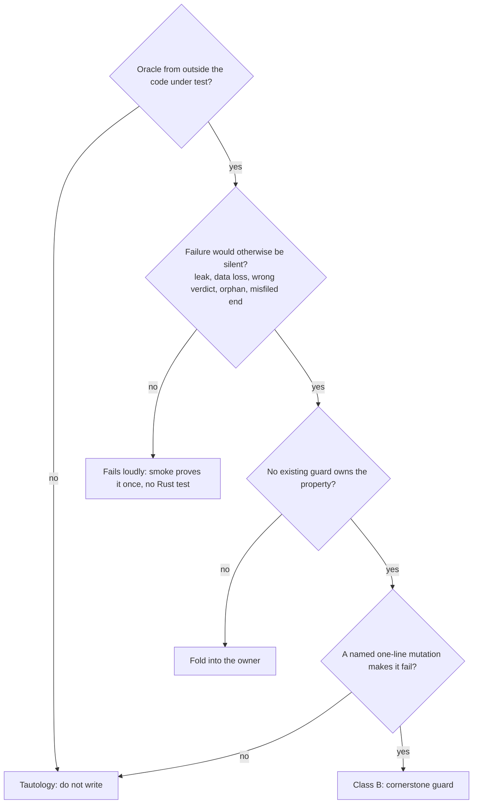

# M2b execution parity: Test Definition (v0)

Date: 2026-11-06. Target path: `__reports__/m2b-execution-parity/01-test_definition_v0.md`.
Normative source: the approved plan's "Test strategy" (a decided matrix; transcribed here, not redesigned).
Model: `__reports__/m1-contracts/00-test_definition_v0.md` (M1). Its classes, the eight oracle-independence rules and the bite record still apply and are not repeated.

## Executive Summary

**What must be proven.** The ranked critical conditions of M2b hold:
- no token reaches the agent container, the store, a log or `docker inspect` (I19);
- no container is destroyed outside the I22 guard;
- no partial run is deleted and no stale resume is accepted (I11);
- no wrong "comparable" verdict (I7);
- no container outlives its supervisor (I15);
- the ends table never misfiles a run (I20).

**Volume.** 36 guards (35 under gateway design A), ceiling 40.

| Where it runs | Count | Guards |
|---|---|---|
| Real Docker (ignored, `guard_container_e2e`) | 8 (7 under A) | B06 B08 B09 B12 B13 B17 B18 B36 |
| Recording fakes | 4 | B10 B11 B14 B15 |
| Host (real processes, PATH-fake `docker`, files) | 24 | the rest |

Linux CI only: B09, B33. Host suite target: under 60 s. Real-Docker suite: under 90 s per leaf.

## Model: admission and classes

| | Class A (development) | Class B (cornerstone guard) |
|---|---|---|
| Where | `#[cfg(test)] mod scaffold` in the unit's file, or `tests/scaffold_<leaf>.rs` | `tests/guard_<topic>.rs`; pure-function guards may sit in `mod guards` |
| Lifetime | Deleted by the leaf's last commit. `git grep -n "mod scaffold\|scaffold_" crates` is empty before reporting | Permanent. Needs `Guards:`, `Oracle:`, `Bite:` doc lines |
| Budget | Free | Counted against the caps below |
| Promotion | Only with the lead's OK and a mutation no other guard catches | n/a |

**Budget and caps.**

| Cap | Value |
|---|---|
| Milestone | 36 (35 under gateway design A: B18 only exists under B) |
| Hard ceiling | 40 |
| Per leaf | at most 4 |
| container_stop | at most 7 |
| L2 and L3 leaves | at most 2 |
| A new guard | the lead's OK, plus a mutation no other guard catches |

Current use: job_store 2, comparability 2, image 1, container_run 4, container_stop 7, gateway 2, experiment_resolution 2, claude_code_driver 3, run_evidence 2, run_plan 3, run_exec 2, cli_ps_kill_watch 1, job_runtime 2, job_orchestrate 1, cli_run 1, supervision_gates 1 = 36.

## Scope

- **In scope:** invariants I7, I11, I14, I15, I19, I20, I22 as M2b carries them, and the critical conditions 1-8 of the plan.
- **Out of scope:** `docker`, Docker Desktop and the Claude Code binary; serde and schema shape (`schema_drift` owns it); M5 items (outcome injection, whole-container census, egress allowlist).
- **Trust boundaries:**
  - Real: filesystem, processes, flock, procfs, git, the Docker daemon (only in the e2e group).
  - Faked: the `docker` CLI on host tests (a PATH fake, process-level only), `DockerDriver`/`DestroyDriver`/`Signaller` (recording fakes), the model upstream (a local echo server), the harness (the testagent).
  - Never called: RiVault or any LLM endpoint. The smoke is `equivalence_smoke`, not a guard.

## Test matrix: B01-B36

Run column: **host**; **fake** (recording fake, no daemon); **e2e** (real Docker, ignored, group `guard_container_e2e`). Platform: **both** or **Linux CI**.
Bites are one-line mutations of the implementation. The implementer tries each and reports it; a verifier re-runs three plus one of its own, at most two of them e2e.

| Id | Leaf | Binary | Property (domain terms) and invariant | Oracle | Bite | Run | Plat |
|---|---|---|---|---|---|---|---|
| B01 | job_store | `guard_job_store` | Concurrent agent and evaluator processes across two real supervisors never exceed N slots machine-wide. R01 §Budget (slots) | An append-only OS log where each holder writes acquire and release; the test computes the peak overlap | Loop `0..n` becomes `0..n+1` in slot acquisition | host | both |
| B02 | job_store | `guard_job_store` | `lost` is derived: lock free and no `job.ended`. Rows: held+no ended = running; free+no ended = lost; free+ended = ended; torn last line tolerated. R01 §Job | A real second fd that holds or releases the flock; R01 sentence | Treat `EWOULDBLOCK` as "free" | host | both |
| B03 | comparability | `guard_comparability` | A verdict table: arms differing only in declared factors compare; any other diff is refused and named. I7 | Pre-drafted rows C01-C20 below | Compare paths by string prefix (`starts_with`) instead of path segments | host | both |
| B04 | comparability | `guard_comparability` | The nuisance set equals M1's hand-written one, so no value can hide as nuisance (I7) | `crates/candler-schemas/tests/vectors/manifest/hashed_paths.toml` (class `nuisance`) | Add `comparable.inputs` to the nuisance set | host | both |
| B05 | image | `guard_image` | Two concurrent `ensure_env` calls for one lock digest make exactly one build. Plan D2 (flock per tag) | The PATH-fake `docker` log: count of `build` lines for the tag | Take the flock after the "tag exists" check, not before | host | both |
| B06 | container_run | `guard_container_e2e` | Kernel facts seen from inside by the testagent `probe`: euid not 0, CapEff 0, NoNewPrivs 1, EROFS on `/` and on input mounts, rw on workspace, HOME and tmp, a host sentinel path absent. I8, plan D3 | The kernel, reported by the testagent | Drop `--cap-drop ALL` from the run builder | e2e | both |
| B07 | container_run | `guard_container_run` | Both refusals (R15): an overlay carrying an `EnvValue::Secret` is refused, and an overlay carrying `ANTHROPIC_BASE_URL`, `ANTHROPIC_AUTH_TOKEN` or `ANTHROPIC_API_KEY` is refused, not overridden. A plain value passes (control). I19, plan D4 | Hand-built overlays | `EnvValue::Secret(_) => continue` in the wrapper instead of `Err`, or overriding the three auth names instead of refusing | host | both |
| B08 | container_run | `guard_container_e2e` | A container whose supervisor never acts expires by itself and exits 124 (bounded orphan lifetime). Runs on the real debian-slim base, because coreutils `timeout` exits 124 and busybox exits 143 (R3). The inner timeout is `wall_s + EXPIRY_MARGIN`, so the test sets a 2 s wall and a small test margin. I15 | Real `docker inspect` `State.ExitCode`, `sleep-forever` on the debian-slim base | Remove the `timeout` wrapper from the entrypoint | e2e | both |
| B09 | container_run | `guard_container_e2e` | On a Linux engine, files the container writes belong to the host uid and the run dir can be sealed. I11, critical condition 7 | `stat` uid by the OS; a rename and chmod of the dir | Omit `--user <uid>:<gid>` | e2e | Linux CI |
| B10 | container_stop | `guard_container_guard` | The guard refuses by name, pattern, "all", empty id, an unlabelled id, a wrong `candler.job` or `candler.run`, a record whose inspect labels differ, and a `candler.role=control` container (R11: never destroyable). Zero `stop`/`rm`. Positive control: a recorded, matching id is destroyed. I22 | Refusal rows written from plan D5 | Skip the `labels.job == current` comparison | fake | both |
| B11 | container_stop | `guard_container_guard` | Every destroy verb is preceded by an inspect of the same id; an inspect that changes between verification and `rm` refuses the `rm`. I22 | Scripted inspect answers (match, then mismatch); the call sequence as a literal | Reuse the first inspect result before `rm` | fake | both |
| B12 | container_stop | `guard_container_e2e` | Real sweep scope: a sibling live job's container survives, an unrecorded container of a lost job is destroyed, the per-job network is removed through `ContainerGuard::destroy_network` (R9), never by a bare `network rm`. I22, I15 | `docker ps -a` and `network ls` filtered by the test's own labels | Drop the `candler.job=<id>` filter from `ps_by_label` (safe only inside the allowlist wrapper, which panics on any other id; never run this bite without it) | e2e | both |
| B13 | container_stop | `guard_container_e2e` | With the docker client killed while a TERM-ignoring agent runs (`ignore-term`, two setsid children), no container labelled for the job remains. I15, plan D4 | `docker ps -a --filter label=candler.job=<id>` is empty | Make `StopStep::DestroyContainer` a no-op | e2e | both |
| B14 | container_stop | `guard_container_guard` | A `StopHook` whose `pre_stop` or `destroy` returns `Err(HookError)` (R6) is logged as the step's outcome, and the group signal and the sweep still run. Positive control: a healthy hook gives the same later steps. R01 §Process supervision (a failed pre-stop continues) | The R01 sentence; recording `Signaller` and driver | early return on the hook's `Err` in `stop.rs` (skips the signal and the sweep) | fake | both |
| B15 | container_stop | `guard_container_guard` | An unreadable `children/` entry (torn JSON, unknown record kind, mode 000) is reported by name (R8: a fake `JobView` returns `ChildEntry::Unreadable { path, error }`), never read as "no container"; valid siblings are still handled. I15, I22 | A fake `JobView`, plus hand-corrupted files | `Err(_) => continue` in the `children/` reader | fake | both |
| B16 | container_stop | `guard_layering_i22` | One choke point: the verbs `stop`, `rm`, `network rm`, `kill`, and `image rm`, `rmi`, `prune` appear only in `isolation/guard.rs` (R22: M2b has no prune at all, so no unguarded destroy verb exists), and `DestroyDriver` calls only there; no `waitpid(-1)` in `candler-core/src`. I22, I15 | A literal verb list; self-test with a planted violation and a non-empty-scan assertion (M1 rule 6) | Add one `driver.rm(..)` call to `sweeper.rs` | host | both |
| B17 | gateway | `guard_container_e2e` | The canary is absent from the agent's env, `/proc/1/environ`, workspace, HOME, every labelled container's inspect, and the gateway logs, even when the upstream echoes `Authorization`. I19 | A per-test random canary; `assert_clean` (non-empty scan, self-tested) | Put the real token in the agent's `-e ANTHROPIC_API_KEY` | e2e | both |
| B18 | gateway | `guard_container_e2e` | Design B only: the agent on the internal network has no route to the host or the internet. Control: a bridge container reaches the host listener. Plan D7 | A host TCP listener; the testagent `probe` | Drop `--internal` from `network create` | e2e | both |
| B19 | experiment_resolution | `guard_resolve_surface` | For every row of `field_paths.toml`: a cell value changes the cell digest, a setting does not, a typed root fills its typed field, nothing lands under a reserved root. I7, I12 | `field_paths.toml`, hand-written in S0 and S3, never imported from `experiment::paths` | Classify `isolation.limits.memory` as a setting | host | both |
| B20 | experiment_resolution | `guard_resolve_surface` | The budget split: `per_run.*` are cell values, every other `budget.*` is a job cap; the container expiry is `per_run.wall_s + EXPIRY_MARGIN` (60 s, a `layout.rs` constant), per `00-architecture_v0.md` section 10.4 (R4). The supervisor deadline is `wall_s`, so the outer deadline fires first. I20 | The section 10.4 formula (literal in the test) | Treat `max_cost_usd` as `per_run` | host | both |
| B21 | claude_code_driver | `guard_claude_code_driver` | The agent command is the reference one: `claude --print` with `--output-format stream-json --verbose --setting-sources project,local --permission-mode <cell value>`. Contract v5 | A literal from the feature_map oracle (never from the builder) | Drop `--setting-sources project,local` | host | both |
| B22 | claude_code_driver | `guard_claude_code_driver` | The skill directory equals the tagged tree, not the working tree. I7 (treatment is `{name, tag, commit}`) | `git ls-tree -r <tag>` on a fixture repo that has an untracked file | Copy the working tree instead of `git archive <tag>` | host | both |
| B23 | claude_code_driver | `guard_claude_code_driver` | Output discovery excludes `.claude/`, venv dirs and read-only input mounts. I8, contract v5 | A fixture tree and a literal expected list from `SANDBOX_REFERENCE.md` v5 | Remove `.claude` from the exclusion globs | host | both |
| B24 | run_evidence | `guard_run_evidence` | An output whose digest equals an input digest gives `invalid(input_leak)`; the same file with one byte changed stays valid (control). I10 | OS `sha256` of hand-built files | Compare sizes instead of digests | host | both |
| B25 | run_evidence | `guard_run_evidence` | The census from a real init frame records `tools` and `mcp_servers` under `measured[] census.*`, with `census.init_tools` sorted | `jq` over a stream from `candler-harness-claude-code/tests/fixtures/streams` (read by relative path) | Write `mcp_servers` into `census.init_tools` | host | both |
| B26 | run_plan | `guard_run_plan` | After two kills, resume leaves existing files byte-identical (except the sealed attempt's `manifest.json` and the new `run.done`), seals unfinished attempts `invalid(interrupted)`, and numbers attempts 1-2-3. I11, I20 | `sha256` of every file before resume; a literal attempt list | `remove_dir_all` on an attempt without `run.done` | host | both |
| B27 | run_plan | `guard_run_plan` | Resume replays the stored cell. Each changed fact (image ID, Claude Code version, a secret no longer present, tag to commit mapping, gateway probe) is refused without `--force`; the unchanged base is accepted (control). I11, plan D10 | A hand-built stored manifest; 5 rows | Skip the image-ID comparison | host | both |
| B28 | run_plan | `guard_run_plan` | `--force` writes `deviations[] {path, stored, observed}` on every new attempt and never touches a sealed run. I11 | Literal deviations; `sha256` of sealed runs | Write deviations only on the first new attempt | host | both |
| B29 | run_exec | `guard_run_exec` | The ends table: rows E01-E18 below, in the R2 order (section 13 of the architecture). I10, I20 | Recorded streams, three recorded inspect JSONs, R01 §Ends | Swap the `OOMKilled` and `ExitCode == 137` checks, so an OOM reads as our stop | host | both |
| B30 | run_exec | `guard_run_exec` | The sealed run dir's path set equals R01's literal; `run.done` appears last (stop after each step k); no absolute path. I11, I17 | The path list in R01 §Run store; `assert_clean` with the temp root as the needle | Write `run.done` before `tree.json` | host | both |
| B31 | cli_ps_kill_watch | `guard_cli_kill` | `candler kill --all` without `-y` refuses and makes zero docker calls; with `-y` it does call docker (control). I22 | The PATH-fake `docker` log, plus exit status | Default `yes` to true | host | both |
| B32 | job_runtime | `guard_job_runtime` | SIGTERM to the supervisor gives `job.ended(killed)`, every run sealed killed, nothing left. I15, I20 | The OS (`kill(pid,0)` plus start time); the literal event kinds | The SIGTERM handler exits without sealing runs | host | both |
| B33 | job_runtime | `guard_job_runtime` | A setsid'd, TERM-ignoring descendant of a supervised child dies, through the subreaper and `waitpid(pid)` only. I15 | The OS, as M1's `guard_supervise`; M1's `supervise/tree.sh` fixture | Remove the `set_child_subreaper(true)` call | host | Linux CI |
| B34 | job_orchestrate | `guard_job_orchestrate` | Crossing a job cap gives `invalid(budget_stop)` on live runs only; sealed runs keep their status; no new run starts. I20 | R01 §Budget; a literal run table | Apply the cap to `all_runs` instead of `live_runs` | host | both |
| B35 | cli_run | `guard_cli_run` | `run` returns at once, the supervisor outlives it holding the job lock, and after `job.ended` no marked process and no unmatched docker create remain. I15, I16 | The OS; the PATH-fake `docker` log | Wait on the supervisor in the launcher (no detach) | host | both |
| B36 | supervision_gates | `guard_container_e2e` | The supervisor SIGKILLed mid-run: after `ps` or `run`, nothing is labelled for the job, no marked host process remains, the network is gone, and the canary is absent from store, job dir, events and logs. I15, I19, I20, I22 | `docker ps -a --filter label=candler.job=<id>`; `assert_clean` | The lost-job path skips the container sweep | e2e | both |

### B03 pre-drafted rows (the lead's; implementers add rows, never edit)

Verdicts: `comparable`, or `refused(<path>)` naming the offending path. "F" is the declared factor set (`factors[]`). Unless stated, the arms' other comparable fields are equal.

| Row | Input (arm X vs arm Y) | Expected verdict | Source sentence |
|---|---|---|---|
| C01 | Identical `comparable`, F = {} | comparable | R01 I7: "The diff of comparability fields proves it" (an empty diff) |
| C02 | Differ in `model.id`, F = {model.id} | comparable | I7: "Arms differ only in declared treatment factors" |
| C03 | Differ in `model.id`, F = {} | refused(model.id) | R01 Error model: "Arms differ outside declared factors: the stratum is invalid; comparisons are refused" |
| C04 | Differ in `model.id` and `permission_mode`, F = {model.id} | refused(permission_mode), `model.id` not named | Error model, same row; a declared factor never covers a second diff |
| C05 | Differ only in `measured`, `sources`, `secrets`, `deviations`, timestamps, host, job id, attempt | comparable | R01 §Run manifest: "Outside the hash: sources[], secrets[], measured[], deviations[], timestamps, host, job id and the attempt" |
| C06 | Differ in `model.endpoint`, F = {model.id} | refused(model.endpoint) | I7 (a sibling path is not a declared factor) |
| C07 | Differ in `model.idx`, F = {model.id} | refused(model.idx) | I7; a prefix of characters is not a prefix of path segments (plan verifier attack) |
| C08 | Differ in `isolation.limits.memory`, F = {isolation.limits} | comparable | R01 §Experiment file: "A level is a value, or a table that fills the values under its path" |
| C09 | Differ in `treatment` (skill tag and commit), F = {} | refused(treatment) | R01 §Run manifest `comparable.treatment`; I7 |
| C10 | Differ in `treatment`, F = {treatment} | comparable | I7 |
| C11 | Differ in `harness.version`, F = {} | refused(harness.version) | R01 §Run manifest `comparable.harness`; §Resume: "a harness that auto-updated" |
| C12 | Differ in `snapshots[]` (catalog digest), F = {} | refused(snapshots) | R01 §Run manifest `comparable.snapshots`; plan D9 |
| C13 | Differ in an `inputs[]` digest (a Dockerfile or server source), F = {} | refused(inputs) | R01 §Run manifest `comparable.inputs` |
| C14 | Differ in `isolation.image` (derived image ID), F = {} | refused(isolation.image) | R01 §Run manifest: "isolation under `isolation.*`"; plan field paths |
| C15 | Differ in `budget.per_run.wall_s`, F = {} | refused(budget.per_run.wall_s) | R01 §Budget: per-run caps are "a treatment condition, the same for every arm" |
| C16 | A value present in X, `unrecorded` (no `value`) in Y, F = {} | refused(that path) | R01 §Run manifest: "A value without `value` was `unrecorded`" |
| C17 | X and Y differ only in `replicates` or a job cap (`budget.max_runs`) | comparable | R01 §Run manifest: job caps and `replicates` are operational settings that never enter `comparable` |
| C18 | `factors[]` lists `model.id` but only `permission_mode` differs | refused(permission_mode) | I7; a lying `factors[]` never proves comparability (plan verifier attack) |
| C19 | A `comparable` list that is unsorted or holds a duplicate | refused as malformed, no verdict computed | R01 §Run manifest: "A reader refuses one that is not" |
| C20 | `comparable` equal, `census.init_tools` differs, F = {} | refused(census.init_tools) | R01 §Session runner: "when it differs between arms of one stratum, that stratum is invalid (I7)"; plan D9 |
| C21 | `comparable` equal, `census.init_tools` equal, `mcp_servers` differ | comparable (control) | Plan D9 (only `init_tools` is the hook) |
| C22 | Differ in `tools.allowed` and `census.init_tools`, F = {tools.allowed} | comparable | Ruled (F5): a declared factor under `tools.*` or `mcp.*` exempts `census.init_tools` |
| C23 | Differ in `model.id` and `census.init_tools`, F = {model.id} | refused(census.init_tools) | Ruled (F5): only a `tools.*` or `mcp.*` factor exempts it |

### B29 pre-drafted rows (the lead's; implementers add rows, never edit)

Precedence (R2): our stop with cause `budget_stop` or `killed` first (E11, E12, E14); then daemon facts (E09), valid only with no stop and no deadline; then `OOMKilled` (E10); then 137 with no stop and no deadline (E17); then gateway signals (E05); then the reader (E16); then trace gateway (E03, E04); then collection (E15); then input leak; then the `ended_by` qualifier, with the wall cap first (E08, E18). `Ended::Deadline` counts as our act in the 137 and daemon rows. The data file lists the rows in this order.

Inputs are a recorded stream, a recorded inspect (clean, 124, OOM), and the supervisor's own act (none, job-budget stop, `candler kill`). Status column is `integrity`; `ended_by` is measured.

| Row | Input | Expected end | Source sentence |
|---|---|---|---|
| E01 | Exit 0, a result without error, tokens greater than 0 | valid, `ended_by` completed | R01 §Ends: "Completed, agent error, or a per-run cap: valid" |
| E02 | Exit 0, an error result with no provider status (a usage-policy refusal after work) | valid, agent error, graded, never retried | R01 §Ends: "an agent error: the run is valid and graded, never retried as a gateway failure" |
| E03 | Exit 0, an error result carrying a provider status | `invalid(gateway)`, retried once | R01 §Ends row 2 |
| E04 | Exit 0, zero tokens | `invalid(gateway)` | R01 §Ends: "0 tokens"; "a run with zero tokens is classified from the trace" |
| E05 | Gateway down, connection refused, no stream | `invalid(gateway)` | R01 §Ends: "connection refused" |
| E06 | E03 again on the retry attempt | `invalid(gateway)`, no third attempt | R01 §Ends: "retried once as a new attempt" |
| E07 | Per-run turn cap reached (the stream's max-turns result) | valid, `ended_by = cap` | R01 §Budget and Error model: "Per-run cap reached: valid run" |
| E08 | Exit 124, inspect `ExitCode` 124 (container self-expiry on the debian-slim base), no act by us | valid, `ended_by = cap{wall}` | Plan D4 (124 is self-expiry) with R01 §Ends row 1 (a per-run cap). Ruled (F4) |
| E09 | Exit 125, or a container that never started, or a missing inspect, with no stop of ours and no deadline | `invalid(infrastructure)` | Plan D14. Needs S2's `InvalidReason::Infrastructure` |
| E10 | Inspect `OOMKilled` true, `ExitCode` 137, no act by us | `invalid(infrastructure)`, not retried; the inspect fact recorded | Ruled (F4): `EndedBy` has no memory cap; the limit bounds the environment, not the treatment |
| E11 | Exit 137 after our stop for a job cap | `invalid(budget_stop)`, never a failure | R01 §Ends row 3; I20 |
| E12 | Exit 137 after `candler kill` | `invalid(killed)` | R01 §Ends row 3; I20 |
| E13 | An attempt with no `run.done` and a lost supervisor | `invalid(interrupted)` | R01 §Ends row 3; §Run identity |
| E14 | Our stop in progress and the stream shows a provider error from the teardown | `invalid(killed)`, not gateway | I20: "never charged to an arm"; our act takes precedence |
| E15 | Collection failed after a clean exit | `invalid(collection_error)`, raw kept | R01 §Ends row 5 |
| E16 | Unparsable stream; a stream of an unknown format version | `invalid(reader_error)`; `invalid(format_unknown)` | R01 §Ends row 5 |
| E17 | Inspect `ExitCode` 137, `OOMKilled` false, no stop of ours recorded and no deadline | `invalid(infrastructure)` | Ruled (F4): something outside Candler killed the container; 137 alone never reads as `killed` |
| E18 | The supervisor's per-run wall deadline fires and our ladder stops the container. Variant: the inspect is missing | valid, `ended_by = cap{wall}`. A missing inspect is recorded, and does not change the end (R2 step 2) | R01 §Ends row 1; the same cap as E08, fired from outside |

## Explicit cuts, so nobody rebuilds them

| Cut | Items | Replaced by |
|---|---|---|
| Dropped | argv tests of the `docker run` builder; "the recording driver saw no unguarded stop/rm"; serde and schema checks of new types; stub and default-method tests; `classify_exit` unit tests; settings and MCP rendering | B06, B16, `schema_drift`, B29, B25 and the smoke |
| Class A only | The stop-ladder order over fakes; the `ChildEntry` happy path; `max_parallel`; the `/v1/models` probe and its concurrency cap; the `claude --version` parse | Deleted at the leaf's last commit |
| One-off `[cmd]` | The hardening `docker inspect \| jq -e` (B06 is the lasting guard); pinning by image ID; the provenance fields (`skill_version`, `eval_infra`, `sandbox_contract`, `planner.*`); the smoke's event order as a literal kind sequence; feature_map `comm -23`; the doc-amendment `git grep`; `gh run list --commit` with the test names | Recorded in the leaf or sweep report |
| Smoke only | The credential swap; the real token absent from inspect and logs; the feature_map rows; preflight control containers removed themselves (`--rm`, R11): after preflight, `docker ps -a --filter label=candler.job=preflight -q` shows none older than the run | `equivalence_smoke` |
| Verifier attacks, not tests | pid and cid reuse races; SIGTERM during a spawn; a kill between `docker run` and the record; `waitpid(-1)` stealing statuses | The verifier briefs in the plan |
| Accepted gap | Setsid'd host descendants on macOS (no subreaper). The catalog command is first-party and does not setsid | Recorded; B33 and B36 cover Linux |

## Fixtures (at most 1.5 MB new)

| Fixture | What it is | Owner | Notes |
|---|---|---|---|
| Testagent image | `assets/docker/testagent/`: a Dockerfile and one script, `FROM busybox@sha256:<digest>` (or alpine, pinned the same way), not `candler-base`. Modes: `stream` (fixed stream-json), `probe` (reports euid, CapEff, NoNewPrivs, write attempts, the host sentinel, TCP connects), `ignore-term` (traps TERM, starts two setsid children), `sleep-forever` | Lead, scaffold S3 | No leaf writes the oracle it is tested by. Built with label `candler.test=1`; the digest is recorded in the Dockerfile |
| Recording fakes | `DockerDriver` (`inspect`, `ps_by_label`, `build`, `network_create`, `network_inspect`, `image_inspect`; `run_argv` is a free function, R12), and a fake `JobView` (R8) and `Signaller`, with hand-written inspect answers; `DestroyDriver` (`stop`, `rm`, `network_rm`) held only by the guard | Lead, S3, in `test-support` | Only `guard_container_guard` imports the recording destroy fake. `test-support` never sits on a production edge |
| PATH-fake `docker` | A script that logs its argv to a file and answers canned output | Lead, S3 | Process-level tests only (B05, B31, B32, B35). Never an argv oracle |
| Recorded inspect JSON | Three real `docker inspect` outputs: clean, 124, OOM | Lead, from a committed script | The script labels its containers `candler.job=record-<random>` and removes only the ids it recorded |
| Streams | M1's mini-corpus and `candler-harness-claude-code/tests/fixtures/streams`, read by relative path | M1 | No copies |
| `field_paths.toml` | Every field path with its class (cell value, setting, typed root) | Lead, S0 and S3 | Oracle of B19 |
| Canary | A fresh random value per test, never committed | Each test | `tests/support::assert_clean(dir, needle)` with a self-test and a non-empty-scan assertion |
| `support/<leaf>.rs` | One per leaf, created in S3 | Lead | Helpers only (rule 10) |
| Pre-drafted rows | B03 (C01-C23) and B29 (E01-E18) above, copied into the leaf's test data file | Lead | Implementers may add rows, never edit |

Size budget: Dockerfile and script under 20 KB; three inspect JSONs under 60 KB; `field_paths.toml` under 20 KB; drafted rows under 40 KB. All other bytes are reused, so the new total stays far under 1.5 MB.

## Safety rules for tests

**Brief rule 7, verbatim.** "Safety: destroy and pid/cid bites only against `guard_signal` or `guard_container_guard` with the recording fakes. Every e2e wraps its driver in a test-side allowlist that refuses any id the test did not create. This is the container analogue of the `kill(-1)` incident, since a sweep bitten on Docker Desktop could `rm` Eliott's own containers."

**Brief rule 9, verbatim.** "e2e: one container per property group, under 90 s per leaf. A missing Docker makes the test panic, not skip. CI asserts the expected test names ran."

**Execution-model safety block, verbatim.**
- "only the I22 guard signals or destroys;"
- "destroy and stop bite tests use only the recording `DockerDriver` and the recording `Signaller`;"
- "every e2e wraps its driver in a test-side allowlist that refuses any id the test did not create, and asserts only on its own `candler.job=<id>` label. A bitten sweep must never reach Eliott's own containers;"
- "the pre-spawn check `git diff --quiet HEAD -- crates/candler-core/src && cargo clean -p candler-core && cargo nextest run -p candler-core -E 'binary(guard_signal)'`;"
- "restore with `git checkout --`;"
- "never `kill`, `pkill`, `killall`, `docker rm -f $(…)`, `docker kill` of an unlabelled id, or `docker system prune`;"
- "tests run as non-root;"
- "`test-support` never goes on a production dependency edge."

**The e2e allowlist wrapper** (a helper in `tests/support`, used by every real-Docker test):

| Part | Rule |
|---|---|
| Wrapper | `AllowlistDriver<D>` wraps the real driver. `create` and `run` add the returned id (and network name) to the allowlist |
| Refusal | `stop`, `rm`, `network_rm` or any signal on an id not in the allowlist **panics** (not an `Err`, so code under test cannot swallow it) |
| Own label | Each test builds its job id as `t-<test>-<random>` and asserts only on `candler.job=<that id>`; it never lists, counts or asserts on other containers |
| Cleanup | A `Drop` guard removes only allowlisted ids, after a label inspect |
| Self-test | Plant a container created outside the wrapper; assert the wrapper panics on its `rm`; remove it with the raw driver |
| No Docker | The test panics, never skips |

## Brief rules 1-10 (verbatim from the plan)

1. Every test has three doc lines: `Guards:` (property), `Oracle:` (source) and `Bite:` (mutation). The bite is tried and reported. A test with no nameable bite is deleted.
2. Respect the cap. Name the line only the new test catches.
3. Class A is fenced and deleted. `git grep -n "mod scaffold\|scaffold_" crates` is empty before reporting.
4. Banned shapes: argv or lists copied from a builder; derive or schema re-checks; self-blessed goldens; "the fake received a call" when only the fake runs; tests of stubs or defaults; a constant checked against itself.
5. Expectations are literals with a provenance comment. Never import `isolation::layout` or `experiment::paths` into a test.
6. Fakes are environments, not oracles. Every refusal test has its positive control.
7. Safety: destroy and pid/cid bites only against `guard_signal` or `guard_container_guard` with the recording fakes. Every e2e wraps its driver in a test-side allowlist that refuses any id the test did not create. This is the container analogue of the `kill(-1)` incident, since a sweep bitten on Docker Desktop could `rm` Eliott's own containers.
8. A property that fails loudly gets no test.
9. e2e: one container per property group, under 90 s per leaf. A missing Docker makes the test panic, not skip. CI asserts the expected test names ran.
10. `tests/support/` holds helpers only, never expected values.

**What each level's Grit reviewer checks:**
- every test file is `guard_*`;
- nothing scaffold survives;
- Guards, Oracle and Bite lines are present;
- no production constants in tests;
- counts are within the caps;
- every refusal test has a positive control;
- the bite record is complete.

Verifiers re-run three bites plus one of their own, at most two of them e2e and under rule 7.

## Run commands

| Purpose | Command |
|---|---|
| Host suite (ignored tests excluded) | `cargo nextest run --workspace --no-tests=fail` |
| Linux lint | `cargo clippy --target x86_64-unknown-linux-gnu --workspace --tests -- -D warnings` |
| Real-Docker e2e (macOS, Docker Desktop) | `cargo nextest run -p candler-core --run-ignored only --no-tests=fail -E 'binary(guard_container_e2e)'` |
| Pre-spawn check before any destroy or signal bite | `git diff --quiet HEAD -- crates/candler-core/src && cargo clean -p candler-core && cargo nextest run -p candler-core -E 'binary(guard_signal)'` |
| Class A gone | `git grep -n "mod scaffold\|scaffold_" crates` (expected: empty) |
| Doc lines present | every `guard_*` test has `Guards:`, `Oracle:`, `Bite:`; count of tests equals the matrix |
| Linux CI evidence | `gh run list --workflow container-e2e --commit $(git rev-parse HEAD) --json conclusion,databaseId`, then `gh run view <id> --log` and check the names below |

**Expected e2e test names** (`b<NN>_<slug>`, all in `guard_container_e2e`): `b06_kernel_facts`, `b08_self_expiry`, `b09_host_uid_sealable` (Linux), `b12_sweep_scope`, `b13_client_killed_container_gone`, `b17_canary_absent`, `b18_internal_network_no_route` (design B), `b36_supervisor_sigkill_nothing_left`.
- macOS local: 7 tests under B, 6 under A (no B09, no B18 under A).
- Linux CI: 8 under B, 7 under A.
- A guard that has not run on Linux is recorded "not yet run" until the CI log shows its name passing, with 0 skipped.

## Open findings for the lead (ruled 2026-11-06)

| # | Contradiction or gap in the plan | Proposed resolution |
|---|---|---|
| F1 | The run command filters `binary(guard_container_e2e)`, one binary. Its 8 tests belong to four parallel leaves (container_run, container_stop, gateway, supervision_gates), and Cargo makes each `tests/*.rs` its own binary. | S3 creates `tests/guard_container_e2e.rs` with one `#[path]` module per leaf, so no leaf edits it. Ruled: the `#[path]` layout, created in S3. |
| F2 | The e2e allowlist wrapper needs a self-test. It is a helper, not a guard, yet M1 counted `guard_assert_clean` as a file. | Ruled: helper self-tests in `tests/support` do not count against the 36. |
| F3 | Rule 7 says pid bites only against `guard_signal` or `guard_container_guard`. B32 and B36 send SIGTERM and SIGKILL to a supervisor the test spawned itself. | Ruled: a test may signal only a pid it spawned and holds a `Child` handle for. |
| F4 | The ends table has no row for exit 124, OOM, or a 137 that is neither OOM nor our stop. R01's table lacks them too. E08 and E10 are drafted as "valid, cap". | Ruled: 124 and a supervisor wall deadline are `cap{wall}` (valid); OOM and an unexplained 137 are `invalid(infrastructure)`; rows E08, E10, E17, E18. S0 amends R01 §Ends. |
| F5 | R01 defines `factors[]` as "paths that vary" and I7 as "declared treatment factors". The verdict needs a declared set. Also a declared `tools.*` factor would always change `census.init_tools`, and plan D9 refuses that. | Define the declared set (the experiment file's factors) and say whether a declared `tools.*` factor exempts `init_tools`. C20 assumes no exemption when F is empty. Ruled: the declared set is the experiment file's factor paths; a factor under `tools.*` or `mcp.*` exempts `census.init_tools` (C22, C23). |
| F6 | R01 says the manifest may be rewritten until sealed, while B26 says "files byte-identical". | Ruled: confirmed as written. |
| F7 | `InvalidReason::Infrastructure` is not in the schema until S2; E09 depends on it. | Ruled: order only; S2 lands before L0. |
| F8 | The B03 verdict labels (`comparable`, `refused(path)`) are domain-level. The plan defines no Rust verdict type. | Ruled: the comparability leaf maps them; rows stay as written. |
