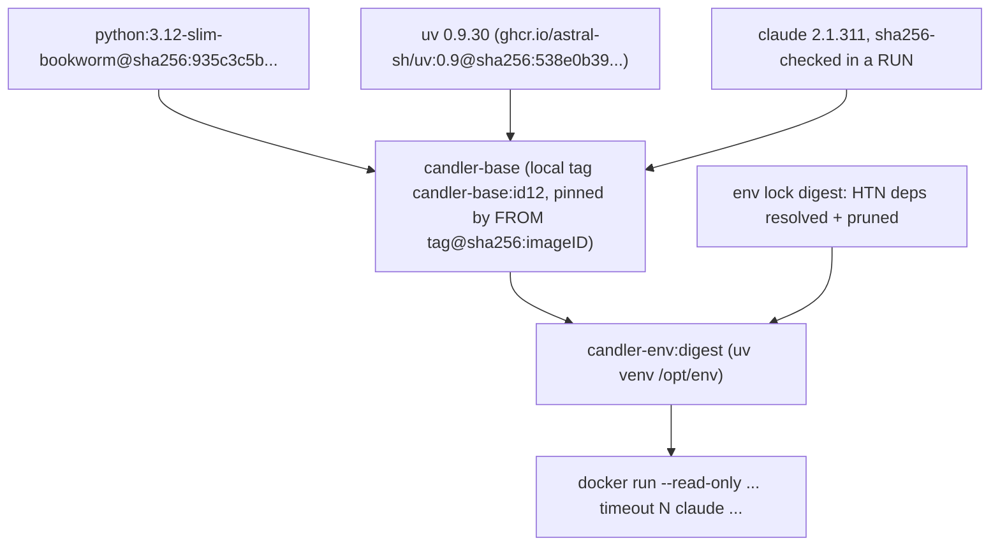

# M2b agent base image — Findings (v0)

Date: 2026-11-06

---
type: findings
topic: m2b-execution-parity
date: 2026-11-06
version: v0
prior-version: none
key-metric: slim vs alpine: 706 vs 561 MB base, 124 vs 143 timeout exit (prior: N/A, delta: N/A)
decision-required: confirm
---

## Headline Result

metric: chosen base
value: debian-slim (python:3.12-slim-bookworm, glibc)
unit: image choice
prior: N/A
direction: new

Both bases pass every functional gate: all 40 env packages install from wheels (`--no-build`), on arm64 and on emulated amd64. The choice rests on reproducibility and the `timeout` exit code, not on wheels.



Caption: layering of the chosen design. The base is built once, the env layer per lock digest.

## Results Tables

### Experiment 1 and 3: builds (arm64 native, Docker Desktop 29.9.2, containerd store)

| Item | Alpine 3.20 (musl) | debian-slim (glibc) |
|---|---|---|
| Base build, `--no-cache` (s) | 10.4 | 11.0 |
| Base size (MB) | 561 | 706 |
| Env layer build, `--no-cache` (s) | 2.7 | 2.8 |
| Env size (MB) | 636 | 779 |
| Env deltas (MB) | 75 | 73 |
| Packages installed | 40 | 40 |
| Compiled from source | none (`--no-build`) | none (`--no-build`) |
| python3 | 3.12.13 (apk, unpinned) | 3.12.16 (inside pinned image) |

### Experiment 3: linux/amd64 under emulation

| Item | Alpine | slim |
|---|---|---|
| Base build (s) | 12.8 | 12.0 |
| Env build (s) | 4.6 | 3.5 |
| `claude --version` in emulation | ok | ok |
| `import libcst, rpds` | ok | ok |

Note: `docker image inspect .Size` for the amd64 images reads 172 and 201 MB. That is not comparable to the arm64 numbers (the non-native platform is not unpacked). Use arm64 sizes only.

### Experiment 2: `claude --version`

| Measure | Value |
|---|---|
| Command | `docker run --rm --network none  claude --version` |
| stdout, exact bytes | `2.1.311 (Claude Code)\n` |
| Parser | `^(\d+\.\d+\.\d+) \(Claude Code\)$` on the trimmed line |
| Same on both bases and both arches | yes |

### Experiment 4: pinned FROM, local image, no registry

| Mechanism | Result | Pins by digest? |
|---|---|---|
| `FROM candler-base@sha256:<imageID>` | fails: tries a registry pull | n/a |
| `FROM sha256:<imageID>` | fails: tries a registry pull | n/a |
| `FROM candler-base:<id12>` (local tag only) | works. BuildKit logs it as `...:<id12>@sha256:<imageID>` | resolves to the digest at build time, but the tag is mutable |
| `FROM candler-base:<id12>@sha256:<imageID>` | works | yes, digest wins |
| Same with a mismatched tag (slim tag, alpine digest) | works, built on the alpine digest. RootFS prefix: alpine true, slim false | yes, the tag is decoration |
| Same with a nonexistent digest | fails closed: tries a registry pull, no fallback | yes |
| `--build-context b=docker-image://candler-base:<id12>@sha256:<imageID>` | works | yes |
| `--build-context b=docker-image://<repo>@sha256:<id>` (no tag) | fails | n/a |
| `--build-context b=docker-image://sha256:<id>` | fails | n/a |

Verification after the build: `docker image inspect` on both images. The env image's `.RootFS.Layers` must start with the base's whole layer list. Result here: base 6 layers, env 8, prefix equal. `.Parent` is absent from the inspect output on the containerd store, so the RootFS prefix is the check to use.

### Experiment 5: hardening

Flags: `--read-only --tmpfs /tmp --cap-drop ALL --security-opt no-new-privileges --init --pids-limit 256 --memory 2g --user <uid>:<gid>`.

| Check | Alpine | slim |
|---|---|---|
| `claude --version` | ok | ok |
| `python -c 'import libcst'` | ok | ok |
| uid 10001 and an arbitrary uid 1234:5678 | ok | ok |
| `claude -p` round trip to a local fake upstream, HOME read-only | exit ok, no state persisted | same |
| `claude -p` with `--tmpfs /home/agent` | ok | ok |
| `claude -p` with `HOME=/tmp/h` | ok | ok |
| `claude -p` with `CLAUDE_CONFIG_DIR=/cfg` (tmpfs), HOME read-only | ok, HOME untouched | ok |

The round trip used a random canary key and a stdlib fake server on the host. No real endpoint or token was used.

### Experiment 5: paths Claude Code wrote (from `docker diff` of a writable run)

| Path | Why |
|---|---|
| `$HOME/.claude/` | projects (transcript jsonl), sessions, plugins/store, backups |
| `$HOME/.claude.json` | global config, written in the HOME dir itself |
| `/tmp/claude-<uid>/` | fswatch probe and scratch |
| `/tmp/cc-socks` | socket scratch |

`CLAUDE_CONFIG_DIR=<dir>` moves all of `.claude/` and `.claude.json` into `<dir>`, and HOME then needs no write access. Nothing under `~/.cache` was written.

### Experiment 6: `timeout`

| Case | Alpine (busybox) | slim (coreutils 9.1) |
|---|---|---|
| Present | yes (`/bin/busybox`) | yes (`/usr/bin/timeout`) |
| Expiry, default TERM | **143** | **124** |
| Child exits 7, no expiry | 7 | 7 |
| `-k 1 1` on a TERM-ignoring child | 137 | 137 |
| `-s KILL` | 137 | 137 |
| `--version` | unsupported | works |

## Observations

| Signal | Baseline / Expected | Observed [source] | Interpretation |
|---|---|---|---|
| wheels | libcst and rpds-py may compile on musl | all 40 install with `--no-build` on all four combinations [source: `uv pip install --no-build`] | not a discriminator today |
| expiry code | plan assumes 124 | 124 only on coreutils; busybox gives 143 [exp 6] | favours slim |
| python source | pinned with the base | slim: in the digest-pinned image. Alpine: `apk add python3` pulls current repo content | Alpine's base is not reproducible from its Dockerfile |
| FROM pin | `candler-base@<id>` | fails; `tag@digest` works and fails closed [exp 4] | use `tag@digest` |
| env determinism | one layer per lock digest | unpinned ranges resolved to mcp 2.3.0, libcst 1.9.0, gtpyhop-core 2.0.2 [source: uv output] | the lock digest must hash the resolved set |
| image IDs | stable per Dockerfile | two `--no-cache` builds of the same Alpine env gave different IDs | never rebuild to compare; build once, pin the ID |

## Contradictions & Surprises

- `claude -p` with a fully read-only HOME exits 0 and says nothing. State is lost silently, so the runner must make `CLAUDE_CONFIG_DIR` writable on purpose and check that transcripts appear.
- The ID-keyed `FROM` the plan hoped for does not work, but a tag plus digest does, and it is a true pin.
- The image build was fast (under 3 s per env layer), so the env cache matters less for time than for identity.

## Decision and sketches

**Decision: debian-slim.** Reasons, in order:
1. Reproducible: python ships inside a digest-pinned image, so the only network inputs are digest-pinned (base, uv) or sha256-checked (claude).
2. `timeout` exits 124 as the plan assumes. Busybox gives 143, so Alpine would force a dual-code rule.
3. glibc is the safe default for later experiment layers that need wheels.

Cost: +145 MB base. Wheels did not decide it.

Base sketch (`Dockerfile.base`):

```
FROM python:3.12-slim-bookworm@sha256:935c3c5b12357a7e10caa9c1e6ca5692344d97cf229832ef584be2cec9fc03df
ARG TARGETARCH
RUN useradd -m -u 10001 -d /home/agent agent
COPY --from=ghcr.io/astral-sh/uv:0.9@sha256:538e0b39736e7feae937a65983e49d2ab75e1559d35041f9878b7b7e51de91e4 /uv /uvx /usr/local/bin/
COPY --chmod=755 claude-glibc-${TARGETARCH} /usr/local/bin/claude
RUN --mount=type=bind,source=claude.sha256,target=/claude.sha256 <grep hash for the arch; sha256sum -c>
USER agent  ENV HOME=/home/agent  WORKDIR /home/agent
```

Two traps found while building: `mv`/`chmod` after `COPY` duplicates the 290 MB binary into a new layer (978 MB image), so use `COPY --chmod` and verify with a bind-mounted checksum file instead. Keep a per-Dockerfile `.dockerignore` so only the right binary enters the context.

Env sketch (`Dockerfile.env`):

```
ARG BASE            # candler-base:<id12>@sha256:<base image id>
FROM ${BASE}
USER root
ENV UV_LINK_MODE=copy UV_PYTHON_DOWNLOADS=never UV_NO_CACHE=1
RUN uv venv /opt/env --seed --python 3.12
RUN uv pip install --python /opt/env/bin/python --no-build <stable deps + planner pin from the lock>
 && find /opt/env -type f ( -name domain.py -o -name problems.py ) -delete
USER agent  ENV VIRTUAL_ENV=/opt/env PATH=/opt/env/bin:$PATH
```

`--no-build` makes any sdist a build failure, so "nothing compiles" is enforced, not hoped for. The prune found nothing to remove (`gtpyhop-core` ships none), matching contract I8.

## Pinned digests

| Item | Digest |
|---|---|
| python:3.12-slim-bookworm (index) | `sha256:935c3c5b12357a7e10caa9c1e6ca5692344d97cf229832ef584be2cec9fc03df` |
| alpine:3.20 (index) | `sha256:d9e853e87e55526f6b2917df91a2115c36dd7c696a35be12163d44e6e2a4b6bc` |
| ghcr.io/astral-sh/uv:0.9 (index; uv 0.9.30) | `sha256:538e0b39736e7feae937a65983e49d2ab75e1559d35041f9878b7b7e51de91e4` |
| claude 2.1.311 linux-arm64 (glibc) | `2e2496c9a8065df93acb0fca2d341f59a6b8777649b2e025ab8c9bcd5eef61f3` |
| claude 2.1.311 linux-x64 (glibc) | `86dc1fcc69498159eaf15f446613e847010f9036bfbbdffd4c49350be8489ada` |
| claude 2.1.311 linux-arm64-musl | `172150e3f9ea07e8e2e2e29862d7d9a25f5c234d8e909e4063df237665bf09b9` |
| claude 2.1.311 linux-x64-musl | `cd40dd327145ee47aa0deacd571801c1d782388f709d71242eee6b91de8ed11f` |

Claude checksums are from `https://downloads.claude.ai/claude-code-releases/2.1.311/manifest.json` (the `stable` channel at probe time; `latest` was 2.1.318). Each downloaded binary matched its manifest checksum. The base image IDs from this probe are local and not meaningful to record.

## Pinned-FROM mechanism (the answer to the plan's open item)

- Candler tags the built base `candler-base:<id12>` and records the full image ID.
- The env Dockerfile takes `ARG BASE` set to `candler-base:<id12>@sha256:<full id>`. This pins exactly: the digest wins over the tag, and a wrong digest fails closed.
- After the build, Candler asserts the env image's `RootFS.Layers` starts with the base's list.
- Equivalent: `--build-context base=docker-image://candler-base:<id12>@sha256:<id>`.
- Caveat: tested only on the containerd image store (Docker Desktop 29.9.2). On a classic overlay2 store the image ID is not a manifest digest, so `tag@digest` may fail. The RootFS check still holds there, so use it as the fallback: build `FROM candler-base:<id12>` and verify. CI on Linux must be probed once.

## Writable-path list (container run)

| Path | Mode | Note |
|---|---|---|
| `CLAUDE_CONFIG_DIR` (e.g. a dir in the run's store mount) | rw | carries transcripts and `.claude.json`; recommended over a HOME write |
| `/tmp` | tmpfs | `claude-<uid>/`, `cc-socks` |
| the workspace | rw mount | agent work |
| `$HOME`, `/opt/env`, rest of rootfs | read-only | claude still runs, but writes nothing |

## Steering Questions

- [now] Confirm debian-slim over Alpine (cost +145 MB, gain reproducibility and exit 124).
- [now] Should the env lock be a `uv.lock`/constraints file committed next to the skill pin, so the lock digest is the hash of resolved versions? The HTN skill's `pyproject.toml` has open ranges (mcp resolved to 2.3.0, libcst to 1.9.0).
- [next run] Treat both 124 and 143 as self-expiry in the exit mapper? Cheap, and it survives a future base change.
- [next run] Probe the pinned-FROM on the Linux CI engine (classic store versus containerd).
- [later] Pin `claude` to `stable` and record the version from `claude --version` into `isolation.image` metadata.

## Pointers

- Plan decision 2: `/Users/hacker/.claude/plans/system-reminder-linked-sessions-now-stateful-pascal.md`
- Prior art: `/Users/hacker/Documents/explore/youzuoqi/harness/docker/Dockerfile`
- HTN sources at `htn-creator-eval@0.4.2`: `.claude/skills/htn-creator/scripts/pyproject.toml`, `.claude/skills/htn-creator-workspace/infrastructure/htn_creator_eval/_env_build.py` (`SANDBOX_STABLE_DEPS`, `prune_bundled_examples`)
- Probe scratch (Dockerfiles, scripts, fake upstream): `/private/tmp/claude-501/m2b-phase0/imgprobe/`
