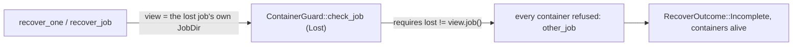

# Supervision gates, the leaf report (v0)

Date: 2026-11-09

---
type: findings
topic: m2b-execution-parity
date: 2026-11-09
version: v0
prior-version: none
key-metric: B36 red on a production defect; 3 of 3 bites fail the gates they target (prior: N/A, delta: N/A)
decision-required: confirm
---

## Headline Result

B36 (`b36_supervisor_sigkill_nothing_left`) kills a real supervisor and recovers the lost job through
the path `candler ps` and `reap_lost_jobs` take. That path leaves the job's containers alive. The
guard refuses every one of them as `other_job`, so recovery returns `Incomplete`. B36 is written
production-faithful and is therefore **red until `src` is fixed**. Everything else in the suite
passes.

## The defect (spec / production, not implemented around)

`ContainerGuard::check_job` accepts a `SweepScope::Lost(j)` only when `j != view.job()`. Both
production callers build the guard and the sweeper over a view of the lost job's own `JobDir`, so the
two never agree. Observed in B36 with the production composition:
`RecoverReport { processes: 1, containers: 0, outcome: Incomplete, refused: [3 x other_job], unknown: true }`.
With a view of another job (a diagnostic composition) the same test passes in 9.7 s and nothing is
left, which shows the rest of the test and of the recovery are sound. Fix candidates for the owner of
`src`: drop the `lost != view.job()` clause, or have `recover_one` / `recover_job` build the guard
over a view that is not the lost job's.

## Names and timings (macOS, Docker Desktop, run whole)

| test | result | s |
|---|---|---|
| container_run_e2e::b06_kernel_facts | pass | 0.6 |
| container_run_e2e::b08_self_expiry | pass | 4.8 |
| container_stop_e2e::b12_sweep_scope | pass | 17.4 |
| container_stop_e2e::b13_client_killed_container_gone | pass | 6.1 |
| gateway_e2e::b17_canary_absent | pass | 21.4 |
| gateway_e2e::b18_internal_network_no_route | pass | 8.2 |
| gateway_e2e::b37_untrusted_upstream_gets_no_credential | pass | 14.7 |
| supervision_gates_e2e::b36_supervisor_sigkill_nothing_left | **fail (the defect)** | 10.1 |

Whole binary: 83.4 s, under the 90 s limit. The leaf lists seven names; `b37` also lives in the
binary, and `b09_host_uid_sealable` is Linux-only.

## Bite record

Each mutation was a temporary edit of another leaf's file, made after a clean-`src` check
(`git diff --quiet HEAD -- crates/candler-core/src`, `cargo clean -p candler-core`, the `guard_signal`
run), restored with `git checkout -- <file>`, and followed by `git status --porcelain crates` showing
only the two test files. B36 bites were run against the diagnostic composition, since the faithful
one is red already.

| bite | mutation | tests | failing assertion |
|---|---|---|---|
| B36 | `jobs/lost.rs`: the lost-job sweep replaced by an empty `ContainerSweep` | B36 | `containers of the job remain: [3 ids]` (supervision_gates_e2e.rs:397) |
| sweeper | `LabelSweeper::sweep_with` returns an empty report at once (covers `sweep` and `sweep_lost`) | B36, B13 | B13: `ContainerSweep { destroyed: [], refused: [], unknown: false }`, left 0, right 1 (container_stop_e2e.rs:402); B36: the same `containers of the job remain` |
| label query | `ps_args` pushes `label=candler.job` without the value | B12 only | B12: `assertion left == right failed: SweepReport {... refused: [other_job x4: two of this run, 61ef24622a00, 3bd621eae7a6] ...}`, right `[]` (container_stop_e2e.rs:315) |

Restore commands: `git checkout -- crates/candler-core/src/jobs/lost.rs`,
`git checkout -- crates/candler-core/src/isolation/container/sweeper.rs`,
`git checkout -- crates/candler-core/src/isolation/docker.rs`.

Deviation: in the label-query bite the guard refused the foreign containers (`other_job`) before the
`AllowlistDriver` could panic, so B12 failed on its own assertion rather than on an allowlist panic.
No container outside the test's own was touched; Eliott's containers and the two older leftovers are
still there.

## Oracle of each test

B36: the daemon's `docker ps -a` and `docker network ls` label filters, plus the OS process table.
B12: the sweep report's `destroyed` and `refused` per scope. B13: the number of containers the stop
hook's sweep destroyed.

## What the CI workflow asserts

`container-e2e.yml` runs `cargo nextest run -p candler-core --run-ignored only --no-tests=fail
--no-fail-fast -E 'binary(guard_container_e2e)'` on `ubuntu-latest`. It does **not** assert the eight
names (`--no-tests=fail` only rejects an empty selection). This is a spec defect for the coordinator;
the leaf did not edit CI. The Linux half is **not yet run**: nothing is pushed.

## Accepted macOS gap

setsid'd host descendants have no subreaper on macOS. `ps -E` shows no environment there, so B36 checks
the `CANDLER_RUN` marker on the pids it knows (those the supervisor recorded); on Linux it scans
`/proc/*/environ`. Linux CI decides the rest.

## Deviations

The test helpers are duplicated from the sibling e2e files rather than shared. B36 runs the supervisor
body directly (`supervise_entry` with a test `JobBody`), not the full orchestrate. The failed-run cleanup
destroys through a guard whose view is another job's, over a fresh `JobDir` of the same id.
`supervision_gates_e2e.rs` allows `clippy::duplicate_mod` on its `support` module, because the
aggregate binary also loads the support files its siblings load.

## Gates

STD (fmt, clippy `-D warnings`, doc `-D warnings`) and LINUX clippy pass; the scaffold and placeholder
greps are empty; `crates/candler-schemas` is untouched, so DRIFT has nothing to bless.
