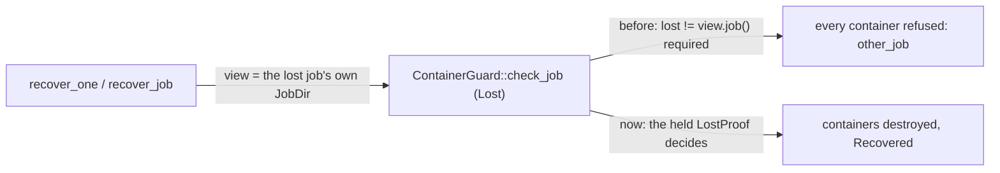

# Supervision gates, the leaf report (v0)

Date: 2026-11-09

---
type: findings
topic: m2b-execution-parity
date: 2026-11-09
version: v0
prior-version: none
key-metric: B36 green after the guard fix; 4 of 4 bites fail the gates they target (prior: N/A, delta: N/A)
decision-required: confirm
---

## Headline Result

B36 (`b36_supervisor_sigkill_nothing_left`) kills a real supervisor and recovers the lost job through
the path `candler ps` and `reap_lost_jobs` take. It first found a production defect (ruling A52): the
guard refused every container of a lost job when its view was of that same job, as both callers build
it, so recovery ended `Incomplete` and the containers stayed alive. The guard clause is dropped (commit
`fix(orchestrator): let a lost job's own view recover it`) and B36, still production-faithful, is green.

## The defect and its fix

`check_job` admitted `SweepScope::Lost(j)` only when `j != view.job()`. Observed in B36 before the fix:
`RecoverReport { processes: 1, containers: 0, outcome: Incomplete, refused: [3 x other_job], unknown: true }`.
The clause meant to stop a live supervisor sweeping its own job; that is code misuse, since a proof
needs a held lock and a second `JobLock::acquire` of a live job fails. The intent is now held at source
level: B16 scans every crate's `src` and requires `LostProof::held(` to appear once, in
`candler-core/src/jobs/lost.rs`; its planted cases are the call in another file, a second call in the
recovery file and no call. B16's Guards, Oracle and Bite lines were updated to say so.

**Fix bite.** With the clause restored, B36 fails: `assertion left == right failed: recovery:
RecoverReport { processes: 1, containers: 0, outcome: Incomplete, runs_sealed: 0, ... refused:
[other_job ...] }`, left `Incomplete`, right `Recovered` (supervision_gates_e2e.rs:394). Restored with
`git checkout -- crates/candler-core/src/isolation/container/guard.rs`, then `cargo clean -p candler-core`.

## Names and timings (macOS, Docker Desktop, run whole)

| test | result | s |
|---|---|---|
| container_run_e2e::b06_kernel_facts | pass | 0.6 |
| container_run_e2e::b08_self_expiry | pass | 4.8 |
| container_stop_e2e::b12_sweep_scope | pass | 17.4 |
| container_stop_e2e::b13_client_killed_container_gone | pass | 6.1 |
| gateway_e2e::b17_canary_absent | pass | 21.4 |
| gateway_e2e::b18_internal_network_no_route | pass | 8.2 |
| gateway_e2e::b37_untrusted_upstream_gets_no_credential | pass | 14.7 |
| supervision_gates_e2e::b36_supervisor_sigkill_nothing_left | pass | 9.9 |

Whole binary after the fix and the helper move: 83.1 s, 8 passed, under the 90 s limit. The leaf lists seven names; `b37` also lives in the
binary, and `b09_host_uid_sealable` is Linux-only.

## Bite record

Each mutation was a temporary edit of another leaf's file, made after a clean-`src` check
(`git diff --quiet HEAD -- crates/candler-core/src`, `cargo clean -p candler-core`, the `guard_signal`
run), restored with `git checkout -- <file>`, and followed by `git status --porcelain crates` showing
only the two test files. The first three bites ran against a diagnostic composition (a view of another job), taken before the
guard fix; the fix bite below ran against the faithful one.

| bite | mutation | tests | failing assertion |
|---|---|---|---|
| B36 | `jobs/lost.rs`: the lost-job sweep replaced by an empty `ContainerSweep` | B36 | `containers of the job remain: [3 ids]` (supervision_gates_e2e.rs:397) |
| sweeper | `LabelSweeper::sweep_with` returns an empty report at once (covers `sweep` and `sweep_lost`) | B36, B13 | B13: `ContainerSweep { destroyed: [], refused: [], unknown: false }`, left 0, right 1 (container_stop_e2e.rs:402); B36: the same `containers of the job remain` |
| label query | `ps_args` pushes `label=candler.job` without the value | B12 only | B12: `assertion left == right failed: SweepReport {... refused: [other_job x4: two of this run, 61ef24622a00, 3bd621eae7a6] ...}`, right `[]` (container_stop_e2e.rs:315) |
| fix | `check_job` gets `&& lost != self.view.job()` back | B36 | `left: Incomplete, right: Recovered`, 3 x other_job (supervision_gates_e2e.rs:394) |

Restore commands: `git checkout -- crates/candler-core/src/jobs/lost.rs`,
`git checkout -- crates/candler-core/src/isolation/container/sweeper.rs`,
`git checkout -- crates/candler-core/src/isolation/docker.rs`,
`git checkout -- crates/candler-core/src/isolation/container/guard.rs`.

Deviation: in the label-query bite the guard refused the foreign containers (`other_job`) before the
`AllowlistDriver` could panic, so B12 failed on its own assertion rather than on an allowlist panic.
No container outside the test's own was touched; Eliott's containers and the two older leftovers are
still there.

## Oracle of each test

B36: the daemon's `docker ps -a` and `docker network ls` label filters, plus the OS process table.
B12: the sweep report's `destroyed` and `refused` per scope. B13: the number of containers the stop
hook's sweep destroyed.

## What the CI workflow asserts

`container-e2e.yml` runs `cargo nextest run -p candler-core --run-ignored only --no-tests=fail
--no-fail-fast -E 'binary(guard_container_e2e)'` on `ubuntu-latest`, tees the log, and (since the
base commit `ci(repo): require every container guard to run and pass`) requires a PASS line for each
of the nine Linux names, B36 among them. The Linux half is **not yet run**: nothing is pushed.

## The verifier's bites

The verifier reproduced the three steps of the leaf. Step 1, the sweeper: under the Lost-only mutation
(`sweep_lost` returns an empty sweep) B36 fails; B13 is not on the Lost path, so it fails only under the
all-scope variant that empties `sweep` too, as recorded above. Step 2, the label query: B12 fails with
the `candler.job` label misnamed. Step 3 (A52): restoring the `lost != view.job()` clause fails B36.

## Open gap and residual

- Nothing owns "serve starts the ZombieTick" (`jobs/runtime/session.rs:283`): B33 starts the tick itself,
  so a serve that forgot it would pass every guard. An open gap for the lead, not fixed here.
- Labels carry no store identity. A copied `jobs/` directory of a live job, recovered with its own free
  lock, would read as Lost and have the live job's containers swept.

## A53: no supervisor outlives its test

B32 spawned the supervisor and asserted before signalling it; a failed assertion left the child running
(the morning flake left orphans). It now holds the child in `HeldChild`, whose drop sends the `Child`'s
own SIGKILL (the one allowed signal) and reaps it. Proof: a `panic!("planted {}", child.id())` planted
after the spawn, B32 alone, pre-spawn check first: `ps -p <pid>` showed nothing after the run; restored
with `cp` of the saved file, never run without the guard. Audit: B33 spawns no supervisor process and its
tree sleeps 20 s; B35's detached supervisor ends with its job (the fake agent sleeps 1 s), so neither can
leak for long. `guard_cli_kill` uses `output()` on a short command.

## Accepted macOS gap

setsid'd host descendants have no subreaper on macOS. `ps -E` shows no environment there, so B36 checks
the `CANDLER_RUN` marker on the pids it knows (those the supervisor recorded); on Linux it scans
`/proc/*/environ`. Linux CI decides the rest.

## Deviations

The helpers it shares with the gateway guards now live once in `tests/support/gateway.rs`. The run key, the sidecar image lookup (an id, not a reference) and the fake's starter (it carries the job's label) stay apart, because they differ in what they return or label. B36 runs the supervisor
body directly (`supervise_entry` with a test `JobBody`), not the full orchestrate. The failed-run cleanup
destroys through a guard whose view is another job's, over a fresh `JobDir` of the same id.
`supervision_gates_e2e.rs` allows `clippy::duplicate_mod` on its `support` module, because the
aggregate binary also loads the support files its siblings load.

## Gates

STD (fmt, clippy `-D warnings`, doc `-D warnings`), LINUX clippy and SUBJ pass; the scaffold and placeholder
greps are empty; `crates/candler-schemas` is untouched, so DRIFT has nothing to bless.

## Note, 2026-11-10

The Linux half has run. The `Container e2e` workflow passed on the pull request of M2b, which
requires a PASS line for each of the nine Linux names (B36 among them): run 42568786540 on
`fe77f9f`, the commit the knowledge-transfer report gates on, and run 42576041947 on `1b607bc`,
the pull request's head, whose tree is what merged as `049a9ab`. The sentence above saying the Linux
half has not run predates the push; the record is left as it was.
