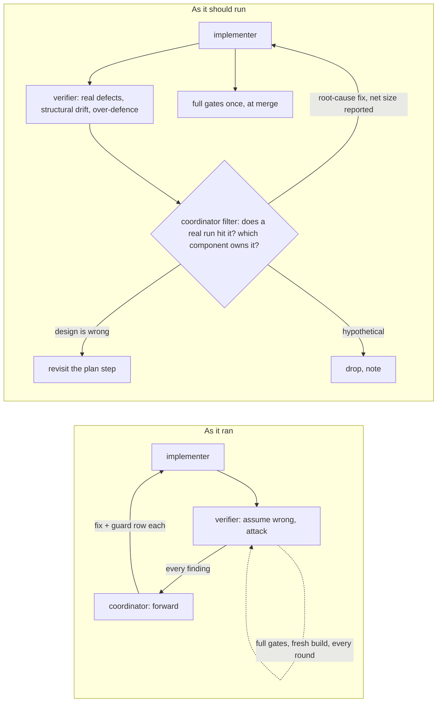

# Coordinating implementers and verifiers: knowledge transfer (v0)

Date: 2026-11-12. Source: the M4 coordinator session (L2 and L3 of `m4-session-runner`). Written for the parent session and any future coordinator that dispatches implementer and verifier agents.

## Executive summary

- **What shipped.** L2 merged (`harness_out_of_core`, `opencode_settings`). L3 is built (`session_runner`, `opencode_wiring`) and in a consolidation pass before merge. No digest moved, no token was spent on a real model, and nothing was pushed.
- **What it cost.** Far more than the work needed:
  - more than 10 hours of wall time;
  - about 25 agent dispatches or resumptions, and on the order of 6 million subagent tokens since the last context summary;
  - the full gate suite run three times per fix round.
- **The core problem.** The coordinator worked as a router, not a filter. Every verifier finding became a fix brief, every fix became a guard case, and the leaves grew by accretion away from their planned structure. Eliott had to intervene four times: test growth, rows per finding, defensive accretion, and cost.

## The loop as it ran, and as it should run

## Wins (carry forward)

- **Verifiers found real defects the gates missed.** Each shipped green and was wrong:
  - `Write` mapped to a dead OpenCode action;
  - `plan` mode escapable through rule order and subagents;
  - `steps` ending a capped run as `completed`;
  - a factor-level session cell differing from its `[fixed]` twin (I12);
  - the session close rule failing on coalesced notifications.
- **Bites.** Requiring each guard to be seen red by a named plausible bug exposed guards that asserted nothing, several times.
- **Recorded fake-model runs** (OpenCode effort, the step cap, bypass plus deny) settled harness behaviour without tokens.
- **Rulings went one way.** Compatibility and behaviour changes (the retired refusal code, D10) went to the parent and came back as rulings; the coordinator did not decide them.
- **Stop and report.** Implementers who hit an accident (lost work, `core.bare`) stopped and reported instead of working around it.

## Pain points and root causes

| Pain point | Root cause |
|:--|:--|
| A fix round per finding, three rounds on one rule (the session close rule went from a time margin, to counting Stop lines, to text matching, to `prompt_id`) | The plan never settled the hard design question ("what signal settles a turn?"), and the coordinator patched each counterexample instead of sending the question back to the plan step |
| Defensive accretion: hardening an argv validator for argv our own code builds, census-forgery guards, length caps, reserved names, validation at two layers | The verifier brief said "assume something is wrong, attack", so verifiers listed every conceivable failure, and the coordinator forwarded them all |
| Test growth, first by tests (56 per incident), then by table rows | "A fix adds a row" replaced "a fix adds a test" without changing the logic. `designing-tests` says: fix at the root, cull the confirm, add a case only for a bug the others miss |
| The OpenCode settings were refused, then mapped, then partly refused again | The facts probe trusted `--help`. Equivalence claims were read from name lists, not from the code path that evaluates them |
| Every fix round re-ran fmt, clippy, the Linux clippy, the workspace suite, DIGEST and GOLDEN in a fresh build dir, by both the implementer and the verifier, then again by the coordinator at merge | No cost model. Verification was proportional to habit, not to the diff |
| Accidents: `git checkout --` wiped uncommitted work; tests run inside `git rebase -x` set `core.bare=true` in the shared repo (git exports `GIT_DIR`, and the tests' `git init` re-initialised it); a target dir shared across worktrees ran a stale binary | Briefs listed safety rules for Docker and disk, not for git or build-dir hygiene. The `rebase -x` advice came from the coordinator |
| A subagent was lost across a context compaction, so a fresh one had to re-learn the leaf | Agent ids lived only in the coordinator's context, not in the notes |
| Commits split by file group did not build | The commit-builds rule was in the brief but never checked before the leaf report |
| Fake-model fixtures hid real-model shapes (coalesced notifications, error turns, Stop continuations) | session_facts' optional real-model run (F6) was skipped, and nobody flagged the gap |

## Next-cycle changes

**For the coordinator**
1. **Filter every finding before it becomes work.** Answer three questions:
   - Does a real run hit it?
   - Which component owns the invariant?
   - Is the design wrong, or the code?

   Drop hypotheticals with a one-line note. Send design-level findings back to the plan, not to the implementer.
2. **Cap fix rounds at two per leaf.** A third round means the plan step is wrong: stop and revisit it with the parent or the user.
3. **Brief verifiers to report three kinds of finding:** real defects, structural drift from the plan, and over-defence (checks against our own code, duplicate validation, incident-pinning cases). "Attack" without that balance produces accretion.
4. **Ask every fix round for its net line count,** and justify growth. Prefer deletion and merging.
5. **Size verification to the diff.**
   - A re-check covers the round's diff and the findings it claims to close.
   - The full gates run once, at merge, in one build dir per worktree, reused across rounds.
   - Use the lightest model that can do mechanical re-checks.
6. **Before dispatching, estimate the cost:** agents × rounds × gate runs. Say it in the plan, and prefer fewer parallel leaves when the work interlocks.
7. **Record each agent's id and role in the shared notes,** so a compaction does not orphan it.

**For implementer briefs** (already added to `m4-implementer-brief.md`, in its "Lessons from L2" section)
- Fix at the root. A reproduction is a confirm and is deleted when the fix holds. A guard gains a case only for a bug the others miss.
- Harness facts come from docs and pinned source with file and line, never `--help` or memory.
- Restore a bite from a copy, never `git checkout --`, `restore` or `stash`. Make a WIP checkpoint before a round of bites.
- Never run tests inside `git rebase -x` without `env -u GIT_DIR -u GIT_WORK_TREE -u GIT_INDEX_FILE`. Never change the shared repository config.
- One `CARGO_TARGET_DIR` per worktree, never shared.
- Every commit builds: check each commit before reporting.

**For plans**
- Each leaf names the one design question it must settle, and a probe answers it before the build. M4's examples:
  - the turn-settling signal;
  - whether each setting's meaning is the same in both harnesses.
- A fixture set from a fake model is not evidence about a real harness's shapes. Plan the real-model run (tokens, with the user's go), or list the shapes the fake cannot show.

## Artifacts to preserve

- `m4-implementer-brief.md` (shared notes), "Lessons from L2": the binding rules above.
- `m4-coordinator-carry.md` (shared notes): the incident log (reversals, `core.bare`, close-rule history).
- `m4-l3-consolidation.md` (shared notes): an example of a removal list that targets a net reduction.
- The leaf reports under `__reports__/m4-session-runner/leaves/`, each with its fix-round sections.

## Open questions

- Should verification be one verifier per leaf at the end, rather than one per fix round? A single structural review, plus targeted re-checks, would likely catch the same defects at a fraction of the cost.
- Which merged leaves (`opencode_settings`, `harness_out_of_core`) need a pruning pass for incident-pinning rows and refusals that cannot fire?
- `run_signals` reads the whole job's gateway log and loses signals past about 7,000 requests: a follow-up, not yet scheduled.
- `live_confirmation` (L5) must include a real-model session where two background jobs finish together, and a long final answer, to test the close rule on real shapes.
