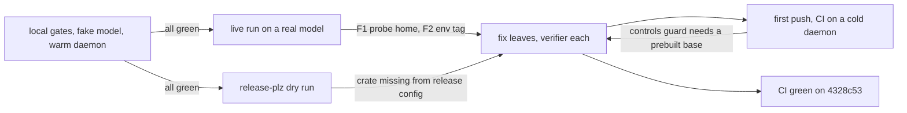

# M4 session runner and second harness: knowledge transfer (v0)

Date: 2026-11-13. Source: the M4 coordinator session, L4 through the milestone PR. Written for the parent session and the next milestone's coordinator. The L2 and L3 lessons are in [coordination_knowledge_transfer_v0.md](coordination_knowledge_transfer_v0.md) and are not repeated here.

## Executive summary

- **What shipped.** PR [CrackingShells/Candler#20](https://github.com/CrackingShells/Candler/pull/20), `merge(runner): land the session runner and the OpenCode driver`, head `4328c53`, all CI green.
  - Session mode: opt-in, a conservative close rule, measured outcomes, and controls against a fake model.
  - OpenCode 2.2.7 behind the same driver traits.
  - No harness named in the core or the schemas.
  - Comparison verdicts for imported runs, and generated contract pages for driver authors.
  - Releases: core v0.8.0 and schemas 0.7.1, by `release-plz`'s dry run.
- **Evidence.**
  - Digests: the golden import (240 runs, 10,320 records) and the mini import (6, 136) are unchanged against main.
  - Live, on RiVault/Reasoning-Small, 4 of 5 runs, 0.19 USD client-side: three session cells closed about 60 s after their last turn, and one OpenCode run went through `candler run` end to end ([live_confirmation_v0.md](live_confirmation_v0.md)).
- **What the late stages found.** The cheap checks passed while the product did not work:
  - **OpenCode could not run at all.** Its version probe died in the read-only control container. Every gate was green, because no test ran the real image through the core's probe.
  - **The env image tag ignored the harness base,** so two harnesses overwrote each other's env.
  - **The release config left out the new crate.** Only a `release-plz update` dry run showed it.
  - **CI failed on the first push.** The controls guard needed a base image that this machine's daemon already had and CI's did not.

## Where each defect was caught

## Wins (carry forward)

- **The live leaf earned its cost.** For under 0.20 USD, it found two defects that 667 tests, the e2e set and four verifiers had missed.
- **Measure first, then fix.** For F2, the coordinator asked for a measurement before any code. Then it asked a reproducibility question: do two `--no-cache` builds give one id? The answer, no, settled the compatibility ruling with evidence instead of argument.
- **Rulings went to the parent, and the parent asked the root-cause question.** "Which component owns the layout a run gives the harness?" turned F1 from a driver patch into one shared core function. "A branch that exists only to keep a fixture green" removed a special case.
- **Dry runs over hand arithmetic.** The version numbers in the first PR draft were wrong, because they came from a stale local `main`. `release-plz update` on a throwaway worktree gave the right ones and exposed the config gap.
- **One verifier per change, at the end.** Each of the four L5 verifiers ran once and found either nothing or one doc line. No change needed more than one fix round.
- **Cleanup was checked with evidence.** Every Docker object was removed by exact id, with the lists compared before and after. The parent asked for proof instead of "most likely timed out", and it was right to.

## Pain points and root causes

| Pain point | Root cause |
|:--|:--|
| OpenCode could not run, yet every gate was green | The OpenCode guards used a fake harness and the conformance suite. No guard ran the real base image through the core's own version probe. The driver crate tested the probe's argv; the core tested the container hardening; nobody tested the two together. |
| The env tag was shared across harnesses | The tag key predates the second base. The milestone adding a second base never listed "everything keyed by the base" as a seam to review. |
| The new crate was missing from `release-plz.toml` | Adding a crate had no release checklist. The fix's first form, the ruled `git_tag_name`, would itself have broken the release job: no `v` tag before v0.8.0 contains the crate. Only the dry run showed that. |
| CI failed on the first push | The milestone branch was never pushed before the PR, so CI first ran the L4 guards at the PR. The local container runs had a warm daemon with every base image built. |
| The live run lost about 25 minutes to Docker Desktop | Its file share never exposed a freshly recreated root under `/private/tmp` in 15 minutes, while a root under `$HOME` worked at once. The refusal text did not name the cause (F4). |
| The first PR draft had wrong versions | The coordinator read `main` locally without fetching. |

## Next-cycle changes

**For plans**
1. **A real-image guard for every driver seam that runs inside a container.** For each such item (version probe, collect, stop), plan one guard that drives the real base image through the core's own path. A fake harness proves the core's logic, not the harness's fit to the container.
2. **When a milestone adds a second instance of something,** list everything keyed by the first: tags, labels, caches, locks, file names. Review each as a seam.
3. **Make the live leaf earlier, and make it gate.** Run one real-model smoke at the first level where the path runs end to end (L3 here), not only at the end. Its findings can then be fixed in the leaves that own them.
4. **A new crate's plan step includes its release config,** checked with a `release-plz update` dry run on a throwaway worktree.

**For the coordinator**
1. **Push the milestone branch after each level merges** (no PR needed), so CI's cold daemon runs the container guards while the level is still fresh.
2. **Run local container gates as a cold daemon would:** a guard that uses an image must build or find it through the core, never assume it. Check this by reading each guard's setup, never by deleting shared images.
3. **`git fetch` before reading `main`** for any version, base or ancestry claim.
4. **Live and e2e scratch roots go under `$HOME`,** a default Docker Desktop share. Run a `--mount type=bind` check on a fresh subdirectory before a run.

**For implementer briefs** (add to the next milestone's brief)
- A guard that needs a Docker image finds or builds it through the core's image service, and removes by id what it built.
- A change to a keyed resource (a tag, a lock or a cache key) lists every reader of the key.

## Artifacts to preserve

- [live_confirmation_v0.md](live_confirmation_v0.md) and `live/commands.sh`: the clean launcher, the mount check, and the four runs.
- [digest_invariance_v0.md](digest_invariance_v0.md): the main-against-branch method, with separate stores and a control that shows the diff can fail.
- `m4-l5-fixes-brief.md` and `m4-coordinator-carry.md` (shared notes): the F1 and F2 rulings, the reproducibility measurement, and the release-config before and after.
- The PR #20 body: release table, evidence, and follow-ups.

## Open questions

- `comparable.values` holds `isolation.image`, a docker id that is machine-local and not reproducible. The new env tag key, built from the lock and the base content, is a content identity. Should it replace the docker id? That is Eliott's decision.
- F4: refusals and infrastructure failures should carry their cause (the invalid reason and the stderr tail). Which milestone owns this?
- Once v0.8.0 is tagged, the OpenCode crate can take the `v{{ version }}` tag template. Should it also get its own changelog, as the other core members have?
