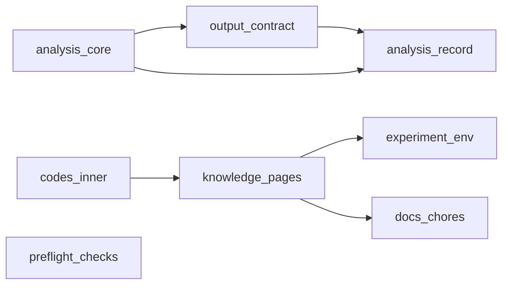

# M6b surface consolidation: verdicts (findings, v3)

Date: 2026-11-23

---
type: findings
topic: m6b_surface_consolidation
date: 2026-11-23
version: v3
prior-version: 01-findings_verdicts_v2.md
key-metric: inputs with an explicit verdict: 72 of 72 (63, plus round 02's nine) (prior: N/A, delta: N/A)
decision-required: confirm
---

## Headline Result

metric: inputs judged (72) and what Candler is asked to build
value: 25 accept, 7 defer, 8 done, 4 m7, 1 owner:consumer, 1 owner:plugin, 2 owner:provider, 8 reject (56 primary records, 14 covered ids, 2 split ids H5 and H6)
unit: ids (primary records counted once; covered and split ids follow their primaries)
prior: v2, 20 accept, 47 primary records
direction: up (round 02's nine candidates taken in as N1 to N9b)

Counts above are over the 56 primary records (the nine N ids are all primary). Over the 72 rows of the table below, which add the 14 covered ids and the two split ids, the tally is 32 accept, 13 defer, 9 done, 4 m7, 1 owner:consumer, 1 owner:plugin, 3 owner:provider (G4 follows C10), 9 reject.

Decision wanted from Eliott: Go or amend. Every question is ruled. Nothing is built until Go.

## What changed from v2

Round 05 (2026-11-23). Eliott ruled Q4c and took in the nine round 02 candidates.

| Point | Ruling | What it changes here |
|:--|:--|:--|
| Q4c | The start command is the check, and no MCP client is needed. Software the agent uses at run time belongs in the image; mounting it is the plug-in's choice, not Candler's idiom. The check runs once per job before the first run, in a container set up as a run's | C2's form is fixed (reason, seams, `preflight_checks`, the box border). The HTN coordinator was told to install its servers in the image |
| N1 | owner:plugin | `plan.*` is the legacy harness's key set, copied by the importer; native runs record the prompt, so the plug-in passes the domain name as a prompt value or reads it from the graded file. The HTN coordinator was told, with the dogfooding direction: target the latest Candler, not a reproduction of the old harness |
| N2, N4, N6 | accept | Into `preflight_checks` |
| N3 | owner:provider | Claude Code's own turn metering; Candler passes `--max-turns` and records the result truthfully |
| N5 | defer | A Future row with a trigger |
| N8 | accept | A probe test first; into `output_contract` |
| N9a | reject | By design: mount placeholders, the files are blobs in the store |
| N9b | accept | The scout found no duplicate: the harness's env overlay is written only by the driver, and the Claude Code driver writes it empty (`candler-harness-claude-code/src/driver.rs:227-237`). A new leaf `experiment_env` at L2 |

## What changed from v1

Round 04 (2026-11-23). Eliott ruled Q3 and asked how the Q4 check would find a server written in any language.

| Point | Ruling or question | What it changes here |
|:--|:--|:--|
| Q3 | The field list is enough; X6 is rejected | X6 goes from `accept` to `reject`. No `Example` section, no `CONTRIBUTING.md` rule change; about 10 calls leave `knowledge_pages`. C12's reason and X5's quick start no longer lean on X6 |
| Q4 | How does the check find servers written in different languages, and where does it look? | Answered in Open questions (Q4c): Candler never looks for a server's files. C2 stays `accept` until Q4c picks its form |
| Round 02 | The HTN candidates were only in the folder README | They now have their own section in this report (Round 02 candidates) |

## What changed from v0

Eliott ruled on the nine steering questions on 2026-11-23 (round 03 of the folder README). This version applies the rulings; every other row is as in v0.

| Question | Ruling | What it changes here |
|:--|:--|:--|
| Q1 | JSON is the default output of every data command | D1 takes O3. `resolve`, `ps` and `ls` flip to JSON: a compatibility finding, sent to the supervising session |
| Q2 | Errors are JSON by default too. `--format json` has no meaning; only a text option does, a pretty print of the JSON | G11 goes from `done` to `accept`, folded into X1. One option asks for the text rendering of stdout and stderr together; `--error-format` and the `--json` flags of `watch` and `resolve` retire into it. R01's rule becomes "the output format is never derived from a terminal" |
| Q3 | Eliott asked why a generated page needs a sample | Answered in v1; ruled in round 04 (X6 rejected) |
| Q4 | The box the author builds is the author's, but Candler may check after the image build that the box holds what the experiment declares. A border of responsibility must be fixed | C2 (and H1, which follows it) goes from `defer` to `accept` as a check after the image build, not the census comparison. The border is drafted in the responsibility record and waits for Eliott's confirmation. Size not yet read |
| Q5 | Option A: the pre-run estimate prints in `resolve` | No change; it was the leaf's proposal |
| Q6 | Defer | G6 stays `defer`; the cause in the message waits with the bind-mount probe row |
| Q7 | Align to the standard meaning | Option A: the code's `Stratum` (a block) keeps the word; the comparability sense is renamed before `analysis-report/1` is cut. X12's glossary stays `defer` |
| Q8 | Option B | The analysis record names the field `interval_reading`; R01 and `docs/statistics.md` change one word |
| Q9 | Option A: offline delivery is M7's | No change in M6b; the responsibility record's open tension is settled by ruling |

## How to read this report

Eliott's round-02 rulings bind every row (items are inputs, not a backlog; Candler's idioms; no user-behaviour baseline; no refusal remedy hints; docs are the web-wide surface while the CLI, MCP and skills are self-contained and offline; M7's MCP shape is decided at M7 planning). Verdicts: `accept` (Candler owns it and the build session builds it), `defer` (Candler owns it, waits for an evidence trigger), `m7`, `owner:<who>`, `reject`, `done` (already true on the tip). Tip judged: `a0df4d48`. The leaf reports under `leaves/` hold each record in full (live on the tip, the ask questioned, responsibility, blast radius, triad, idioms); this report folds them, resolves the seams between them and adds what no leaf could see alone.

## Verdicts

| Id | Leaf | Verdict | Folded into | Reason |
|:--|:--|:--|:--|:--|
| G1 | knowledge_as_data | owner:consumer | - | Choosing the catalog is the experiment author's call; Candler derives, records and gates it (catalog digest, census, stratum refusal are live). Premise "snapshots or inputs unsupported" is half wrong: only snapshots. |
| G2 | execution_preflight | done | - | Treatment-as-factor is refused and differing `eval_infra`/`sandbox_contract` strata are refused by design (`compare.rs`). |
| G3 | analysis_outputs | accept | F2 (accept), F4 (reject) | Orientation half accepted via F2 (A and B follow a natural order of the levels, not the cell digest). The Holm half is rejected via F4 (`reading` and `reject` answer two questions) and handled by C6's decision list. |
| G4 | analysis_outputs | owner:provider | C10 | RiVault's cache and its cost counting are the provider's; the 2026-11-09 ruling stands (no workaround in Candler). |
| G5 | execution_preflight | accept | - | The treatment step pins a commit and never checks that the skill subtree exists in it; add the check as a preflight check id (no `codes.toml` row). |
| G6 | execution_preflight | defer | - | A bind-mount probe is a platform special case on one incident; trigger: a second bind-mount failure. Naming the cause in `jobs.session_controls_failed` is not covered by G8 and is a separate ask (seam 2), deferred with it by Q6. |
| G7 | cli_contract | defer | C13 | A plug-in check verb adds little over the checks `evaluate` runs; author traps are page content. Future row. |
| G8 | codes_review | accept | - | 39 caller codes are shadowed by `*.document_invalid`; make the inner code the printed `code` (one `schemas@` release). Covers 14 of the 39 shadowed rows; path and scope caveats in the codes review. |
| G9 | cli_contract | done | - | Store root fallback is sourced (I12) and `config.no_store` is raised only when no root resolves at all (see Seams, seam 1); R01's sentence is nearly right. |
| G10 | execution_preflight | done | - | Fixed-value traps are refused or recorded loudly; the image-id trap already has a Future row. Caveat: two residuals (`--set` unknown `request.*` keys, the order of the factor refusal) were not read; `done` covers the traps read. |
| G11 | cli_contract | accept | X1 | Ruled by Q2: errors are JSON by default like stdout, and one text option renders both; `--error-format` retires into it. |
| G12 | cli_contract | reject | C14 | Inferring import rules would put domain strings in the core (I1) and fail silently into an append-only store (I11). |
| G13 | analysis_outputs | defer | - | Already a Future row (`architecture.md:1800`); trigger not met; widen it with double grading. |
| G14 | execution_preflight | done | - | Detached supervisor with no daemon is R01's design (I16); consumer sentences are docs. Caveat: cap metering, the sweep flake and copied `jobs/` dirs were not verified; `done` covers the design, not those behaviours. |
| G15 | execution_preflight | done | - | Isolation facts are as designed and open residuals already carry rows. |
| G16 | docs_and_skills | done | - | Pages and schemas are generated under drift tests; residual hand copies go to X5, X8 and X11. Its "skills link the pages" cure is overruled by R04. |
| G17 | knowledge_as_data | done | - | Policy already in `CONTRIBUTING.md:20,82` (`:75` the bump, minor while 0.y.z): pre-1.0 breaking changes carry `!` or a BREAKING CHANGE footer; the four unmarked M2c changes are past misses the supervisor accepted, with no history rewrite; the version table (`docs/contract/index.md:30-36`) is correct. |
| G18 | knowledge_as_data | defer | C7 | The commit is recorded and gates strata; only an errata list is missing, with one occurrence so far. |
| G19 | knowledge_as_data | defer | C7 | Candler records the alias; whether the stream carries the backing model is unchecked. |
| G20 | knowledge_as_data | accept | C3 | The path vocabulary has two hand-written owners and no page; one table plus one generated page. |
| G21 | execution_preflight | defer | - | No Docker lock or `gc` is needed by Candler's own runs; `gc` waits on the image identity row. Future row. |
| C1 | execution_preflight | accept | - | Cells, new and reused runs are already computed by `PlanMode::Check` and printed nowhere; print the summary, no new verb or option. It prints in `resolve` (Q5, option A); `resolve` needs Docker (seam 5). |
| C2 | execution_preflight | accept | H1 | Ruled by Q4 and Q4c: once per job, before the first run, in a container set up as a run's (image, mounts, env, secrets), each declared stdio server's start command is started with stdin open and must still be running after a short wait, or the job is refused with the server's stderr. No MCP client; remote servers are outside the box and skipped. The probe verb stays rejected; the census comparison at run time stays a Future row. Border in the responsibility record. |
| C3 | knowledge_as_data | accept | - | One const table of paths in `candler-core` read by the code, rendered as one generated page under the existing d1 guard. |
| C4 | execution_preflight | done | H2 | `resolve` already prints each value with its source (`derived {step}`); JSON form is X1's. |
| C5 | execution_preflight | reject | - | Shape, unknown fields and factor rules already run before the image step (order inferred from module docs, bodies unread); a skip switch is a second validation path. `resolve` as a whole needs Docker (seam 5). |
| C6 | analysis_outputs | accept | - | A list of decisions derived in core from `Report` (one per tested entry: labels, B minus A, interval, `p_holm`, `reject`, family size, omitted reasons); no job state. |
| C7 | knowledge_as_data | defer | H4, G18, G19 | Reported model and errata registry: one occurrence and an unchecked stream. Future row. |
| C8 | analysis_outputs | accept | - | Candler sums the per-run costs it already records, counting runs covered and runs without a total; tokens are a Future row. |
| C9 | analysis_outputs | accept | H7 | The normalised trace is already stored at seal time; print it with one renderer. Verb: `inspect <run>` (see Seams, seam 4). |
| C10 | analysis_outputs | owner:provider | G4 | A flag cannot tell a cache hit from a deterministic agent; the ruling stands. |
| C11 | cli_contract | reject | - | Remedies are ruled out; valid values as facts already live in messages where useful; a field would change `refusal/1`. |
| C12 | knowledge_as_data | reject | - | A scaffold is the experiment file written through flags; the field lists of the generated pages (C3, X7 and the existing contract pages) meet the need (X6, samples, was rejected by Q3). |
| C13 | cli_contract | defer | G7 | `check_suite` exists in core; exposing it waits for a lost job start. Future row. |
| C14 | cli_contract | reject | G12 | See G12. |
| C15 | execution_preflight | defer | G21 | See G21. |
| H1 | execution_preflight | accept | C2 | See C2. |
| H2 | execution_preflight | done | C4 | See C4. |
| H3 | knowledge_as_data | accept | C3 | See C3: the web page only; serving the data to an offline agent is not delivered by any accepted item (Q9, D1, M7). |
| H4 | knowledge_as_data | defer | C7 | See C7. |
| H5 | analysis_outputs, cli_contract | accept | F2, F4, C6, F5 | Split: label half F2 (accept), Holm-headline half F4 (reject, the headline is `reject` through C6), summary half C6 (accept), text half F5 (accept). Net: the summary is built from F2, C6 and F5. |
| H6 | execution_preflight, analysis_outputs | accept | C1, C8 | Split: estimate half C1 (accept), spend half C8 (accept). Two times of one fact; the estimate from history waits on C8's record. |
| H7 | analysis_outputs | accept | C9 | See C9. |
| H8 | execution_preflight | defer | G21 | See G21. |
| H9 | docs_and_skills | m7 | - | Skill content is M7's to shape; X6 (samples) was rejected by Q3. |
| H10 | docs_and_skills | m7 | - | Checklist wording is M7's; the facts it needs come from C3. |
| H11 | docs_and_skills | m7 | - | `side` in the registry is the map; M7 derives its notes from it with no copy. |
| H12 | docs_and_skills | m7 | - | CLI half is D1; the MCP half is M7's shape. |
| F2 | analysis_outputs | accept | - | A and B depend on cell digests today; order the levels by a natural order in core (no option). |
| F4 | analysis_outputs | reject | - | `reading` is the interval's and `reject` is Holm's; merging states an interval fact from a p-value. |
| F5 | cli_contract | accept | H5 | `analyze --format text` rendered from the record, after X4, F2 and C6. |
| X1 | cli_contract | accept | G11 | JSON is the one default on stdout and stderr across the data verbs; one option asks for the text rendering (D1, Q1, Q2). The premise "resolve prints nothing" is wrong. |
| X2 | execution_preflight | reject | - | `evaluate` waits so its report is one stdout document; `run` returns an id because it is long. Designed in R01. |
| X3 | cli_contract | accept | - | Narrow form: exit codes and value domains from one constant feeding `--help` and the page; examples are rejected. |
| X4 | cli_contract | accept | - | `analysis-report/1` and `inspect-*` records in `candler-schemas` under `schema_drift`; the R01 Future trigger is met. |
| X5 | docs_and_skills | accept | - | `README.md` becomes the store window (60 to 80 lines); inventories leave it. |
| X6 | docs_and_skills | reject | - | Ruled by Q3: the generated field list of each contract page is enough. No `Example` section and no change to the five-section rule. |
| X7 | docs_and_skills | accept | - | One generated config page over the two files (project `candler.toml`, user config); `slots.*` and `gateway.*` are user config. |
| X8 | analysis_outputs | accept | - | Correct `docs/statistics.md:165` ("not offered yet") and R01 `:328`, `:1335`, `:1757`. |
| X9 | codes_review | accept | - | Fix the `config.no_store` row text; stamps are a record of the last check and are re-stamped only after a real check. |
| X10 | cli_contract | accept | - | Dissolved by D1: `show` and `diff` get the default format. |
| X11 | docs_and_skills | accept | - | Docstrings stay the source; rewrite the helper README as an author page with one tested example. |
| X12 | docs_and_skills | defer | - | A hand glossary is a second source. The word "stratum" in two senses is settled by Q7 (the comparability sense is renamed in `analysis_record`). Future row. |
| N1 | round02 | owner:plugin | - | `plan.*` is the old harness's `experiment.json` key set, which the importer copies (`import/manifest.rs:127-158`, `import/legacy.rs:7`), so only imported runs carry it. A kind gets the recorded values it names by exact path (`evaluation/context/assemble.rs:143-158`). In the native run the domain name is not a value; it is inside `prompt.template`. The plug-in passes it as a prompt value or reads it from the graded file. |
| N2 | round02 | accept | - | `--set replicates=1` passes the known-path check because `replicates` is a setting (`resolve/layers.rs:34`), but the plan reads only the file's value (`runner/plan.rs:1168`). Honour it or refuse it. About 2 calls. |
| N3 | round02 | owner:provider | - | Claude Code's own metering. Both runs of `a16b0809…` received `--max-turns 200` (`raw/resolved.jsonl.gz`); its result line says `error_max_turns` at 201 (r2) and `success`, `end_turn` at 250 (r4). Candler recorded both truthfully (`run.ended_by` cap against completed, `run.num_turns`). |
| N4 | round02 | accept | - | A `[treatment]` default is demanded even when `request.treatment` is the factor. The refusal is at `resolve/steps/identity.rs:133-139`; the rule that demands the default is the build's first read. About 10 calls. |
| N5 | round02 | defer | - | `plugin_environment.rs:310-322` reads `treatment:` in a plug-in's build context as a plain path, and no stated reason was found; a plug-in's image may be meant not to depend on the treatment. The experiment-level pair works today. Future row. |
| N6 | round02 | accept | - | A prompt starting with `/` passes `resolve` and is refused at run time. The check moves into `resolve`, the place Q5 named for such checks. About 5 calls. |
| N8 | round02 | accept | - | `resolve` uses `CANDLER_STORE` (`main.rs:37`, `commands/resolve.rs:243`, `commands/common.rs:106-116`), but its printed resolution is built without the store (`preflight.rs:268-315`), so it likely names the default as the source. A probe test sets the variable and reads the printout; if it is right, N8 closes as done. About 3 calls. |
| N9a | round02 | reject | - | By design. A mounted file needs an empty mount point, which stays in the saved workspace; the file itself is a content-addressed blob in the store, listed under `comparable.inputs`. Under Q4c a server the agent uses belongs in the image anyway. |
| N9b | round02 | accept | - | Not a duplicate (`leaves/n9b_env_scout_v0.md`). Secrets are names whose values reach the host gateway only (`isolation/container/run.rs:78-106`); `mcp.servers.<key>.env` reaches server processes; the harness's overlay is the driver's and is empty for Claude Code (`driver.rs:227-237`). An `env` table in the experiment file sets name and value for the harness; values are cell values, so they are recorded and enter the cell digest (`resolve/layers.rs:27-58`). Refused names: those Candler sets (`PATH`, `HOME`, `VIRTUAL_ENV`, `LANG`, the gateway's, the driver's state variables), secret names, duplicates. About 20 calls and a `schemas@` release. |

The N rows come from `leaves/round02_candidates_v0.md` and the coordinator's checks of the run store; N9b's from `leaves/n9b_env_scout_v0.md`. Where this table differs from a leaf's wording: G9's reason is corrected by seam 1; G3 is a covered id whose two primaries disagree (F2 accept, F4 reject), judged accept for the orientation half only; H5 and H6 are the two split ids.

## Seams

Each seam the leaves raised, resolved with its reason, or sent to a steering question (Q1 to Q8 in v0, now ruled; see What changed from v0). Seams 1 to 7 are the ones the coordinator marked; the table after them lists the rest.

### 1. `config.no_store`: is the refusal ever raised?

Two leaves disagree: `cli_contract` says the code never raises it, `codes_review` says it is emitted at `crates/candler/src/commands/common.rs:103`. Outcome: **it is emitted, and it is reachable, but only when no store root resolves at all.**

- `resolved_root` takes the `store.root` entry from the resolved settings and builds `CliRefusal::NoStore` when none exists (`common.rs:89-104`).
- The core default for `store.root` is `<project root>/.candler/store` when a project file is found, else `<state home>/candler/store` (`$XDG_STATE_HOME`, else `~/.local/state`); "with neither, there is no default" (`crates/candler-core/src/resolve/layers.rs:284-344`; guard `the_default_store_root_follows_the_project_or_the_user_state_directory`, `crates/candler-core/tests/it/guard_resolve.rs:631-689`).
- So the refusal fires when there is no `--store`, no `CANDLER_STORE`, no `candler.toml` found and no state home (no `HOME`, no `XDG_STATE_HOME`): for example a bare container. That is exactly the environment Eliott describes for agents.
- Consequences. (a) The registry row text "Not raised today: a verb given no store root takes the default store" (`crates/candler/src/commands/refusal.rs:233-241`, `docs/contract/index.md:70`) is wrong or at least misleading: X9's finding stands. (b) R01 §CLI surface (`architecture.md:333-335`, "a verb that finds none refuses, naming the three ways") is true in that case, so the R01 drift claim of `cli_contract` is mostly unfounded: do not "correct" R01, reword the registry row. (c) G9 stays `done`; its trap (a mistyped project dir quietly using the default store) is real but is the zero-configuration design, and D1's `store` field in `ps`/`ls` records shows which store answered.
- Whether `Config.state_home` is ever empty on a normal laptop was not read (the leaves did not trace `Config` construction); the claim is "reachable by construction", not "seen".

### 2. G6: is "name the cause in the refusal" covered by G8?

**It is a gap.** G8 fixes one thing: the inner code of a failed experiment or suite file read (`*.document_invalid`, 39 rows, `candler-schemas`). G6's ask is different: when Docker cannot share the store root, a run's session control fails and `jobs.session_controls_failed` (`docs/contract/codes.toml:979-982`) says "No model's behaviour causes this" without the Docker host's cause (`docs/contract/index.md:170`). `codes_review` never mentions G6, and `execution_preflight` handed it to them. What I could check: the refusal row exists (`crates/candler-core/src/jobs/refusal.rs`); whether the refusal message carries the Docker error text was not established by any leaf or by me (one colgrep search found the table only, not the construction site). The leaf's Future row had a second trigger, "the cause still unnamed after `codes_review`"; that is a state, not evidence, so it is dropped from the row (the probe waits for a second failure) and the cause-in-the-message ask is raised separately as **Q6**; until answered G6 stays `defer`.

### 3. C3, X6, X7, X3 and X11: one generator and one fact source, or two?

What the leaves show, together:

| Item | Fact | Owner of the fact today | Rendered by |
|:--|:--|:--|:--|
| Item C3 | path vocabulary and source forms (`model.id`, `runner.mode`, `treatment:<path>`, settings classes) | `is_known_path` (`layers.rs:60-122`) and `REQUEST_KEYS` (`refusal.rs:201-206`), two hand-written owners | none; proposes one const table plus a page `configuration-paths.md` |
| Item X7 | the five keys of the two config files (`store.root`, `plugins.dirs` in `candler.toml`; `slots.count`, `slots.evaluators`, `gateway.upstream_ca` in the user config) | `PROJECT_TABLES` and `USER_TABLES` (`crates/candler-core/src/resolve/config.rs:13-23`, `:149-161`, `:242-273`), private constants | none; proposes a page `config-file.md` |
| Item X6 | sample files (experiment, suite, plugin manifest, import rules) | fixtures that tests already parse | proposed an `Example` section; rejected by Q3 |
| Item X3 | exit codes and value domains | `Exit` (`commands/mod.rs:27-39`) and clap | proposes one `EXIT_CODES` constant feeding `--help` and a page row |
| Item X11 | the Python plug-in API | docstrings in `plugin.py` | none (no generator; README rewrite) |

Outcome:
- **C3 and X7 do own one fact.** The configuration keys `store.root`, `plugins.dirs`, `slots.count` and `slots.evaluators` are both "configuration paths" in C3's table (`layers.rs:27-58` names them as settings) and the keys of X7's tables. Built as proposed there would be two tables for the same four keys. Resolution: **the key names have one owner.** Intended shape: one const table in `candler-core::resolve` with a `file` column (project, user, none) and a class (experiment path, config key), read by `is_known_path` and `REQUEST_KEYS`, and two generated pages (`configuration-paths.md`, `config-file.md`) that render slices of it. The verifier points out, rightly, that `PROJECT_TABLES` and `USER_TABLES` drive typed parsing (`config.rs:319-337`) and `is_setting` (`layers.rs:27-58`) carries experiment-path rules, so one table cannot simply replace them and this is a new design neither leaf costed. Therefore: the build session's first read decides whether the typed tables can take their key names from the one table; if they cannot, the fallback keeps one owner per fact by dropping the four config keys from C3's table (they appear there as a pointer to the X7 page) and generating X7's page from the typed tables. `is_setting` (`layers.rs:27-58`) also names the four config keys as hand-written literals, a third owner: in both shapes it must read the one table (or the X7 page's typed tables) instead of its literals, and the build session's first read confirms it can; if it cannot, the item stops and returns to Eliott. Only then do two items not own one fact. C3 and X7 are built in one leaf; sizes (12 and 6 calls) hold for the fallback and may rise by about 6 for the intended shape.
- **X6 is rejected (Q3), so the five-section rule holds.** C3 and X7 add pages in the existing shape; neither invents a page shape. The rest of this bullet, about X7's fixture, was written when X6 was accepted: X7's Example is the project fixture `observe/ls/candler.toml`; the user config has no tested fixture and gets no Example (build adds none).
- **The generator is test-support code** (`crates/candler/tests/it/support/contract_pages/`), so the interactive surfaces cannot reuse it. None of the accepted items needs it to: C3 and X7 are web-wide pages (X6 is rejected) (the generator is right for them). X3's exit codes are interactive and live in the binary (`after_help`) from one constant that the page generator also reads: that is one source, two readers, and whether the test crate can read it is open: `crates/candler` has no `lib.rs` and its tests include source files by `#[path]` with stand-ins (`crates/candler/tests/it/main.rs:6-16`, found by the verifier), so reading `Exit` or an `EXIT_CODES` constant needs a new path include, not counted in X3's 6 calls (add about 2). What no accepted item solves is offline delivery of C3's table to an agent (H3 asked for it through `--json`): that stays D1 and M7's, and no verdict depends on it. State this plainly to Eliott: the path vocabulary will be readable on the web and in the CLI only through refusals and `resolve` until M7 decides.
- X11 shares nothing with the generator (docstrings remain the source), and its README example is the one a test imports.

### 4. D1 with F2, F4, C6, C8, C9 and F5: do the analysis records and D1's schema list agree?

D1 proposes `analysis-report/1` (arms, entries, comparisons, runs, summary), `inspect-run/1`, `inspect-job/1`, small list, diff and rates records, cut after F2 and F4 settle. Checked against the records:

| Record | What it asks of the analysis output | Fits D1? |
|:--|:--|:--|
| F2 accept | `Comparison.levels` in a natural order | Yes: it changes values, not fields; build before the record is cut. |
| F4 reject | `reading` stays the interval's reading, `reject` stays Holm's | Yes: the fields stay as they are. Ruled by Q8: the record names it `interval_reading`. |
| C6 accept | a list of decisions derived in core, one key of `analyze` | Yes: it is D1's "summary" member of `analysis-report/1`; D1 listed it, so it is one list, not two. |
| C8 accept | `spent` per arm in `analyze`, `spent` for the job in `inspect <job>` | Not in D1's list: D1 names `arm_json` as it is today. Add `spent` (cost sum, runs counted, runs without a total) to `analysis-report/1` arms and to `inspect-job/1`. |
| F5 accept | `analyze --format text` rendered from the record | Yes: needs the record first. |
| C9 accept | transcript of a run | Not in D1's list; see below. |

Therefore **the record is cut once, after F2, C6 and C8 are built** (build levels L0 then L2, below); cutting it earlier forces a `/2`. The inspect records and the small records can go first (L1).

**C9's verb.** `analysis_outputs` left it to `cli_contract`, which does not mention C9. Outcome: **`inspect <run> --transcript`.** `show` takes no run (`show.rs:11-27`), `inspect` is the per-run verb (`inspect.rs:205-275`), and a new verb would break "every new option must say why" for no gain. The flag chooses what is shown, not the format, so D1's `--format` applies: `json` prints the events as the stored normalised trace (one JSON object per line, as `watch` does), `text` one line per event. The normalised trace is already a `candler-schemas` type (`TraceFile`, read as one JSON object per line: `crates/candler-schemas/src/trace.rs:1216-1309`), so the transcript's JSON is that type's events and needs no new record and no release.

### 5. "resolve is not a plan" against `PlanMode::Check`

Adjudication in one line: **the idiom is "the experiment is never called a plan" (R01), not a ban on computing a plan**; `PlanMode::Check` is the core's no-lock planning pass (`crates/candler-core/src/runner/plan.rs:83-92`) and `run` already uses it (`run.rs:1-14`). C1's accept prints cells, new and reused runs from `PlanMode::Check` and says "the experiment stays an experiment", so it does not call the experiment a plan. Two cautions for the build, both for **Q5**: (a) `resolve` stops before planning today (`resolve.rs:1-12`), so adding planning output to it joins two operations in one verb; (b) the verifier found that `resolve` itself needs Docker: its foreground preflight builds a `DockerCli` (`crates/candler/src/commands/preflight.rs:317-322`), so a printed plan from `resolve` needs Docker, and so does the X5 quick start that runs `candler resolve`. C5's rejection rested on step order inferred from module docs (`execution_preflight` says so); the order is true, but "validation without Docker" is not available from `resolve` as a whole. C1 does not create a no-Docker path and does not need one; the X5 quick start must say Docker is required, which D2 now does.

### 6. Docs drift raised by the leaves

All in one table. Owner is the build session's docs leaf unless stated; none needs a test (a test per stale sentence is a test per incident, AGENTS.md fail list).

| Where | Drift | Fix | Owner |
|:--|:--|:--|:--|
| `architecture.md:326` | says `resolve <experiment \| suite>`; the code takes an experiment only (`resolve.rs:39-52`) | edit R01 | docs leaf |
| `architecture.md:328` | says `analyze` finds the experiment by digest; the code reads `--experiment` only (`analyze.rs:77-127`) | edit R01 | docs leaf (X8) |
| `architecture.md:1335` and `:1757` | one says a paired-design Future row exists (it does, `:1806`; `analysis_outputs` wrongly said none), the other that "M6a builds the paired tests" | drop `:1757`'s clause. The Future row `:1335` promises already exists (`architecture.md:1806`, "Paired designs", trigger "a design that pairs replicates"): add nothing | docs leaf (X8) |
| `docs/statistics.md:165` | "Paired tests are not offered yet" promises what R01 rules out | say runs are not paired so a paired test does not apply | docs leaf (X8) |
| `docs/statistics.md:80`, `:166-167` against `blocking.rs:29-38` | "stratum" means a comparability class in the page and one block of a comparison in the code | not a docs-only fix: ruled by **Q7** (the comparability sense is renamed) | ruled |
| `python/candler-evaluator/README.md:5` | "M2a fills it in" | rewritten by X11 | X11 |
| R09 gap 2 (and the README Gotchas) | places `slots.*` and `gateway.*` in `candler.toml`; they are user config (`config.rs:19-23`) | not a repo file: X7's page states it; no edit | none |
| `README.md` | "Csv and Table" as two formats; `Table` is a sub-option of `--format csv` (`analyze.rs:61-75`) | the leaves' and the campaign's wording only; the repo README never says it | none |
| X1 input | "resolve prints nothing on success"; it prints values with sources and has `--json` (`resolve.rs:39-52`, `288-298`) | none (an input, corrected in the X1 row) | none |
| `docs/contract/index.md:70` | `config.no_store` "Not raised today" | X9, row text in `refusal.rs:233-241` (seam 1) | X9 |
| `architecture.md:333-335` | none after seam 1: R01 is true when no root resolves | leave | none |
| 21 `[checked: v@...]` stamps | 10 at 0.6.0 and 11 at 0.7.0 against core 0.13.0 | restamp only after a real re-read | X9 |

### 7. Verbs `cli_contract` did not examine

`cli_contract` examined the args only of `run`, `kill`, `ingest`, `evaluate`, `show`, `diff`, and not the row types of `show`, nor whether `watch` prints the committed `event-envelope`. **D1's phrase "every data verb" therefore covers, with evidence: `analyze`, `inspect`, `resolve`, `ps`, `ls`, `diff`, and `show --rates`. It does not cover `run`, `kill`, `ingest`, `evaluate`, `show`'s row types or `watch`'s event envelope; for those the report says "unknown" and does not guess.** They appear as a gap in the design suggestions (`evaluate`'s report is the one most likely to be a data document: the leaf's own table says `evaluate` "prints the report" and that its shape was not examined).

### The other seams

| Seam | Outcome |
|:--|:--|
| C1, C4, C5 on `resolve` | C4 `done`: `resolve` is already the explain (`resolve.rs:150-179`). C5 `reject`: no skip-Docker switch. C1 adds a derived summary, no option, no new validation path; it lives in `resolve` by Q5's ruling. They do not conflict. |
| C3, X7 and the plug-in facts (X11) | C3 and X7: one table, seam 3. X11 is docstrings and a README; no overlap with the table. |
| G5 and G6 with the registry verdict | G5 is a preflight check id (`<step>.<check>`, `resolve.rs:1-12`), not a registry code, so `codes_review`'s note that a new pre-spend refusal is a new row does not apply to G5: no `codes.toml` row; the run-time `IsolationError::Plan` row (`isolation/refusal.rs:53-340`) stays. G6: seam 2. |
| X11 with X6 | The helper README's example is the file an engine fixture imports (`engine_second.py:3`); X6's plug-in manifest sample is a different fixture (`plugins/needs-inputs/plugin.toml`). No shared fact. |
| X6 import-rules sample | X6 rejected (Q3). Still true: no page documents `ingest --rules` (`ImportRules`, `import/rules.rs:93-117`). A field list for it belongs with the contract pages; left to the build session with `codes_review`'s count of `config.import_*` rows. |
| C8 with `execution_preflight` C1 (H6 split) | One fact at two times: C1 estimates from `PlanMode::Check`, C8 sums sealed manifests. The live meter stays untouched (`schedule.rs:128-136`); C8 says how many runs its sum covers, so the two never need comparing. A cost-from-history estimate waits on C8's record and has no verdict of its own. |
| C2 with `codes_review` and `analysis_outputs` | Accepted by Q4 and Q4c as a start-command check before each job's first run: it refuses the job before any run and writes nothing to the integrity record. Its form follows G5's, a preflight check id; whether it needs a `codes.toml` row is read with its code. The census comparison, which would flag a run and enter the integrity record, stays a Future row. |
| G8 with `docs_and_skills` | After the G8 build, "match on side plus path, not on code" in any skill is false (`codes_review`); M7's skill text must be written after, not before. |
| C7 with D1 | A `check` verb would be a new output type under D1. Deferred. |
| G21 with the image identity row | `gc` waits on `architecture.md:1773`. |
| H5 and H6 splits | H5: F2 gives labels and order, C6 the list, F5 the text; F4's Holm half is answered by C6's headline being `reject`. H6: C1 then C8; no stitched feature: the estimate and the sum are two operations that read different data. |
| Covered id G3 | A covered id with two primaries that disagree: accept for orientation (F2), the Holm half rejected (F4). |

## Triad over the accepted set

The nine cells summed over the 19 accepted records (S sustainable, Sc scalable, E efficient; each record has a +, 0 or minus per cell).

| | Development | Codebase | Consumption |
|:--|:--|:--|:--|
| S | 8 plus, 11 zero | 12 plus, 7 zero | 19 plus |
| Sc | 7 plus, 12 zero | 11 plus, 5 zero, 3 minus | 13 plus, 5 zero, 1 minus |
| E | 6 plus, 12 zero, 1 minus | 1 plus, 18 zero | 17 plus, 2 zero |

No cell has more minus than plus; no accepted record is net negative on consumption. The weakest cells are codebase scalability (3 minus) and development efficiency (1 minus).

Compromises taken, each where two cells conflict:

| Where | Conflict | Winner and why |
|:--|:--|:--|
| X1 default flip (`resolve`, `ps`, `ls` to JSON by default) | codebase and consumption gain; a person at a terminal loses | consumption, because stdout's reader is a program; reversible by one default. Ruled by Q1, and stderr follows by Q2. |
| F2 natural order of levels | a stable sign gains; the experimenter's declared order is not used | stability, because `analyze` runs without the experiment file (`analyze.rs:25-46`); C6's labels make the order harmless |
| G8 inner code as `code` | consumption gains; codebase pays to carry the typed error through serde (post-parse validation) | consumption; post-parse validation moves the existing validator, it adds no second layer, but the pointer may be lost for the inner variants (fallback in the codes review) |
| X7 generator reading private constants (X6 rejected) | codebase scalability minus (visibility changes, a docs page reads a test fixture) | no copy; a hand copy would be a second source |
| X11 README repeats one signature as an example | consumption gains over a pure no-repeat rule | an example a test imports cannot rot silently |
| X4 and X1 cost (about 105 Sonnet calls together) | development efficiency | one record per output instead of `json!` growth; cost paid once |
| C8 stored sum beside the live meter | two numbers for one fact | the sum is computed from sealed manifests only and states its coverage |
| C9 no paging | a long transcript is large | one line per event, a consumer may stop reading |
| X3 narrow form (no examples in `--help`) | an example helps consumption | an example is hand prose in a second place; exit codes and domains come from one constant |
| X9 no hand restamp | stamps stay old | a stamp is a record of a check; restamping without checking asserts a check nobody made |

## Blast radius

Over the 24 accepted records (the others change nothing, by definition).

### Crates and modules

| Crate or area | Touched by | Notes |
|:--|:--|:--|
| `candler-core::analysis` (`report.rs`, new `summary.rs`, `spend.rs`) | F2, C6, C8 | `analyze` never writes the store (`analyze.rs:1-20`) |
| `candler-core::runner::plan`, `resolve::steps::identity`, `resolve::layers`, `resolve::config` | C1, G5, C3, X7, N2, N4, N6 | `layers.rs`/`config.rs` gain one table |
| `candler-core` run container setup, reused for the per-job start-command check | C2 | the run's own container plan, so the check sees the same mounts and env |
| `candler-schemas` experiment schema, `resolve::layers`, `isolation::container::run` | N9b | an `env` table whose values are cell values, and the refusal of reserved names |

| `candler-core::trace` | C9 | one render function |
| `candler-harness::skills` | G5 | names the missing path |
| `candler-schemas` (`execution.rs`, `evaluation.rs`, `refusal.rs`, `refusal_impls.rs`, new `analysis.rs`, `inspect.rs`, `generate.rs`) | G8, X4, X1 | the one crate whose releases move |
| `candler` (`commands/*`, `main.rs`, new shared `OutputArgs`) | X1, X10, X4, F5, C9, X3, C1 | every data verb's `Args` |
| `candler/tests/it/support/contract_pages`, `docs/contract/`, `CONTRIBUTING.md`, `README.md`, `docs/statistics.md`, `python/candler-evaluator/README.md`, `__design__/architecture.md` | C3, X7, X3, X9, X5, X8, X11 | docs and generator |

### `schemas@` releases

| Release | What lands | Reason |
|:--|:--|:--|
| 1 | G8: the mapping from variant to wire `code` changes for the same invalid file (`experiment.document_invalid` to `experiment.factor_without_levels`); `side` stays and `path` stays only if the post-parse validator supplies a pointer (codes review) | a behaviour change on the wire; `codes.toml` rows unchanged |
| 2 | D1 phase one: `analysis-report/1`, `inspect-run/1`, `inspect-job/1` (including C6's summary and C8's `spent`) | additive files under `crates/candler-schemas/schema/`, blessed by `schema_drift` |
| 3 | D1 phase two: the small records (job summary list, experiment listing, diff, rates) | additive |
| 4 | N9b: the `env` table in the experiment schema; whether it is additive within `experiment/1` is the build's first read | the experiment file gains a field |

G8 and phase one could share a release if they land close; they are different leaves at different levels, so plan for three and treat two as the saving. **Hidden release to watch:** if the analyze record is cut before F2, C6 and C8 are built, it needs a `/2`; the level order below prevents that. C1, G5, C3, F2, C6 (as a core struct), C8, C9 (core render), X3, X5 to X11, X9 and X10 need no release on their own.

### `codes.toml`

| | Count | Detail |
|:--|:--|:--|
| Rows added | about 2, possibly 1 more | N9b adds the refusals of reserved, secret and duplicate env names. G5, C1, F2, C6, C8 add none; G5 is a check id, and C2 (Q4) takes the same form unless its code read shows a row is needed. C9 may add one "run without a trace" refusal if the build finds the registry has none (to be checked) |
| Retired | 0 | seam 1 says the `config.no_store` variant is live; do not retire |
| Lifted | 0 | |
| Text edits | 1 row text, 2 Notes lines | `config.no_store` row text (`refusal.rs:233-241`); `experiment-file.md:108` and `suite-file.md:66` for G8, with new stamps |
| `remedy` key | 0 | gate G3 stays true |

### Guards that change, and digests at risk

| Guard | Changed by | How |
|:--|:--|:--|
| `guard_golden_design.rs:402-433`, `guard_analysis_report.rs:1428-1514`, `guard_known_truth.rs:581-724`, `guard_analyze.rs:1252-1312` | F2 | re-pinned once: which level is A |
| U1, U2 in `guard_cli_surface.rs` | X1, X10 | the verb and option matrix gains `--format`; U2's stamp is already the text on `show` and `diff` |
| the guards that parse `ps` and `ls` text and `resolve` text: `guard_cli_observe.rs:422-436, 531-577, 722-786, 828-878` (TSV columns) and `guard_cli_surface.rs:904` (`row_resolve`), found by the verifier | X1 | the default flip rewrites them to parse JSON; the guards that read the stderr refusal as text flip with Q2 and are found by the build's first read or to pass `--format text` |
| `d1_regenerating_the_pages_changes_nothing` (`contract_pages.rs:73-102`) and the section-order check (`:173-234`) | C3, X7, X3 | pages added to the table; the five sections stay (Q3) |
| every test asserting `document_invalid` on a value-invalid file | G8 | expectation changes (the defect) |
| `schema_drift` | X4, X1 | blesses the new files, no new code |
| `e2_slots_evaluators_is_a_known_path` (`guard_resolve.rs:788-797`) | C3 | stays; the table feeds the same predicate |

Digests: none moves. Outputs of `analyze`, `inspect` and the CLI are not hashed; cell and run digests come from manifests, which no accepted item changes (C8 reads manifests; C2's check runs before each job's first run and hashes nothing; N9b adds a cell value, so an experiment with no `env` table must hash as today, which its guard pins; the deferred census comparison would have been the one near `comparable`). The ordering by natural level in F2 changes which level is called A, not any digest. GOLDEN: the 240-run golden parity compares outcome rows (`architecture.md:29`), untouched; only the three sign-pinning guards above move.

## D1

One output contract. Condensed from `leaves/cli_contract_v0.md`; terms: a *data verb* is one whose stdout a program parses; `--error-format` is the existing global option that picks the stderr refusal rendering (text or JSON) and is never derived from a terminal (R01 §CLI surface).

**What the tip shows.** Defaults split three ways: JSON by default (`watch`, `analyze`, `inspect`); text by default (`resolve` with `--json`, `ps` and `ls` as TSV with no JSON); no default (`show` and `diff`, a required `--format` with different value sets, `json|toml` and `json|text`). Only the refusal on stderr has a versioned record (`refusal/1`). `ps` squashes whitespace into `_` to keep its TSV splittable (`ps.rs:283-296`): text is already used as a machine format. `analyze`'s JSON is built by hand with `json!` (`analyze.rs:162-357`) and the core `Report` is not `Serialize` (`report.rs:466-485`). Corrections to the inputs: `Table` selects the CSV table, it is not a third format; `resolve` prints values and has `--json`.

| Option | What it is | Gains | Costs |
|:--|:--|:--|:--|
| O1 | fill holes only: JSON for `ps`/`ls`, a schema for `analyze` | smallest | three defaults and three spellings stay |
| O2 | one `--format json\|text` on every data verb, each keeps today's default | one spelling, no behaviour change | the default still depends on the verb |
| O3 (recommended) | as O2, default `json` everywhere | one spelling and one default; `show`/`diff` need no required option, X10 dissolves; matches the three verbs already JSON | `candler ps` at a terminal prints JSON; humans type `--format text` |
| O4 | as O3, default `text` | friendlier at a terminal | consumers always pass the option, as they must pass `--error-format json` today |

Ruled O3 (Q1), and stderr follows (Q2): JSON is the default on both streams. A fixed default is not derivation from a terminal, so it keeps R01's rule; auto-switching on a TTY would break it, and D1 forbids it. Flipping `resolve`, `ps`, `ls` and the stderr refusal is a compatibility finding, sent to the supervising session (no external users).

**The option.** One shared `OutputArgs { format }` flattened into each data verb. JSON is what a verb prints when the option is absent, so `json` is not one of its values (Q2). Its values are `text`, the rendering of the same record for a person, plus a verb's own extra renderings: `analyze` keeps `csv` with `--table`, `show` keeps `toml`. Per-verb value sets let clap refuse a wrong value at parse time (a usage record, no `codes.toml` row). The value is spelled `text`, as `--error-format text` spells it today. `watch --json` and `resolve --json` retire (JSON is their default); `ps` and `ls` TSV become their `text`; `analyze` and `inspect` gain `text`. `--format text` also renders the stderr refusal as text, so `--error-format` retires into it. The build reads which errors `--error-format` covers today (clap usage errors raised before the option is parsed among them) and keeps that coverage. Guard U2 requires every option to say why it cannot be derived: "it is how the output is read" satisfies it.

**Ground truth in `candler-schemas`.** For every JSON output a consumer parses, not for the computation behind it: core computes domain types, `candler-schemas` holds the wire record (versioned, `JsonSchema`, under `schema_drift`), a conversion at the core boundary builds it, the CLI only renders it. The pattern exists for the refusal (`refusal.rs:488-502`).

| Output | Moves into `candler-schemas` | Stays in core or the CLI |
|:--|:--|:--|
| `analyze` report | `analysis-report/1`: arms (with C8's `spent`), entries, comparisons (F2 order), runs, summary (C6) | the statistics and `Report`; CSV renders from the record |
| `inspect` run and job | `inspect-run/1`, `inspect-job/1` (the job one carries C8's `spent`) | the store reads |
| `ps`, `ls` | small records, each with the `store` root used | recovery logic |
| `diff` report, `show --rates` | small records | the comparison logic |
| C9's transcript | nothing new: the stored `TraceFile` is already a schema type (`candler-schemas/src/trace.rs:1216-1309`) | the render |
| `resolve` | later, if M7 or a consumer needs it (`Resolution` is already `Serialize` in core, `layers.rs:246-259`) | the layering |
| `show` outcome rows, `watch` events | already `outcome-record`, `event-envelope`; build checks the CLI prints exactly those | nothing |
| `Exit`, `CliError`, `Paint`, `--live` drawing | no | CLI crate |

**Text stays a rendering, never a second source.** A renderer's only input is the record (`fn text(&Record) -> String`), so text cannot show a fact JSON lacks; CSV reads the record too. One table-driven guard enforces it (D3), not a test per renderer.

**CLI and M7 share the types, M7's shape stays open.** Record types live in `candler-schemas`, producers in the operation API, the CLI renders. M7 may serialise the same record as a tool result, wrap it, or choose another envelope at M7 planning. D1 fixes only that no output shape is defined in a surface crate.

**What "every data verb" covers.** Evidence exists for `analyze`, `inspect`, `resolve`, `ps`, `ls`, `diff` and `show --rates`. **Not examined, unknown: `run`, `kill`, `ingest`, `evaluate` (its report is the likely candidate for a record), `show`'s outcome row types, and whether `watch` prints the committed `event-envelope` type.** The design suggestions carry this as a gap; the first build leaf reads them before writing the matrix.

**Releases.** See Blast radius: phase one is `analysis-report/1` and `inspect-*`, cut after F2, C6 and C8; phase two the small records.

## D2

README as the store window. Condensed from `leaves/docs_and_skills_v0.md`.

Four audiences, one source per fact: the store window (`README.md`), the web-wide surface (`docs/`), the interactive surfaces (CLI, MCP, skills: self-contained, offline) and development (`AGENTS.md`, `CLAUDE.md`, `__design__/`). The README's 31 lines hold a good identity paragraph (`README.md:3-8`) and a crate and verb inventory that is a hand copy of what `Cargo.toml` and the clap verbs own, with no guard; it lacks who it is for, features in consumer words, a quick start (nothing is published, so the honest one is a source build and a command that spends nothing) and a link to `docs/`. `AGENTS.md` and `CLAUDE.md` stay development-level, as Eliott said; the fix for a consumer agent landing in the repo is the store window plus a link, not a change to the rules.

**X5 accept**: `README.md` becomes 60 to 80 lines: what it is and is not, six to eight features, quick start (build from source, then `candler resolve` on an experiment fixture in the repository (X6 was rejected, so it is a path in the source tree, not a published sample), which starts no job and spends nothing but needs Docker running, `preflight.rs:317-322`; the quick start says so), Learn more (`docs/contract/index.md`, `docs/statistics.md`, `candler --help`), one line each for status and contributing; the crate inventory and verb list leave. No test: no copy of a code fact remains.

## D3

Every test an accepted item proposes, with its role (probe, confirm or guard; R14), the question, why no existing test answers it, and why it stays sustainable and scalable. Items with no test are listed after the table with the reason. X6's guard is withdrawn with X6 (Q3).

| Test | Role | Question | Why no existing test answers it | Sustainable and scalable |
|:--|:--|:--|:--|:--|
| C1: printed counts equal `PlanOutcome` | confirm | does the printed run count equal the runs `run` would start, and the reused count the sealed runs? | no test compares printed numbers with `PlanOutcome` | one test over the existing plan fixtures; reads `PlanOutcome`, asserts a relation, so no new infrastructure |
| G5: a pinned commit without the skill subtree is refused with the path named | guard (I7) | does resolve refuse a treatment whose commit lacks the skill tree? | `b22_skill_tree_is_the_tag` (`guard_claude_code_driver.rs:179-308`) covers a tag that has the tree, not one without it | one added case in an existing git fixture, no new file; no per-harness code |
| C3: the path page equals what the code accepts | guard | is the page equal to what `is_known_path` accepts? | the d1 guard covers schema and driver pages only, not paths | no new test: the page is listed in the d1 guard's page table and `is_known_path` reads the table, so the page cannot differ without the guard turning red. If a reviewer keeps `is_known_path` hand-coded, add one guard that every accepted path is a row |
| F2: `orientation_ignores_cell_digests` | guard | does A and B depend on anything but the levels? | the report and known-truth tests fix one digest order and assert signs, never vary it | one fixture varying one unrelated setting, asserting a relation, independent of level count |
| C6: `summary_agrees_with_entries` | guard | can the headline disagree with the entries it summarises? | `guard_analyze.rs:1252-1312` checks the JSON names the test and blocks; nothing derives a decision list | reuses the golden-shape fixture, asserts a relation so retuning a statistic does not break it, covers every entry |
| C8: `spend_sums_recorded_costs_and_counts_the_rest` | guard | is the sum exactly the recorded values, never hiding a missing one? | caps tests exercise the live meter (`caps.rs:105-162`); `run_values` only builds per-run values | a fake store, no model; asserts counts and sum, not a harness shape |
| C9: `transcript_lists_every_event_in_order` | guard | does the transcript drop or reorder events? | trace tests prove raw to trace, nothing renders it | runs on a stored fixture, independent of the provider stream; the assertion is the relation, so a new event kind needs no edit |
| X1: one table-driven guard in `guard_cli_surface.rs`, one row per verb added as that verb's record lands (the `analyze` row in `analysis_record`, L2) | guard | does a verb drift back to a hand-built `println!` shape? | U1 and U2 check which verbs and options exist, not what they print | one row per verb over the U1 matrix; `schema_drift` keeps the files honest; no test per renderer. It also covers X10, F5 and X4's output |
| G8: inner codes print as `code` | confirm | does a file with a factor without a level print `experiment.factor_without_levels` and a suite with a repeated id `suite.id_repeated`? | current tests assert `document_invalid` for these (the defect) | one table-driven test over the 14 inner codes of the review, expectations read from `codes.toml`; a new inner code adds a row, not a test |
| X7: the config page keys equal the keys the reader accepts | guard | do the page's keys equal the keys the code accepts? | no test compares the two | covered by the d1 guard because the page reads the same table (seam 3) |
| X3: exit codes in `--help` and on the page come from one constant | confirm | do help and page agree? | the page row does not exist | the existing `contract_pages` drift check covers it; one constant |

No test, with the reason: X4 (schema files fall under the existing `schema_drift`, role confirm, already present), X10 and F5 (covered by X1's guard row), X5 (a hand page with no copied code fact), X8 and X9 (prose and row text; a test for a stale sentence is a test per incident), X11 (docstrings are the source; the example is already imported by an engine fixture).

## Codes review

From `leaves/codes_review_v0.md`; the report carries **263 / 85 / 27**, never "377".

- 377 rows are 263 live caller codes, 85 `[internal]` allowlist entries (R04's 85 counts by key and is right; a recount of 83 counted by header and missed the two rows after `[helper]`) and 27 `[helper]` rows, plus the one retired and one lifted row. Total by key: 85 + 27 + 265, minus the two exit rows. Keep all three audiences in the file; state the split once in the generated `docs/contract/index.md` (counts generated there); the hand-written `codes.toml` header carries no counts, since hand counts rot (the 83 versus 85 episode).
- A section is a module's catalog, a code prefix is the surface (22 prefixes across 14 caller tables); state it in the header; seven rows sit after the `[helper]` header and are left (append-only); no guard proposed (a test per incident).
- **Merge: no.** `*.value_invalid` (6), `*.io_failed` (6), `*.field_unset` (5), `isolation.gateway_*` (8), docker (7) keep their distinctions of side or path. The one real duplicate, `suite.` and `evaluation.dependency_*` (4 rows, one fault at two stages), defers with the trigger "an MCP client matches on one and not the other".
- **Retire: no new retirement**; the existing retired and lifted rows are the promise working as written. Eight rows have zero static emit sites outside tables and tests; none is proven dead, none proven emitted (a `#[from]` conversion builds a variant without naming it). One catalog-reading probe, run once and deleted, would settle it; not proposed.
- **G8 accept**: 39 caller rows (15 %) are shadowed by `*.document_invalid` on the file-read path; the fix and its test cover the 14 experiment and suite inner codes, and the 25 `format.*` and `canonical.*` rows stay behind `document_invalid`. Option 2: `code` becomes the inner code, `document_invalid` stays for pure shape errors serde cannot name. One `schemas@` release; no row added or retired. Cost: the typed error must survive serde (validate after parse). Two costs the leaf did not state, found by the verifier: (1) `execution_path` gives a pointer only for the document, TOML and the `inputs`, `replicates` and `budget` variants (`crates/candler-schemas/src/refusal_impls.rs:19-50`) and today's pointer comes from serde (`execution.rs:1285-1301`), so the inner variants probably carry no path and "a code, a side and a path" needs a pointer from the post-parse validator or is lost for them; (2) `read_value` validates inside `try_from` for every JSON read of the type, so moving validation after the parse loosens that invariant for non-TOML readers. The build session's first probe settles both; size 25 Sonnet calls may be exceeded. **Fallback if the validator cannot supply a pointer:** keep `code` as the inner code only for variants that carry a pointer, and for the rest keep `document_invalid` with the inner code in `causes[]` (the leaf's option 1), so no refusal loses its path; the build session reports which variants fall back.
- **X9 accept**: `config.no_store` row text is wrong (seam 1); the 21 `[checked: v@...]` stamps are re-stamped only after a real re-read.
- Not added: any `remedy` key (G3 stays true).

## Responsibility record (draft)

For R01, as a section of §Layer responsibilities or a new §Documents and surfaces. It folds in the seams: the config pages are generated from the one table (seam 3), and the generator is test code so offline delivery is not promised yet.

> **Four audiences, one source per fact.** Candler's text is written for four audiences. Each fact has one source, and every other place that shows it is generated from that source or does not show it.
>
> | Audience | Serves | Files | May hold | May not hold | Source of truth |
> |:--|:--|:--|:--|:--|:--|
> | Store window | a person or agent deciding whether Candler fits | `README.md` | what Candler is and is not, its main features, a quick start, the way to more | crate or verb inventories, version numbers, plans, anything a code fact owns | hand-written, short, with no copy of a code fact |
> | Web-wide | a visitor who reads, with internet, what Candler specifies | `docs/` (contract pages, statistics, config pages), `crates/candler-schemas/schema/` | reference: fields, rules, refusals, versions, method and caveats | design rationale, roadmap, contributor rules | tables and samples generated from schemas, manifests, `codes.toml`, the path table and fixtures that tests parse, under a drift test; hand text only where generation cannot speak (Surface, Notes, method prose) |
> | Interactive | an agent or person using Candler in an isolated environment, offline | the CLI (`--help`, refusals, JSON), the MCP server, the skills, the package docstrings | everything the caller needs to act: values, domains, exit codes, the same facts the web pages show | a link to `docs/`, a URL, a pointer that needs a network; a hand copy of a fact | the binary and the package: the same schemas, registry and tables the pages are generated from |
> | Development | an agent or person who changes Candler | `AGENTS.md`, `CLAUDE.md`, `CONTRIBUTING.md`, `__design__/`, `__reports__/`, `__roadmap__/` | rules, rationale, plans, history | a consumer entry point; a claim a consumer relies on and no guard checks | hand-written; a rule a test can hold is held by a guard |
>
> **The offline rule.** The interactive surfaces (CLI, MCP, skills) are self-contained and work with no network: they never link to `docs/` and never need it. What a page of `docs/` says that an interactive caller needs must reach that caller from the same source, through the binary or the package. This rule requires of the MCP server only that its content is served from what it ships; the shape of its tools and resources is decided at M7 planning.
>
> **Consequences.** (1) A hand copy of a code fact, in any audience, is a second source: remove it or generate it. (2) A page never says in prose what a guard or a refusal already says. (3) Web pages may link each other and the repository; interactive text may not link them. (4) A fact two accepted items would both own gets one owner in the owning crate; pages are slices of it. Named exception to (1): an example a test imports may repeat a signature (X11).

> **The box border (Q4, Q4c).** The experiment file declares what the box must hold: its servers, the treatment's skill, its read-only mounts. Candler builds the box from those declarations and the author's build context. Software the agent uses at run time, MCP servers included, belongs in the image build; read-only mounts are for the files the agent works on (data, or code it analyses, even when that code is an MCP server). Candler is responsible that each declared stdio server starts in the box it built: once per job, before the first run, in a container set up as a run's, each server's start command must start and stay up, or the job is refused. Whether a server answers MCP correctly once started is recorded by the harness's census at each run; what the author's build context adds beyond the declarations is the author's.

Open tension, settled by ruling: C3 (H3) and X7 produce web-wide pages only, and X3 rejects examples in `--help`, so the path vocabulary and the config keys do not reach an offline interactive caller in M6b. Eliott ruled (Q9, option A) that offline delivery is M7's responsibility; H3's ask is met on the web in M6b.

## Design suggestions

### Proposed build leaves

Levels are by shared files and dependencies. Estimates are Sonnet calls from the records (X4's 40 split by me: about 15 for the inspect records inside the output leaf, about 25 for the analysis record). A verifier means the leaf changes wire or guard behaviour.

| Leaf | Ids | Owned files | Level | Calls | Verifier |
|:--|:--|:--|:--|--:|:--|
| `analysis_core` | F2, C6, C8 | `candler-core/src/analysis/{report,summary,spend}.rs`; `candler/src/commands/{analyze,inspect}.rs` (additive keys for C6 and C8); the four F2 guards | L0 | 30 | yes: re-pins sign guards |
| `codes_inner` | G8 | `candler-schemas/src/{execution,evaluation,refusal,refusal_impls}.rs`, tests asserting `document_invalid` | L0 | 25 | yes: wire behaviour, `schemas@` release |
| `preflight_checks` | C1 (summary method only; printing is in `output_contract` by design, so the C1 file split is deliberate), G5, C2 (the start-command check, per Q4c), N2, N4, N6 | `candler-core/src/runner/plan.rs`, `resolve/steps/identity.rs`, `candler-harness/src/skills.rs`, the job start for C2 (reusing the run's container setup; files read by the build), one fixture | L0 | 14 + 15 (C2) + 17 (N2, N4, N6) = 46 | yes: a new check that refuses jobs |
| `output_contract` | X1, G11, X10, X4 (inspect and small records, the `ps` and `ls` records carrying the `store` root used, which G9's `done` relies on), C1 (printing in `resolve`, per Q5), N8 (the store's source in that printout, probe first) | `candler/src/commands/*`, `resolve`'s printed resolution (`preflight.rs`), `main.rs`, `candler-schemas` new inspect records, `guard_cli_surface.rs` | L1, after `analysis_core` (shares `analyze.rs`, `inspect.rs`) | 68 | yes: defaults flip on both streams, guards U1 and U2 |
| `knowledge_pages` | C3, X7, X3, X9 | `candler-core/src/resolve/{layers,config}.rs`, `candler/tests/it/support/contract_pages/`, `docs/contract/`, `commands/refusal.rs` row, `main.rs` `after_help` | L1, after `codes_inner` (shares `experiment-file.md` and `suite-file.md` Notes) | 37 | yes: generator and page-shape rule |
| `analysis_record` | X4 (analysis-report), F5, C9, and the names ruled by Q7 (the comparability sense renamed) and Q8 (`interval_reading`) | `candler-schemas/src/analysis.rs`, `candler-core/src/trace/`, `candler-core/src/analysis/compare.rs` (the comparability names), `commands/analyze.rs`, `commands/inspect.rs` | L2, after `analysis_core` and `output_contract` | 51 | yes: the record cut once |
| `experiment_env` | N9b | `candler-schemas/schema/experiment.schema.json` (the `env` table; and the secrets wording at `:288`, "the environment variables the runs need", although secrets reach the gateway only, `run.rs:78-106`), `resolve/layers.rs`, `isolation/container/run.rs`, `codes.toml` rows for the refused names | L2, after `knowledge_pages` (shares `layers.rs` and the experiment-file page) | 20 | yes: a `schemas@` release and a new cell value |
| `docs_chores` | X5, X8, X11 (and the one-line residual of G16 in `python/candler-evaluator/README.md`, owned by X11 alone), the drift table of seam 6, the wording of Q2, Q7 and Q8 in R01 and `docs/statistics.md` (names fixed by ruling, so it runs beside `analysis_record`) | `README.md`, `docs/statistics.md`, `python/candler-evaluator/README.md`, `docs/contract/evaluator-helper.md` Surface, `__design__/architecture.md` | L2, after `knowledge_pages` (shares `evaluator-helper.md`) | 25 | no |

Total about 302 Sonnet calls (about $12.4 at $0.041 per call, before verifiers). C2's 15 and N4's 10 rest on code the build reads first. `knowledge_pages` builds C3 and X7 from one table, as seam 3 requires. The build session's first read, before writing code: the unexamined verbs and the `watch` envelope (seam 7), and the exact shape of `TraceFile` events as C9's output (seam 4).

**Conditions on `output_contract` from the supervising session** (its compatibility ruling on Q1 and Q2, 2026-11-23: accepted as a breaking change, built as Eliott ruled):
- No deprecation period and no aliases: `--error-format`, `watch --json` and `resolve --json` retire outright. clap's ordinary unknown-flag error is enough, with no refusal row and no remedy hint.
- Each commit that changes a default output or retires a flag carries `!` and gives its migration path in the body: the old invocation, the new one, and how to get text back (`--format text`). This is `CONTRIBUTING.md:20` and `:82`; before 1.0 it bumps the minor version.
- The same merge sweeps every in-repo caller: `scripts/`, `docs/` (CLI pages and examples), the tests that parse TSV or text output, and any skill text. No caller is left on the old shape.
- The HTN lane is the only outside caller. The build's knowledge-transfer report holds a short migration note for its coordinator (what changed, old-to-new flags, the release tag); the supervising session relays it at merge.
- A golden or parity test that compares CLI output may move its digest only with this verdict cited.

### Drafted R01 §Future features rows

From the leaves' `defer` records (row form: name, what, why, evidence trigger).

| Name | What | Why | Evidence trigger |
|:--|:--|:--|:--|
| Declared-versus-census check | The run compares the cell's declared MCP servers and tools with the census the harness reports at start, and flags a run whose box lacks one | A box can differ from its files and only a census read shows it | A run on the tip, or a model-free test, whose census differs from the cell's declared servers or tools after `1e6dc91a` (the M2b-era defect predates that fix and is not counted). Q4c put a start-command check before each job's first run into the build; this row is the run-time comparison, which also catches a server that starts but does not answer MCP |
| Bind-mount probe on the store root | A resolve step that mounts the store root into a throwaway container and refuses with the Docker error named | A store on a path the Docker host cannot share fails every run late | A second bind-mount failure of a run or control. Naming the Docker cause in `jobs.session_controls_failed` waits with it (Q6, deferred) |
| Docker lock and `candler gc` | A lock the call holds around image builds, and a verb that lists, with a dry run, then removes a store's own images, containers and networks | Concurrent builds of one tag, and env images that pile up per store | Two concurrent resolves or runs that fail or build twice on one tag. (Deciding the identity row at `architecture.md:1773` unblocks `gc` but is a decision, not evidence.) |
| Reported model and errata | Record the model the endpoint reports as a `provenance.*` value, only as the stream or gateway gives it; an errata file of commit ranges known to give invalid runs, with a `check` | A run's validity depends on a Candler commit and the alias hides which model answered | (a) a captured live stream or gateway log of a real run that carries a model field; (b) a second defect after `1e6dc91a` that invalidates stored runs and that the recorded commit does not already let `compare` refuse |
| Two counts, a regrade gap and double grading (widens the row at `:1800`) | `show` without `--rates` and `inspect` count every current record; `--pending` does not regrade after a suite entry's params change; two concurrent evaluations can grade one run twice | One count per fact, and a regrade that follows params | A user-visible mismatch in a report, or a double-graded run seen in a store |
| Check a plug-in and a suite without a job | Expose `check_suite` and `describe` as one operation | Fewer wasted job starts for plug-in authors | A plug-in author (or the HTN lane) loses a job start to a fault `check_suite` would have reported, shown in a report |
| Glossary page | One page of the terms the contract pages use, each entry quoting its owner's doc comment | A consumer reads cell, arm, stratum or block in the wrong sense, or M7 needs an undefined term | A recorded misreading by a consumer agent, or M7 planning names the term (Q7 settled the two senses of "stratum") |
| Token sums in reports (C8's tokens half) | `analyze` and `inspect <job>` sum tokens beside cost | `run.usage` is the harness's own shape, so sums differ by harness | A second harness whose usage shape the first sum cannot read, or a report that needs tokens |
| Treatment layer in a plug-in's build context (N5) | Accept `treatment:` in a plug-in fragment's `isolation.build.context`, so a plug-in ships one "install the skill's own package" layer | Each experiment declares the dockerfile and `treatment:` context pair itself today | A second plug-in needs the same layer, or two experiments of one plug-in diverge in that pair; first read why `plugin_environment.rs:310-322` takes the value as a path |
| Merge of the dependency-code twins | retire `suite.dependency_*` or `evaluation.dependency_*` into one | one fault at two stages | An MCP client matches on one and not the other |

Also from the leaves: a bare-minimum gap, not a Future row, for the build: D1's unexamined verbs (seam 7).

### Owners

| Input | Owner | What to tell them |
|:--|:--|:--|
| Input G1 | consumer (the experiment's author, today the HTN lane) | Candler derives the catalog from the image, records its digest and the census, and refuses unequal strata; choosing the instrument is yours. Read the catalog digest and the census before trusting a fail. M7's skill text should say so. |
| C10 and G4 | provider (RiVault) | Identical replies come from the provider's cache, which counts cache hits as paid; only the body field `"cache": {"no-cache": true}` bypasses it. Candler adds no flag and no workaround (ruling of 2026-11-09). The experimenter documents n and independence (`docs/statistics.md`, "Independence"). |
| N1 | plug-in (htn-creator-eval, the HTN coordinator) | Told 2026-11-23: `plan.*` exists only on imported runs; pass the domain name as a prompt value (the prompt is generated and its values are known) or read it from the graded file; target the latest Candler rather than the old harness's shape. Also from Q4c: install the servers the agent uses in the image, do not mount them |
| N3 | provider (Claude Code, the harness) | Its `--max-turns` stopped one run at 201 and let another finish at 250. Candler records both; nothing to change. Told to the HTN coordinator 2026-11-23 |
| Input G17 | supervising session | Closed, no action: the policy is in `CONTRIBUTING.md:20,82` (`:75` the bump, minor while 0.y.z); the four unmarked M2c changes are past misses the supervisor accepted, with no history rewrite; the version table is correct. |

## Observations

| Signal | Baseline / Expected | Observed [source] | Interpretation |
|:--|:--|:--|:--|
| Inputs whose premise was wrong or half wrong on the tip | the inputs describe the code | at least 12: C4, C5, G1 (only `snapshots` is unsupported), G9's R01 claim, X1 ("resolve prints nothing"), F5 ("JSON only"), X7 (`slots.*` in the wrong file), C7/G18, G16, G3 (orientation is by cell digest), C9 (wrong verb and source), X9 (only one page row is stale) [source: leaf `The ask questioned` sections] | the inputs are leads, not facts; the verdicts rest on the tip |
| Refusal codes a caller parses | 377 | 263 caller codes, 85 allowlist, 27 helper [source: `codes_review` M1, M2] | the number that matters for granularity is 263; 39 of them are unreachable behind `document_invalid` (G8) |
| Inputs that are a defect in Candler's guards | a box that differs from its files is Candler's | one past occurrence, fixed at `1e6dc91a`, and no guard compares declared servers with the census (C2) [source: `execution_preflight`] | the only item Eliott's ruling points at that is not yet guarded; Q4 accepted a check after the image build |
| Accepted items that touch the same files | disjoint | `inspect.rs` and `analyze.rs` in four leaves; `experiment-file.md` and `suite-file.md` in two; config keys in two items [source: seams 3, 4] | shapes the levels: three at L0, two at L1, two at L2 |

## Open questions

None. Round 05 ruled Q4c and the nine round 02 candidates. Go or amend.

## Round 02 inputs

The HTN lane hit N1 to N9b while running Candler `5199afc7` (v0.13.0) in its Phase 6 run 2; Eliott took all nine in at round 05 (item 7 of the lane's file is the skill's, and stays out). Evidence: `02-input_htn_run2_gaps_v0.md`, a verbatim copy of the lane's file; `leaves/round02_candidates_v0.md`, the code check; `leaves/n9b_env_scout_v0.md`, the env scout. The run ids are `a16b0809…-r2-a1`, `a16b0809…-r4-a1` (N3) and `be1123c5…-r4-a1` (N9b), in the run store the lane's file names.

## Pointers

- Leaf reports: `leaves/execution_preflight_v0.md`, `leaves/knowledge_as_data_v0.md`, `leaves/analysis_outputs_v0.md`, `leaves/cli_contract_v0.md`, `leaves/docs_and_skills_v0.md`, `leaves/codes_review_v0.md`
- Verifier findings and dispositions: `leaves/verdicts_v0.md`
- Round 02 checks: `leaves/round02_candidates_v0.md`, `leaves/n9b_env_scout_v0.md`
- Folder README and rulings table: `README.md`
- Rulings that bind: `__reports__/m7-mcp-server/README.md` round 02
- Campaign README and leaf: `__roadmap__/m6b-surface-consolidation/README.md`, `__roadmap__/m6b-surface-consolidation/consolidated/verdicts.md`
