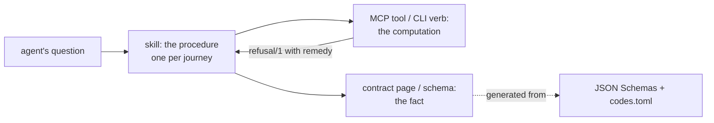

# M7 pre-study: how well LLM agents can consume Candler (v0)

Date: 2026-11-23

---
type: findings
topic: m7-mcp-server
date: 2026-11-23
version: v0
prior-version: none
key-metric: consumer journeys covered end to end by a doc or a sample file: 0 of 5 (prior: N/A, delta: N/A)
decision-required: confirm
---

Candler's success depends on how easily LLM agents can consume it. So before M7 builds an MCP server,
this study takes stock of what an agent can read and run today, measured against six questions:
- how to explain consumption;
- usage patterns;
- gotchas;
- what code should compute instead of the agent;
- speed;
- ease.

"Consume" means using Candler to design an experiment, write a plug-in or a suite, run, import,
evaluate and analyse. It does not mean contributing to Candler.

The study covers main 5199afc7 (core v0.13.0, schemas@0.11.3, candler-evaluator 0.1.0). Three
read-only inventories are its evidence (Pointers). Nothing was built or run. The line numbers come
from semantic search and may be a few lines off.

## Headline Result

metric: consumer journeys covered end to end by a doc or a sample file
value: 0 of 5 (design and run an experiment, author a plug-in and suite, import legacy results, evaluate, analyse)
unit: journeys
prior: N/A (first run)
direction: new

In one sentence: Candler has a good **reference layer** and no **task layer**. The contract pages,
the JSON Schemas and the refusal registry are accurate because they are generated. Nothing tells an
agent how to get from a question to a verdict. Several of the steps it would have to guess are
deterministic and belong in code.

## Results Tables

### What a consuming agent can read today

| Layer | Exists | Quality for an agent | Missing |
|:--|:--|:--|:--|
| Entry point | `README.md` (31 lines); `CLAUDE.md` points to `AGENTS.md` | `README.md` has no quickstart, no install path and no link to `docs/`. `AGENTS.md` is for contributors, so an agent that lands in the repo gets Rust rules | a "using Candler" entry |
| Reference | `docs/contract/` (8 pages), 19 JSON Schemas, `codes.toml` (about 390 stable codes, append-only) | good: generated from the schemas, so it cannot drift | sample files; legal setting paths (`[fixed]` and `factors[].levels` are typed `map` and `any`); `candler.toml`; output schemas of `analyze`, `show`, `inspect` |
| Methods | `docs/statistics.md` | the best consumer doc: methods and validity limits | the `analyze` field names; line 165 ("Paired tests are not offered yet") needs checking against M6a |
| Plug-in API | `candler-evaluator` docstrings and two example plug-ins (26 and 51 lines) | the kind signature `(params, context, prior)`, `RunContext`, `KINDS`, `needs` and `params_schema` are visible only in code | a guide; examples with a manifest and a suite |
| CLI help | clap `about` lines | one line per verb, no examples. Flag help carries design reasons ("cannot be derived: …") instead of value domains. Exit codes appear only in a module doc | value domains, examples, exit codes |
| Task docs / skills | none. The contract-docs campaign deferred tutorials and an authoring skill "after 1.0" | — | all of it; the M7 gate now asks for the skills before M8 |

### The CLI as an agent meets it

| Verb | Output | Spends | Agent friction |
|:--|:--|:--|:--|
| `run` | the job id only | yes (tokens, money, wall time) | no plan, run count or cost before it starts; no dry run |
| `resolve` | TSV, or JSON for failures only | no | needs Docker; stops before planning, so budget and drift refusals do not fire; check ids are not `codes.toml` codes |
| `ps`, `ls` | TSV only | no | no JSON |
| `watch` | JSON lines until `job.ended` | no | it is the only way to wait |
| `evaluate` | blocks; job id on stderr, report on stdout | wall time, maybe tokens | waits differently from `run` |
| `inspect`, `analyze` | always JSON | no | `analyze` gives raw statistics; the agent folds `comparisons[].entries[]` by hand |
| `show`, `diff` | JSON or TOML | no | `--format` is required and has no default |
| `ingest --rules` | (unchecked) | no | rules file written by hand; its format is documented only through refusal text |

Answering "did it pass?" takes 5 commands plus a manual fold: `run`, `watch`, `inspect`, `evaluate`,
`analyze`. Answering "how many runs and what could it cost?" takes none: no command answers it.

### Gotchas that hurt a consuming agent most

Columns:
- **Class:** W = silently wrong result, S = time or money burned, C = confusing refusal.
- **Best prevention:** what removes the gotcha rather than documenting it.

| # | Gotcha | Class | Live? | Best prevention |
|:--|:--|:--|:--|:--|
| G3 | `analyze` orients B − A by recording order (F2) and judges `reading` before Holm (F4) | W | yes | code (deferred to dogfooding by Eliott) |
| G2 | two experiment files make two strata with no test between them; arms differing in `eval_infra` are refused | W | yes, by design | a skill sentence plus a plan check |
| G4 | RiVault answers identical requests from cache: replicates can repeat, and a cache hit is billed in `cost_usd` | W, S | yes, by ruling | a flag on identical runs in one cell |
| G5 | a treatment repo without `.claude/skills/<name>` fails every run in 0.1 s with `isolation_failed` and no path named | C, S | probably | a resolve-time refusal |
| G6 | a store under `/private/tmp` on Docker Desktop gives `session_controls_failed`, with no cause named | C, S | unknown | a bind-mount probe in `resolve`; the cause in `causes[]` |
| G8 | inner codes (`factor_without_levels`, `count_zero`, `path_overlap`) print as `*.document_invalid`; an unknown `[budget]` key reports `/foo` | C | yes | the inner code carried in `causes[]` |
| G9 | a missing or mistyped store silently falls back to the default (`config.no_store` "not raised today") | W | yes | every result echoes the store root it used |
| G11 | refusals are text unless `--error-format json`, which no doc mentions | C | yes | the MCP server always sets it |
| G7 | plug-in traps: an `uv run` wrapper, `print` on stdout, a bad outcome silently becoming `not_measured{instrument_error}`, a PyPI instrument failing with -32000 | C | yes, documented | a `plugin check` that runs `describe` and the suite check without a job |
| G13 | a re-grade at the same evaluator version is refused; `diff --pending` misses param changes; two concurrent evaluations can grade a run twice | W | yes | code (Future features) |

All 17 gotchas, with sources: `00-inventory_gotchas_v0.md`.

### Observed usage patterns

| Pattern | Steps as observed | Journey |
|:--|:--|:--|
| P1 Probe, then scored run | `resolve`, then 1–2 cheap cells (`run --set`), then `watch`, `inspect`, then the full file and `analyze` | design and run |
| P2 Import a legacy corpus | pin the suite by sha256, then `ingest --rules`, `evaluate`, `diff` against the import | import |
| P3 Author a plug-in | manifest, package, suite, `plugins.dirs`, `resolve`, `evaluate`; re-pin the helper before a tag | author |
| P4 Compare versions × models | one file with `model.id` × `request.treatment`, then `run`, `evaluate`, `analyze --experiment`; read Holm and `instrument_error` | analyse |
| P5 Check MCP reachability | census `init_tools`, the catalog snapshot, `mcp.servers.<key>` | design and run |
| P6 Grade a raw trace | `ingest <dir>`, then `evaluate`, `show`, `inspect` | evaluate |
| P7 Resume, stop, clean up | `ps`, `kill -y`; resume replays stored values; never `docker rm` | design and run |

## Observations

| Signal | Baseline / Expected | Observed [source] | Interpretation |
|:--|:--|:--|:--|
| Reference accuracy | docs drift from code (R01 and README had lagged, v1-review) | contract pages and codes are generated from the schemas [inventory_docs §1] | the reference layer is sound; build on it, don't rewrite it |
| Task layer | one end-to-end example per journey | none, and the contract-docs plan deferred it past 1.0 [`gap_analysis_contract_docs_v0.md:25`] | the M7 skills gate already pulls this before M8; the plan is out of date |
| Setting vocabulary | an agent can list legal paths | only through `experiment.unknown_path` refusals, `resolve`, or Rust `settings_table()` [inventory_surface §2] | the commonest guess; listing it is a computation |
| Pre-run knowledge | runs and cost known before spending | the planner already computes the plan in check mode (`run.rs:268-307`); nothing exposes it [inventory_surface §4] | a plan verb is mostly wiring |
| Refusal actionability | a code, a pointer and a remedy | a code and a pointer; remedies only in prose; `unknown_path` lists no valid paths; `fact_changed` never mentions `--force` [inventory_surface §3] | add valid values and the nearest match to the refusal; a remedy per code |
| Calls per question | 1 call for "did it pass?" | 5 calls plus a jq-style fold [inventory_surface §5] | a summary operation is the biggest speed win |
| Who consumes today | an agent drives the CLI | HTN drives Candler through its plug-in and import rules only; no HTN script calls the CLI [inventory_gotchas §4] | the M7 skills will be the first real agent consumers: dogfooding starts there |

## The six questions

### 1. How to explain how to consume Candler?

Three layers, one source of truth each, never restated:

- **Facts** stay in `docs/contract/` and the schemas. Add what is missing:
  - sample files for the experiment, suite, manifest and import rules, each run by a guard test so it
    cannot rot;
  - the setting vocabulary;
  - `candler.toml`;
  - the output schemas of `analyze`, `show` and `inspect`.

  The MCP server serves these pages as resources.
- **Procedures** go into agent skills, one per journey: author a plug-in, design and drive a run,
  evaluate and analyse, import. Each skill links the pages and never copies them. M7's gate already
  asks for the first three.
- **Entry point:** a consumer-facing "using Candler" page, linked from `README.md`, which names
  install, store, `candler.toml`, the five journeys and the skills. `CLAUDE.md` keeps pointing
  contributors to `AGENTS.md`.

### 2. What are the usage patterns?

The seven observed patterns fold into five journeys. That is the smallest set of skills and tool
groups that covers them:

| Journey | Patterns | Tools it needs |
|:--|:--|:--|
| Design and run | P1, P5, P7 | settings listing, scaffold, validate, plan, `run`, `watch`, `kill` |
| Author plug-in and suite | P3 | manifest and suite scaffolds from `describe`, `plugin check` |
| Import | P2 | `ingest`, rules inference, outcome join |
| Evaluate | P6 | `evaluate`, `show`, `inspect` |
| Analyse | P4 | `analyze`, summary |

All five share one loop: question → design → validate → plan and cost → probe → run → evaluate →
verdict. The agent's judgement is needed at the two ends: the question and design, and the verdict.
Everything in between is mechanical.

### 3. What are the gotchas and what might break?

See the gotchas table above. The pattern behind it: **most gotchas are cheaper to remove than to
document.**
- **Code:**
  - G5 and G6 become resolve-time refusals;
  - G8 carries the inner code;
  - G9 echoes the store root;
  - F2 and F4 orient by declared level order and read Holm.
- **Documentation:** provider facts (G4) and statistical limits (F3, power, independence).

Each skill gets a short "will break" list, kept to the ones code cannot remove.

What might break when the MCP server lands:
- a driving agent spending without a budget (I13);
- a driving agent reading a live run's ground truth (I8);
- the MCP results drifting from the CLI's.

All three are already M7 gates, so the server must be a thin layer over the same operations.

### 4. What should code compute instead of an agent?

The rule: an agent chooses and interprets; code derives, checks and counts. The candidates, ranked by
how much guessing they remove:

| # | Chore today | Computed by | Size |
|:--|:--|:--|:--|
| 1 | multiply cells × replicates by hand; no cost known | a **plan** operation: cells, new vs reused runs, drift, and worst-case wall time and cost against the job caps | small: `plan_runs` in check mode exists |
| 2 | guess setting paths until no refusal | a **settings listing**: paths, types, harness support, registered harnesses | small: `settings_table()` exists |
| 3 | assemble TOML from typed tables | **scaffolds**: an experiment from factors and levels; a suite and manifest from a plug-in's `describe` | medium |
| 4 | needing Docker to learn whether a file is well formed | **validate without Docker**: shape, unknown fields, factor rules | small |
| 5 | 5 calls plus a fold for "did it pass?" | a **summary**: job state, valid runs, gate rates, each pair's Holm decision, reasons for anything not computed | medium |
| 6 | read prose to fix a refusal | **remedies**: valid values and the nearest match in the refusal; a remedy per code | medium: the registry rows need a ruling |
| 7 | check a plug-in by running a job | **`plugin check`**: `describe`, the suite check, lock pin and ancestry | small |
| 8 | write import rules by hand | **rules inference** from a legacy folder's markers | medium |
| 9 | spot repeated replicates by eye | **identical-run flag** per cell | small |

All of these belong in the **operation API** in `candler-core`, not in the MCP layer. The CLI and the
server then get them alike, which is also what the M7 gate "same results on both surfaces" needs.

### 5. How to make it fast to use?

Fast means fewer calls and less waiting, not a faster binary.
- **One call per question:**
  - plan (#1) answers "what will this cost";
  - summary (#5) answers "did it pass";
  - `inspect <job>` already answers "which runs".
- **JSON everywhere**, with ids an agent chains into the next call: `ps`, `ls`, and `resolve` on
  success.
- **No polling.** `run` returns ids at once. The MCP server reports progress through notifications,
  and offers one "wait until ended" that returns the summary.
- **Compact results by default:** ids plus a summary, with detail on request through `inspect` and
  `show` (already the M7 gate).
- **Checks in seconds:** validation without Docker (#4) comes before the Docker preflight.

### 6. How to make it easy to use?

- **One entry point**, and a skill for each journey.
- **Refusals that say what to do:**
  - always `refusal/1` (the server sets `--error-format json` and `--store` itself);
  - each refusal carries valid values, the nearest match and a remedy;
  - the inner code is carried in `causes[]`.
- **Defaults computed, not invented.** Keep the budget mandatory (I13), but the plan proposes caps
  from the per-run caps and `max_parallel`. Scaffolds fill in every derivable field.
- **Every result says its context:** the store root, core and schemas versions, the evaluator
  version used.
- **Measured, not assumed:**
  - Ease is a number: calls, refusals, wall time and cost for a fresh agent to finish each journey
    using only its skill.
  - Measure a baseline now, with the CLI and today's docs, and make "beats the baseline" part of
    the skills gate.
  - Candler can run that experiment on itself: the driving agent is the treatment, and the journeys
    are the suite.

## Contradictions & Surprises

- The contract-docs plan put tutorials and an authoring skill "after 1.0". The M7 gate (A6) asks
  for the skills before M8. The plan is stale on this point.
- `resolve` is documented and used as the free preflight (P1), yet it needs Docker and stops before
  planning. So the refusals an agent most wants early (budget, drift, cell plan) only fire inside
  `run`.
- `docs/statistics.md:165` says "Paired tests are not offered yet" on the day the milestone named
  "paired statistics" closed. The wording may be right (the M6a tests are blocked, not matched
  pairs), but it reads as a contradiction to an agent.

## Steering Questions

- [now] **Scope.** Fold the consumability layer into M7 as its first level, with the operation API
  changes #1–#7 and the docs facts, before the MCP tools? Or make it its own milestone before M7?
  Recommendation: fold it in, because the M7 gates (same results on both surfaces, skills that
  work) need it anyway.
- [now] **Baseline.** Measure a fresh agent doing the three gate journeys with the CLI and today's
  docs (calls, refusals, wall time, cost) before planning, ideally as a Candler experiment on
  RiVault? It gives M7 a number to beat.
- [now] **Remedies in the registry.** `codes.toml` promises rows are "added, never edited away".
  Does adding a `remedy` key to existing rows keep that promise, or do remedies live beside the
  registry?
- [next run] **Task docs before 1.0.** Accept that tested sample files and the "using Candler"
  entry page move ahead of 1.0, against the contract-docs plan?
- [later] F2 and F4 (G3) are code-fixable and silently wrong for an agent. They stay deferred to
  dogfooding, which the M7 skills will start.

## Pointers

- `00-inventory_docs_v0.md`: every consumer-readable document, the CLI help, gaps, quotes.
- `00-inventory_surface_v0.md`: the operation table, hand-authored inputs, refusals, computable chores.
- `00-inventory_gotchas_v0.md`: 17 gotchas with sources, 7 usage patterns, 12 chores.
- `__roadmap__/candler-v1/contracts/parity/alignment/surfaces/isolation/m5b/stats/mcp/m7_mcp_server.md`: the M7 leaf and its gates.
- `__reports__/contract-docs/gap_analysis_contract_docs_v0.md`: the contract-docs plan.
- `__reports__/m6a-paired-stats/knowledge_transfer_v0.md`: F1–F5.
- `__design__/architecture.md`: §Operation API, §Budget, §CLI surface, I8, I13.
