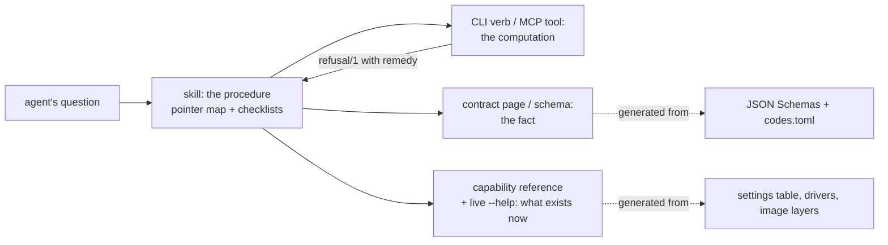

# M7 pre-study: how well LLM agents can consume Candler (v1)

Date: 2026-11-23

---
type: findings
topic: m7-mcp-server
date: 2026-11-23
version: v1
prior-version: 00-findings_agent_consumability_v0.md
key-metric: consumer journeys covered end to end by a doc or a sample file: 0 of 5 (prior: 0 of 5, delta: 0)
decision-required: confirm
---

Candler's success depends on how easily LLM agents can consume it. So before M7 builds an MCP server,
this study takes stock of what an agent can read and run today, measured against six questions:
- how to explain consumption;
- usage patterns;
- gotchas;
- what code should compute instead of the agent;
- speed;
- ease.

"Consume" means using Candler to design an experiment, write a plug-in or a suite, run, import,
evaluate and analyse. It does not mean contributing to Candler.

**What changed since v0.** The HTN Phase coordinator, Candler's only consumer today, sent its lane's
view (`01-input_htn_lane_v0.md`). It corrects one v0 finding: HTN sessions *do* drive the CLI by
hand, and they rebuild by hand much of what code could compute. It also adds three patterns, four
gotchas, six chores and a view on the form (CLI, skill, MCP). The metric did not move; the evidence
behind it is stronger.

The study covers main 5199afc7 (core v0.13.0, schemas@0.11.3, candler-evaluator 0.1.0). Three
read-only inventories and the HTN input are its evidence (Pointers). Nothing was built or run. The
line numbers come from semantic search and may be a few lines off.

## Headline Result

metric: consumer journeys covered end to end by a doc or a sample file
value: 0 of 5 (design and run an experiment, author a plug-in and suite, import legacy results, evaluate, analyse)
unit: journeys
prior: 0 of 5 (v0)
direction: flat

In one sentence: Candler has a good **reference layer** and no **task layer**, and its one consumer
fills the gap by reading Rust and writing its own tools. The contract pages, the JSON Schemas and the
refusal registry are accurate because they are generated. Nothing tells an agent how to get from a
question to a verdict, or even what Candler can do. Many of the steps it guesses or scripts are
deterministic and belong in code.

Second number, from HTN's last session (Phase 4.5, 3 runs): **8 chores done by hand** that code could
do. They are: 3 model-driven probes plus a canary to prove the agent's world, a transcript decoder, a
backing-model lookup, an `env -i` wrapper, a `lockf` docker lock, image cleanup, spend measured from
transcripts, and version facts copied into the brief.

## Results Tables

### What a consuming agent can read today

| Layer | Exists | Quality for an agent | Missing |
|:--|:--|:--|:--|
| Entry point | `README.md` (31 lines); `CLAUDE.md` points to `AGENTS.md` | `README.md` has no quickstart, no install path and no link to `docs/`. `AGENTS.md` is for contributors, so an agent that lands in the repo gets Rust rules | a "using Candler" entry |
| Capabilities | none | "can Candler do X?" is answered by reading Rust and guard tests; HTN once got it wrong (Dockerfile layer visible only in `isolation/image.rs`) | a capability and field reference, generated from code |
| Reference | `docs/contract/` (8 pages), 19 JSON Schemas, `codes.toml` (about 390 stable codes, append-only) | good: generated from the schemas, so it cannot drift | sample files; legal setting paths (`[fixed]` and `factors[].levels` are typed `map` and `any`); `candler.toml`; output schemas of `analyze`, `show`, `inspect` |
| Methods | `docs/statistics.md` | the best consumer doc: methods and validity limits | the `analyze` field names; line 165 ("Paired tests are not offered yet") needs checking against M6a |
| Plug-in API | `candler-evaluator` docstrings and two example plug-ins (26 and 51 lines) | the kind signature `(params, context, prior)`, `RunContext`, `KINDS`, `needs` and `params_schema` are visible only in code | a guide; examples with a manifest and a suite |
| CLI help | clap `about` lines | one line per verb, no examples. Flag help carries design reasons ("cannot be derived: …") instead of value domains. Exit codes appear only in a module doc | value domains, examples, exit codes |
| Version facts | none | which Candler commits had which defect lives in the coordinator's memory and is copied into every brief | an errata registry |
| Task docs / skills | none. The contract-docs campaign deferred tutorials and an authoring skill "after 1.0" | — | all of it; the M7 gate now asks for the skills before M8 |

### The CLI as an agent meets it

| Verb | Output | Spends | Agent friction |
|:--|:--|:--|:--|
| `run` | the job id only | yes (tokens, money, wall time) | no plan, run count or cost before it starts; no dry run; caller must hold a docker lock and clean images |
| `resolve` | TSV, or JSON for failures only | no | needs Docker; stops before planning, so budget and drift refusals do not fire; check ids are not `codes.toml` codes; says nothing about which layer set a field |
| `ps`, `ls` | TSV only | no | no JSON |
| `watch` | JSON lines until `job.ended` | no | it is the only way to wait |
| `evaluate` | blocks; job id on stderr, report on stdout | wall time, maybe tokens | waits differently from `run` |
| `inspect`, `analyze` | always JSON | no | `analyze` gives raw statistics; the agent folds `comparisons[].entries[]` by hand |
| `show`, `diff` | JSON or TOML | no | `--format` is required and has no default; no transcript rendering, so HTN wrote `stream.py` |
| `ingest --rules` | (unchecked) | no | rules file written by hand; its format is documented only through refusal text |

Answering "did it pass?" takes 5 commands plus a manual fold: `run`, `watch`, `inspect`, `evaluate`,
`analyze`. Answering "how many runs and what could it cost?", "what will the agent see?" or "was this
run made by a version with a known defect?" takes none: no command answers them.

### Gotchas that hurt a consuming agent most

Columns:
- **Class:** W = silently wrong result, S = time or money burned, C = confusing refusal.
- **Best prevention:** what removes the gotcha rather than documenting it.

| # | Gotcha | Class | Live? | Best prevention |
|:--|:--|:--|:--|:--|
| G3 | `analyze` orients B − A by recording order (F2) and judges `reading` before Holm (F4) | W | yes | code (deferred to dogfooding by Eliott; HTN asks for it again) |
| G18 | a run's validity depends on the Candler commit (e.g. before 1e6dc91a, `mcp.*` silently gave no servers); the only record is the coordinator's memory | W | yes | run provenance plus an errata registry and `candler check` |
| G19 | the transcript records the model alias, not the backing model; HTN asks RiVault separately | W | yes | record the model the endpoint reports |
| G20 | "can Candler do X?" answered from Rust; a wrong "no" routes work to the wrong owner | W | yes | the capability reference as data |
| G2 | two experiment files make two strata with no test between them; arms differing in `eval_infra` are refused | W | yes, by design | a skill sentence plus a plan check |
| G4 | RiVault answers identical requests from cache: replicates can repeat, and a cache hit is billed in `cost_usd` | W, S | yes, by ruling | a flag on identical runs in one cell |
| G5 | a treatment repo without `.claude/skills/<name>` fails every run in 0.1 s with `isolation_failed` and no path named | C, S | probably | a resolve-time refusal |
| G6 | a store under `/private/tmp` on Docker Desktop gives `session_controls_failed`, with no cause named | C, S | unknown | a bind-mount probe in `resolve`; the cause in `causes[]` |
| G21 | concurrent runs share Docker; images pile up per store | S | yes | the run owns the docker lock; `candler gc` with a dry run |
| G8 | inner codes (`factor_without_levels`, `count_zero`, `path_overlap`) print as `*.document_invalid`; an unknown `[budget]` key reports `/foo` | C | yes | the inner code carried in `causes[]` |
| G9 | a missing or mistyped store silently falls back to the default (`config.no_store` "not raised today") | W | yes | every result echoes the store root it used |
| G11 | refusals are text unless `--error-format json`, which no doc mentions | C | yes | the MCP server always sets it; the CLI could default to JSON when not on a TTY |
| G7 | plug-in traps: an `uv run` wrapper, `print` on stdout, a bad outcome silently becoming `not_measured{instrument_error}`, a PyPI instrument failing with -32000 | C | yes, documented | a `plugin check` that runs `describe` and the suite check without a job |
| G13 | a re-grade at the same evaluator version is refused; `diff --pending` misses param changes; two concurrent evaluations can grade a run twice | W | yes | code (Future features) |

G18 to G21 are new in v1, from the HTN input. All 17 earlier gotchas, with sources:
`00-inventory_gotchas_v0.md`.

### Observed usage patterns

| Pattern | Steps as observed | Journey |
|:--|:--|:--|
| P0 Capability discovery | read Rust source and guard tests to learn whether Candler supports a feature, before routing a gap | all (new) |
| P1 Probe, then scored run | `resolve`, then 1–2 cheap cells (`run --set`), then `watch`, `inspect`, then the full file and `analyze` | design and run |
| P2 Import a legacy corpus | pin the suite by sha256, then `ingest --rules`, `evaluate`, `diff` against the import | import |
| P3 Author a plug-in | manifest, package, suite, `plugins.dirs`, `resolve`, `evaluate`; re-pin the helper before a tag | author |
| P4 Compare versions × models | one file with `model.id` × `request.treatment`, then `run`, `evaluate`, `analyze --experiment`; read Holm and `instrument_error` | analyse |
| P5 Check MCP reachability | census `init_tools`, the catalog snapshot, `mcp.servers.<key>` | design and run |
| P6 Grade a raw trace | `ingest <dir>`, then `evaluate`, `show`, `inspect` | evaluate |
| P7 Resume, stop, clean up | `ps`, `kill -y`; resume replays stored values; never `docker rm` | design and run |
| P8 Prove the agent's world | 3 model-driven runs: list every server's tools; plant a canary evaluator input and search `/` for it; then the gate. Under `env -i` and a `lockf` | design and run (new) |
| P9 Brief with version facts | copy "main ≥ commit X, or Y is broken" and open caveats into every session brief | all (new) |

P8 is P5 done with real model turns because no cheaper check exists. P0 and P9 are what an agent does
when the facts it needs are not served as data.

## Observations

| Signal | Baseline / Expected | Observed [source] | Interpretation |
|:--|:--|:--|:--|
| Reference accuracy | docs drift from code (R01 and README had lagged, v1-review) | contract pages and codes are generated from the schemas [inventory_docs §1] | the reference layer is sound; build on it, don't rewrite it |
| Task layer | one end-to-end example per journey | none, and the contract-docs plan deferred it past 1.0 [`gap_analysis_contract_docs_v0.md:25`] | the M7 skills gate already pulls this before M8; the plan is out of date |
| Capability discovery | an agent asks Candler what it supports | sessions read Rust; one wrong answer on record [HTN input §1] | generate the capability reference from the same code that enforces it |
| Setting vocabulary | an agent can list legal paths | only through `experiment.unknown_path` refusals, `resolve`, or Rust `settings_table()` [inventory_surface §2] | the commonest guess; listing it is a computation |
| Pre-run knowledge | runs, cost and the agent's world known before spending | the planner already computes the plan in check mode (`run.rs:268-307`); nothing exposes it. The agent's world is learned by spending model turns [inventory_surface §4; HTN input §3] | a plan verb is mostly wiring; a probe is new work |
| Refusal actionability | a code, a pointer and a remedy | a code and a pointer; remedies only in prose; `unknown_path` lists no valid paths; `fact_changed` never mentions `--force` [inventory_surface §3] | add valid values and the nearest match to the refusal; a remedy per code |
| Calls per question | 1 call for "did it pass?" | 5 calls plus a jq-style fold [inventory_surface §5] | a summary operation is the biggest speed win |
| Run provenance | a run says which Candler and which model made it | the alias only; the Candler commit lives in briefs [HTN input §2–3] | provenance is a recorded fact, not a briefing habit |
| Who consumes today | an agent drives the CLI | v0 said no HTN script calls the CLI. True of scripts, but HTN *sessions* drive it by hand, with home-made wrappers [HTN input §3] | consumers exist and are agents; their wrappers are the backlog |

## The six questions

### 1. How to explain how to consume Candler?

Three layers, one source of truth each, never restated:

- **Facts** stay in `docs/contract/` and the schemas. Add what is missing:
  - sample files for the experiment, suite, manifest and import rules, each run by a guard test so it
    cannot rot, with one worked experiment per common shape (HTN asks for more like
    `golden_design/experiment.toml`);
  - the setting vocabulary and the capability reference (field paths, source forms such as
    `treatment:<path>`, pairing rules, caveats), served as JSON by a verb, generated from code;
  - `candler.toml`;
  - the output schemas of `analyze`, `show` and `inspect`.

  The MCP server serves these as resources.
- **Procedures** go into agent skills, one per journey: author a plug-in, design and drive a run,
  evaluate and analyse, import. HTN's rule fits: a skill is a pointer map plus decision checklists. It
  links the pages, injects live `--help` and the capability JSON, and never copies a flag list. M7's
  gate already asks for the first three. Two checklists HTN names:
  - experiment design: question, then factors, arms, controls, n;
  - agent environment: agent versus evaluator audience; domain versus treatment dependencies; never
    put the grading reference in the build context or the treatment.
- **Entry point:** a consumer-facing "using Candler" page, linked from `README.md`, which names
  install, store, `candler.toml`, the five journeys and the skills. `CLAUDE.md` keeps pointing
  contributors to `AGENTS.md`.
- **Ownership notes:** a short table from symptom to the layer that owns it (Candler, plug-in,
  treatment, provider), so an agent routes a gap without reading Rust.

### 2. What are the usage patterns?

The ten observed patterns fold into five journeys plus two cross-cutting needs. That is the smallest
set of skills and tool groups that covers them:

| Journey | Patterns | Tools it needs |
|:--|:--|:--|
| Design and run | P1, P5, P7, P8 | capability reference, scaffold, validate, plan, probe, `run`, `watch`, `kill`, `gc` |
| Author plug-in and suite | P3 | manifest and suite scaffolds from `describe`, `plugin check` |
| Import | P2 | `ingest`, rules inference, outcome join |
| Evaluate | P6 | `evaluate`, `show` (with transcript), `inspect` |
| Analyse | P4 | `analyze`, summary |
| *Cross-cutting:* know what exists | P0 | capability reference, `resolve --explain` |
| *Cross-cutting:* know what to trust | P9 | provenance, errata, `check` |

All five journeys share one loop: question → design → validate → plan and cost → probe → run →
evaluate → verdict. The agent's judgement is needed at the two ends: the question and design, and
the verdict. Everything in between is mechanical.

### 3. What are the gotchas and what might break?

See the gotchas table above. The pattern behind it: **most gotchas are cheaper to remove than to
document.**
- **Code:**
  - G5 and G6 become resolve-time refusals;
  - G8 carries the inner code;
  - G9 echoes the store root;
  - G18 and G19 become recorded provenance plus an errata check;
  - G20 becomes the capability reference;
  - G21 becomes a run-owned lock and `gc`;
  - F2 and F4 orient by declared level order and read Holm (deferred).
- **Documentation:** provider facts (G4) and statistical limits (F3, power, independence).

Each skill gets a short "will break" list, kept to the ones code cannot remove.

What might break when the MCP server lands:
- a driving agent spending without a budget (I13);
- a driving agent reading a live run's ground truth (I8);
- the MCP results drifting from the CLI's.

All three are already M7 gates, so the server must be a thin layer over the same operations.

### 4. What should code compute instead of an agent?

The rule: an agent chooses and interprets; code derives, checks and counts. The candidates, grouped by
the question they answer and ranked inside each group by how much guessing they remove. **Asked by**
says who raised it: v0 (the inventories) or HTN.

**Before spending**

| # | Chore today | Computed by | Size | Asked by |
|:--|:--|:--|:--|:--|
| 1 | multiply cells × replicates by hand; no cost known | a **plan** operation: cells, new vs reused runs, drift, worst-case wall time and cost against the job caps, and a warning when n gives too wide an interval | small: `plan_runs` in check mode exists | v0, HTN |
| 2 | prove the agent's world with 3 model runs and a canary | an **agent-world probe**, no model: the rendered `.mcp.json`; per server connected or not, `tools/list` count, inputSchema digests; mounted inputs and their audience; `/opt/env` packages; the treatment commit; a leak check that no evaluator input is reachable | large: builds the cell's container and speaks MCP inside it | HTN (its top ask) |
| 3 | read Rust to learn fields and capabilities; guess setting paths | a **capability reference as data**: field paths, types, source forms, pairing rules, caveats, registered harnesses | small to medium: `settings_table()` exists; image layers and source forms do not have a table yet | v0, HTN |
| 4 | trace which layer set a field by reading files | **`resolve --explain`**: each field's setting layer (plug-in environment, experiment, treatment) and the build layers present | medium | HTN |
| 5 | needing Docker to learn whether a file is well formed | **validate without Docker**: shape, unknown fields, factor rules | small | v0 |

**After running**

| # | Chore today | Computed by | Size | Asked by |
|:--|:--|:--|:--|:--|
| 6 | 5 calls plus a fold for "did it pass?" | a **summary**: job state, valid runs, gate rates, each pair's Holm decision with level labels, reasons for anything not computed; JSON plus a short text rendering | medium | v0, HTN (F5) |
| 7 | copy version facts into briefs; ask RiVault for the backing model | **provenance and errata**: each run records the Candler commit and the model the endpoint reports; an errata registry; `candler check <run\|store>` flags affected runs | medium; the backing model depends on what the endpoint returns (unchecked) | HTN |
| 8 | measure spend from transcripts | **spend per run and per experiment**: tokens and cost, summed | small: `cost_usd` is already recorded | HTN |
| 9 | decode `raw/stdout.jsonl.gz` with a home-made script | **`show <run> --transcript`** | small | HTN |
| 10 | spot repeated replicates by eye | an **identical-run flag** per cell | small | v0 |

**Authoring**

| # | Chore today | Computed by | Size | Asked by |
|:--|:--|:--|:--|:--|
| 11 | read prose to fix a refusal | **remedies**: valid values and the nearest match in the refusal; a remedy per code | medium: the registry rows need a ruling | v0 |
| 12 | assemble TOML from typed tables | **scaffolds**: an experiment from factors and levels; a suite and manifest from a plug-in's `describe` | medium | v0 |
| 13 | check a plug-in by running a job | **`plugin check`**: `describe`, the suite check, lock pin and ancestry | small | v0 |
| 14 | write import rules by hand | **rules inference** from a legacy folder's markers | medium | v0 |

**Housekeeping**

| # | Chore today | Computed by | Size | Asked by |
|:--|:--|:--|:--|:--|
| 15 | `lockf` around every run; `docker rmi` by hand | the **run owns the docker lock**; **`candler gc`** removes a store's own images, containers and networks, with a listing dry run | medium | HTN |

All of these belong in the **operation API** in `candler-core`, not in the MCP layer. The CLI and the
server then get them alike, which is also what the M7 gate "same results on both surfaces" needs.

The probe (#2) is the largest item and the one HTN values most. It overlaps with `resolve`'s Docker
preflight, which already builds the image. It is a candidate to plan as its own leaf, or its own
milestone, rather than squeeze into M7's first level.

### 5. How to make it fast to use?

Fast means fewer calls and less waiting, not a faster binary.
- **One call per question:**
  - plan (#1) answers "what will this cost";
  - probe (#2) answers "what will the agent see", without model turns;
  - summary (#6) answers "did it pass";
  - check (#7) answers "can I trust this run";
  - `inspect <job>` already answers "which runs".
- **JSON everywhere**, stable, with ids an agent chains into the next call: `ps`, `ls`, and `resolve`
  on success.
- **No polling.** `run` returns ids at once. The MCP server reports progress through notifications,
  and offers one "wait until ended" that returns the summary.
- **Compact results by default:** ids plus a summary, with detail on request through `inspect` and
  `show` (already the M7 gate).
- **Checks in seconds:** validation without Docker (#5) comes before the Docker preflight.
- **No wrappers:** the run takes its own lock and cleans its own images, so a caller does not need
  `env -i`, `lockf` or `docker rmi` around it.

### 6. How to make it easy to use?

- **One entry point**, and a skill for each journey.
- **Ask Candler, not the source.** What Candler supports, which fields exist and which version is
  sound are answers Candler gives as data (#3, #7).
- **Refusals that say what to do:**
  - always `refusal/1` (the server sets `--error-format json` and `--store` itself);
  - each refusal carries valid values, the nearest match and a remedy;
  - the inner code is carried in `causes[]`.
- **Defaults computed, not invented.** Keep the budget mandatory (I13), but the plan proposes caps
  from the per-run caps and `max_parallel`. Scaffolds fill in every derivable field.
- **Every result says its context:** the store root, core and schemas versions, the evaluator
  version used, the backing model.
- **Measured, not assumed:**
  - Ease is a number: calls, refusals, wall time and cost for a fresh agent to finish each journey
    using only its skill.
  - Measure a baseline now, with the CLI and today's docs, and make "beats the baseline" part of
    the skills gate.
  - Candler can run that experiment on itself: the driving agent is the treatment, and the journeys
    are the suite.

## Form: CLI, skill, MCP

HTN's view and the M7 gate pull in different directions. HTN: the base is the CLI with a stable
`--json`, because agents drive Bash well; MCP only where it holds state an agent would otherwise
rediscover; "a thin wrapper over `candler run` adds little". The M7 gate: read-only tools, and
budgeted `run`, `evaluate` and cancel tools that enforce I13 and I8.

| Surface | HTN | M7 gate | Proposal |
|:--|:--|:--|:--|
| CLI | the base, with stable `--json` | not named | the base. Every verb gets `--json` with the same result types as the operation API |
| Skill | pointer map plus checklists; live `--help` | skills exercised by an agent using the server alone | agree with HTN on form. The gate's "server alone" is reread as "the skill and Candler's own surfaces", unless Eliott keeps it |
| MCP, read and state | store index, errata, resolved-config queries | read-only ops returning ids plus summaries | agree: these come first (plan, probe results, capability reference, summary, check) |
| MCP, mutating | adds little over the CLI | run, evaluate, cancel with a budget; no ground truth | keep, for a reason HTN does not weigh: an agent with Bash can read the store's files and skip the budget. A driving agent given only the MCP tools cannot. The tools are the policy boundary for I8 and I13, not convenience |

The proposed order: operation API and CLI JSON contract, then the state-holding MCP tools, then the
budgeted mutating tools. Each step is useful on its own, and the CLI never falls behind the server.

## Contradictions & Surprises

- **v0 was wrong about current consumers.** It said no HTN script calls the CLI. HTN's sessions do,
  by hand, and wrap it in `env -i`, `lockf`, `stream.py` and a RiVault lookup. The inventory looked
  at scripts, not sessions.
- The contract-docs plan put tutorials and an authoring skill "after 1.0". The M7 gate (A6) asks
  for the skills before M8. The plan is stale on this point.
- `resolve` is documented and used as the free preflight (P1), yet it needs Docker and stops before
  planning. So the refusals an agent most wants early (budget, drift, cell plan) only fire inside
  `run`.
- HTN spent model turns (P8) to learn what a container would show, which is deterministic. That is
  the clearest case of an agent doing code's job.
- `docs/statistics.md:165` says "Paired tests are not offered yet" on the day the milestone named
  "paired statistics" closed. The wording may be right (the M6a tests are blocked, not matched
  pairs), but it reads as a contradiction to an agent.

## Steering Questions

- [now] **Scope.** Fold the consumability layer into M7 as its first level (operation API chores
  #1, #3, #5, #6, #7, #11, #13 and the docs facts), before the MCP tools? Or make it its own
  milestone before M7? Recommendation: fold it in, because the M7 gates (same results on both
  surfaces, skills that work) need it anyway.
- [now] **The probe (#2).** HTN's top ask, and the largest item. Plan it inside M7, as its own leaf
  after the first level, or as a separate milestone? Recommendation: its own leaf in M7, after the
  plan and capability reference, because it reuses `resolve`'s image build.
- [now] **MCP shape.** Keep the budgeted mutating tools as a v1 gate (the proposal: they are the I8
  and I13 boundary), or narrow M7's MCP to the state-holding tools as HTN suggests?
- [now] **Baseline.** Measure a fresh agent doing the three gate journeys with the CLI and today's
  docs (calls, refusals, wall time, cost) before planning, ideally as a Candler experiment on
  RiVault? It gives M7 a number to beat.
- [now] **Remedies and errata in the registry.** `codes.toml` promises rows are "added, never edited
  away". Does adding a `remedy` key to existing rows keep that promise, or do remedies live beside
  the registry? The errata registry (#7) needs the same decision: a new file, or rows in an existing
  one.
- [next run] **Task docs before 1.0.** Accept that tested sample files, the capability reference and
  the "using Candler" entry page move ahead of 1.0, against the contract-docs plan?
- [later] **F2, F4, F5 (G3).** HTN raises them again as a reader of real results. That is a
  dogfooding signal. They stay deferred unless Eliott rules otherwise; #6 (the summary) would
  absorb F5 and depends on F4.

## Pointers

- `01-input_htn_lane_v0.md`: the HTN coordinator's lane input, condensed.
- `00-findings_agent_consumability_v0.md`: the prior version.
- `00-inventory_docs_v0.md`: every consumer-readable document, the CLI help, gaps, quotes.
- `00-inventory_surface_v0.md`: the operation table, hand-authored inputs, refusals, computable chores.
- `00-inventory_gotchas_v0.md`: 17 gotchas with sources, 7 usage patterns, 12 chores.
- `__roadmap__/candler-v1/contracts/parity/alignment/surfaces/isolation/m5b/stats/mcp/m7_mcp_server.md`: the M7 leaf and its gates.
- `__reports__/contract-docs/gap_analysis_contract_docs_v0.md`: the contract-docs plan.
- `__reports__/m6a-paired-stats/knowledge_transfer_v0.md`: F1–F5.
- `__design__/architecture.md`: §Operation API, §Budget, §CLI surface, I8, I13.
