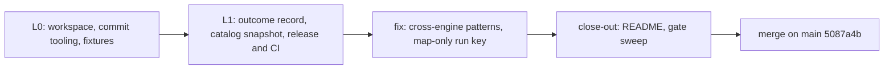

# Wire schemas — Knowledge Transfer (v0)

Date: 2026-10-29

## Executive Summary

- **What shipped.** On local `main`, merge `5087a4b` (not pushed):
  - the cargo workspace (five crates, under Grit's lints from one `[workspace.lints]` table);
  - `cog.toml` with a `commit-msg` hook;
  - `release-plz.toml`, git-only, with publishing off, on two tag lines: `v*` for the core group and `schemas@*` for `candler-schemas`;
  - two CI workflows;
  - `candler-schemas`: the shared string formats, the outcome record and the tool-catalog snapshot, with `outcome-record.schema.json` and `catalog-snapshot.schema.json` kept equal to the structs by a drift test.
- **Primary outcomes.**
  - The schemas are tested in three layers: property tests, MCP's own `Tool` schema (spec 2026-07-28), and real data.
  - An adversarial verifier mapped all 10,320 golden rows through the outcome types without a refusal.
  - The per-role sums equal today's `_outcome.py`: gate 10420/11645, quality 5080/5189, descriptive 3281/3472.
  - Every published pattern reads alike under ECMA 262, Rust and Python's `re` (760,033 strings, every code point).
  - The HTN Phase 4.5 gate is met: the snapshot schema is on `main`.

## Wins

- **Domain-free tests first, real data as acceptance.** Eliott's overfitting challenge led to this split. The MCP spec fixtures and the property tests caught shapes the HTN capture script never emits: `title`, `annotations`, `icons`, `_meta`.
- **Golden rows picked by a script, by shape class.** 14 classes cover all 10,320 rows (`tests/fixtures/legacy/select_golden.py`). The mapping test derives its expectations from a table, not from the fixtures.
- **Adversarial verifiers found real defects, each of which the mechanical gates had passed.**
  - A `Value::Number` could be mutated to NaN after `build()`, which would write an unreadable `null`.
  - A `fail` could weigh 3/3 and raise a rate.
  - serde read structs written as JSON arrays.
  - Python's `$` matched before a final newline.
  - Duplicate tool names were accepted.
- **Rulings recorded as they were made.** Each design rule settled during the build went into `__design__/architecture.md` in its own `docs(design)` commit, so the merge left no gap between design and code:
  - weight tied to status;
  - I5 and I6 at the record;
  - the deprecated `{legacy: code}` cause;
  - the snapshot reader's limits;
  - pattern anchoring.
- **Reusing agents that held context** (implementer for fixes, verifier for confirmation passes) kept fix rounds to minutes.

## Pain Points

- **Leaf text defects, all of my own authoring:**
  - three commit subjects over 72 characters;
  - "a non-legacy cause is required" contradicted the golden mapping;
  - "`num > den` rejected by both readers" contradicted "`num ≤ den` cannot be stated in JSON Schema";
  - `release_ci.md` cloned the wrong branch and gated on a dry run that needs a forge.
- **Shared `$TMPDIR`.** One agent's commit-message file overwrote another's, and a commit landed with the wrong subject (amended on its branch).
- **An agent ran destructive git commands in the coordinator's checkout.** A failed `cd` before `&&`-less commands led to `git reset --hard`, `git clean -fdq`, probe commits and tags in the coordinator's checkout. The agent repaired it, and the checkout was verified intact: no uncommitted work existed, and the tags and probe commits were gone.
- **Tool surprises:**
  - `cog install-hook` fails in a linked worktree;
  - the hook first rejected `fixup!` subjects;
  - `cocogitto` is not in `taiki-e/install-action`;
  - `version.workspace = true` made a schemas bump drag every crate;
  - schemars keeps hard line breaks in `description`s;
  - clippy's test allowances do not reach helpers in integration-test files without `#![cfg(test)]`.
- **The HTN capture script could not load low-level `mcp.server.Server` servers**, so bio-opentrons needed a change in another repository.

## Root Causes

- **Leaf text was authored without running checks on it.** The commit subjects and the release gate were never checked mechanically, and cross-rules were written in two places that drifted.
- **Rate semantics were not traced through to the record.** The design stated defaults but not what a weight may be per status, and that is where the verifier found the gap.
- **Agent briefs covered paths but not shell safety**: absolute paths, `set -e`, and never acting outside one's worktree.
- **Grit's lessons reached the level-0 implementers only through review.** Level 1 briefs carried them up front, and the level-1 reviews were much shorter.

## Next-cycle Changes

- **Instruction changes.**
  - Before committing a campaign, run `cog verify` on every leaf **Commit** field.
  - Read each cross-rule against every other leaf that restates it.
  - Make each gate command runnable without a forge.
- **Workflow changes.** Every implementer brief says:
  - unique `$TMPDIR/<leaf>-*` message files;
  - absolute paths only, and commands chained with `&&` or `set -e`;
  - never run git in another checkout.

  Carry the Grit checklist lessons into every Rust brief from the first dispatch:
  - one-paragraph schema docs;
  - `BORROW`/`INDEX` in tests;
  - `#![cfg(test)]` in integration tests;
  - explicit lifetimes.
- **Review process changes.** Keep the pairing of adversarial verifier plus Grit reviewer on persisted contracts, with a confirmation pass after each fix round. For text-format rules, require a cross-engine probe (Rust, Python, Node).

## Artifacts to Preserve

- **Design:** [`__design__/architecture.md`](../../__design__/architecture.md) §Wire encodings, §Wire schema: outcome record, §Wire schema: tool-catalog snapshot, §Golden corpus.
- **Schemas:** [`crates/candler-schemas/schema/`](../../crates/candler-schemas/schema/), the published contract.
- **Fixture provenance:** [`crates/candler-schemas/tests/fixtures/`](../../crates/candler-schemas/tests/fixtures/), with its `legacy/`, `upstream/`, `spec/` and `outcomes/` READMEs and `select_golden.py`.
- **Campaign:** [`__roadmap__/wire-schemas/`](../../__roadmap__/wire-schemas/README.md).

## Open Questions

- **HTN capture fix.** Branch `feat/htn-eval-capture-lowlevel-servers` (`93ded966`) in mcp-python-ingestion, worktree `~/Documents/tmp/claude-worktrees/mcp-python-ingestion/capture-lowlevel`. It is unpushed and awaits Eliott's decision to land, keep or drop it. Its pytest suite was not run.
- **HTN realignment.** HTN's capture script and loader must move to `tool-catalog-snapshot/1` (`servers_dir` and `stubbed_modules` under `ext`). They also keep only four tool fields today, while `/1` keeps them all. Phase 4.5 owns this.
- **M2a.** It must write the legacy ↔ clean equivalence table for the 209 `zero_weight` passes and the 742 legacy `not_measured` rows. It must also confirm that the core refuses `{legacy}` from evaluators.
- **Release tooling, unverified until the first push.**
  - `release-plz release` was never run, because it needs a forge.
  - A release PR opened with `GITHUB_TOKEN` does not trigger CI.
  - A force-push breaks the `cog check` push range.
- **Scopes.** `cog.toml` lists scopes exactly, so `adapter-opencode` must be added before M4.
- **Design narrowing to confirm.** `inputSchema` is accepted wider than MCP (no `type: object` required). Empty and duplicate names are refused, which only narrows what MCP accepts on empty names.
