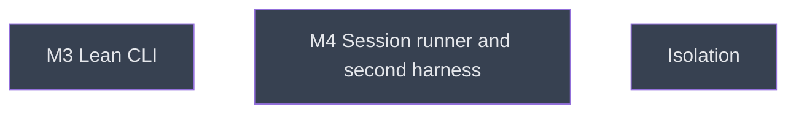

# Surfaces

## Context
Depth 3. After both parity milestones: the lean CLI (M3) and the session runner with the second harness (M4), in parallel. Both need only M2b; the tree also makes them wait for M2a.

## Goal
The CLI is lean and the runner covers long-lived sessions and a second harness.

## Pre-conditions
- [ ] `../m2a_evaluation_parity.md` and `../m2b_execution_parity.md` are `done`

## Success Gates
- ⬜ `m3_lean_cli.md` and `m4_session_runner.md` are `done`

## Status

## Nodes
| Node | Type | Status |
|:-----|:-----|:-------|
| `m3_lean_cli.md` | 📄 Leaf Task | ⬜ Planned |
| `m4_session_runner.md` | 📄 Leaf Task | ⬜ Planned |
| `isolation/` | 📁 Directory | ⬜ Planned |

## Amendment Log
| ID | Date | Source | Nodes Added | Rationale |
|:---|:-----|:-------|:------------|:----------|

## Progress
| Node | Branch | Commits | Notes |
|:-----|:-------|:--------|:------|
