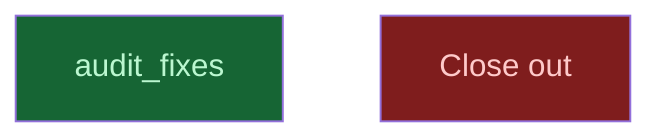

# Audit fixes

## Context
Runs after the audit. It repairs only the README claims the audit found broken, in one capped leaf (K6); anything larger goes to Next.

## Goal
Every claim the audit found broken is fixed or moved to Next with its evidence.

## Pre-conditions
- [ ] `[nl]` `__reports__/diet/01-findings_e2e_audit_v0.md` committed and the `shed/` level merged

## Success Gates
- ✅ `audit_fixes` merged, or marked done with "no broken claim"
- ✅ Workspace gates pass

## Status

## Nodes
| Node | Type | Status |
|:-----|:-----|:-------|
| `audit_fixes.md` | 📄 Leaf Task | ✅ Done |
| `close/` | 📁 Directory | 🚫 Blocked |

## Amendment Log
| ID | Date | Source | Nodes Added | Rationale |
|:---|:-----|:-------|:------------|:----------|

## Progress
| Node | Branch | Commits | Notes |
|:-----|:-------|:--------|:------|
| `close/` | -- | -- | blocked, superseded by `__roadmap__/integrity/causes/checkpoint/snapshot/review/dogfood/dogfooding_pass.md` (P7) |
