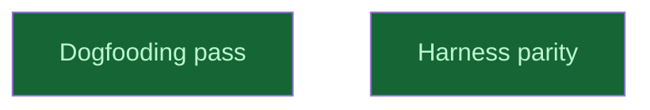

# Dogfooding pass

## Context
The milestone's last gate, replacing the diet's `close_out`. Two RiVault models from different families, both under OpenCode, use Candler with only what an outside consumer has, and every friction they meet is attributed. The knowledge transfer follows. Amendment A3 adds `parity/` below it: the pass's finding (1) is where level 3, harness parity, starts.

## Goal
Whose failure each friction is, Candler's or the agent's, is known from the transcripts, and the milestone is recorded.

## Pre-conditions
- [ ] `[nl]` `../seam_review_two.md` is `done`

## Success Gates
- ✅ `dogfooding_pass.md` is `done`
- ✅ `parity/` is `done`

## Status

## Nodes
| Node | Type | Status |
|:-----|:-----|:-------|
| `dogfooding_pass.md` | 📄 Leaf Task | ✅ Done |
| `parity/` | 📁 Directory | ✅ Done |

## Amendment Log
| ID | Date | Source | Nodes Added | Rationale |
|:---|:-----|:-------|:------------|:----------|

## Progress
| Node | Branch | Commits | Notes |
|:-----|:-------|:--------|:------|
