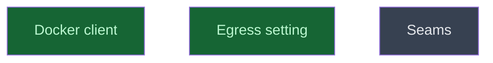

# Client

## Context
Level L1 of `m5-container-isolation`, after `wire_shapes` merges. It holds two leaves:
- `docker_client`: one Docker client and one control-container builder (A5), plus the trait
  methods that A1 and A8 build on;
- `egress_setting`: the `isolation.egress` cell value, parsed and refused at resolve, with no
  Docker.
Its successor `seams/` needs both.

## Reference Documents
- [R01 Architecture](../../../__design__/architecture.md) — §Process supervision, §Agent environment and secrets
- [R06 Approved plan](/Users/hacker/Library/Application%20Support/Claude/side-session-notes/local_7f577b41-1698-4eeb-9de3-4ee9460ae606/m5-approved-plan.md) — D3, D6 and its file layout

## Goal
Every docker process the core starts is built by `isolation/docker.rs`. Every control container comes from one `ControlSpec` on one `hardening(limits)`. `isolation.egress` resolves to a canonical list or is refused.

## Pre-conditions
- [ ] [cmd] `wire_shapes` merged: `git log --format=%s 18142ec..feat/m5-container-isolation | grep -q '^merge(schemas): land wire_shapes'`
- [ ] [cmd] DIGEST and GOLDEN pass on the milestone tip

## Success Gates
- ✅ [cmd] Both leaves' gates pass on the milestone tip after their merges; STD, LINUX and DIGEST pass
- ✅ [cmd] The trait additions are in place for L2: `git grep -q 'fn inspect_many' -- crates/candler-core/src/isolation/driver.rs && git grep -q 'fn create' -- crates/candler-core/src/isolation/driver.rs`
- ⬜ [cmd] The milestone branch is pushed and CI's `container-e2e` job is green on it

## Gotchas
- **Race rules:**
  - `docker_client` keeps the public signatures of `DockerImageService::{ensure, base}`;
  - `egress_setting` owns `resolve/steps/egress.rs` (new), its refusal route in
    `resolve/{preflight,refusal}.rs` and the per-cell settle in `runner/plan.rs`;
  - shared append-only hunks go to the coordinator.
- `docker_client` leaves `harness_baseline/argv.json` byte-identical; A8 changes it at L2.

## Status

## Nodes
| Node | Type | Status |
|:-----|:-----|:-------|
| `docker_client.md` | 📄 Leaf Task | ✅ Done |
| `egress_setting.md` | 📄 Leaf Task | ✅ Done |
| `seams/` | 📁 Directory | ⬜ Planned |

## Amendment Log
| ID | Date | Source | Nodes Added | Rationale |
|:---|:-----|:-------|:------------|:----------|

## Progress
| Node | Branch | Commits | Notes |
|:-----|:-------|:--------|:------|
