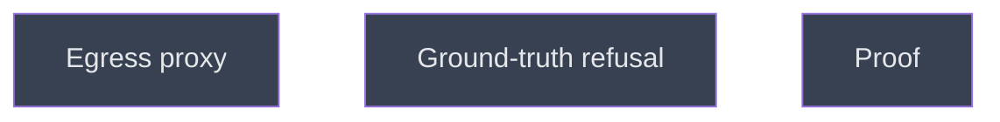

# Egress

## Context
Level L3, after `seams/`. It holds two leaves:
- `egress_proxy`: the allowlist enforced by a per-allowlist egress proxy, attacked by an
  adversarial real-image e2e;
- `ground_truth_refusal`: refuses an author's input that puts ground truth into agent-bound bytes.
After this level the egress path runs end to end, so the coordinator runs the live smoke here.

## Reference Documents
- [R01 Architecture](../../../../../__design__/architecture.md) — §Agent environment and secrets (the model token, networks), I8
- [R06 Approved plan](/Users/hacker/Library/Application%20Support/Claude/side-session-notes/local_7f577b41-1698-4eeb-9de3-4ee9460ae606/m5-approved-plan.md) — D1, D2, D9

## Goal
A listed host and port is reachable from the agent's container and nothing else is, while the model gateway keeps working. An author's input that would put ground truth into the agent's bytes is refused at resolve.

## Pre-conditions
- [ ] [cmd] `seams/` merged: `for l in guard_reuse container_create plugin_environment; do git log --format=%s 18142ec..feat/m5-container-isolation | grep -q "^merge(isolation): land $l" || exit 1; done`
- [ ] [cmd] DIGEST, GOLDEN and E2E pass on the milestone tip

## Success Gates
- ⬜ [cmd] Both leaves' gates pass on the milestone tip after their merges; STD, LINUX, DIGEST and E2E pass
- ⬜ [nl] `egress_proxy`'s adversarial verifier closed with no open finding
- ⬜ [nl] The coordination session's ruling on D9's newly refused input is recorded in the Progress table
- ⬜ [nl] The live smoke is recorded (see the campaign README); its run id is checkable with `candler show`
- ⬜ [cmd] The milestone branch is pushed and CI's `container-e2e` job is green on it

## Gotchas
- **Files.** `egress_proxy` owns the egress mode in `gateway.rs`, `assets/docker/gateway/*`, the
  network choice in `container/mod.rs`, `isolation/model.rs` and `jobs/orchestrate/session.rs`.
  `ground_truth_refusal` owns a new resolve step file.
- **Verification.** `ground_truth_refusal` merges on its report and gates; `ground_truth_e2e`'s
  verifier attacks it at L4.

## Status

## Nodes
| Node | Type | Status |
|:-----|:-----|:-------|
| `egress_proxy.md` | 📄 Leaf Task | ⬜ Planned |
| `ground_truth_refusal.md` | 📄 Leaf Task | ⬜ Planned |
| `proof/` | 📁 Directory | ⬜ Planned |

## Amendment Log
| ID | Date | Source | Nodes Added | Rationale |
|:---|:-----|:-------|:------------|:----------|

## Progress
| Node | Branch | Commits | Notes |
|:-----|:-------|:--------|:------|
