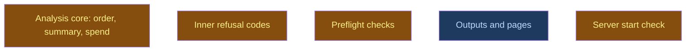

# Build from verdicts v3

## Context
The build of M6b, added by amendment A1 after Eliott's Go (2026-11-23, G7 of the campaign README). It builds every `accept` row of the approved verdicts report, `__reports__/m6b-surface-consolidation/01-findings_verdicts_v3.md` (R16), as the leaves of R16 §Design suggestions (with the two changes in Gotchas), plus a knowledge-transfer close. The verdict study wrote it; Eliott asked for the leaves instead of a planning session ("Since you have the context, I task you to write the roadmap leaves for the `/build`"). Depth is order, from R16's leaf graph:
- **This level (L0):** `analysis_core` (F2, C6, C8), `codes_inner` (G8), `preflight_checks` (C1's summary, G5, N2, N4, N6), `server_check` (C2).
- **`outputs/` (L1):** `output_contract` (X1, G11, X10, X4's inspect and small records, C1's printing, N8), after `analysis_core`; `knowledge_pages` (C3, X7, X3, X9), after `codes_inner`.
- **`outputs/records/` (L2):** `analysis_record` (X4's analysis record, F5, C9, the Q7 and Q8 names), after `analysis_core` and `output_contract`; `docs_chores` (X5, X8, X11, seam 6), after `knowledge_pages`; `experiment_env` (N9b), after `knowledge_pages`.
- **`outputs/records/close/` (L3):** `knowledge_transfer`, the HTN lane's migration note and the close of M6b.
Nothing here is pushed. The supervising session (the milestone coordinator, `local_7f577b41-1698-4eeb-9de3-4ee9460ae606`) owns the PR to `main`.

## Reference Documents
- [R16 Verdicts v3](../../../../__reports__/m6b-surface-consolidation/01-findings_verdicts_v3.md) — the approved report: §Verdicts (one row per id), §Seams, §Blast radius, §D1, §D3 (every test, its role and question), §Codes review, §Responsibility record (draft), §Design suggestions (the leaves, the supervisor's conditions, the Future rows)
- [R17 Report folder README](../../../../__reports__/m6b-surface-consolidation/README.md) — Eliott's rulings, rounds 03 to 05, and the Go
- [R18 Leaf records](../../../../__reports__/m6b-surface-consolidation/leaves/) — `<area>_v0.md`: each accepted id's design suggestion with its `path:line` citations from `a0df4d48`; `round02_candidates_v0.md` and `n9b_env_scout_v0.md` for N2 to N9b
- [R01 Architecture](../../../../__design__/architecture.md) — §Layer responsibilities, §Operation API, §CLI surface, §Contracts & Invariants, §Analysis statistics, §Future features
- [R12 AGENTS.md](../../../../AGENTS.md) — the triad, what fails it, the comment rule, the checks
- [R19 CONTRIBUTING.md](../../../../CONTRIBUTING.md) — commit shape, scopes, breaking changes (`:20`), the three release lines and the schema bump table
- [R13 Refusal registry](../../../../docs/contract/codes.toml) — append-only
- [R14 designing-tests skill](/Users/hacker/.claude/plugins/cache/cracking-shells/designing-tests/1.1.0/skills/designing-tests/SKILL.md) — roles probe, confirm, guard
- [R20 M6a campaign README](../../../m6a-paired-stats/README.md) — the source of the standard gates and the execution model this build reuses
- [R11 Cost report v2](../../../../__reports__/agent-token-costs/03-findings_campaign_costs_v2.md) — the per-call rates

## Goal
Every accepted input of R16 is built as its row says, with its tests designed per D3, on the integration branch `claude/rdm-m6b-surface-consolidation-8c47a6`, and every standard gate is green at the close.

## Pre-conditions
- [x] [nl] Eliott said Go on verdicts v3 (2026-11-23), recorded in the rulings table of `__reports__/m6b-surface-consolidation/README.md`
- [ ] [cmd] `$BUILD_BASE` is the commit that added this directory, `BUILD_BASE=$(git log --diff-filter=A --format=%H -1 -- __roadmap__/m6b-surface-consolidation/consolidated/build/README.md)`, and the integration branch contains it: `git merge-base --is-ancestor $BUILD_BASE HEAD`
- [ ] [cmd] The disk has room: `df -h /System/Volumes/Data` shows at least 40 GiB available

## Success Gates
- ⬜ [cmd] STD, LINUX and SUBJ pass on the integration tip (Gotchas, Standard gates)
- ⬜ [cmd] DIGEST passes: no cell, run or golden digest moved
- ⬜ [cmd] GOLDEN passes: the 240-run golden parity still holds
- ⬜ [cmd] No remedy key was added: `! grep -Eq '^remedy *=' docs/contract/codes.toml`
- ⬜ [cmd] Every leaf's report exists: `for l in analysis_core codes_inner preflight_checks server_check output_contract knowledge_pages analysis_record docs_chores experiment_env; do test -f __reports__/m6b-surface-consolidation/build/${l}_v0.md || exit 1; done`
- ⬜ [nl] Every accepted id of R16 is built or carries a ruled reason in its leaf report; no leaf built a `defer`, `m7`, `owner:` or `reject` row
- ⬜ [nl] The supervisor's conditions on `output_contract` hold (that leaf's Success Gates), and the HTN migration note is in the knowledge-transfer report
- ⬜ [nl] Every verifier closed with no open finding

## Gotchas
- **What binds.** R16's `accept` rows, as worded there, and Eliott's rulings (R17); D1 to D3 of R16; the round 02 rulings of the M7 pre-study (campaign README, Gotchas). A leaf builds its own rows and nothing else: never a `defer`, `m7`, `owner:` or `reject` row, never a fix spotted in passing (it goes in the leaf report as a follow-up).
- **Leaves differ from R16's table in two places, both by this amendment.** C2 is its own leaf, `server_check`, because its files (job start, container setup) are disjoint from `preflight_checks` and its guard may need Docker. `docs_chores` also lands R16's drafted Future rows and the responsibility record in R01, since a `defer` verdict means "becomes an R01 §Future features row" and nobody else owns R01.
- **First reads.** R16 left three facts to the build, each read in the first step of the leaf that needs it, through colgrep, before any code: the output of `run`, `kill`, `ingest`, `evaluate`, `show`'s row types and whether `watch` prints `event-envelope` (seam 7), and which errors `--error-format` covers today (`output_contract`); the shape of `TraceFile` events (seam 4, `analysis_record`); whether the `env` table is additive within `experiment/1` (`experiment_env`).
- **The race in this level.** All four L0 leaves may add a module to `crates/candler-core/tests/it/main.rs`; `codes_inner` and `preflight_checks` both may edit `guard_resolve.rs`; `codes_inner` and `server_check` both may regenerate pages under `docs/contract/`. The coordinator merges `codes_inner` first (it changes printed codes the others' guards assert); each later leaf rebases onto the tip, re-adds its `mod` line, regenerates the pages with `CANDLER_BLESS_CONTRACT=1` and never hand-merges a generated file.
- **Execution model** (R20's). A fresh Opus coordinator per level dispatches every leaf of the level at once, each a Sonnet subagent with `model: "sonnet"` passed explicitly, in its own worktree. It integrates each leaf: rebase onto the integration tip, run the leaf's `[cmd]` gates and its ownership check (integration, not verification), `git merge --no-ff -F <file>`, confirm with `git log`. It reviews the seams after each level, handles escalations only and never verifies its own dispatches. At each level merge it runs STD (workspace form) and DIGEST; at the L1 merge and at the close also LINUX, SUBJ and GOLDEN. It batches `dirtree-rdm update` calls per level, re-reads `dirtree-rdm ls` at each level close, and writes one Progress row per merged leaf (branch, merge commit, notes).
- **Implementer owns its verify loop.** On a `[V]` leaf the implementer, once its gates pass, dispatches a fresh Sonnet verifier with the leaf's Verifier brief verbatim, adding only the branch name, fixes the findings, has the same verifier re-check through SendMessage, and reports once. A disputed finding, a spec defect or a second failed re-check goes to the coordinator. If a Sonnet subagent cannot dispatch Agent, the coordinator dispatches the verifier with the same brief and relays its findings. Verifiers (8): every leaf but `docs_chores` and `knowledge_transfer`.
- **Worktrees.** `python3 scripts/worktree.py add <path> <branch> --base <integration tip>` creates each leaf's worktree and syncs the hook; branch `claude/m6b-build-<leaf>`. After the merge the coordinator removes it with `git worktree remove <path>` and `git branch -d <branch>` (`worktree.py remove` only removes branches that `main` contains), which also deletes its `target/`.
- **Shared machine.** Each leaf builds in its worktree's own `target/` with `RUSTC_WRAPPER=sccache` exported per command; never set `CARGO_TARGET_DIR` (`scripts/worktree.py` refuses a shared target directory). At most three leaves build at once. `df -h /System/Volumes/Data` before each level's first build (211 GiB free on 2026-11-23); stop and report below 40 GiB. Docker only for a gate that names it (`server_check`): if the daemon is down, `docker desktop start` and wait until `docker info` answers; never stop it, never prune; remove what you built, by id; scratch roots under `$HOME`. No model call, no RiVault run.
- **colgrep.** Implementers read code only through colgrep (`search`, then `expand` on the hits that matter) and trust the result; no exploring by `sed -n`, `cat`, `git grep`, `git log` or Read. Build logs written to a file and filtered hard are allowed. Index only the crate dirs the leaf needs (`index_build` with `path` set to a crate dir of the leaf's own worktree), never a root; one index build on the machine at a time. Every `search` sets `paths` to exact subdirs of the leaf's worktree (without it the server searches the stale main checkout), `include: ["*.rs"]`, `code_only: true`, `limit` 5 to 10, `snippet_lines` 2 to 3, and `pattern` when an identifier is known. Clear the leaf's index when the leaf merges.
- **Schemas.** A commit that touches `crates/candler-schemas/` is scoped `schemas` and touches no other crate (R19, release lines); the consumers' changes go in the next commit. Schema files are regenerated with `CANDLER_BLESS_SCHEMAS=1 cargo nextest run -p candler-schemas drift`, never edited by hand. Bumps follow R19's schema table (a new record or optional field is a minor). Releases are cut by CI after the supervisor's PR merges, so R16's four `schemas@` releases leave as one; the leaves keep their schema commits apart anyway.
- **Contract pages.** Generated sections are regenerated with `CANDLER_BLESS_CONTRACT=1 cargo nextest run -p candler -E 'test(/^contract_pages::/)'`, never edited by hand; hand sections (Surface, Notes) keep the five-section rule (`CONTRIBUTING.md`, Q3).
- **`codes.toml`.** Append-only. Rows are added only where a leaf says so (`experiment_env`; `server_check` and `analysis_record` only if their first read shows the registry lacks the code); text edits only as `knowledge_pages` and `codes_inner` say; no `remedy` key.
- **Breaking changes.** A commit that changes a printed default, a printed code or a key, or retires a flag, carries `!` and states its migration path in the body (old invocation or value, new one, and `--format text` where text is wanted back), per R19 `:20`. No external users: every compatibility finding goes to the supervising session before merge.
- **Owned files.** Each leaf lists its OWNED files as a regex; its ownership check is `git diff --name-only $BASE_LEAF..HEAD | grep -vE '<owned regex>'`, which must print nothing (`$BASE_LEAF` is the leaf's branch point). No leaf edits `__roadmap__/`, `cog.toml`, `.config/` or `Cargo.lock`. The leaf report `__reports__/m6b-surface-consolidation/build/<leaf>_v0.md` is always owned.
- **Every leaf.** Pre `[cmd]`: the worktree is the leaf's own checkout (`cargo metadata --format-version 1 --no-deps | jq -r .workspace_root` prints its path) and `git merge-base --is-ancestor $BASE_LEAF HEAD`. Post `[cmd]`: the ownership check, the leaf's targeted tests and `cargo clippy -p <each crate touched> --all-targets -- -D warnings`. Post `[nl]`: the leaf report lists each changed existing guard with its reason, each Bite (the plausible bug that turned each new guard red), D3's four answers for each new test, and the follow-ups seen in passing.
- **Test design (D3, R14).** The tests are R16 §D3's rows, or the leaf's own where R16 has none, each with its four answers in the report. A guard is written first, seen red, and carries a `Guards:` line in its doc comment; a probe is deleted once it has answered; a confirm is kept or culled as R14 says, and the report records which. Expected values never come from the code under test.
- **Behaviour changes stop the implementer**, who reports them to the coordinator before the leaf merges: an existing guard changed beyond R16 §Guards that change, a moved digest, an input newly refused or newly admitted beyond the leaf's rows.
- **Comments** describe the code as it is: no history, ids, roadmap or ruling references in code (R12). The reasons go in the leaf report.
- **Standard gates** (`$BUILD_BASE` from the Pre-conditions):
  - **STD**: `cargo fmt --check && cargo clippy --workspace --all-targets -- -D warnings && cargo nextest run --workspace && RUSTDOCFLAGS="-D warnings" cargo doc --workspace --no-deps`; implementers run only their targeted tests and `-p` clippy;
  - **LINUX**: `cargo clippy --target x86_64-unknown-linux-gnu --workspace --tests -- -D warnings`;
  - **SUBJ**: `cog check $BUILD_BASE..HEAD && git log --format=%s $BUILD_BASE..HEAD | awk 'length>72{b=1}END{exit b}'`;
  - **DIGEST**: `git diff --numstat $BUILD_BASE -- crates/candler/tests/oracle crates/candler-core/tests/oracle/vectors crates/candler-schemas/tests/vectors ':(exclude)crates/candler-core/tests/oracle/vectors/field_paths.toml' | awk '$2!=0{b=1}END{exit b}' && cargo nextest run -p candler-schemas --no-tests=fail -E 'test(/guard_cell_digest/)' && cargo nextest run -p candler-core --no-tests=fail -E 'test(/guard_import_mini|guard_legacy_mapping|guard_oracle_mini|guard_run_context|guard_engine|guard_seams/)'`. A failure that a leaf's verdict row explains (a CLI output fixture under `crates/candler/tests/oracle` after D1) is ruled by the coordinator with that row cited and recorded in the Progress table; any other failure stops the leaf;
  - **GOLDEN**: `export CANDLER_GOLDEN_CORPUS=/Users/hacker/Documents/tmp/candler-m1-golden/campaign/20260806-cont-train && cargo nextest run -p candler-core --run-ignored only --no-tests=fail -E 'test(/guard_golden::/)' && cargo nextest run -p candler --run-ignored only --no-tests=fail -E 'test(/guard_oracle_ac/)'` (read it, never write in it).
- **Defects.** Verify each claim of R16 against the code before building on it. A claim that is wrong on the tip is a finding in the leaf report and goes to the coordinator; never build on a false premise.
- **History.** Rebase each leaf onto the integration tip, then `git merge --no-ff -F <file>` (subject `merge(<scope>): …`). Nothing is pushed and no history is rewritten. Commit messages end with `Co-Authored-By: Claude Opus 5.5 <noreply@anthropic.com>` (or the implementer's own model).
- **Budget** (R11 rates: $0.041 per Sonnet call, $0.063 per coordinator call). R16's estimates are design estimates; each leaf's cap is 1.5 times its estimate and is an action: at the cap, stop, commit what is green, list what is left.
  | Row | Calls | $ |
  |:--|--:|--:|
  | Implementers, nine leaves at their caps | 470 | 19.3 |
  | Verifiers, 8 at about 30 calls | 240 | 9.8 |
  | Fix rounds | 80 | 3.3 |
  | Coordinators, 3 levels at about 70 | 210 | 13.2 |
  | Close (`knowledge_transfer`, coordinator) | 30 | 1.9 |
  | Contingency 15 % | | 7.1 |
  | **Build cap** | | **55 (stop and report to Eliott at 44)** |
  Spend is measured from transcripts at each level merge; a coordinator whose own row runs over stops early.

## Status

## Nodes
| Node | Type | Status |
|:-----|:-----|:-------|
| `analysis_core.md` | 📄 Leaf Task | 🔄 In Progress |
| `codes_inner.md` | 📄 Leaf Task | 🔄 In Progress |
| `preflight_checks.md` | 📄 Leaf Task | 🔄 In Progress |
| `outputs/` | 📁 Directory | 🔵 Amendment |
| `server_check.md` | 📄 Leaf Task | 🔄 In Progress |

## Amendment Log
| ID | Date | Source | Nodes Added | Rationale |
|:---|:-----|:-------|:------------|:----------|

## Progress
| Node | Branch | Commits | Notes |
|:-----|:-------|:--------|:------|
